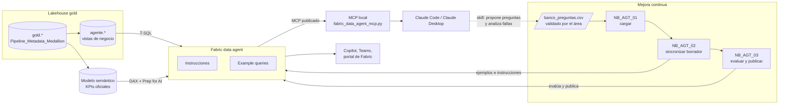
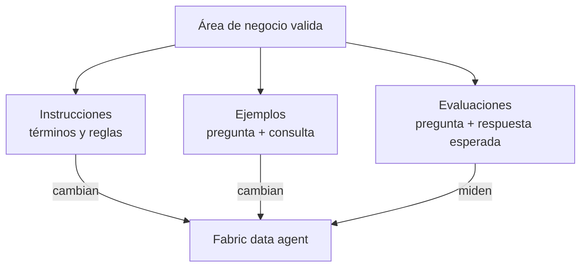
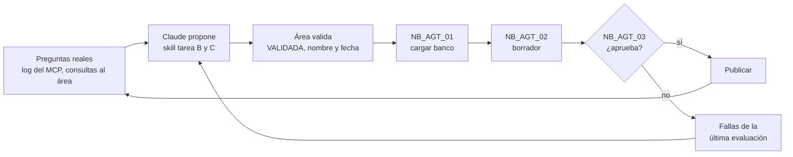
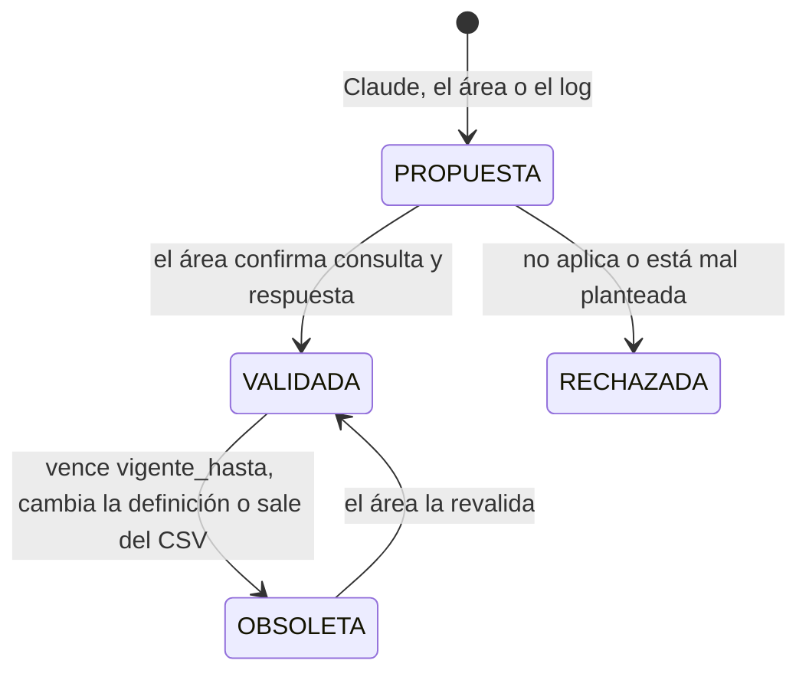

# Agente de datos en Fabric, con Claude

**En corto:** un framework para poner a disposición del negocio un agente que responde preguntas sobre los datos de Fabric, y para que mejore todos los meses con preguntas y respuestas que valida el área que corresponde. La consulta la arma un **Fabric data agent** sobre vistas de la capa gold. Claude entra en dos lugares: lo usa como herramienta vía MCP para responder y analizar, y con la skill [`agente-datos-fabric`](skill/agente-datos-fabric/SKILL.md) redacta instrucciones, propone preguntas y analiza las evaluaciones.

**Sobre "entrenamiento":** acá significa **curar ejemplos e instrucciones y medir con evaluaciones**. No hay fine-tuning ni se reentrena ningún modelo. Lo que el área valida entra al agente como *example queries* (pregunta + consulta) e instrucciones, y como un set de evaluación (pregunta + respuesta esperada) que dice si cada cambio mejoró o empeoró el agente.

| Archivo | Qué es | ¿Escribe? |
|---|---|---|
| [`sql/01_vistas_agente.sql`](sql/01_vistas_agente.sql) | Esquema `agente` con vistas de negocio sobre gold, sin PII | Crea vistas |
| [`skill/agente-datos-fabric/plantillas/banco_preguntas.csv`](skill/agente-datos-fabric/plantillas/banco_preguntas.csv) | El banco de preguntas: ejemplos y evaluaciones, con quién y cuándo las validó | — |
| [`skill/agente-datos-fabric/plantillas/instrucciones_agente.md`](skill/agente-datos-fabric/plantillas/instrucciones_agente.md) | Descripción e instrucciones del agente y de cada fuente | — |
| [`notebooks/NB_AGT_01_cargar_banco.ipynb`](notebooks/NB_AGT_01_cargar_banco.ipynb) | Valida el CSV y lo guarda en la tabla Delta `agente_ctl.banco_preguntas` | Sí, con `DRY_RUN = False` |
| [`notebooks/NB_AGT_02_sincronizar_ejemplos.ipynb`](notebooks/NB_AGT_02_sincronizar_ejemplos.ipynb) | Lleva ejemplos e instrucciones validados al **borrador** del agente, con backup | Sí, en el borrador, con `DRY_RUN = False` |
| [`notebooks/NB_AGT_03_evaluar_y_publicar.ipynb`](notebooks/NB_AGT_03_evaluar_y_publicar.ipynb) | Evalúa, compara con la última versión aprobada y publica solo si aprueba | Historial de evaluaciones; publica solo si se lo pedís |
| [`mcp/fabric_data_agent_mcp.py`](mcp/fabric_data_agent_mcp.py) | MCP local para que Claude Code o Claude Desktop le pregunten al agente | No |
| [`skill/agente-datos-fabric/`](skill/agente-datos-fabric/SKILL.md) | Skill de Claude: instrucciones, preguntas candidatas, análisis de fallas y consultas | No: genera archivos para revisar |
| [`pruebas/prueba_local.py`](pruebas/prueba_local.py) | Prueba de las reglas de los notebooks y del MCP contra un agente simulado | Solo archivos temporales |

---

## 1. La respuesta corta: dónde guardar los datos para el agente

**En el lakehouse que ya tiene la capa gold, con un esquema `agente` de vistas encima. Y el modelo semántico como segunda fuente para los KPIs oficiales.** No hace falta copiar los datos a un Warehouse para que los lea un agente.

Para el Fabric data agent, lakehouse y warehouse son casi lo mismo: los dos se consultan en T-SQL por el SQL analytics endpoint, de solo lectura, y los dos admiten instrucciones de fuente y *example queries*. La diferencia está en cómo **escribís** los datos, no en cómo los lee el agente. Si tu ETL es Spark (como [`Pipeline_Metadata_Medallion`](../Pipeline_Metadata_Medallion/README.md)), el lakehouse es el lugar natural. La comparación completa está en la [sección 4.1](#41-dónde-guardar-los-datos).

## 2. Cómo funciona



1. **Datos.** Las vistas `agente.*` exponen la capa gold con nombres de negocio y sin columnas sensibles. El agente solo ve esas vistas (y el modelo semántico, si lo sumás).
2. **Agente.** El Fabric data agent traduce la pregunta a T-SQL o DAX, la corre **con la identidad del usuario** (respeta RLS y CLS) y responde. Usa las instrucciones y los 3 ejemplos más parecidos a la pregunta.
3. **Claude.** Al publicar, el agente queda expuesto como servidor MCP. Claude lo usa como una herramienta: puede hacerle varias preguntas, combinar las respuestas con otro contexto y redactar el análisis.
4. **Mejora continua.** El área valida preguntas y respuestas. Las de tipo *ejemplo* entran al agente; las de tipo *evaluación* lo miden antes de publicar cada cambio (sección 6).

## 3. Qué ofrece Fabric hoy

Lo verifiqué en la documentación oficial (octubre de 2026):

| Pieza | Para qué | Dato clave verificado |
|---|---|---|
| [Fabric data agent: fuentes](https://learn.microsoft.com/fabric/data-science/data-agent-add-datasources) | El motor que responde | Hasta **5 fuentes** por agente. SQL (lakehouse, warehouse, SQL database, mirrored) en T-SQL; modelo semántico en DAX; eventhouse en KQL; graph, ontology y Azure AI Search en preview |
| [Configuración del agente](https://learn.microsoft.com/en-us/fabric/data-science/data-agent-configurations) | Instrucciones y ejemplos | Instrucciones del agente, instrucciones y descripción por fuente, y *example queries*: toma los **3 más parecidos** a cada pregunta |
| [Modelo semántico como fuente](https://learn.microsoft.com/en-us/fabric/data-science/data-agent-semantic-model) | KPIs con la lógica del modelo | **Ignora** las instrucciones del agente para generar DAX y no admite instrucciones de fuente ni ejemplos. Usa *Prep data for AI*: esquema para IA, instrucciones de IA y **respuestas verificadas** |
| [Permisos](https://learn.microsoft.com/fabric/data-science/data-agent-sharing) | Quién ve qué | Respeta los permisos del usuario, **RLS y CLS**. Mínimo: Read en el lakehouse, SELECT en el warehouse, Read en el modelo |
| [El agente como servidor MCP](https://learn.microsoft.com/en-us/fabric/data-science/data-agent-mcp-server) | Que Claude lo use | `https://api.fabric.microsoft.com/v1/mcp/workspaces/{ws}/dataagents/{id}/agent`, **una sola herramienta**, token Bearer de Entra ID en cada request, sin *dynamic client registration*. Las respuestas **pueden salir del límite de cumplimiento de Fabric** hacia el cliente MCP |
| [SDK del agente](https://learn.microsoft.com/fabric/data-science/fabric-data-agent-sdk) | Automatizar la configuración | Preview. Crear, configurar, cargar ejemplos y publicar el borrador (`publish_staging`) |
| [SDK de evaluación](https://learn.microsoft.com/en-us/fabric/data-science/evaluate-data-agent) | Medir con preguntas validadas | Preview. `evaluate_data_agent(df[question, expected_answer], ...)` contra el borrador (`sandbox`) o lo publicado (`production`), con un juez configurable (`critic_prompt`) |
| [Git y deployment pipelines](https://learn.microsoft.com/fabric/data-science/data-agent-source-control) | Versionar el agente | Preview. Instrucciones en `stage_config.json`, por fuente `datasource.json` y `fewshots.json`. El borrador y lo publicado van en carpetas separadas |
| [Fabric IQ MCP](https://learn.microsoft.com/en-us/fabric/iq/connectors/fabric-iq-mcp) | Alternativa: Claude consulta el modelo semántico directo | GA, solo lectura. Herramientas `GetSemanticModelSchema`, `ExecuteQuery` (DAX) y otras. OAuth delegado, sin service principal. **No** consulta lakehouse ni warehouse |
| [Metadata sync del SQL endpoint](https://learn.microsoft.com/fabric/data-engineering/sql-analytics-endpoint-metadata-sync) | Que el agente vea lo último que cargó Spark | Sincroniza solo; para forzar una tabla, `EXEC sys.sp_dw_refresh_ext_table 'esquema.tabla'` (con la sincronización nueva, en preview) |

Requisitos de todo lo anterior: capacidad **F2 o superior** (o P1 con Fabric) y, en el tenant, habilitados el Fabric data agent y el **procesamiento y almacenamiento entre geografías para IA**.

## 4. Decisiones de diseño y alternativas

### 4.1. Dónde guardar los datos

| | **A. Lakehouse gold + vistas `agente` (recomendada)** | B. Warehouse | C. Modelo semántico (Power BI) |
|---|---|---|---|
| Cómo lo lee el agente | T-SQL por el SQL analytics endpoint | T-SQL | DAX |
| Ejemplos e instrucciones de fuente | Sí | Sí | **No**: se usa *Prep data for AI* (respuestas verificadas) |
| Cómo se escriben los datos | Spark, notebooks, pipelines (lo que ya hace el framework medallion) | T-SQL, stored procedures, transacciones entre tablas | Refresh del modelo (import o Direct Lake) |
| Consistencia con los tableros | Depende de que las vistas usen la misma definición que el modelo | Igual que A | **Total**: usa las mismas medidas |
| Preguntas que responde mejor | Detalle, listados, rankings, filtros libres | Igual que A | KPIs con lógica compleja (márgenes, acumulados, *time intelligence*) |
| Costo extra | Ninguno: las vistas no copian datos | Copiar gold al warehouse y mantener esa copia | Ninguno si el modelo ya existe |
| Complejidad | Baja | Media: otra copia y otro proceso | Baja, si el modelo ya está documentado |
| Riesgo | Las vistas pueden quedar desfasadas unos segundos de lo que escribió Spark | Doble fuente de verdad | El agente no sigue tus instrucciones para DAX |

**Recomiendo A, más C si ya hay un modelo semántico con los KPIs.**

- **A** porque el agente lee igual que un warehouse y no duplicás datos ni procesos. Las vistas te dan nombres de negocio, una granularidad clara y dejan afuera las columnas sensibles aunque alguien las agregue a gold.
- **C** como segunda fuente para que "margen de marzo" dé lo mismo en el agente y en el tablero. En las instrucciones del agente decís qué preguntas van a cada fuente. Para que el modelo responda bien, documentalo con [`Documentar_Modelo_Semantico`](../Documentar_Modelo_Semantico/README.md) y cargá respuestas verificadas en *Prep data for AI*.
- **B** solo si el equipo ya trabaja en T-SQL y escribe gold con stored procedures o necesita transacciones entre tablas. Si es así, las vistas `agente.*` se crean igual, con el mismo script.

### 4.2. Quién arma la consulta

| | **A. Fabric data agent + Claude vía MCP (recomendada)** | B. Claude arma la consulta | C. Solo Fabric data agent |
|---|---|---|---|
| Cómo | El agente traduce y consulta; Claude le pregunta por MCP y redacta | Claude lee el esquema y escribe el DAX (Fabric IQ MCP) o el SQL (un MCP propio de solo lectura) | Los usuarios usan el agente en Fabric, Teams o Copilot |
| Ejemplos y evaluación | Los de Fabric (SDK, Git) | Los armás vos: skill con ejemplos y un evaluador propio | Los de Fabric |
| Permisos | Los del usuario, con RLS y CLS | Los del usuario en Fabric IQ; en un MCP propio depende de cómo lo armes | Los del usuario |
| Para qué sirve Claude | Análisis de varios pasos, combinar con documentos, redactar informes | Todo | Solo mejora continua (skill) |
| Costo | Capacidad Fabric + suscripción o API de Claude | Suscripción o API de Claude; menos capacidad Fabric | Capacidad Fabric |
| Complejidad | Media | Alta: mantenés el evaluador y la seguridad | Baja |
| Riesgo | Las respuestas salen de Fabric hacia Claude | Igual, más el SQL lo genera un modelo fuera de Fabric | El más bajo |

**Recomiendo A.** El gobierno queda en Fabric (permisos por usuario, ejemplos versionados en Git, evaluación oficial) y Claude suma lo que el agente no hace: encadenar preguntas, explicar y redactar. B tiene sentido más adelante para analistas que trabajan sobre el modelo semántico desde Claude Code, con Fabric IQ MCP. C es el punto de partida si todavía no está decidido usar Claude con datos de la empresa.

### 4.3. Dónde vive el banco de preguntas

| Opción | Para el área | Para los notebooks | Historia |
|---|---|---|---|
| **CSV o Excel revisado por el área + tabla Delta `agente_ctl.banco_preguntas` (recomendada)** | Edita una planilla | Lectura directa con Spark | `DESCRIBE HISTORY` de Delta + el CSV en Git |
| SQL database de control (como `Pipeline_Metadata_Medallion`) | Necesita un formulario | Necesita conexión desde Spark | Tablas de auditoría |
| Solo `fewshots.json` en Git | No sirve para el área | — | Git |

Es el mismo patrón que [`Documentar_Modelo_Semantico`](../Documentar_Modelo_Semantico/README.md): Claude propone, una persona aprueba en un CSV, y un notebook carga solo lo aprobado.

## 5. Las tres palancas para mejorar el agente



| Palanca | Qué valida el área | Cómo entra al agente |
|---|---|---|
| **Instrucciones** | Definiciones de negocio: qué es "venta", qué es "cliente activo", qué fuente es la oficial | `instrucciones_agente.md` → `NB_AGT_02` |
| **Ejemplos** | Que la consulta responde bien la pregunta | `uso = EJEMPLO` → *example queries* de la fuente SQL. En un modelo semántico: respuesta verificada en *Prep data for AI*, a mano |
| **Evaluaciones** | La respuesta correcta, con un período cerrado | `uso = EVALUACION` → `NB_AGT_03`. **No** entran al agente |

Ejemplos y evaluaciones nunca comparten pregunta: si el agente vio la respuesta, la evaluación mide memoria. `NB_AGT_01` lo rechaza.

## 6. Proceso de mejora continua

### 6.1. El ciclo



### 6.2. Roles

| Rol | Quién | Qué hace |
|---|---|---|
| **Dueño funcional** (uno por área: Comercial, Finanzas...) | Referente del área | Valida definiciones, ejemplos y respuestas esperadas de su área. Firma con nombre y fecha |
| **Responsable del agente** | Ingeniería de datos / BI | Corre los notebooks, mantiene las vistas y decide publicar |
| **Claude** (skill `agente-datos-fabric`) | — | Redacta instrucciones, propone preguntas y analiza fallas. Nunca valida |
| **Usuarios** | Quien usa el agente | Hacen preguntas. Las que fallan son candidatas para el banco |

Cada pregunta pertenece a **un** área (`area_negocio`) y la valida el dueño funcional de esa área. Si una pregunta cruza áreas ("margen por vendedor"), la valida el área dueña del indicador.

### 6.3. Estados de una pregunta



Solo las `VALIDADA` (y no vencidas) llegan al agente o a la evaluación.

### 6.4. Cadencia sugerida

| Frecuencia | Qué | Quién |
|---|---|---|
| Diaria (programada) | `NB_AGT_03` con `ETAPA = 'production'`: si el agente publicado cae del umbral, el notebook falla y salta la alerta | Automático |
| Quincenal | Revisar el log de preguntas y las fallas; Claude propone preguntas nuevas | Responsable del agente + Claude |
| Quincenal | Validar las `PROPUESTA` | Dueño funcional de cada área (30 minutos) |
| Después de cada validación | `NB_AGT_01` → `NB_AGT_02` → `NB_AGT_03` con `ETAPA = 'sandbox'` → publicar si aprueba | Responsable del agente |
| Trimestral | Revisar `vigente_hasta`, definiciones que cambiaron y el umbral | Todos |

### 6.5. Criterio para publicar

`NB_AGT_03` aprueba si se cumplen **las dos**:

1. **Acierto ≥ 85 %** (`UMBRAL_ACIERTO`) en las evaluaciones validadas. Las respuestas que el juez no pudo clasificar cuentan como no acertadas.
2. **No cae más de 2 puntos** (`MAX_CAIDA_PP`) contra la última evaluación aprobada. Así un cambio que arregla 3 preguntas y rompe 5 no pasa.

Los dos números son un punto de partida [dato a confirmar con cada área]. Para empezar, alcanza con 20 a 40 evaluaciones por área.

### 6.6. Reglas del banco

- **Períodos cerrados en las evaluaciones** ("marzo de 2026", no "el mes pasado"). Si el período se reprocesa, el área revalida la respuesta.
- **Una pregunta, un área, un dueño.** Con nombre y fecha de validación.
- **Sin datos personales** en preguntas ni respuestas.
- **El CSV manda.** Lo que se saca del CSV queda `OBSOLETA` en la tabla, no se borra.
- **Lo que falló no se copia como ejemplo.** Se enseña el patrón con otra pregunta.

## 7. Requisitos y permisos

| Qué | Para qué | Dónde se configura |
|---|---|---|
| Usuarios del agente **sin** permiso sobre el esquema `agente_ctl` (banco y evaluaciones) | Que no vean las respuestas esperadas | `GRANT SELECT` solo sobre `agente` |
| Capacidad F2 o superior (o P1 con Fabric) | Data agent, MCP y evaluación | Workspace settings > License info |
| Tenant: Fabric data agent y procesamiento entre geografías para IA habilitados [verificar nombre exacto de cada opción] | Data agent | Admin portal > Tenant settings |
| Lakehouse gold con esquemas (ej. `LH_MEDALLION`) | Datos y tablas del banco | El de `Pipeline_Metadata_Medallion` |
| Rol **Contributor** o más en el workspace | Crear el agente y correr los notebooks | Workspace > Manage access |
| Usuarios del agente: Read en el lakehouse y SELECT en `agente.*`; Read en el modelo semántico | Consultar | Compartir el agente **y** las fuentes |
| Azure CLI (`az login`) en la PC de quien usa Claude Code | Token para el MCP | Local |

## 8. Cómo armarlo

### Paso 1. Vistas

Corré [`sql/01_vistas_agente.sql`](sql/01_vistas_agente.sql) en el SQL analytics endpoint del lakehouse. Adaptá las vistas a tus tablas gold. La consulta de validación del final tiene que dar los mismos totales en las dos filas.

### Paso 2. Crear el agente

1. **New item > Data agent** (ej. `AG_VENTAS`).
2. Agregá el lakehouse y seleccioná **solo** las vistas del esquema `agente`. Si hay modelo semántico con los KPIs, agregalo también y configurá *Prep data for AI* en el modelo.
3. Pedile a Claude: *"Usá la skill agente-datos-fabric para redactar las instrucciones del agente"*, con el diccionario de datos y las vistas. Revisá el resultado con el área y guardalo en `Files/agente/AG_VENTAS/instrucciones_agente.md` (y en el [repo de la implementación](../docs/convenciones.md#16-dónde-van-los-artefactos-de-cada-implementación), en `agentes/AG_VENTAS/`).

### Paso 3. Primer banco de preguntas

1. Pedile a Claude: *"Proponé 15 ejemplos y 30 evaluaciones para el área Comercial"*. Devuelve un CSV con todo en `PROPUESTA`.
2. El área revisa: corrige, corre las consultas, completa `respuesta_esperada` y marca `VALIDADA` con su nombre y la fecha.
3. Subí el CSV a `Files/agente/AG_VENTAS/banco_preguntas.csv` y corré `NB_AGT_01` con `DRY_RUN = True`. Corregí los errores y volvé a correrlo con `DRY_RUN = False`.

### Paso 4. Cargar el borrador y evaluar

1. `NB_AGT_02` con `DRY_RUN = True`: revisá el plan (qué ejemplos agrega, cambia o borra). Después con `DRY_RUN = False` y `RUTA_INSTRUCCIONES` apuntando al `.md`.
2. `NB_AGT_03` con `ETAPA = 'sandbox'`. La primera vez no hay evaluación anterior: solo cuenta el umbral.
3. Si aprueba, publicalo: `PUBLICAR_SI_APRUEBA = True`, o desde el portal. Al publicar, completá la descripción con el bloque `descripcion` de las instrucciones: es la que Claude lee para decidir cuándo usar el agente.

### Paso 5. Programar el control diario

Un pipeline o una programación del notebook `NB_AGT_03` con `ETAPA = 'production'`, después de la carga diaria de gold. Si falla, configurá la alerta en el pipeline (la misma que en `Pipeline_Metadata_Medallion`).

### Paso 6. Versionar

Conectá el workspace a Git. Cada publicación deja en el repo las instrucciones y los ejemplos (`fewshots.json`), así cada cambio del agente tiene su diff y se puede revisar en un PR.

## 9. Conectar Claude al agente

### Claude Code o Claude Desktop (recomendado)

El endpoint MCP del agente pide un token de Entra ID en cada llamada y no acepta registro dinámico de clientes, así que no se puede agregar directo como conector. [`mcp/fabric_data_agent_mcp.py`](mcp/fabric_data_agent_mcp.py) corre en tu PC, pide el token con tu `az login` y le pasa la pregunta al agente. Claude ve una sola herramienta: `preguntar_agente_fabric`.

```bash
python -m venv .venv && .venv/bin/pip install -r Agente_Datos_Fabric/mcp/requirements.txt
az login
```

En `.mcp.json` del proyecto (Claude Code) o en `claude_desktop_config.json` (Claude Desktop):

```json
{
  "mcpServers": {
    "fabric-ag-ventas": {
      "command": ".venv/bin/python",
      "args": ["Agente_Datos_Fabric/mcp/fabric_data_agent_mcp.py"],
      "env": {
        "FABRIC_WORKSPACE_ID": "<id del workspace>",
        "FABRIC_DATA_AGENT_ID": "<id del data agent>",
        "FABRIC_AGENT_DESCRIPTION": "<el bloque descripcion de instrucciones_agente.md>",
        "FABRIC_AGENT_LOG": "preguntas_agente.jsonl"
      }
    }
  }
}
```

Los IDs están en **Settings > Model Context Protocol** del agente. No son secretos, pero no los mezcles con credenciales: el proxy no usa ninguna, toma el token de tu sesión de Azure.

`FABRIC_AGENT_LOG` anota cada pregunta (sin la respuesta, salvo que pongas `FABRIC_AGENT_LOG_RESPUESTAS=1`). Es la materia prima de la mejora continua: la skill lo usa para proponer preguntas nuevas.

### Alternativa: el modelo semántico directo con Fabric IQ MCP

Si querés que Claude escriba el DAX (opción B de la sección 4.2), [Fabric IQ MCP](https://learn.microsoft.com/en-us/fabric/iq/connectors/fabric-iq-mcp) expone el esquema y `ExecuteQuery` sobre los modelos semánticos que podés leer. Usa OAuth delegado y algunos clientes necesitan un *app registration* propio en Entra ID [verificar cómo se configura en el cliente de Claude que uses]. En este caso los ejemplos y la evaluación quedan de tu lado, no en Fabric.

### Seguridad

- Las respuestas del agente **salen de Fabric hacia Claude** (lo dice la documentación del MCP del agente). Antes de usarlo con datos reales, validá con el área de seguridad o legales que esos datos pueden procesarse en Anthropic según el plan que tengan.
- Por eso las vistas `agente.*` no exponen columnas personales. Si un dato sensible no está en las vistas, ni el agente ni Claude lo pueden devolver.
- El agente consulta con la identidad de quien pregunta: Claude no ve nada que esa persona no pueda ver en Fabric.

## 10. Cómo validar

| Prueba | Resultado esperado |
|---|---|
| Consulta de validación de `01_vistas_agente.sql` | Mismas filas y total en `agente.ventas` y `gold.fact_ventas` |
| `NB_AGT_01` con una fila `VALIDADA` sin `validado_por` | Error, no escribe nada |
| `NB_AGT_01` con la misma pregunta como ejemplo y evaluación | Error por fuga |
| `NB_AGT_02` con `DRY_RUN = True` | Plan visible, backup guardado, el agente no cambia |
| `NB_AGT_03` con `ETAPA = 'sandbox'` | Una fila en `agente_ctl.eval_historial` y el CSV de fallas |
| Un usuario sin permiso sobre el lakehouse le pregunta al agente | Error de autorización o respuesta vacía, nunca datos |
| Claude Code con el MCP: *"¿Cuánto vendimos en marzo de 2026?"* | Llama a `preguntar_agente_fabric` y cita el agente y el período |
| [`pruebas/prueba_local.py`](pruebas/prueba_local.py) | `Todo OK` |

**Qué está probado y qué no.** Con [`pruebas/prueba_local.py`](pruebas/prueba_local.py) probé las reglas de validación del banco, el plan de sincronización de ejemplos, la lectura de instrucciones, la decisión de aprobar y la escritura `MERGE` en Delta (Spark 3.5.3 y Delta 3.2.1, la línea del runtime 1.3 de Fabric). El MCP local lo probé contra un servidor MCP que imita el del agente (misma ruta, una herramienta, token Bearer obligatorio). Las llamadas al SDK de Fabric las escribí leyendo el código de `fabric-data-agent-sdk 0.1.33a0`, **sin correrlas contra un agente real**, igual que las vistas SQL. Probalo primero en un workspace de desarrollo.

## 11. Operación (mini runbook)

| Situación | Qué hacer |
|---|---|
| La evaluación diaria falla sin que nadie haya tocado el agente | Mirá el CSV de fallas. Causas típicas: datos nuevos que cambiaron una respuesta esperada (¿el período estaba cerrado?), un cambio de esquema en gold que rompió una vista, o un cambio del modelo de Fabric. Con la skill (tarea C) clasificá las fallas |
| Una evaluación falla y el agente tiene razón | La respuesta esperada está vieja: el área la revalida. No cambies el agente |
| Publicaste y empeoró | `NB_AGT_02` guardó un backup antes de cambiar. Restaurá los ejemplos desde `Files/agente/<AGENTE>/backup/<fecha>/` o volvé a la versión anterior desde Git, y publicá |
| Querés descartar un borrador | `FabricDataAgentManagement(AGENTE).reset_staging()` vuelve el borrador a lo publicado |
| El agente no ve una tabla nueva de gold | Agregala a una vista `agente.*` y seleccionala en el agente. Si la vista existe y no aparece: `EXEC sys.sp_dw_refresh_ext_table 'gold.tabla'` o *Refresh* en el SQL endpoint |
| El agente usa el modelo semántico cuando no corresponde | Ajustá la descripción de cada fuente y la sección *Fuentes de datos* de las instrucciones |
| El juez marca como incorrecta una respuesta que está bien | Suele ser el formato (separadores, redondeo). Ajustá `CRITIC_PROMPT` o escribí la respuesta esperada con la misma precisión que usa el agente. El juez tiene que contestar `yes` o `no`: el SDK decide buscando esas palabras |
| Claude dice que el agente devuelve error | `az login` vencido, el agente no está publicado o el usuario no tiene permiso en las fuentes. El proxy devuelve el error como texto |
| Cambia una definición de negocio | Actualizá `instrucciones_agente.md`, marcá `OBSOLETA` las preguntas afectadas y pedile al área que valide las nuevas |

**Datos a confirmar en la documentación vigente**, porque cambian seguido: el estado de preview del SDK, de la evaluación y de Git para data agents; los nombres exactos de las opciones del tenant; los límites de ejemplos e instrucciones; si `sandbox` sigue siendo el nombre del borrador en la evaluación; y el consumo de capacidad de cada evaluación.

## Próximos pasos

1. Crear las vistas `agente.*` en el lakehouse de desarrollo y el data agent con esas vistas.
2. Elegir **un** área y su dueño funcional; armar con Claude el primer banco (15 ejemplos, 30 evaluaciones) y validarlo.
3. Correr `NB_AGT_01` → `NB_AGT_02` → `NB_AGT_03` en desarrollo y publicar si aprueba.
4. Conectar Claude Code con el MCP local y probar con preguntas reales del área.
5. Programar la evaluación diaria y fijar la primera reunión quincenal de validación.
