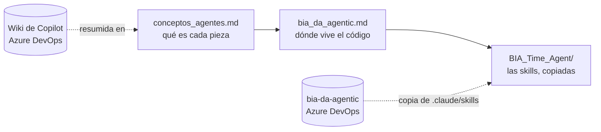

# Agentes de Data Analytics

**En corto:** esta carpeta junta lo que no es un framework de Fabric sino un **agente del equipo de Data Analytics de BIA**: qué es un agente y un MCP, el repo donde viven (`bia-da-agentic`, en Azure DevOps) y la copia de las skills de BIA Time Agent. El resto del repo (los casos de datos) no depende de nada de acá.

## Archivos

| Archivo | Qué tiene | Leelo cuando… |
|---|---|---|
| [conceptos_agentes.md](conceptos_agentes.md) | MCP, tools, skills y agente sin confundirlos; las herramientas (Copilot CLI, Azure CLI, MCP de Fabric y Power BI); BIA Time Agent y el análisis de Ayudin YPFL | Es tu primera vez con agentes o vas a diseñar uno nuevo |
| [bia_da_agentic.md](bia_da_agentic.md) | Cómo clonar `bia-da-agentic` en Windows y qué hay en cada carpeta | Vas a instalar BIA Time Agent o a construir sobre ese repo |
| [BIA_Time_Agent/](BIA_Time_Agent/README.md) | Las 14 skills del agente de carga de horas en Redmine, con los clientes de los ejemplos anonimizados | Querés ver cómo está armado un agente real: orquestador + skills chicas + MCP propios |

## Cómo se relacionan

La fuente de verdad sigue en Azure DevOps: la wiki de Javier Ramos y el repo `bia-da-agentic`. Acá hay resúmenes y una copia, que se actualizan por PR.

## Reglas de esta carpeta

- Nada de credenciales ni datos de colaboradores.
- Nombres de clientes solo donde hacen al contexto (Ayudin es un proyecto de un cliente); en ejemplos de skills, genéricos.
- Las skills de `BIA_Time_Agent/` no se editan acá: se vuelven a copiar desde el origen.

## Próximos pasos

1. Si se arranca Ayudin, su relevamiento y diseño van en una página nueva de esta carpeta.
2. Actualizar la copia de BIA Time Agent cuando salga una versión nueva.
