# BIA Time Agent: skills (copia)

**En corto:** copia de las 14 skills de BIA Time Agent, el agente que ayuda a cada colaborador de BIA a revisar y cargar sus horas en Redmine. Son 13 skills de procedimiento y `bia-time-agent`, el agente completo para Claude que arma `npm run build`. La fuente es el repo [bia-da-agentic](../docs/bia_da_agentic.md) de Azure DevOps: **acá no se editan**, se vuelven a copiar cuando cambia la versión.

Copia del 2026-10-26, `main` en el commit `dbdbcd1` (BIA Time Agent v0.20.0), carpeta `.claude/skills/`. El único cambio frente al origen: los clientes, dominios y números de issue de los ejemplos se reemplazaron por genéricos (`Cliente Ejemplo`, `cliente-ejemplo.com`, `ACME`, `CLI`, `#10001`, `#1001`, `#1002`). Las reglas y el texto son los mismos.

> A diferencia de las otras skills de este repo, estas no trabajan sobre Fabric: leen Redmine, Vacation Tracker y metadatos de Microsoft 365 (nunca contenido), y escriben en Redmine **solo** cargas que el colaborador confirmó.

## Archivos

| Skill | Etapa | Qué hace | Escribe |
|---|---|---|---|
| [`bia-time-agent`](skill/bia-time-agent/SKILL.md) | Agente | Reglas, configuración personal, herramientas permitidas y flujo; carga las demás. Generado desde `agent.yaml` | Vía `create-time-entry` |
| [`resolve-time-range`](skill/resolve-time-range/SKILL.md) | Contexto | "Ayer", "la semana pasada", "desde mi última carga" → rango exacto para validar | No |
| [`identify-working-days`](skill/identify-working-days/SKILL.md) | Contexto | Horas mínimas por día según jornada, días laborales y feriados; licencias de Vacation Tracker | No |
| [`resolve-time-context`](skill/resolve-time-context/SKILL.md) | Contexto | Referencia informal (cliente, reunión) → hasta cinco proyectos o issues de Redmine con evidencia | No |
| [`review-time-period`](skill/review-time-period/SKILL.md) | Revisar | Clasifica cada día como vacío, incompleto, completo o llamativo; licencias por cargar y duplicados | No |
| [`recover-missing-time-period`](skill/recover-missing-time-period/SKILL.md) | Recuperar | Orquesta la recuperación de un período atrasado: huecos → evidencias → propuestas → confirmación → registro → verificación | Sí, tras confirmar |
| [`collect-work-evidence`](skill/collect-work-evidence/SKILL.md) | Recuperar | Evidencias de Microsoft 365 (calendario, llamadas de Teams, documentos, correos enviados, chats), solo metadatos y solo de los días con huecos | No |
| [`normalize-work-evidence`](skill/normalize-work-evidence/SKILL.md) | Recuperar | Agrupa evidencias en actividades sin contar dos veces reuniones recurrentes o superpuestas | No |
| [`classify-work-context`](skill/classify-work-context/SKILL.md) | Recuperar | Destino de cada actividad (issue escrito, prefijo de cliente, dominios, historial) con confianza alta, media o baja | No |
| [`estimate-work-duration`](skill/estimate-work-duration/SKILL.md) | Recuperar | Unidades de trabajo y duración con la granularidad de BIA (múltiplos de 0,5 h hacia arriba) | No |
| [`reconcile-evidence-with-time-entries`](skill/reconcile-evidence-with-time-entries/SKILL.md) | Recuperar | Qué está cargado, qué falta y qué parece cargado en otro destino | No |
| [`propose-time-entry`](skill/propose-time-entry/SKILL.md) | Proponer | Propuesta verificable: datos confirmados, inferidos y faltantes | No |
| [`prepare-multi-day-entries`](skill/prepare-multi-day-entries/SKILL.md) | Proponer | Lote de varios días agrupado por estado, con reglas de confirmación por confianza | No |
| [`create-time-entry`](skill/create-time-entry/SKILL.md) | Ejecutar | Registra en Redmine, una por una, las cargas confirmadas e informa el resultado real | Sí |

Desde la v0.20.0, en una recuperación las skills de normalizar, estimar, conciliar y proponer quedan como referencia de criterio: los números los calcula `build_day_view` del MCP `bia-workdays` (decisión D-55).

## Flujo

```mermaid
flowchart LR
    U([Colaborador]) --> A[bia-time-agent<br/>lee y valida config.yaml]
    A --> R[resolve-time-range]
    R --> W[identify-working-days]
    W --> REV[review-time-period<br/>huecos y licencias]
    REV -->|"acepta recuperar"| REC[recover-missing-time-period]
    REC --> E[collect-work-evidence<br/>metadatos M365]
    E --> N[normalize-work-evidence]
    N --> C[classify-work-context]
    C -.-> CTX[resolve-time-context]
    C --> D[build_day_view<br/>bia-workdays]
    D --> P[propose-time-entry]
    P --> M[prepare-multi-day-entries]
    M -->|confirmación| X[create-time-entry]
    X --> RM[(Redmine)]
    A -->|"carga puntual"| P
```



Regla del flujo: **resolver contexto → proponer → confirmar → ejecutar**. Revisar no es recuperar: una revisión muestra huecos y ofrece armar propuestas, pero no lee el calendario hasta que el colaborador lo pide.

## Requisitos

No funcionan sueltas. Necesitan lo que instala `npm run install-user` en el repo de origen:

| Pieza | Para qué |
|---|---|
| MCP `redmine` | Consultar issues y cargas; `createTimeEntry` |
| MCP `vacation-tracker` | Licencias y feriados |
| MCP `bia-workdays` (propio) | Fechas, feriados, redondeos, sumas, clasificaciones y la vista del día |
| MCP `bia-m365` (propio) | Metadatos de Microsoft 365 vía Microsoft Graph, solo lectura |
| `~/.bia-time-agent/config.yaml` | Configuración personal (jornada, ID de Entra, prefijos de cliente) |

Para instalarlas y usarlas, seguir [Instalación y uso](../docs/copilot-javier-ramos/Agentes-de-IA/BIA-Time-Agent/Instalación-y-uso.md) de la wiki y el `README.md` de `bia-da-agentic`, no esta copia.

## Actualizar la copia

```powershell
# En el clon local (ver docs/bia_da_agentic.md)
cd $HOME\dev\bia-da-agentic
git pull
git log -1 --oneline   # anotar commit y versión en este README
```

Copiar `.claude/skills/*` a `BIA_Time_Agent/skill/`, volver a reemplazar los ejemplos de clientes y de issues por genéricos, revisar el diff (sin credenciales, sin datos de colaboradores) y abrir un PR. Si cambia la cantidad de skills, actualizar este README y el [catálogo](../docs/catalogo_skills.md).

### Validación

- Hay 14 carpetas en `skill/`, una por skill, cada una con `SKILL.md`.
- El `name` del frontmatter coincide con el nombre de la carpeta.
- `bia-time-agent/SKILL.md` empieza con el aviso `GENERADO desde agent.yaml`.
- Ningún `SKILL.md` nombra un cliente real ni un dominio externo.

## Próximos pasos

1. Usar estas skills como referencia de estructura para el MVP de Ayudin (agente orquestador + skills chicas + MCP propios con pruebas).
2. Volver a copiar cuando salga una versión nueva de BIA Time Agent.
