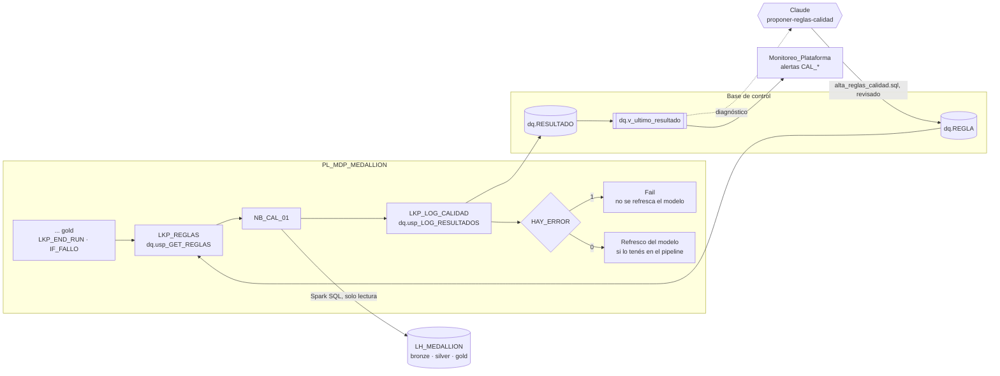

# Calidad y reconciliación

**En corto:** el pipeline medallion valida **fila por fila** en silver (`meta.DQ_RULE`). No controla, en cambio, lo que una fila sola no muestra: que los totales de gold cuadren con silver, que cada venta tenga su cliente y su producto, o que gold esté al día. Este framework suma reglas en un esquema `dq` de la base de control. Las corre `NB_CAL_01` con Spark SQL después de gold. Si una regla grave falla, el pipeline **frena antes de refrescar el modelo semántico**: mejor un reporte con datos de ayer que uno con números que no cuadran. Los resultados quedan con su historia y llegan como alertas por [Monitoreo_Plataforma](../Monitoreo_Plataforma/README.md). Claude propone las reglas y diagnostica las que fallan con la skill [`proponer-reglas-calidad`](skill/proponer-reglas-calidad/SKILL.md).

| Archivo | Qué es | ¿Escribe? |
|---|---|---|
| [`sql/01_ddl_calidad.sql`](sql/01_ddl_calidad.sql) | Esquema `dq`: `REGLA`, `RESULTADO`, `usp_GET_REGLAS`, `usp_LOG_RESULTADOS` y `v_ultimo_resultado` | Crea objetos en `dq` |
| [`notebooks/NB_CAL_01_evaluar_reglas.ipynb`](notebooks/NB_CAL_01_evaluar_reglas.ipynb) | Recibe las reglas por parámetro, las corre y devuelve los resultados por `exit` | No: solo lee el lakehouse |
| [`skill/proponer-reglas-calidad/`](skill/proponer-reglas-calidad/SKILL.md) | Skill de Claude: proponer reglas (`alta_reglas_calidad.sql`) y diagnosticar las que fallan | No: genera un script para revisar |
| [`pruebas/prueba_local.py`](pruebas/prueba_local.py) | Validación, comparación, condiciones y las reglas de la plantilla corriendo en Spark | Solo en una carpeta temporal |

---

## 1. Cómo funciona

- **El notebook no se conecta a la base.** Es el mismo patrón que el pipeline medallion: recibe las reglas con un Lookup y devuelve los resultados con `exit`, y el pipeline los registra con un stored procedure. No hay credenciales ni drivers en Spark.
- **Dos tipos de regla.** `COMPARA` sirve para el cuadre entre capas: dos consultas con las mismas métricas y, opcionalmente, una clave de cruce como el mes. `CONDICION` sirve para integridad, frescura, volumen y reglas de negocio: una consulta que devuelve un número que tiene que quedar en un rango.
- **Una métrica falla solo si supera las dos tolerancias**, la absoluta y la porcentual. Con las dos en `0`, tiene que dar exacto.
- **Una regla rota no frena a las demás.** Si una tabla no existe o el SQL tiene un error, la regla queda como `ERROR_EJECUCION` y el resto se evalúa igual.
- **Solo métricas, nunca filas.** `DETALLE` lista las claves de cruce y las métricas que difieren, nunca datos de personas. La clave de una regla no puede tener nombre de dato personal.

## 2. Ejemplos

Las reglas de la [plantilla](skill/proponer-reglas-calidad/plantillas/alta_reglas_calidad.sql) usan el modelo de ejemplo del pipeline medallion:

| Regla | Categoría | Tipo | Severidad | Qué controla |
|---|---|---|---|---|
| `cuadre_ventas_silver_gold` | CUADRE | COMPARA por mes | ERROR | Filas e importe de `silver.ventas` contra `gold.fact_ventas` |
| `ventas_sin_cliente` | INTEGRIDAD | CONDICION, máximo 0 | ERROR | Ventas cuyo cliente no está en `dim_cliente` |
| `ventas_sin_producto` | INTEGRIDAD | CONDICION, máximo 0 | ERROR | Ventas cuyo producto no está en `dim_producto` |
| `frescura_ventas` | FRESCURA | CONDICION, máximo 48 h | WARN | Horas desde la última venta en gold [dato a confirmar] |
| `claves_ventas_bronze_silver` | CUADRE | CONDICION, máximo 0 | WARN | Ventas que llegaron a bronze y no están en silver |

## 3. Requisitos

| Qué | Para qué |
|---|---|
| Base de control con el pipeline medallion ([`01_ddl_control.sql`](../Pipeline_Metadata_Medallion/sql/01_ddl_control.sql)) | Mismo `RUN_ID` y `LOAD_GROUP` |
| `LH_MEDALLION` como lakehouse por defecto de `NB_CAL_01` | Las consultas usan `silver.*`, `gold.*`, `bronze.*` |
| Identidad del pipeline con `EXECUTE` en `dq.usp_GET_REGLAS` y `dq.usp_LOG_RESULTADOS` | Ver los `GRANT` del script |

## 4. Pasos

1. **Base de control.** Corré `sql/01_ddl_calidad.sql` en DES. En el repo de la implementación, copialo como migración `sql/NNN_ddl_calidad.sql` con `-- repetible` en la primera línea: es idempotente.
2. **Reglas.** Pedile a Claude las reglas de tu modelo con la skill `proponer-reglas-calidad`. Revisá `alta_reglas_calidad.sql` y corrélo en DES. Empezá con todas en `WARN`.
3. **Probar a mano.** `EXEC dq.usp_GET_REGLAS 'default'`, copiá `REGLAS_JSON` al parámetro `reglas_json` de `NB_CAL_01` y corrélo. Revisá que lo que falla sea real.
4. **Pipeline.** Agregá estas actividades a `PL_MDP_MEDALLION` después de `IF_FALLO` (paso 3 del [pipeline medallion](../Pipeline_Metadata_Medallion/README.md#paso-3-pipeline-pl_mdp_medallion)):

   | # | Actividad | Tipo | Configuración | Depende de |
   |---|---|---|---|---|
   | 8 | `LKP_REGLAS` | Lookup | Stored procedure `dq.usp_GET_REGLAS` (`LOAD_GROUP = @pipeline().parameters.p_load_group`). First row only: marcado | 7 Succeeded |
   | 9 | `NB_CALIDAD` | Notebook | `NB_CAL_01_evaluar_reglas`. Parámetros: `run_id = @pipeline().RunId`, `reglas_json = @activity('LKP_REGLAS').output.firstRow.REGLAS_JSON` | 8 Succeeded |
   | 10 | `LKP_LOG_CALIDAD` | Lookup | Stored procedure `dq.usp_LOG_RESULTADOS`: `RUN_ID = @pipeline().RunId`, `RESULTADOS_JSON = @coalesce(activity('NB_CALIDAD').output?.result?.exitValue, '')`. First row only: marcado | 9 **Completed** |
   | 11 | `IF_CALIDAD` | If Condition | `@equals(activity('LKP_LOG_CALIDAD').output.firstRow.HAY_ERROR, true)`. En *True*: actividad **Fail** con el mensaje `Calidad con errores: ver dq.v_ultimo_resultado` | 10 Succeeded |

   El refresco del modelo semántico, si está en el pipeline, va después de `IF_CALIDAD` en *False*. La dependencia en **Completed** (10) registra el resultado aunque el notebook haya fallado. En ese caso el SP recibe un JSON vacío y registra un `ERROR_EJECUCION` grave, así que no pasa en silencio. [verificar] el tipo que devuelve el Lookup para una columna `BIT` (booleano o 0/1) y ajustá la expresión del If.
5. **Alertas.** Con [Monitoreo_Plataforma](../Monitoreo_Plataforma/README.md) instalado, `NB_MON_01` lee `dq.v_ultimo_resultado` y abre `CAL_REGLA_FALLA` (ALTA si la regla es `ERROR`) o `CAL_REGLA_ERROR_EJECUCION`.
6. **Endurecer.** Después de dos o tres semanas sin falsos positivos, pasá las reglas de cuadre e integridad a `ERROR`.

## 5. Cómo validar

| Prueba | Resultado esperado |
|---|---|
| [`pruebas/prueba_local.py`](pruebas/prueba_local.py) | `Todo OK`. Con pyspark, las cinco reglas de la plantilla corren en Spark SQL sobre un modelo con fallas sembradas y las detectan |
| `NB_CAL_01` a mano con las reglas reales | Las reglas de cuadre dan `OK` sobre una carga completa y sin errores |
| Sembrar una falla en DES: borrar una fila de `gold.fact_ventas` | `cuadre_ventas_silver_gold` en `FALLA` con el mes en `DETALLE`. Si es `ERROR`, el pipeline termina en `IF_CALIDAD`. La próxima corrida, que vuelve a cargar gold, la deja en `OK` |
| Regla con una tabla inexistente | `ERROR_EJECUCION` en esa regla y las demás evaluadas igual |

**Qué está probado y qué no.** La lógica del notebook se probó localmente, y las reglas de la plantilla con Spark 3.5.3 (`prueba_local.py`, también en el CI de BIA). **No están probados** en Fabric real el T-SQL (`OPENJSON`, `FOR JSON`, sin ejecutar), las actividades del pipeline ni el tipo que devuelve el Lookup para `HAY_ERROR`. Probalo primero en un workspace de desarrollo.

## 6. Operación (mini runbook)

| Situación | Qué hacer |
|---|---|
| El pipeline frenó en `IF_CALIDAD` | `SELECT * FROM dq.v_ultimo_resultado WHERE ESTADO <> 'OK'` y pediselo a Claude (tarea B de la skill). Corregí la causa y volvé a correr: las reglas se evalúan de nuevo |
| Hay que publicar igual (la diferencia está entendida) | Pasá esa regla a `WARN` por script, con el motivo en `DESCRIPCION`. **Cambio con impacto**: deja de frenar. Volvé a `ERROR` cuando se corrija |
| Una regla da falsos positivos | Ajustá la consulta o la tolerancia por script revisado. No la desactives sin reemplazo |
| Cambió una tabla de gold | Las reglas que la usan pueden quedar en `ERROR_EJECUCION`: actualizalas en el mismo PR que cambia gold |
| `dq.RESULTADO` crece mucho | Borrá los resultados de más de un año después de exportarlos. **Cambio con impacto**: se pierde la historia |

## Próximos pasos

1. Correr `01_ddl_calidad.sql` en DES y cargar las reglas del modelo real, en `WARN`.
2. Agregar las actividades 8 a 11 a `PL_MDP_MEDALLION`.
3. Confirmar con el negocio los umbrales de frescura de cada hecho [dato a confirmar].
4. Cuadre contra el **origen**. Requiere que la copia registre las filas leídas (`ROWS_READ` en `SP_LOG_COPY_OK`, desde la salida de la Copy) o un Lookup de totales en el origen. Hoy el pipeline no lo registra.
5. Pasar a `ERROR` las reglas estables.
