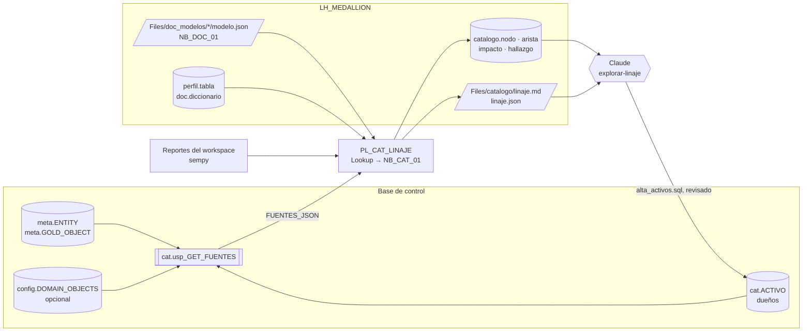

# Catálogo y linaje

**En corto:** la plataforma ya sabe mucho de sí misma, pero en lugares separados. El inventario tiene los items, el pipeline medallion la metadata de cada tabla, el perfilado el origen y la documentación los modelos semánticos. Este framework los une en un solo grafo **origen → bronze → silver → gold → modelo semántico → reporte**, para contestar dos preguntas de todos los días:

- *¿Qué rompo si cambio esto?*
- *¿De dónde sale este número?*

Lo arma `NB_CAT_01` sin conectarse a la base de control y sin leer filas, solo metadata. De paso encuentra lo que está mal conectado: un gold que lee otro sin esperarlo, PII que llega a gold, tablas que nadie usa. Claude responde las preguntas de impacto y propone dueños con la skill [`explorar-linaje`](skill/explorar-linaje/SKILL.md).

| Archivo | Qué es | ¿Escribe? |
|---|---|---|
| [`sql/01_ddl_catalogo.sql`](sql/01_ddl_catalogo.sql) | Esquema `cat`: `ACTIVO` (dueño, área, criticidad) y `usp_GET_FUENTES` (toda la metadata en un JSON) | Crea objetos en `cat` |
| [`notebooks/NB_CAT_01_armar_linaje.ipynb`](notebooks/NB_CAT_01_armar_linaje.ipynb) | Arma el grafo, el impacto y los hallazgos, y el diagrama Mermaid | Sí, en `catalogo.*` y `Files/catalogo/` del lakehouse |
| [`skill/explorar-linaje/`](skill/explorar-linaje/SKILL.md) | Skill de Claude: impacto de un cambio, procedencia de un número, dueños y revisión de hallazgos | No: informes y un script para revisar |
| [`pruebas/prueba_local.py`](pruebas/prueba_local.py) | Las funciones sin Spark y el notebook completo con Spark y Delta | Solo en una carpeta temporal |

---

## 1. Cómo funciona



| Tramo | De dónde sale | Confianza |
|---|---|---|
| origen → bronze → silver | `meta.ENTITY` | alta |
| silver/gold → gold | `SQL_TEXT` de `meta.GOLD_OBJECT`, analizado con el parser de Spark **sin ejecutarlo** (también entiende CTE y materialized lake views) | alta; media si el parser falla y queda la expresión regular |
| gold → tabla del modelo | `origen` de cada tabla en `modelo.json`: esquema y tabla en Direct Lake, o la navegación `Schema=..., Item=...` de la expresión M | alta; **baja** si solo coincide el nombre (un `modelo.json` de antes de esta versión) |
| tabla del modelo → modelo → reporte | `modelo.json` y `sempy.fabric.list_reports` | alta |

- **Solo metadata.** No lee filas. Para detectar PII en gold mira los **nombres** de columna de cada tabla que existe en el lakehouse y los cruza con las columnas `IS_PII` de silver.
- **Foto completa en cada corrida.** Las tablas `catalogo.*` se reemplazan; la historia queda en el time travel de Delta.
- **El linaje es de tablas, no de columnas.** El impacto de una columna se confirma leyendo el `SQL_TEXT` de los gold afectados; la skill lo hace y dice qué verificó.

### Qué hallazgos busca

| Código | Severidad | Qué detecta |
|---|---|---|
| `FALTA_DEPENDS_ON_GOLD` | ALTA | Un gold lee otro que no está en `DEPENDS_ON_GOLD`: el orquestador puede correrlo antes y leer datos de ayer |
| `PII_EN_GOLD` | ALTA | Una tabla de gold tiene columnas PII que vienen de silver |
| `CICLO` | ALTA | Dos objetos gold se leen entre sí |
| `PII_EN_MODELO`, `REFERENCIA_DESCONOCIDA`, `LEE_ENTIDAD_INACTIVA`, `GOLD_SIN_FUENTES`, `REFERENCIA_SIN_ESQUEMA` | MEDIA | Columnas personales visibles en el modelo, tablas que no carga nadie, lecturas de entidades dadas de baja, SQL ilegible |
| `SILVER_SIN_USO`, `GOLD_SIN_CONSUMO`, `SIN_DUENO`, `ITEM_FUERA_DEL_LINAJE`, `MODELO_SIN_DOCUMENTAR`, ... | INFO | Lo que se carga y nadie lee, lo que no tiene dueño, lo que falta documentar |

## 2. Opciones

| Opción | Costo | Qué muestra | Cuándo |
|---|---|---|---|
| **A. Este catálogo (recomendada para empezar)** | Una corrida de Spark por día | Linaje de tablas con la lógica de la plataforma: dependencias de gold, PII, entidades inactivas, dueños | Ya tenés la metadata de los otros casos y querés respuestas hoy |
| B. Microsoft Purview (Data Map + Unified Catalog) | Licencia y escaneos [dato a confirmar] | Linaje de items de Fabric que Purview recolecta solo, glosario, clasificaciones y políticas a nivel organización [verificar el alcance actual del linaje de Fabric en Purview] | Gobierno de datos de toda la organización, más allá de esta plataforma |
| C. Las dos | A + B | Este catálogo para la operación diaria y Purview como catálogo corporativo | Cuando Purview ya está. `linaje.json` puede alimentar linaje propio en Purview vía su API Atlas [verificar el endpoint y el formato] |

**Recomiendo A.** Sale con lo que ya existe y encuentra problemas que un catálogo genérico no ve, porque conoce la metadata del pipeline. Si la organización adopta Purview, A sigue sirviendo para la operación y C es la integración.

## 3. Requisitos

| Qué | Para qué |
|---|---|
| Base de control con el pipeline medallion ([`01_ddl_control.sql`](../Pipeline_Metadata_Medallion/sql/01_ddl_control.sql), versión con `DELETE_MODE`) | `cat.usp_GET_FUENTES` lee `meta.*` |
| `LH_MEDALLION` como lakehouse por defecto de `NB_CAT_01` | Lee `modelo.json`, `perfil.*` y `doc.*`, y escribe `catalogo.*` |
| `NB_DOC_01` corrido en cada modelo semántico, con la versión que guarda `origen` | Unir el modelo con gold con confianza alta |
| Opcionales: [inventario](../Inventario_Workspace/README.md) (`config.DOMAIN_OBJECTS`), [perfilado](../Perfilado_Origen_Medallion/README.md), [diccionario](../Documentar_Modelo_Semantico/README.md) | GUID de los items, filas y descripciones |
| Identidad del pipeline con `EXECUTE` en `cat.usp_GET_FUENTES`, y permiso de lectura en el workspace para listar reportes | Ver los `GRANT` del script |

## 4. Pasos

1. **Base de control.** Corré [`sql/01_ddl_catalogo.sql`](sql/01_ddl_catalogo.sql) en DES. En el repo de la implementación, copialo como migración `sql/NNN_ddl_catalogo.sql` con `-- repetible` en la primera línea: es idempotente.
2. **Modelos.** Volvé a correr `NB_DOC_01` en cada modelo semántico, así su `modelo.json` trae de qué tabla lee cada tabla. Sin eso, la unión con gold es por nombre y con confianza baja.
3. **Probar a mano.** `EXEC cat.usp_GET_FUENTES`, copiá `FUENTES_JSON` al parámetro `fuentes_json` de `NB_CAT_01` y corrélo. Revisá `Files/catalogo/linaje.md`.
4. **Pipeline `PL_CAT_LINAJE`.** Programalo una vez por día, después de las cargas:

   | # | Actividad | Tipo | Configuración | Depende de |
   |---|---|---|---|---|
   | 1 | `LKP_FUENTES` | Lookup | Stored procedure `cat.usp_GET_FUENTES`. First row only: marcado | — |
   | 2 | `NB_LINAJE` | Notebook | `NB_CAT_01_armar_linaje`. Parámetros: `run_id = @pipeline().RunId`, `fuentes_json = @activity('LKP_FUENTES').output.firstRow.FUENTES_JSON` | 1 Succeeded |

   El notebook no falla por los hallazgos: los deja en `catalogo.hallazgo`. Si querés que el pipeline avise, agregá un If con `@activity('NB_LINAJE').output.result.exitValue` y `hay_alta` [verificar cómo leer un campo del exitValue en una expresión: puede requerir `json()`].
5. **Dueños.** Pedile a Claude los dueños de los activos sin dueño (tarea C de la skill). Revisá `alta_activos.sql` y corrélo en DES.

## 5. Consultas útiles

```sql
-- ¿Qué toco si cambio silver.clientes? (Spark SQL sobre el lakehouse)
SELECT i.hasta, n.tipo, n.capa, n.dueno, n.criticidad, i.distancia
FROM catalogo.impacto i JOIN catalogo.nodo n ON n.id = i.hasta
WHERE i.desde = 'lh:silver.clientes'
ORDER BY i.distancia, n.criticidad;

-- ¿De dónde sale el reporte? (aguas arriba)
SELECT i.desde, n.capa, i.distancia
FROM catalogo.impacto i JOIN catalogo.nodo n ON n.id = i.desde
WHERE i.hasta = 'reporte:Tablero comercial'
ORDER BY i.distancia DESC;

-- Lo urgente
SELECT * FROM catalogo.hallazgo WHERE severidad = 'ALTA';
```

## 6. Cómo validar

| Prueba | Resultado esperado |
|---|---|
| [`pruebas/prueba_local.py`](pruebas/prueba_local.py) | `Todo OK`. Sin Spark: análisis de SQL, linaje del modelo de ejemplo, hallazgos, impacto y diagrama. Con Spark: el notebook completo, el parser de Spark y las tablas `catalogo.*` |
| `NB_CAT_01` con la metadata real | Un nodo por tabla de bronze, silver y gold de la metadata, y aristas hasta los modelos documentados |
| Sacar un `GOLD_CODE` de `DEPENDS_ON_GOLD` en DES | `FALTA_DEPENDS_ON_GOLD` en ese objeto |
| Agregar una columna PII de silver al `SELECT` de un gold en DES y cargarlo | `PII_EN_GOLD` en esa tabla |

**Qué está probado y qué no.** Las funciones y el notebook, con Spark 3.5.3 y Delta 3.2.1 (`prueba_local.py`, también en el CI de BIA). **No están probados** en Fabric real: `cat.usp_GET_FUENTES` (T-SQL sin ejecutar), la lectura de reportes con `sempy` (nombres de columna `[verificar]`), las propiedades `SchemaName` y `EntityName` de TOM que agrega `NB_DOC_01`, ni el formato de las expresiones M que genera Power BI Desktop. Probalo primero en un workspace de desarrollo.

## 7. Operación (mini runbook)

| Situación | Qué hacer |
|---|---|
| Hay hallazgos `ALTA` | `SELECT * FROM catalogo.hallazgo WHERE severidad = 'ALTA'` y pediselos a Claude (tarea D de la skill). `FALTA_DEPENDS_ON_GOLD` se corrige en `meta.GOLD_OBJECT` con la skill `metadata-medallion` |
| Van a cambiar una tabla o una columna | Pedile a Claude el impacto (tarea A) **antes** del cambio, y avisá a los dueños de los activos `ALTA` |
| Muchas aristas de confianza baja | Los `modelo.json` son viejos: corré `NB_DOC_01` de nuevo en esos modelos |
| `ITEM_FUERA_DEL_LINAJE` de modelos que nadie documentó | Documentalos con `NB_DOC_01`, o confirmá con el dueño que se pueden borrar. **Borrar un item es un cambio con impacto**: hacelo por despliegue, no a mano |
| El diagrama no entra en `linaje.md` | Con más de `max_nodos_diagrama` nodos sale un diagrama por objeto gold. Para el completo, subí el parámetro o usá `linaje.json` |
| Cambió un dueño | Actualizá `cat.ACTIVO` con `alta_activos.sql`; no borres filas, usá `IS_ACTIVE = 0` |

## Próximos pasos

1. Correr `01_ddl_catalogo.sql` en DES y volver a correr `NB_DOC_01` en los modelos principales.
2. Armar `PL_CAT_LINAJE` y revisar la primera tanda de hallazgos.
3. Cargar los dueños de los activos `ALTA` con la skill. [dato a confirmar]: quién es dueño de cada modelo.
4. Sumar a [Monitoreo_Plataforma](../Monitoreo_Plataforma/README.md) una regla que lea `catalogo.hallazgo` y abra alertas para los `ALTA`.
5. Si la organización usa Purview, probar publicar `linaje.json` como linaje propio (opción C).
