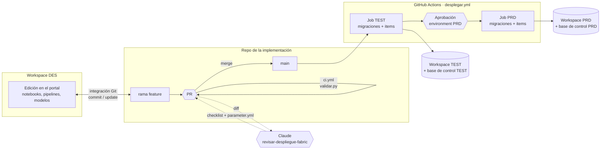

# Desplegar entre ambientes (DES → TEST → PRD) con CI/CD

**En corto:** los casos de BIA se arman en un workspace de desarrollo. Este framework define cómo llegan a TEST y PRD sin copiar nada a mano. Se usa un **repo por implementación** conectado al workspace de DES con la integración Git de Fabric. Cada PR se valida solo. Cada merge a `main` despliega el mismo commit en TEST y, con la aprobación de una persona, en PRD. Las piezas son [fabric-cicd](https://microsoft.github.io/fabric-cicd/) (la librería de Microsoft para publicar items de Fabric desde un repo) y GitHub Actions. Los ID de DES se reemplazan por los de cada ambiente con un `parameter.yml`, y la base de control se actualiza con migraciones SQL registradas. Claude revisa cada PR con la skill [`revisar-despliegue-fabric`](skill/revisar-despliegue-fabric/SKILL.md) y arma el checklist de pase a producción.

| Archivo | Qué es | ¿Escribe? |
|---|---|---|
| [`plantilla_repo/`](plantilla_repo/README.md) | Lo que se copia al repo de la implementación: workflows, scripts y `parameter.yml` | — |
| [`plantilla_repo/deploy/validar.py`](plantilla_repo/deploy/validar.py) | `parameter.yml` válido por ambiente, GUID de DES sin parametrizar, secretos y reglas de `sql/` | No |
| [`plantilla_repo/deploy/aplicar_sql.py`](plantilla_repo/deploy/aplicar_sql.py) | Migraciones de la base de control en orden, una vez cada una, en transacción, con registro en `log.MIGRACION` | Sí, en la base de control del ambiente |
| [`plantilla_repo/deploy/desplegar_items.py`](plantilla_repo/deploy/desplegar_items.py) | Publica los items del repo en el workspace del ambiente con fabric-cicd | Sí, en el workspace. No borra nada salvo que se pida |
| [`plantilla_repo/.github/workflows/`](plantilla_repo/.github/workflows/) | `ci.yml` (cada PR), `desplegar.yml` (merge a `main`) y `_desplegar_ambiente.yml` (pasos de un ambiente) | — |
| [`plantilla_repo/workspace/parameter.yml`](plantilla_repo/workspace/parameter.yml) | Reemplazos de DES a TEST y PRD: workspace, lakehouse, conexiones, servidor de la base | — |
| [`skill/revisar-despliegue-fabric/`](skill/revisar-despliegue-fabric/SKILL.md) | Skill de Claude: revisar un PR, proponer `parameter.yml`, checklist y vuelta atrás, diagnosticar un despliegue fallido | No: genera un informe |
| [`pruebas/prueba_local.py`](pruebas/prueba_local.py) | Prueba de los tres scripts y los workflows, con el validador real de fabric-cicd y Fabric simulado | Solo en carpetas temporales |

---

## 1. Cómo funciona

1. **Desarrollo.** Se trabaja en el workspace de DES, conectado a Git. Cada cambio se commitea a una rama desde el panel *Source control*, o se trabaja en un workspace propio con *Branch out*.
2. **PR.** `ci.yml` corre `validar.py`: `parameter.yml` válido para TEST y PRD, sin secretos y con las migraciones bien nombradas y marcadas. Claude revisa el diff con la skill y deja el checklist.
3. **Merge a `main`.** `desplegar.yml` despliega en TEST: valida en modo estricto, aplica las migraciones nuevas a la base de control y publica los items con fabric-cicd, reemplazando los ID de DES.
4. **PRD.** El job de PRD espera la aprobación de una persona en el environment `PRD` de GitHub. Despliega **el mismo commit** que pasó por TEST.
5. **DES vuelve a `main`.** En el panel *Source control* del workspace de DES, *Update* para quedar alineado.

## 2. Opciones

| Opción | Costo | Complejidad | Control | Riesgo | Cuándo |
|---|---|---|---|---|---|
| A. **Deployment pipelines** de Fabric (DES → TEST → PRD en el portal) | Incluido en la capacidad | Baja | Medio: reglas de despliegue por item; la aprobación es quién tiene permiso de desplegar | Medio: el pase es a mano, sin validación automática, y las reglas no cubren todo (por ejemplo, IDs dentro del código de un notebook) [verificar alcance de las reglas vigentes] | Equipo chico, pocos items, sin repo |
| **B. fabric-cicd + GitHub Actions (recomendada)** | Incluido; minutos de Actions del plan de GitHub [verificar cuota] | Media: un service principal, dos environments y un `parameter.yml` | Alto: PR, validación, aprobación y registro de cada despliegue en GitHub | Bajo: mismo commit en TEST y PRD, migraciones registradas, sin borrados por defecto | Lo habitual |
| C. Un workspace por ambiente conectado cada uno a su rama (`des`, `test`, `main`) | Incluido | Baja al principio | Bajo: el pase es un merge entre ramas, sin reemplazo de IDs | Alto: los ID de DES llegan tal cual a PRD; hay que corregirlos a mano en cada workspace | Solo para prototipos |

**Recomiendo B.** Es la única que reemplaza los ID dentro de notebooks y pipelines (lakehouse por defecto, conexiones), que es lo que hace que PRD lea datos de DES sin que nadie se dé cuenta. Además deja el despliegue en el mismo lugar que el código: cada pase a PRD es un merge con su PR, su checklist y su aprobación. A (deployment pipelines) se puede combinar más adelante si alguien prefiere el botón del portal, pero no las dos para el mismo workspace.

## 3. Qué se despliega y qué no

| Pieza | Cómo llega a TEST y PRD | Por qué |
|---|---|---|
| Notebooks, pipelines, modelos semánticos, reportes, environments, variable libraries | `desplegar_items.py` (fabric-cicd) | Son definiciones: el repo manda |
| Lakehouse (`LH_MEDALLION`) | fabric-cicd lo crea si no existe. **Nunca lo borra**: fabric-cicd exige un flag explícito que este framework no activa | Los datos no se despliegan: los crean las cargas |
| Tablas y esquemas del lakehouse (`bronze`, `silver`, `gold`, `perfil`, `doc`, `perf`, `agente_ctl`) | Los crean los notebooks en su primera corrida | Son datos, no definiciones |
| Base de control (SQL database) | Se crea **a mano una vez** por ambiente. Su esquema llega con `aplicar_sql.py` | fabric-cicd publica el item SQL database, pero el esquema se maneja como migraciones registradas, con marca de impacto y transacción. El alcance real de fabric-cicd sobre el esquema de una SQL database está [por verificar] |
| Metadata del pipeline (`meta.*`) | Migraciones `NNN_alta_<origen>.sql` | Es configuración versionada |
| Vistas `agente.*` | A mano o con un notebook, en el SQL analytics endpoint de cada ambiente | No están en la base de control |
| Conexiones (*Manage connections and gateways*) | A mano, una por ambiente. Su ID va en `parameter.yml` | No son items del workspace |
| Fabric data agent | Fuera del alcance por defecto | Tiene su propio ciclo de evaluación y publicación (`NB_AGT_03`). Se puede sumar `DataAgent` a `--tipos` cuando ese ciclo esté estable |
| Secretos | Nunca en el repo. Key Vault, leído en tiempo de ejecución | `validar.py` falla si encuentra uno |

## 4. Requisitos

| Qué | Para qué | Dónde se configura |
|---|---|---|
| Repo de la implementación con el contenido de [`plantilla_repo/`](plantilla_repo/README.md) | Todo | GitHub |
| Workspace DES conectado a ese repo, carpeta `workspace/` | Exportar los items | Workspace settings > Git integration (*Git folder* = `workspace`) |
| Workspaces TEST y PRD **sin** integración Git | Los escribe solo el workflow | — |
| App de Entra ID (service principal) con **credenciales federadas** para `repo:<org>/<repo>:environment:TEST` y `:environment:PRD` | Login sin secretos desde GitHub (OIDC) | Entra ID > App registrations > Certificates & secrets > Federated credentials |
| Tenant: permitir que los service principals usen las APIs de Fabric, idealmente limitado a un grupo de seguridad [verificar el nombre exacto de la opción] | Que fabric-cicd pueda publicar | Admin portal > Tenant settings > Developer settings |
| El service principal como **Contributor** en los workspaces TEST y PRD (Admin solo si algún día se habilita el borrado definitivo) | Publicar items | Workspace > Manage access |
| Usuario del service principal en la base de control de TEST y PRD con permisos de DDL y escritura (`db_ddladmin`, `db_datareader`, `db_datawriter`) [verificar el mínimo en SQL database de Fabric] | `aplicar_sql.py` | `CREATE USER [<app>] FROM EXTERNAL PROVIDER;` en cada base |
| Environments `TEST` y `PRD` en GitHub, con variables `AZURE_CLIENT_ID`, `AZURE_TENANT_ID`, `FABRIC_WORKSPACE_ID`, `SQL_SERVER`, `SQL_DATABASE` | Un juego de valores por ambiente | Settings > Environments |
| *Required reviewers* en `PRD` | La aprobación antes de producción | Settings > Environments > PRD. En repos privados puede requerir un plan pago de GitHub [verificar] |
| Branch protection en `main`: PR obligatorio y `CI / validar` en verde | Que nada llegue a `main` sin validar | Settings > Branches |

Ninguno de estos valores es secreto: el login es por OIDC, sin client secret. Igual van como *variables* del environment, no en el código.

## 5. Cómo armarlo

### Paso 1. Repo y DES

1. Creá el repo de la implementación y copiá el contenido de `plantilla_repo/` a su raíz.
2. Conectá el workspace de DES al repo, rama `main`, carpeta `workspace`, y hacé el primer commit desde el workspace. Quedan las carpetas `<Nombre>.<Tipo>/` de cada item.
3. Copiá las migraciones iniciales a `sql/` (ver [la plantilla](plantilla_repo/README.md#primeras-migraciones)) con `-- repetible` en la primera línea.

### Paso 2. `parameter.yml`

1. Corré `python deploy/validar.py`: lista los GUID de DES que aparecen en los items y no tienen reemplazo.
2. Completá `workspace/parameter.yml` con la [plantilla](plantilla_repo/workspace/parameter.yml): workspace (`$workspace.$id`), lakehouse (`$items.Lakehouse.LH_MEDALLION.$id`), conexiones (un ID por ambiente) y servidor de la base de control.
3. O pedile a Claude: *"Usá la skill revisar-despliegue-fabric para completar parameter.yml"* con la salida de `validar.py`.
4. Repetí hasta que `validar.py --estricto` no muestre GUID sin parametrizar.

### Paso 3. Identidad y ambientes

1. App de Entra ID con las dos credenciales federadas, la opción del tenant, el rol en los workspaces y el usuario en cada base (sección 4).
2. Creá a mano en TEST y PRD la SQL database de control, el lakehouse `LH_MEDALLION` con esquemas y las conexiones a los orígenes. Copiá los ID de las conexiones a `parameter.yml`.
3. Environments `TEST` y `PRD` en GitHub con sus variables, y *Required reviewers* en `PRD`.

### Paso 4. Primer despliegue

1. PR con `parameter.yml` y `sql/`: `CI` en verde y el checklist de Claude.
2. Merge. Mirá el job de TEST: el plan de migraciones (`APLICAR` para todas la primera vez) y los items publicados.
3. Probá en TEST: una corrida del pipeline con `p_load_group` de prueba, `log.RUN_STEP`, y que los notebooks lean `LH_MEDALLION` de TEST (no el de DES).
4. Aprobá PRD.

## 6. Dónde entra Claude

| Tarea | Pedido | Entrega |
|---|---|---|
| Revisar un PR | *"Revisá este PR con la skill revisar-despliegue-fabric"* + el diff | Checklist con veredicto, hallazgos, `parameter.yml` propuesto y vuelta atrás |
| Completar `parameter.yml` | La salida de `validar.py` | Las entradas que faltan, con el tipo de cada GUID |
| Preparar una migración con impacto | El cambio que se quiere hacer | Script con backup, marca `-- impacto:` y vuelta atrás |
| Diagnosticar un despliegue fallido | El log del job | Causa, cambio exacto y si se puede volver a correr |

Claude **no despliega ni aprueba**. El despliegue lo dispara el merge, y PRD lo aprueba una persona.

## 7. Cómo validar el framework

| Prueba | Resultado esperado |
|---|---|
| [`pruebas/prueba_local.py`](pruebas/prueba_local.py) | `Todo OK` (validador real de fabric-cicd 1.4.0; Fabric y la base simulados) |
| PR con un notebook que apunta a otro lakehouse de DES sin parametrizar | `CI` pasa con advertencia; el job de TEST falla en `validar.py --estricto` antes de tocar nada |
| PR que edita una migración ya aplicada | El job falla en el plan, sin ejecutar nada |
| Migración con un error en el lote 3 | El job falla; la base queda como estaba (transacción) y la migración no se registra |
| Borrar un notebook del repo y desplegar sin `borrar_huerfanos` | El notebook sigue en TEST y PRD |
| Mismo despliegue con `borrar_huerfanos = true` (*Run workflow*) | El notebook se borra; el lakehouse y la base no |
| Rechazar la aprobación de PRD | TEST queda desplegado, PRD no cambia |

**Qué está probado y qué no.** Con [`pruebas/prueba_local.py`](pruebas/prueba_local.py) probé `validar.py` con el validador real de `parameter.yml` de fabric-cicd 1.4.0 (variables `$workspace` e `$items`, error por variable mal escrita), la detección de GUID y secretos, las reglas y el plan de las migraciones (incluido el DDL real de `Pipeline_Metadata_Medallion` e `Inventario_Workspace`), la ejecución con una conexión simulada y `desplegar_items.py` con fabric-cicd simulado. Las firmas de `FabricWorkspace`, `publish_all_items` y `unpublish_all_orphan_items` las verifiqué en el código de fabric-cicd 1.4.0. **No están probados** un despliegue real contra workspaces de Fabric, el login OIDC, la conexión a la SQL database con el token del service principal ni la instalación del driver ODBC en el runner. Probalo primero con un workspace TEST de prueba.

## 8. Operación (mini runbook)

| Situación | Qué hacer |
|---|---|
| Falló el job de TEST | Pasale el log a Claude (tarea B de la skill). Corregí en un PR nuevo; el workflow se vuelve a correr con el merge |
| Hay que volver atrás un cambio de items | Revert del PR en `main`. El workflow despliega la versión anterior en TEST y, con aprobación, en PRD |
| Hay que volver atrás una migración | No se revierte sola. Migración nueva con la vuelta atrás (y la marca de impacto si borra algo) |
| Cambio urgente en PRD | Igual por PR: el flujo tarda minutos. Nunca editar en el portal de PRD: el próximo despliegue lo pisa |
| Alguien editó un item en el portal de TEST o PRD | Se pierde en el próximo despliegue. Si el cambio sirve, hacelo en DES y que entre por PR |
| Un item nuevo de DES no aparece en TEST | ¿Está su tipo en `--tipos` (`TIPOS_POR_DEFECTO` de `desplegar_items.py`)? ¿Se commiteó desde el workspace de DES? |
| `$items.Lakehouse.LH_MEDALLION.$id` no resuelve | El lakehouse tiene que estar en el repo (carpeta `LH_MEDALLION.Lakehouse/`) o existir en el workspace destino con ese nombre exacto |
| Cambiar de versión de fabric-cicd | Cambiá `deploy/requirements.txt`, corré `pruebas/prueba_local.py` y probá en TEST antes de mergear. `validar.py` usa una función interna de fabric-cicd (`validate_parameter_file`) que puede moverse entre versiones |
| Rotar la identidad | Las credenciales federadas no vencen. Si se cambia la app, actualizá `AZURE_CLIENT_ID` en los dos environments y los roles en workspaces y bases |

**Datos a confirmar en la documentación vigente**, porque cambian seguido: nombres de las opciones del tenant para service principals, roles mínimos del service principal en el workspace y en la SQL database, el scope del token para SQL database en Fabric (`aplicar_sql.py`), qué hace fabric-cicd con la definición de una SQL database y el alcance de las reglas de deployment pipelines.

## Próximos pasos

1. Crear el repo de la implementación (por ejemplo `TDM_Platform`) con la plantilla y conectar el workspace de DES.
2. Completar `parameter.yml` hasta que `validar.py --estricto` no avise nada.
3. Service principal, environments de GitHub y bases de control de TEST y PRD.
4. Primer despliegue a un workspace TEST de prueba y revisión del resultado.
5. Después, si hace falta: sumar el data agent a `--tipos`, notificación del despliegue a Teams y despliegue de las vistas `agente.*` con un notebook post-despliegue.
