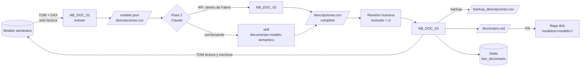

# Documentar un modelo semántico de Fabric con Claude

**En corto:** tres notebooks de Fabric y una skill de Claude que documentan un modelo semántico en cuatro pasos. El paso 1 lee la estructura y una muestra de los datos. En el paso 2 Claude redacta las descripciones. En el paso 3 se cargan en el modelo, y en el paso 4 se publica el diccionario. Todo corre dentro de Fabric: los datos se leen con `semantic-link` y TOM, los archivos quedan en un lakehouse y el diccionario se publica como Markdown y como tabla Delta. Nada se escribe en el modelo sin una revisión humana y un backup previo.

| Archivo | Paso | Qué hace | ¿Modifica el modelo? |
|---|---|---|---|
| [`notebooks/NB_DOC_01_extraer_modelo.ipynb`](notebooks/NB_DOC_01_extraer_modelo.ipynb) | 1 | Lee tablas, columnas, medidas y relaciones, más filas, nulos, cardinalidad y una muestra. Genera `modelo.json` y `descripciones.csv` | No |
| [`notebooks/NB_DOC_02_redactar_con_claude.ipynb`](notebooks/NB_DOC_02_redactar_con_claude.ipynb) | 2 (opcional) | Llama a la API de Claude, una tabla por llamada, y completa `descripciones.csv` | No |
| [`skill/documentar-modelo-semantico/`](skill/documentar-modelo-semantico/SKILL.md) | 2 | La misma tarea hecha conversando con Claude (Claude Code o claude.ai), con plantillas | No |
| [`notebooks/NB_DOC_03_cargar_y_publicar.ipynb`](notebooks/NB_DOC_03_cargar_y_publicar.ipynb) | 3 y 4 | Backup, carga de las descripciones aprobadas, `diccionario.md` y tabla Delta `doc_diccionario` | **Sí**, solo con `DRY_RUN = False` |

La skill sigue el formato de [`diccionario-datos`](https://github.com/estebanotero/Agentes/tree/main/ejemplos/skills/diccionario-datos) del repo Agentes. Le agrega ejemplo, nulos, clave, relación, medidas y el diagrama ER.

---

## 1. Flujo

Todo queda en el lakehouse por defecto, bajo `Files/doc_modelos/<modelo>/`.

## 2. Qué herramientas de Fabric usa, y por qué

Verifiqué en la documentación oficial qué se puede usar para leer y escribir un modelo semántico desde Fabric:

| Herramienta | Lee | Escribe descripciones | Dónde corre | Uso en el framework |
|---|---|---|---|---|
| [`semantic-link` (`sempy.fabric`)](https://learn.microsoft.com/en-us/fabric/data-science/read-write-power-bi-python) | Tablas, columnas, medidas, relaciones; datos con `evaluate_dax` y `read_table` | No | Notebook de Fabric (viene instalado) | Perfil y muestra con DAX |
| [`semantic-link-labs` (TOM)](https://github.com/microsoft/semantic-link-labs) | Todo el modelo vía XMLA | Sí, con `connect_semantic_model(readonly=False)` | Notebook de Fabric (`%pip install`) | Metadatos (paso 1) y carga (paso 3) |
| [Funciones DAX `INFO.VIEW.*`](https://learn.microsoft.com/en-us/dax/info-functions-dax) | Tablas, columnas, medidas, relaciones | No | Vista de consultas DAX, notebooks | Alternativa para revisar a mano desde el servicio |
| [Power BI Modeling MCP](https://github.com/microsoft/powerbi-modeling-mcp) | Todo el modelo | Sí | En tu PC, con un cliente MCP (VS Code, Claude Code) | Alternativa para el paso 2 sin notebooks (en Public Preview) |
| TMDL / PBIP en Git | Todo el modelo como archivos | Sí, editando archivos | Repo + integración Git de Fabric | Cuando el modelo ya se versiona como PBIP |

## 3. Opciones para el paso 2 (quién escribe las descripciones)

| Opción | Costo | Complejidad | Escala | Riesgo | Cuándo |
|---|---|---|---|---|---|
| **A. Notebooks + skill conversando con Claude (recomendada para empezar)** | Tu suscripción de Claude | Baja | Media (decenas de tablas) | Bajo: vos ves cada salida | Primeros modelos, para ajustar el criterio |
| B. Notebooks + `NB_DOC_02` con la API de Claude | Por token. [verificar precio vigente](https://www.anthropic.com/pricing) | Media: API key en Key Vault | Alta: muchos modelos o corrida programada | Medio: metadatos y ejemplos salen de Fabric hacia la API | Cuando el criterio ya está ajustado |
| C. Power BI Modeling MCP + Claude Code | Tu suscripción de Claude | Media: instalación local | Media | Medio: Claude puede escribir directo en el modelo, así que conviene usarlo con `--readonly` | Si ya trabajás con un cliente MCP en tu PC |

**Recomiendo empezar con A**, que es el mismo flujo que con Databricks: el notebook deja todo listo, Claude redacta con la skill y vos revisás. Cuando el resultado te convenza, pasá a B para automatizarlo. Las dos opciones terminan en el mismo `descripciones.csv` y en el mismo paso 3.

## 4. Requisitos y permisos

| Qué | Para qué paso | Dónde se configura |
|---|---|---|
| Capacidad Fabric o Premium con **endpoint XMLA**: lectura para los pasos 1 y 2, **lectura y escritura** para el paso 3 | 1, 3 | Admin portal > Capacity settings > Power BI workloads > XMLA Endpoint |
| Permiso **Build** o **Write** sobre el modelo (Contributor o más en el workspace) | 1, 3 | Workspace > Manage access |
| Lakehouse por defecto adjunto a los notebooks | 1, 2, 3 | Notebook > Lakehouses |
| Key Vault con la API key de Anthropic, y permiso de lectura del secreto para quien corre el notebook | Solo B | Azure Key Vault > Access policies o RBAC |

`list_columns`, `list_measures` y `list_relationships` de `sempy` piden permiso **ReadWrite** sobre el modelo, según su propia documentación. Por eso el paso 1 lee los metadatos con TOM en modo `readonly=True`. Si con Build te da error de permisos, pedí Write sobre el modelo [verificar el mínimo en tu tenant].

## 5. Cómo se usa

### Paso 1. Extraer (solo lectura)

1. Importá los tres notebooks en el workspace (**Import > Notebook**) y adjuntales un lakehouse.
2. En `NB_DOC_01`, completá `MODELO` y `WORKSPACE`, revisá `PATRONES_SENSIBLES` y corrélo.
3. Queda `Files/doc_modelos/<modelo>/modelo.json` y `descripciones.csv`. Si `descripciones.csv` ya existía, el notebook no lo pisa.

### Paso 2. Redactar

- **Opción A:** descargá `modelo.json` y `descripciones.csv` desde el lakehouse (botón derecho > Download) o con OneLake file explorer. Después pedile a Claude: *"Usá la skill documentar-modelo-semantico con estos archivos"*. Subí el CSV completo al mismo lugar.
- **Opción B:** en `NB_DOC_02`, completá `KEY_VAULT_URL`, `SECRETO_API_KEY` y `CONTEXTO_NEGOCIO`, y corrélo. Solo completa filas vacías, así que no pisa lo que ya revisaste.

En los dos casos, **revisá el CSV**: corregí lo necesario y poné `revisado = si` en lo aprobado. Lo que diga `[dato a confirmar]` no se carga.

### Paso 3. Cargar en el modelo (cambio con impacto)

1. Corré `NB_DOC_03` con `DRY_RUN = True`. Muestra el plan (objeto, antes y después) y guarda `backup_descripciones_<fecha>.csv`.
2. Si el plan está bien, cambiá a `DRY_RUN = False` y volvé a correrlo. Al terminar relee el modelo y valida que cada descripción haya quedado como se esperaba.
3. Por defecto no pisa descripciones que ya existen (`PISAR_EXISTENTES = False`).

### Paso 4. Publicar

`NB_DOC_03` también genera:

- `diccionario.md`, con un diagrama ER en Mermaid, tablas, columnas (tipo, descripción, ejemplo, nulos, clave, relación y sensibilidad) y medidas. Copialo a este repo en `modelos/<modelo>/diccionario.md` y subilo con un PR.
- La tabla Delta **`doc_diccionario`** en el lakehouse. Una fila por objeto, con el modelo como clave: cada corrida reemplaza solo las filas de ese modelo. Se puede consultar desde el SQL endpoint o armar un reporte de catálogo encima.

Las descripciones cargadas también se ven en Power BI como tooltip en el panel **Data**, y las usa Copilot para entender el modelo.

## 6. Cómo validar

| Prueba | Resultado esperado |
|---|---|
| Correr `NB_DOC_01` dos veces | El segundo `descripciones.csv` no pisa el primero |
| Columna con nombre tipo `Email` o `DNI` | En `modelo.json` aparece `sensible_sugerido: true` sin ejemplos, y en el diccionario el ejemplo es `-` |
| `NB_DOC_03` con `DRY_RUN = True` | Muestra el plan, guarda el backup y el modelo no cambia |
| `NB_DOC_03` con `DRY_RUN = False` | Imprime "Validación OK" y la descripción aparece como tooltip en Power BI |
| Fila con `[dato a confirmar]` y `revisado = si` | No se carga |
| Restaurar el backup (celda final de `NB_DOC_03`) | Las descripciones vuelven a como estaban |

Probalo primero con un modelo de desarrollo o con una copia del modelo.

## 7. Operación (mini runbook)

| Situación | Qué hacer |
|---|---|
| **El modelo se publica desde Power BI Desktop o PBIP** | La próxima publicación pisa las descripciones cargadas por XMLA. Llevalas al origen: si es PBIP/TMDL en Git, cargá las descripciones en los archivos `.tmdl`. Si es un `.pbix`, abrí el modelo y cargalas ahí, o descargá antes el modelo actualizado |
| No se puede descargar el `.pbix` después de cargar | Es una limitación conocida de los modelos modificados por XMLA. [verificar en la doc vigente](https://learn.microsoft.com/en-us/power-bi/service-export-to-pbix) antes de cargar en un modelo que la gente descarga |
| `connect_semantic_model` falla con un error de XMLA | Revisá que el XMLA de la capacidad esté en lectura y escritura y que tengas permiso Write sobre el modelo |
| Agregaron tablas o columnas | Corré `NB_DOC_01` y después borrá o renombrá el CSV viejo, o agregá las filas nuevas a mano. Las existentes se conservan si copiás sus descripciones |
| `COUNTBLANK` tarda mucho en un modelo grande | Poné `CALCULAR_NULOS = False` |
| Programarlo | Pipeline con `NB_DOC_01` y `NB_DOC_02` en la frecuencia que quieras. `NB_DOC_03` conviene correrlo a mano, porque necesita la revisión humana |

**Datos a confirmar en la documentación oficial**, porque cambian con el tiempo: nombres y ubicación de las opciones de XMLA en el Admin portal, la limitación de descarga de `.pbix` y el estado de preview del Power BI Modeling MCP.

## Próximos pasos

1. Correr `NB_DOC_01` sobre un modelo de desarrollo y revisar `modelo.json`.
2. Hacer el paso 2 con la skill (opción A) y ajustar el criterio de las descripciones.
3. Correr `NB_DOC_03` en `DRY_RUN` y después cargarlo.
4. Subir el primer `diccionario.md` a `modelos/<modelo>/` y decidir si se automatiza con la opción B.
5. Si el modelo va a ser fuente de un agente de datos, usar el diccionario para redactar sus instrucciones y las respuestas verificadas de *Prep data for AI* (ver [`Agente_Datos_Fabric`](../Agente_Datos_Fabric/README.md)).
