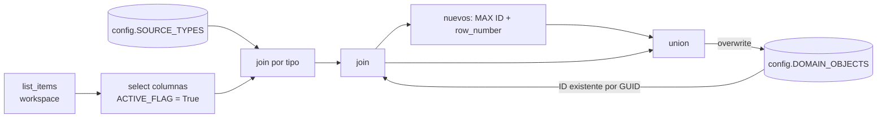
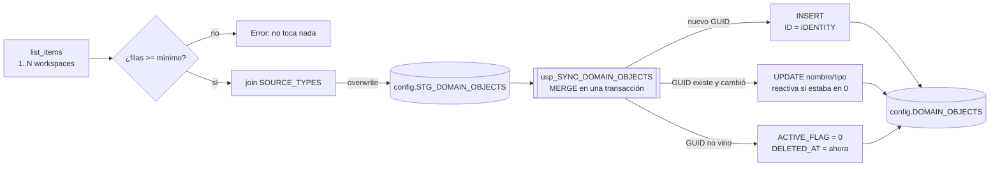

# Inventario de items de un workspace de Fabric en `config.DOMAIN_OBJECTS`

**En corto:** tu notebook actual arma bien el inventario, pero lo graba con `overwrite`, y eso trae dos problemas. El primero es que recrea la tabla, así que se pierden `IDENTITY`, la PK y los índices. El segundo es que los items borrados desaparecen de la tabla en vez de quedar marcados. La versión nueva graba en una tabla **staging** y después un **MERGE** en SQL hace las altas, los cambios y las bajas lógicas (`ACTIVE_FLAG = 0`). El ID numérico lo genera SQL con `IDENTITY` y nunca cambia.

| Archivo | Para qué |
|---|---|
| [`sql/01_ddl_domain_objects.sql`](sql/01_ddl_domain_objects.sql) | Backup, tabla nueva con IDENTITY y PK, migración conservando los ID, staging y el stored procedure de sincronización |
| [`NB_Workspace_inventory_v2.ipynb`](NB_Workspace_inventory_v2.ipynb) | Notebook nuevo: lee los items, graba la staging y llama al stored procedure |

---

## 1. Qué hace el notebook actual, celda por celda

| Celdas | Qué hace |
|---|---|
| 1 | `sempy.fabric.list_items("<nombre-del-workspace>")` trae los items del workspace como pandas y los pasa a Spark |
| 2 | Se queda con `WORKSPACE_ID`, `OBJECT_NAME`, `FABRIC_ITEM_GUID` y `ARTIFACT_TYPE`, y agrega `ACTIVE_FLAG = True` fijo |
| 4–5 | Arma la URL JDBC a la SQL database de Fabric y lee `config.SOURCE_TYPES` |
| 7–8 | Hace un left join por tipo para obtener `SOURCE_TYPE_ID` |
| 10–12 | Lee la tabla destino `config.DOMAIN_OBJECTS` y cruza por GUID para recuperar el `ID` de los items que ya existían |
| 13–14 | A los items nuevos (sin ID) les asigna `MAX(ID) + row_number()` |
| 16–17 | Une existentes y nuevos |
| 18 | **Pisa toda la tabla** con `mode("overwrite")` |

## 2. Problemas que encontré

| # | Problema | Consecuencia |
|---|---|---|
| 1 | `overwrite` recrea la tabla (DROP + CREATE con tipos de Spark) | Se pierden `IDENTITY`, PK, índices, defaults y permisos sobre la tabla. Las columnas quedan como `NVARCHAR(MAX)` |
| 2 | Los items borrados no están en el DataFrame final | Desaparecen de la tabla. No hay baja lógica ni historial, y si otra tabla referenciaba ese ID queda huérfana |
| 3 | `ACTIVE_FLAG` siempre es `True` | El flag no aporta información |
| 4 | Si la tabla tiene más de un workspace, el overwrite borra los otros | Pérdida de datos al sumar un segundo workspace |
| 5 | Si `list_items` falla o vuelve vacío, se graba la tabla vacía | Se borra todo el inventario |
| 6 | `MAX(ID) + row_number()` calculado en Spark | Funciona con una sola corrida a la vez, pero dos corridas en paralelo pueden generar ID repetidos |
| 7 | `trustServerCertificate=true` | No valida el certificado del servidor. Con `encrypt=true` y el `hostNameInCertificate` correcto se puede poner en `false` |
| 8 | `from pyspark.sql.functions import max` | Pisa el `max` de Python. Mejor `from pyspark.sql import functions as F` |

## 3. Opciones

| Opción | Costo | Complejidad | Robustez | Comentario |
|---|---|---|---|---|
| A. Seguir con Spark y `overwrite`, agregando las bajas en el DataFrame | Igual | Baja | Baja | Sigue perdiendo PK e IDENTITY en cada corrida |
| **B. Staging + `MERGE` en un stored procedure (recomendada)** | Igual | Media | Alta | El ID lo da SQL, la tabla no se recrea y es transaccional |
| C. Delta en un Lakehouse con `MERGE` de Delta, y después copiar a SQL | Un poco más | Alta | Alta | Tiene sentido si después querés historial (SCD2) en el lakehouse |

**Recomiendo B.** La lógica de altas y bajas queda en un solo lugar (SQL), es atómica, y Spark solo transporta datos.

## 4. Cómo queda

Tabla final:

| Columna | Tipo | Nota |
|---|---|---|
| `ID` | `INT IDENTITY` PK | Estable, nunca se reutiliza |
| `FABRIC_ITEM_GUID` | `VARCHAR(36)` UNIQUE | Clave natural para el MERGE |
| `WORKSPACE_ID`, `OBJECT_NAME`, `ARTIFACT_TYPE`, `SOURCE_TYPE_ID` | | Igual que hoy |
| `ACTIVE_FLAG` | `BIT` | 1 = existe, 0 = borrado en Fabric |
| `CREATED_AT`, `UPDATED_AT`, `LAST_SEEN_AT`, `DELETED_AT` | `DATETIME2` UTC | Auditoría |

Reglas del MERGE:

- **Alta**: un GUID nuevo se inserta y SQL le asigna el ID.
- **Cambio**: si cambia el nombre, el tipo o el workspace se actualiza, y si estaba dado de baja y volvió, se reactiva.
- **Baja**: un GUID que ya no viene pasa a `ACTIVE_FLAG = 0`, pero **solo en los workspaces que se inventariaron en esa corrida**.
- **Guardia**: si la staging tiene menos filas que `@MinRowsExpected`, el SP falla sin tocar nada.

## 5. Pasos para implementarlo

1. En **DES**, corré [`sql/01_ddl_domain_objects.sql`](sql/01_ddl_domain_objects.sql) hasta el PASO 3 (backup, staging, tabla nueva y copia). Nada de eso modifica la tabla actual.
2. Revisá que `config.DOMAIN_OBJECTS_NEW` tenga la misma cantidad de filas y los mismos ID que la actual.
3. **PASO 4 (cambio con impacto)**: el `sp_rename` reemplaza la tabla vieja por la nueva. Antes de correrlo, revisá si hay FK, vistas o reportes que apunten a `config.DOMAIN_OBJECTS`. Para volver atrás, renombrá al revés o restaurá desde `DOMAIN_OBJECTS_BKP_20261022`.
4. Corré el PASO 5 (el stored procedure).
5. Importá `NB_Workspace_inventory_v2.ipynb` en Fabric, completá `SQL_SERVER` y `SQL_DATABASE` (los sacás de **Settings > Connection strings** de la SQL database), ajustá `WORKSPACES` y corrélo.

## 6. Cómo validar

- La última celda del notebook compara los activos de la tabla con lo que devolvió `list_items`. Tienen que quedar 0 faltantes y 0 sobrantes.
- **Prueba de alta**: creá un item de prueba en el workspace, corré el notebook y tiene que aparecer con un ID nuevo.
- **Prueba de baja**: borrá ese item, volvé a correr, y tiene que quedar con `ACTIVE_FLAG = 0` y `DELETED_AT` cargado, **con el mismo ID**.
- **Prueba de la guardia**: poné un nombre de workspace inexistente y el notebook tiene que fallar sin tocar la tabla.

## 7. Operación (mini runbook)

| Situación | Qué hacer |
|---|---|
| Programar | Usá un schedule del notebook o un Data Pipeline (Notebook + Stored procedure activity). Una vez por día suele alcanzar |
| Falla la celda del token | La audiencia de `getToken` está marcada como **[verificar]**. Probá `https://database.windows.net/.default`, o pasá la llamada al SP a una actividad Stored procedure del pipeline |
| Aparecen tipos sin `SOURCE_TYPE_ID` | El notebook los lista. Agregalos a `config.SOURCE_TYPES` y en la próxima corrida se completan |
| Un item se movió de workspace | Fabric mantiene el GUID, así que se actualiza `WORKSPACE_ID` y conserva su ID |
| Permisos | La identidad que corre el notebook necesita ver el workspace (Viewer o más) y en la base: `SELECT` sobre `config`, `INSERT/UPDATE/ALTER` sobre la staging y `EXECUTE` sobre el SP. No hace falta `db_owner` |

> Datos a confirmar en la documentación oficial, porque cambian con el tiempo: la audiencia del token para SQL database en Fabric y el comportamiento exacto de `mode("overwrite")` del conector Spark de Fabric (si hace DROP o TRUNCATE). En la staging da igual cuál de los dos haga.

## Próximos pasos

1. Correr el script hasta el PASO 3 en DES y comparar las tablas.
2. Confirmar el swap del PASO 4.
3. Probar el notebook v2 con un item de prueba (alta y baja).
4. Programarlo en un pipeline diario.
