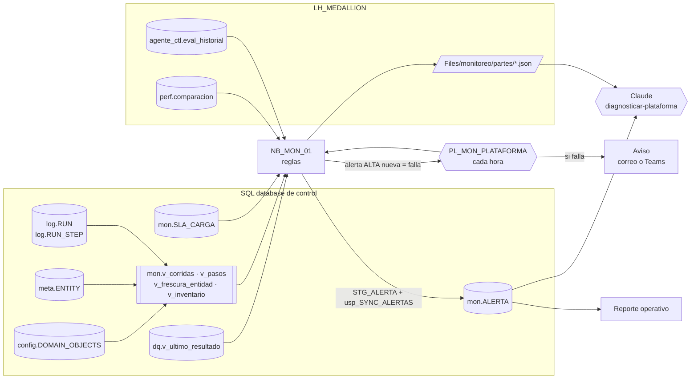

# Monitoreo de la plataforma

**En corto:** cada caso de BIA deja su estado en un lugar distinto. El pipeline medallion usa `log.RUN` y `log.RUN_STEP`, el agente `agente_ctl.eval_historial`, performance `perf.comparacion` y el inventario `config.DOMAIN_OBJECTS`. Hoy solo se avisa cuando un pipeline falla, así que no hay aviso si una carga nunca arrancó, si gold no está a la hora que lo necesita el negocio o si el agente en producción empeoró. Este framework junta todo en un esquema `mon` de la misma base de control. Un notebook aplica reglas fijas cada hora y abre o cierra alertas solo. El pipeline que lo programa avisa por un único canal cuando aparece una alerta grave. Claude, con la skill [`diagnosticar-plataforma`](skill/diagnosticar-plataforma/SKILL.md), convierte las alertas en un parte diario: causa raíz, si se puede reintentar y a quién avisar.

| Archivo | Qué es | ¿Escribe? |
|---|---|---|
| [`sql/01_ddl_monitoreo.sql`](sql/01_ddl_monitoreo.sql) | Esquema `mon`: SLA por grupo de carga, alertas, staging, `mon.usp_SYNC_ALERTAS` y vistas `mon.v_*` | Crea objetos en `mon` |
| [`notebooks/NB_MON_01_evaluar_alertas.ipynb`](notebooks/NB_MON_01_evaluar_alertas.ipynb) | Lee las fuentes, aplica las reglas, sincroniza `mon.ALERTA` y deja el parte JSON | Solo en `mon.*` y `Files/monitoreo/` |
| [`skill/diagnosticar-plataforma/`](skill/diagnosticar-plataforma/SKILL.md) | Skill de Claude: parte diario con causas raíz, reintentos y ajustes de umbrales | No: genera un informe |
| [`pruebas/prueba_local.py`](pruebas/prueba_local.py) | Prueba las reglas del notebook con situaciones armadas a mano | No |

---

## 1. Cómo funciona

- **Una sola base de control.** `mon` es un esquema más de `DB_TDM_Platform`, igual que `config`, `meta` y `log` (ver [convenciones 1.5](../docs/convenciones.md#15-una-sola-base-de-control)). Las alertas quedan junto a lo que describen y el reporte tiene una sola fuente.
- **Las alertas se abren y se cierran solas.** Cada alerta tiene una `CLAVE` estable (`MDP_PASO_FALLIDO|silver.erp_clientes`). Mientras la regla se siga cumpliendo, se actualiza la misma fila (`VECES`, `ULTIMA_VEZ_AT`). Cuando deja de cumplirse se cierra (`RESUELTA_AT`), y si vuelve se abre otra fila. Así queda la historia: cuánto tardó en resolverse cada problema.
- **Solo se cierran alertas de lo que se evaluó.** Si la tabla del agente no existe todavía, o falla su lectura, sus alertas abiertas no se tocan.
- **Se avisa una sola vez.** El notebook termina con error solo cuando aparece una alerta `ALTA` **nueva**. La misma alerta abierta en la corrida siguiente no vuelve a hacer fallar el pipeline.

## 2. Reglas

Están en la celda `# --- funciones` del notebook. Los umbrales se cambian con el parámetro `UMBRALES` sin tocar el código.

| Código | Origen | Severidad | Cuándo | Umbral por defecto |
|---|---|---|---|---|
| `MDP_PASO_FALLIDO` | Pipeline medallion | ALTA | El último paso de una capa y entidad en la ventana es `FAILED`. Si después volvió a correr bien, no alerta | `ventana_horas` = 24 |
| `MDP_CORRIDA_COLGADA` | Pipeline medallion | ALTA | Corrida en `RUNNING` hace más del máximo | `MAX_DURACION_MIN` del SLA del grupo, o `max_duracion_min` = 180 |
| `MDP_SLA_INCUMPLIDO` | Pipeline medallion | ALTA | Pasó la hora límite de un grupo y no hay corrida exitosa hoy | `mon.SLA_CARGA` |
| `MDP_SLA_TARDE` | Pipeline medallion | MEDIA | Terminó bien, pero después de la hora límite | `mon.SLA_CARGA` |
| `MDP_RECHAZOS_ALTOS` | Pipeline medallion | MEDIA | La última carga de silver rechazó por calidad más que el umbral | `max_pct_rechazo` = 5 % |
| `MDP_VOLUMEN_ANOMALO` | Pipeline medallion | BAJA | La última carga de silver escribió menos de la mitad o más del triple de la mediana de las anteriores | `volumen_min_ratio` = 0,5 · `volumen_max_ratio` = 3 · `volumen_min_historia` = 5 |
| `MDP_ENTIDAD_SIN_DATOS` | Pipeline medallion | MEDIA | Entidad activa que no trae filas a silver hace días, o nunca | `dias_sin_datos` = 3 |
| `INV_ITEMS_BORRADOS` | Inventario | MEDIA | Items que dejaron de existir en un workspace dentro de la ventana | `ventana_horas` = 24 |
| `INV_SIN_CORRER` | Inventario | BAJA | `NB_INV_01` no actualiza el inventario hace días | `dias_inventario` = 2 |
| `AGT_NO_APRUEBA` | Agente | ALTA en `production`, MEDIA en `sandbox` | La última evaluación de un agente no aprueba | Los umbrales de `NB_AGT_03` |
| `AGT_SIN_EVALUAR` | Agente | BAJA | La última evaluación es vieja | `dias_sin_evaluar_agente` = 7 |
| `PERF_REGRESION` | Performance | MEDIA | La última comparación de un modelo tiene consultas en `regresion` o `resultado_distinto` | Los umbrales de `NB_PERF_03` |
| `CAL_REGLA_FALLA` | Calidad | ALTA si la regla es `ERROR`, MEDIA si es `WARN` | El último resultado de una regla de `dq.REGLA` es `FALLA` | Las tolerancias de cada regla ([Calidad_Reconciliacion](../Calidad_Reconciliacion/README.md)) |
| `CAL_REGLA_ERROR_EJECUCION` | Calidad | MEDIA | La regla no se pudo ejecutar (tabla que no existe, SQL roto) | — |

Los umbrales de volumen y de entidad sin datos son orientativos: conviene ajustarlos después de dos o tres semanas de historia real [dato a confirmar].

## 3. Opciones para avisar

| Opción | Cómo | A favor | En contra |
|---|---|---|---|
| **A. Pipeline que falla + actividad de aviso (recomendada)** | `PL_MON_PLATAFORMA` programado cada hora: actividad **Notebook** con `NB_MON_01` y, en la salida *On fail*, una actividad **Office 365 Outlook** o **Teams** [verificar disponibilidad y estado de preview de cada actividad en tu tenant] | Simple, todo en Fabric, un solo canal. Avisa solo lo nuevo y grave | El mensaje es el error del notebook: texto plano |
| B. Alertas de falla del schedule | Notificación de falla en la programación del pipeline o del notebook [verificar opciones vigentes] | Sin actividades extra | Menos control del destinatario y del texto |
| C. Activator sobre `mon.ALERTA` | Regla de Activator sobre el reporte operativo o un origen de datos [verificar qué orígenes admite hoy] | Avisos por condición, sin código | Otra pieza más que mantener; conviene cuando haya muchas reglas de negocio |

Con la A, el pipeline también falla si el notebook no puede leer la base o el lakehouse: ese aviso cubre que el monitoreo mismo esté caído.

## 4. Requisitos

| Qué | Para qué |
|---|---|
| Base de control con `log.*` y `meta.*` ([`01_ddl_control.sql`](../Pipeline_Metadata_Medallion/sql/01_ddl_control.sql)) | Vistas de corridas, pasos y frescura |
| `config.DOMAIN_OBJECTS` ([Inventario](../Inventario_Workspace/README.md)) | Opcional: reglas `INV_*`. Si no existe, la vista no se crea y el origen no se evalúa |
| `LH_MEDALLION` como lakehouse por defecto del notebook | Leer `agente_ctl.*` y `perf.*` (opcionales) y escribir `Files/monitoreo/partes/` |
| Identidad que corre el pipeline | `SELECT` en `log`, `meta`, `config`; escritura en `mon`; `EXECUTE` en `mon.usp_SYNC_ALERTAS` (ver los `GRANT` del script). Lectura del lakehouse |
| Canal de aviso | Un buzón o canal de Teams del equipo de operación, no una persona |

## 5. Pasos

1. **Base de control (escritura, sin impacto en otros casos).** Corré `sql/01_ddl_monitoreo.sql` en DES. En un repo de implementación armado con [Despliegue_Entre_Ambientes](../Despliegue_Entre_Ambientes/README.md), copialo como migración `sql/NNN_ddl_monitoreo.sql` con `-- repetible` en la primera línea: es idempotente.
2. **SLA.** Cargá una fila por `LOAD_GROUP` en `mon.SLA_CARGA`, con la hora **en UTC**. Por ejemplo, Argentina es UTC-3, así que las 07:00 se cargan como `'10:00'`. Sin filas no hay reglas de SLA, pero el resto funciona.
3. **Notebook.** Importá `NB_MON_01`, completá `SQL_SERVER` y `SQL_DATABASE` y corrélo una vez con `DRY_RUN = True`. Revisá que las alertas que muestra tengan sentido.
4. **Primera corrida real.** Con `DRY_RUN = False`. Revisá `mon.v_alertas_abiertas` y el JSON en `Files/monitoreo/partes/`.
5. **Pipeline.** `PL_MON_PLATAFORMA` con la actividad Notebook, la de aviso en *On fail* y un schedule cada hora. Si el pipeline medallion corre una vez por día, también sirve programarlo 15 minutos después de cada hora límite del SLA.
6. **Parte diario.** Pasale a Claude el último JSON de `Files/monitoreo/partes/` con la skill `diagnosticar-plataforma`.
7. **Reporte operativo** (siguiente paso, no está en este PR): un reporte sobre el SQL analytics endpoint de la base de control con tres páginas. *Hoy* muestra las alertas abiertas por severidad y el estado del SLA por grupo. *Corridas* muestra la duración, las filas y los fallos por día desde `mon.v_corridas`. *Historia* muestra el tiempo hasta resolver cada alerta (`DETECTADA_AT` a `RESUELTA_AT`).

## 6. Cómo validar

| Prueba | Resultado esperado |
|---|---|
| [`pruebas/prueba_local.py`](pruebas/prueba_local.py) | `Todo OK`: cada regla con su caso positivo y negativo, plataforma sana sin alertas y orígenes evaluados según las fuentes disponibles |
| `DRY_RUN = True` en DES | Las alertas que muestra coinciden con lo que ves en `log.RUN_STEP` |
| Forzar una falla: una entidad de prueba con `SOURCE_OBJECT` inexistente | `MDP_PASO_FALLIDO` abierta, el pipeline de monitoreo falla una vez y avisa. Al corregir y recargar, la alerta queda con `RESUELTA_AT` |
| Correr `NB_MON_01` dos veces seguidas | La segunda no falla ni duplica filas: `VECES` = 2 en las mismas alertas |

**Qué está probado y qué no.** Las reglas se probaron localmente con pandas (`prueba_local.py`, también en el CI de BIA). **No están probados** en Fabric real el script SQL (T-SQL escrito para SQL database / Azure SQL, sin ejecutar), el conector JDBC, el token de la base, las actividades de aviso ni el rendimiento con mucha historia en `log.RUN_STEP`. Probalo primero en un workspace de desarrollo.

## 7. Operación (mini runbook)

| Situación | Qué hacer |
|---|---|
| Llegó un aviso | Abrí `mon.v_alertas_abiertas` o pedile el parte a Claude. Arreglá la causa raíz: las alertas se cierran solas en la próxima corrida |
| Una alerta se repite y nadie la atiende | Es ruido. Ajustá el umbral en `UMBRALES` o el SLA. Cambiar o borrar un SLA es un **cambio con impacto**: deja de avisar, así que anotá el valor anterior |
| El monitoreo falla todas las horas | Probablemente no lee la base (token, permisos) o falta una vista. Corré el notebook a mano y mirá la primera celda que falla |
| Hay que cerrar una alerta a mano | `UPDATE mon.ALERTA SET RESUELTA_AT = SYSUTCDATETIME() WHERE ALERTA_ID = <id>`. Si la regla se sigue cumpliendo, la próxima corrida la vuelve a abrir |
| `mon.ALERTA` crece mucho | Borrá las resueltas de más de un año después de exportarlas. Es un **cambio con impacto**: se pierde la historia |
| Se suma un caso nuevo con su propio log | Agregá una función `alertas_<caso>` en la celda de funciones, su fuente en `evaluar()`, una prueba en `prueba_local.py` y el origen en la tabla de reglas |

## Próximos pasos

1. Correr `01_ddl_monitoreo.sql` en DES y cargar los SLA reales de cada `LOAD_GROUP` [dato a confirmar: horarios que necesita el negocio].
2. Hacer la primera corrida con `DRY_RUN = True` y ajustar umbrales.
3. Armar `PL_MON_PLATAFORMA` con el aviso y sumarlo al repo de la implementación (`TDM_Platform`).
4. Construir el reporte operativo sobre `mon.*`.
5. Más adelante: sumar `log.MIGRACION` del despliegue (migraciones fallidas) y el consumo de capacidad cuando exista el framework de costos.
