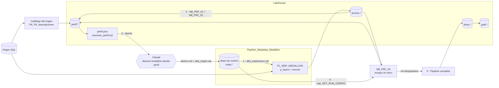

# Perfilar una base de origen para diseñar silver y gold, con Claude

**En corto:** antes de diseñar silver y gold hay que conocer el origen con **datos**, no con supuestos: qué columna es la clave, qué tipo tiene de verdad un campo de texto, cuántos nulos hay, qué tablas se relacionan aunque nadie haya declarado la FK y dónde hay datos personales. Tres notebooks perfilan las tablas de origen ya copiadas a bronze y dejan ese **perfil** en el lakehouse y en un `perfil.json`. Con la skill [`disenar-medallion-desde-perfil`](skill/disenar-medallion-desde-perfil/SKILL.md), Claude convierte el perfil en el diseño de silver y gold y en la **metadata** del caso [Pipeline metadata-driven medallion](../Pipeline_Metadata_Medallion/README.md): entidades, columnas, tipos, PII, reglas de calidad y objetos gold. Un último notebook prueba esa metadata contra los datos antes de cargarla.

| Archivo | Qué es | ¿Escribe datos? |
|---|---|---|
| [`sql/01_catalogo_origen.sql`](sql/01_catalogo_origen.sql) | Catálogo de un SQL Server: tipos, PK, FK, filas y descripciones declaradas | No: solo lee vistas de sistema del origen |
| [`notebooks/NB_PRF_01_perfilar.ipynb`](notebooks/NB_PRF_01_perfilar.ipynb) | Perfil por tabla y columna: nulos, distintos, patrones, tipos sugeridos, rangos, dominios, PII, claves candidatas | Solo en el esquema `perfil` y en `Files/perfil/` |
| [`notebooks/NB_PRF_02_relaciones.ipynb`](notebooks/NB_PRF_02_relaciones.ipynb) | Relaciones implícitas por inclusión de valores, FK declaradas con huérfanos, rol de cada tabla y `resumen_perfil.md` con diagrama | Solo en `perfil.relacion` y en `Files/perfil/` |
| [`notebooks/NB_PRF_03_validar_propuesta.ipynb`](notebooks/NB_PRF_03_validar_propuesta.ipynb) | Ensayo en seco de la metadata propuesta sobre bronze: tipos que pierden valores, reglas que fallarían, clave, PII | Solo en `perfil.validacion` y en `Files/perfil/` |
| [`sql/02_consultas_perfil.sql`](sql/02_consultas_perfil.sql) | Consultas de Spark SQL sobre el perfil: resumen, PII, huérfanos, **cambios entre corridas** | No |
| [`skill/disenar-medallion-desde-perfil/`](skill/disenar-medallion-desde-perfil/SKILL.md) | Skill de Claude: carga exploratoria, diseño de silver y gold, revisión de la validación, cambios del origen | No: genera documentos y scripts para revisar |
| [`pruebas/prueba_local.py`](pruebas/prueba_local.py) | Prueba de los tres notebooks con Spark y Delta en tu PC, sin Fabric | Solo en una carpeta local |

---

## 1. Cómo funciona

| Paso | Qué pasa | Quién | ¿Cambia algo? |
|---|---|---|---|
| 1. Carga exploratoria | Las tablas a perfilar se dan de alta como entidades mínimas (`FULL`, sin columnas, `LOAD_GROUP = 'exploracion'`) y el pipeline las copia **solo a bronze** | Claude genera el script, vos lo corrés en desarrollo | Sí: filas en `meta.ENTITY` y tablas en bronze |
| 2. Perfil | `NB_PRF_01` y `NB_PRF_02` sobre la última copia de bronze, más el catálogo si lo tenés | Notebooks | Solo `perfil.*` |
| 3. Diseño | Claude lee `perfil.json` y entrega `diseno_<origen>.md` y `alta_<origen>.sql` | Claude, con revisión humana | No |
| 4. Validación | Se carga `alta_<origen>.sql` en la base de control de **desarrollo** y `NB_PRF_03` lo prueba contra bronze | Vos + notebook | Solo `perfil.validacion` |
| 5. Carga | Primera corrida completa del pipeline (`bronze,silver,gold`) en desarrollo | Pipeline | Sí: silver y gold |
| 6. Seguimiento | Se vuelve a perfilar cada tanto y la consulta 5 de `02_consultas_perfil.sql` muestra qué cambió en el origen | Notebooks + Claude | Solo `perfil.*` |

## 2. Qué mide el perfil, y para qué decisión

| Métrica (`perfil.columna`) | Cómo se calcula | Decisión que alimenta |
|---|---|---|
| `nulos`, `vacios`, `con_espacios` | Conteo exacto (sobre la muestra si la tabla es grande) | Reglas `IS NOT NULL`, `trim` |
| `distintos`, `es_unica` | `approx_count_distinct` y, para las candidatas a clave, `countDistinct` exacto sobre **toda** la copia | `PRIMARY_KEY`, `SILVER_MODE` |
| Claves candidatas (`perfil.clave_candidata`) | Simples; si no hay, pares y ternas de las columnas sin nulos de más cardinalidad; más la PK declarada. Se ordenan y se marca la `preferida` (declarada > entero con nombre de clave > resto) | `PRIMARY_KEY` |
| `patrones` | Proporción de valores de texto que cumplen: entero, decimal con punto, decimal con coma y miles con punto, fecha ISO, fecha con barra, timestamp, booleano, email, CUIT/CUIL, CBU | `TARGET_TYPE`, `TRANSFORM_EXPR`, PII |
| `tipo_sugerido`, `transform_sugerida` | Reglas sobre los patrones (umbral `UMBRAL_TIPO = 99,5 %`). Distingue `dd/MM` de `MM/dd` mirando qué parte pasa de 12, y deja como texto los códigos con ceros a la izquierda | `TARGET_TYPE`, `TRANSFORM_EXPR` |
| `min`, `max`, `p01`, `p99`, `negativos`, `ceros`, `futuras`, `antiguas` | Agregados en la misma pasada | Reglas `DROP` / `WARN` de rango |
| `dominio`, `top_valores` | Valores más frecuentes; el dominio completo si tiene hasta `MAX_DOMINIO` valores. **No se guardan para PII** | Reglas `IN (...)`, normalización |
| Nota de variantes | `distintos` vs. distintos de `upper(trim())` | `upper(trim(...))` |
| `pii`, `pii_motivo` | Por contenido (≥ 80 % emails, CUIT/CUIL, CBU) o por nombre (la misma lista que `NB_DOC_01`). Un CUIT solo de empresas (30/33/34) no se marca | `IS_PII`, qué queda fuera de gold |
| `candidata_watermark`, `candidata_baja_logica` | Fecha sin nulos con nombre de modificación; columna tipo `Anulada`/`Activo` con pocos valores | `LOAD_TYPE`, `WATERMARK_COLUMN`, `SOURCE_FILTER` |
| Relaciones (`perfil.relacion`) | Para cada clave preferida, las columnas de otras tablas con tipo compatible y nombre parecido; mide la **inclusión** (valores del hijo que existen en el padre) y las filas huérfanas | Modelo estrella de gold, `LEFT JOIN` y miembro desconocido |
| `rol_sugerido` (en `perfil.json`) | Dimensión si otras tablas apuntan a ella; hecho si apunta a varias y tiene medidas y fecha | Hechos y dimensiones de gold |

Todos los umbrales son parámetros de los notebooks. Las reglas para pasar de cada señal a la metadata están en [`reglas_perfil_a_metadata.md`](skill/disenar-medallion-desde-perfil/reglas_perfil_a_metadata.md).

## 3. Decisiones de diseño y alternativas

### 3.1. Dónde perfilar

| Opción | Carga sobre el origen | Complejidad | Credenciales | Comentario |
|---|---|---|---|---|
| A. Consultas de perfil contra el origen (JDBC desde Spark o T-SQL) | **Alta**: un `COUNT(DISTINCT)` por columna en el ERP de producción | Media | Hacen falta en el notebook | Lo más directo, pero castiga al sistema transaccional y obliga a manejar usuario y clave en Spark |
| **B. Sobre bronze, después de una copia exploratoria (recomendada)** | Una sola lectura completa, con la Copy y la conexión que ya usa el pipeline | Baja | Ninguna nueva: la conexión de Fabric | El perfil mide exactamente lo que va a leer silver (nombres saneados, tipos de Parquet, CSV como texto) |
| C. Herramientas de perfil de terceros o de Fabric (Data Wrangler, Purview data quality, ydata-profiling) | Depende | Baja para mirar, alta para automatizar | Depende | Buenas para explorar una tabla a mano. No dejan el perfil en un formato que alimente la metadata ni el seguimiento de cambios. Verificá alcance y costo en la documentación vigente |

**Recomiendo B.** Reusa el pipeline, no suma credenciales y la copia exploratoria no se tira: es la primera historia de bronze. El catálogo del origen (opcional) es una consulta liviana a vistas de sistema que no lee datos.

### 3.2. Dónde guardar el perfil

| Opción | Pros | Contras |
|---|---|---|
| **Delta en el esquema `perfil` del lakehouse + `perfil.json` (recomendada)** | Se escribe desde Spark sin drivers; historia por `corrida_id` para comparar; el JSON es lo que lee Claude | Una tabla más por cada concepto |
| Tablas en la base de control (`meta.*`) | Todo junto | Los notebooks tendrían que conectarse a la SQL database, algo que el caso medallion evita a propósito |

### 3.3. Quién convierte el perfil en metadata

| Opción | Calidad | Control | Cuándo |
|---|---|---|---|
| Reglas fijas en código (perfil → SQL automático) | Pareja, sin criterio de negocio | Alto | Orígenes muy simples |
| **Claude con la skill (recomendada)** | Decide con contexto (devoluciones con cantidad negativa, CUIT de empresas) y explica cada decisión con evidencia | Revisión humana + `NB_PRF_03` | Lo habitual |
| A mano con el resumen | La que tenga la persona | Alto | Una o dos tablas |

La skill no reemplaza la revisión: la acelera y deja escrito por qué se decidió cada cosa. `NB_PRF_03` agrega el control objetivo.

### 3.4. Otras decisiones

- **Se perfila la última copia de bronze** (`SOLO_ULTIMA_CORRIDA = True`): bronze es append y con cargas `FULL` tiene una copia completa por corrida.
- **Las tablas grandes se muestrean** (`MAX_FILAS_PERFIL`) para las distribuciones, pero el conteo de filas y la verificación de claves son sobre la copia completa: una clave no se puede confirmar con una muestra.
- **Los patrones se miden con expresiones regulares, no parseando**: no hay excepciones de parseo de fechas y es una sola pasada. La conversión real la prueba `NB_PRF_03` con la misma lógica que `NB_MDP_20_silver`.
- **`NB_PRF_03` recibe el mismo `CONFIG_JSON` que el orquestador**: se valida lo que va a correr, no una copia de la propuesta.
- **Sin valores de PII fuera de bronze**: el perfil no guarda ejemplos, mínimos ni máximos de las columnas que parecen PII, ni ejemplos de huérfanos de esas columnas.

## 4. Cómo encaja con los otros casos

| Caso | Qué toma de este | Qué le da a este |
|---|---|---|
| [Pipeline_Metadata_Medallion](../Pipeline_Metadata_Medallion/README.md) | `alta_<origen>.sql` con entidades, columnas, PII, reglas de `meta.DQ_RULE` y objetos de `meta.GOLD_OBJECT` decididos con datos | La copia exploratoria a bronze, la convención de nombres de bronze y el `CONFIG_JSON` que valida `NB_PRF_03` |
| [Documentar_Modelo_Semantico](../Documentar_Modelo_Semantico/README.md) | Las descripciones del origen (`descripcion_origen`) y el `diseno_<origen>.md` como contexto para el diccionario | La misma lista de patrones sensibles, en [`Comun/patrones_sensibles.json`](../Comun/README.md) |
| [Performance_Modelo_Semantico](../Performance_Modelo_Semantico/README.md) | Gold nace con claves enteras y sin texto de alta cardinalidad en los hechos: lo que más pesa en Vertipaq | — |
| [Agente_Datos_Fabric](../Agente_Datos_Fabric/README.md) | Gold con nombres de negocio y sin PII, base de las vistas `agente.*` | — |

## 5. Requisitos y permisos

| Qué | Para qué | Dónde |
|---|---|---|
| El caso [Pipeline_Metadata_Medallion](../Pipeline_Metadata_Medallion/README.md) armado en desarrollo (base de control, lakehouse, pipeline) | Copia exploratoria y destino de la metadata | Ver su README |
| Rol **Contributor** en el workspace | Crear el esquema `perfil` y correr notebooks | Workspace > Manage access |
| Lakehouse con esquemas como **default** de los tres notebooks | Leer bronze y escribir `perfil.*` | Notebook > Lakehouses |
| Opcional: `VIEW DEFINITION` y `VIEW DATABASE STATE` en el origen | `sql/01_catalogo_origen.sql` | DBA del origen |
| Claude con la skill instalada | Paso 3 | Copiar la carpeta de la skill a `.claude/skills/` o subirla en claude.ai |

## 6. Cómo se usa

### Paso 1. Carga exploratoria (cambio en desarrollo)

1. Opcional pero recomendado: corré [`sql/01_catalogo_origen.sql`](sql/01_catalogo_origen.sql) contra el origen y dejá el resultado en `Files/perfil/<origen>/catalogo/` (Copy a Parquet o CSV exportado). Si la Copy no acepta el `DECLARE` del script, sacá el filtro de esquemas y dejá solo el `SELECT` `[dato a confirmar en tu versión de Fabric]`.
2. Pedile a Claude: *"Con la skill disenar-medallion-desde-perfil, prepará la carga exploratoria de estas tablas"* y pasale el catálogo o la lista. Devuelve un script con [`alta_exploracion.sql`](skill/disenar-medallion-desde-perfil/plantillas/alta_exploracion.sql).
3. Revisalo y corrélo en la base de control de desarrollo. `meta.usp_VALIDATE_METADATA` tiene que devolver cero filas.
4. Corré `PL_MDP_MEDALLION` con `p_load_group = exploracion` y `p_layers = bronze`.

### Paso 2. Perfil (solo lectura de bronze)

1. Importá los tres notebooks y adjuntales el lakehouse como default.
2. `NB_PRF_01_perfilar`: `ORIGEN`, `TABLAS` (por ejemplo `bronze.erp_*`), `PREFIJO_BRONZE` y `CATALOGO` si lo tenés.
3. `NB_PRF_02_relaciones`: `ORIGEN` (toma la última corrida).
4. Leé `resumen_perfil.md`: es la foto del origen en una página.

### Paso 3. Diseño con Claude

Pasale `perfil.json` y lo que necesita el negocio: *"Usá la skill disenar-medallion-desde-perfil para diseñar silver y gold de este origen. Gold tiene que responder ventas por cliente, producto y mes."* Entrega:

- `diseno_<origen>.md`: decisiones con su evidencia, modelo estrella en Mermaid, PII y la lista de `[dato a confirmar]`.
- `alta_<origen>.sql`: metadata con la plantilla de `metadata-medallion`, idempotente, que actualiza las entidades exploratorias.

Respondé los `[dato a confirmar]` y pedile la versión corregida.

### Paso 4. Validación (ensayo en seco)

1. Corré `alta_<origen>.sql` en la base de control **de desarrollo** y `EXEC meta.usp_VALIDATE_METADATA`.
2. `EXEC meta.usp_GET_RUN_CONFIG 'default', 'validacion'` y copiá la columna `CONFIG_JSON`.
3. `NB_PRF_03_validar_propuesta` con ese JSON en `config_json`.
4. Si hay `BLOQUEANTE`, pasale `validacion.md` a Claude (tarea C de la skill), corregí y repetí. Las `ADVERTENCIA` se leen una por una: algunas son decisiones conscientes.

### Paso 5. Primera carga

`PL_MDP_MEDALLION` con `p_load_group = default` y `p_layers = bronze,silver,gold`, en desarrollo. Revisá `log.RUN_STEP` con las consultas del caso medallion. Recién después, producción.

### Paso 6. Seguimiento

Volvé a correr el paso 2 una vez por mes (o antes de cada cambio grande del origen) y la consulta 5 de [`02_consultas_perfil.sql`](sql/02_consultas_perfil.sql). Si cambió algo, pedile a Claude la tarea D de la skill.

## 7. Dónde entra Claude

| Tarea | Pedido | Entrega |
|---|---|---|
| Carga exploratoria | *"Prepará la carga exploratoria de estas tablas"* + catálogo | Script `alta_exploracion` con filtros para tablas grandes |
| Diseño de silver y gold | *"Diseñá silver y gold con este perfil"* + `perfil.json` + necesidad del negocio | `diseno_<origen>.md` + `alta_<origen>.sql` |
| Revisar la validación | *"Revisá esta validación"* + `validacion.md` | Script corregido y qué decisión cambió |
| Cambios del origen | *"¿Qué cambió en el origen?"* + consulta 5 | Cambios de metadata y si hace falta reprocesar |
| Documentar | Skill `documentar-modelo-semantico` sobre el modelo de gold, con `diseno_<origen>.md` como contexto | Diccionario de datos |

Claude **no se conecta al origen, a la base de control ni al lakehouse**: lee el perfil y genera documentos y scripts que vos revisás y corrés. Es la misma regla que en el resto del repo.

## 8. Cómo validar el framework

| Prueba | Resultado esperado |
|---|---|
| `NB_PRF_01` sobre una tabla con PK conocida | `perfil.clave_candidata` con esa clave como `preferida` |
| Una columna de emails o CUIT de personas | `pii = true` y sin `min`, `max` ni `top_valores` |
| Una fecha guardada como texto `dd/MM/yyyy` | `tipo_sugerido = date` y `transform_sugerida = to_date(trim(...), 'd/M/yyyy')` |
| Un hijo con un valor que no está en el padre | `perfil.relacion` con `filas_huerfanas` > 0 y el valor en `ejemplos_huerfanos` |
| `NB_PRF_03` con una regla `FAIL` que no se cumple | `BLOQUEANTE` y `hay_bloqueantes = true` |
| `NB_PRF_03` con un `int` para una columna que tiene `2,5` | `ADVERTENCIA` de pérdida por conversión |
| Dos corridas de perfil sin cambios en el origen | La consulta 5 de `02_consultas_perfil.sql` no devuelve filas |
| [`pruebas/prueba_local.py`](pruebas/prueba_local.py) | `Todas las pruebas pasaron.` |

**Qué está probado y qué no.** Los tres notebooks los corrí con [`pruebas/prueba_local.py`](pruebas/prueba_local.py) (Spark 3.5.3 y Delta 3.2.1, la línea del runtime 1.3 de Fabric) sobre un bronze inventado: tipos sugeridos, PII por contenido y por nombre, clave compuesta, catálogo con PK y FK, FK con huérfanos, relaciones inferidas, roles, y una validación con bloqueantes y advertencias. Las consultas de `02_consultas_perfil.sql` corrieron sobre ese resultado. **No están probados** en Fabric real los notebooks (en particular `SHOW TABLES` en un lakehouse con esquemas y el rendimiento en tablas grandes), `01_catalogo_origen.sql` contra un SQL Server, ni la copia exploratoria con el pipeline. Probalo primero en un workspace de desarrollo.

## 9. Operación (mini runbook)

| Situación | Qué hacer |
|---|---|
| `NB_PRF_01` tarda mucho | Bajá `MAX_FILAS_PERFIL` (las distribuciones salen de la muestra) o perfilá por lotes con `TABLAS`. Las tablas muy anchas hacen una consulta de valores frecuentes por columna |
| Una tabla no aparece | `TABLAS` usa el nombre de bronze (`bronze.erp_*`), no el del origen. Revisá que la copia exploratoria haya terminado (`log.RUN_STEP`) |
| El catálogo no cruza con bronze | `PREFIJO_BRONZE` tiene que coincidir con el prefijo de `ENTITY_CODE`; si no siguen la convención, usá `MAPEO_TABLAS` |
| Todas las columnas salen como clave candidata | Pasa en tablas chicas. Mirá la `preferida`; si es incorrecta, decíselo a Claude con la clave real |
| Falta una relación que existe | El nombre del hijo no se parece al del padre. Corré `NB_PRF_02` con `PROBAR_TODOS = True` (más caro) o declarala en el diseño |
| Una relación sale `descartada` por pocos huérfanos | Bajá `MIN_INCLUSION` o tratala como relación con huérfanos en gold. Es información de calidad del origen: avisale al dueño |
| Una columna sale PII por nombre y no lo es (`NombreProducto`) | Es una sugerencia. Claude la deja en `IS_PII = 0` explicándolo; ajustá [`Comun/patrones_sensibles.json`](../Comun/README.md) si se repite: lo comparten este caso y `NB_DOC_01` |
| `NB_PRF_03` dice que falta bronze | La entidad no tuvo copia exploratoria o tiene otro `BRONZE_TABLE` |
| Borrar perfiles viejos | `DELETE FROM perfil.columna WHERE corrida_id < '<id>'` (y en las demás tablas `perfil.*`), después `VACUUM`. **Cambio con impacto**: perdés la historia para comparar |
| Bajar las entidades exploratorias que no se usan | `UPDATE meta.ENTITY SET IS_ACTIVE = 0 WHERE LOAD_GROUP = 'exploracion'`. No las borres: bronze conserva su historia |

## Próximos pasos

1. Elegir un origen real y 5 a 10 tablas, correr el catálogo y la carga exploratoria en desarrollo.
2. Perfilar, leer `resumen_perfil.md` y ajustar los umbrales si hace falta.
3. Diseñar con Claude, validar con `NB_PRF_03` y hacer la primera carga completa.
4. Programar el perfil mensual y revisar la consulta de cambios.
5. Después, si hace falta: perfil de orígenes `FILES` con varios formatos de fecha por archivo, reglas de calidad entre tablas en gold y publicar `perfil.*` en Purview como evidencia de calidad.
