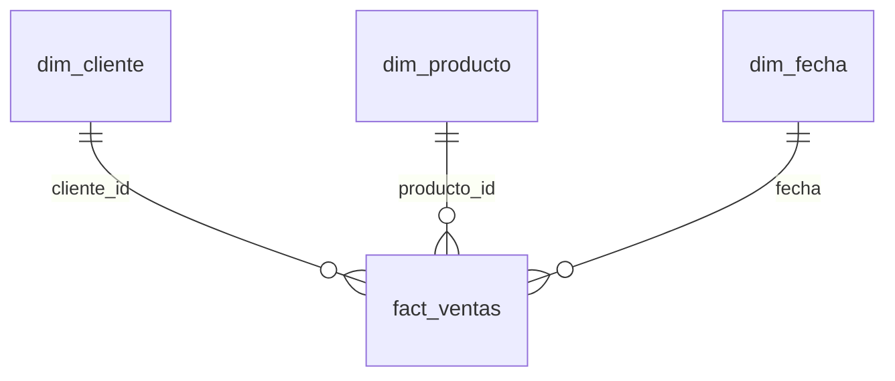

# Diseño silver y gold · `<origen>`

| | |
|---|---|
| Perfil | `Files/perfil/<origen>/<corrida_id>/perfil.json` |
| Generado con | skill `disenar-medallion-desde-perfil` |
| Pedido por / fecha | `<persona>` · `<AAAA-MM-DD>` |
| Estado | Borrador para revisión. No correr en producción |
| Metadata | `alta_<origen>.sql` (validar con `NB_PRF_03_validar_propuesta`) |

## 1. Resumen

<En 3 a 5 líneas: qué tablas entran, qué modelo de gold sale, qué decisiones necesitan al negocio.>

## 2. Silver

### `silver.<tabla>` ← `<esquema.Tabla de origen>`

| Decisión | Valor | Evidencia del perfil |
|---|---|---|
| Clave | `<cliente_id>` | <PK declarada; 0 % nulos; única en N filas> |
| Modo | `MERGE` | <hay clave> |
| Carga | `INCREMENTAL` por `<FechaModificacion>` | <sin nulos, nombre de fecha de modificación> |
| Baja lógica | <`SOURCE_FILTER` / columna / no aplica> | <`Anulada` con 2 valores> |

| Columna bronze | Columna silver | Tipo | Transformación | PII | Evidencia |
|---|---|---|---|---|---|
| `<ClienteID>` | `<cliente_id>` | `int` | — | No | <entero, único> |

Reglas de calidad:

| Regla | Expresión | Acción | Evidencia |
|---|---|---|---|
| `<cliente_id_no_nulo>` | `<cliente_id IS NOT NULL>` | `FAIL` | <clave> |

## 3. Gold

| Objeto | Tipo | Granularidad / clave | Carga | Origen |
|---|---|---|---|---|
| `gold.fact_<proceso>` | Hecho | <una fila por línea de venta> · `<venta_id, linea>` | `MERGE` | `silver.<...>` |
| `gold.dim_<entidad>` | Dimensión | <una fila por cliente> · `<cliente_id>` | `OVERWRITE` | `silver.<...>` |

Relaciones con huérfanos y cómo se resuelven:

| Relación | Filas huérfanas | Tratamiento |
|---|---|---|
| `<ventas.cliente_id → clientes>` | <N> | <LEFT JOIN + miembro -1 'Desconocido'> |

## 4. Datos personales

| Columna | Motivo | Dónde queda |
|---|---|---|
| `<silver.clientes.email>` | <contenido: 98 % emails> | <silver con IS_PII = 1, fuera de gold> |

## 5. Datos a confirmar

1. <pregunta concreta, a quién> [dato a confirmar]

## 6. Próximos pasos

1. Revisar este diseño con <dueño del origen / área>.
2. Correr `alta_<origen>.sql` en la base de control de desarrollo y `EXEC meta.usp_VALIDATE_METADATA`.
3. Correr `NB_PRF_03_validar_propuesta` con la salida de `meta.usp_GET_RUN_CONFIG 'default', 'validacion'`.
4. Primera corrida del pipeline en desarrollo y revisión de `log.RUN_STEP`.
5. Documentar el modelo semántico de gold con `documentar-modelo-semantico`.
