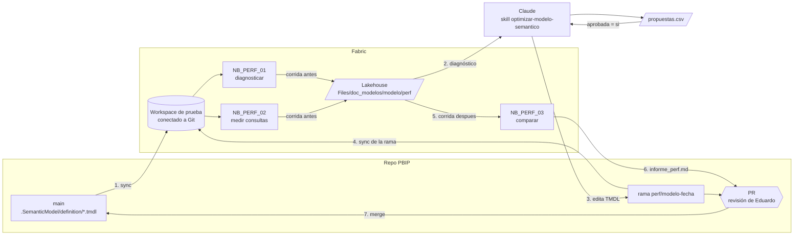

# Mejorar la performance de un modelo semántico PBIP con Claude

**En corto:** un ciclo de *medir → proponer → cambiar → volver a medir* para modelos semánticos de Fabric / Power BI que se versionan como **PBIP (TMDL) en Git**. Tres notebooks de Fabric diagnostican el modelo y miden consultas DAX con traza. Una skill le da a Claude el criterio para proponer optimizaciones con evidencia y aplicarlas **en los archivos `.tmdl` por PR**. Nada se cambia en el modelo publicado: el cambio entra por Git, se despliega en un workspace de prueba, se mide de nuevo y una persona decide el merge con el informe de antes y después pegado en el PR.

Extiende [`Documentar_Modelo_Semantico`](../Documentar_Modelo_Semantico/README.md): usa el `modelo.json` que genera `NB_DOC_01` (expresiones DAX y descripciones de las medidas) y la misma carpeta del lakehouse, `Files/doc_modelos/<modelo>/`. No vuelve a extraer la estructura.

| Archivo | Paso | Qué hace | ¿Modifica el modelo? |
|---|---|---|---|
| [`../Documentar_Modelo_Semantico/notebooks/NB_DOC_01_extraer_modelo.ipynb`](../Documentar_Modelo_Semantico/notebooks/NB_DOC_01_extraer_modelo.ipynb) | 0 (recomendado) | Estructura, medidas y perfil del modelo → `modelo.json` | No |
| [`notebooks/NB_PERF_01_diagnosticar.ipynb`](notebooks/NB_PERF_01_diagnosticar.ipynb) | 1 y 5 | Vertipaq Analyzer, Best Practice Analyzer y fallback de Direct Lake → `diagnostico.json` | No |
| [`notebooks/NB_PERF_02_medir_consultas.ipynb`](notebooks/NB_PERF_02_medir_consultas.ipynb) | 1 y 5 | Corre `consultas.csv` en frío y en caliente con traza: total, motor de almacenamiento (SE), motor de fórmulas (FE), DirectQuery y huella del resultado | Solo vacía la caché |
| [`skill/optimizar-modelo-semantico/`](skill/optimizar-modelo-semantico/SKILL.md) | 2 y 3 | Claude propone en `propuestas.csv` y aplica las aprobadas en TMDL, en una rama con PR. Incluye el [catálogo de optimizaciones](skill/optimizar-modelo-semantico/catalogo_optimizaciones.md) | No: cambia archivos del repo |
| [`notebooks/NB_PERF_03_comparar.ipynb`](notebooks/NB_PERF_03_comparar.ipynb) | 6 | Compara dos corridas y escribe `informe_perf.md` con veredicto | No |
| [`ci/bpa-pr.yml`](ci/bpa-pr.yml) | 3 (opcional) | Plantilla de GitHub Actions: BPA con Tabular Editor 2 sobre el TMDL de cada PR | No |
| [`pruebas/prueba_local.py`](pruebas/prueba_local.py) | | Prueba sin Fabric de la lógica de los tres notebooks | No |

---

## 1. Flujo



1. **Línea base.** El workspace de prueba tiene desplegado `main`. `NB_PERF_01` y `NB_PERF_02` con `CORRIDA = "antes"`.
2. **Diagnóstico y propuestas.** Claude lee la corrida y el TMDL, y completa `propuestas.csv` con evidencia para cada cambio. Una persona marca `aprobada = si`.
3. **Cambios en TMDL.** Claude crea la rama, hace un commit por propuesta y abre el PR. Si está activo el workflow de CI, el BPA corre sobre el PR.
4. **Despliegue de la rama.** El workspace de prueba toma la rama (ver sección 5).
5. **Medición después.** `NB_PERF_01` y `NB_PERF_02` con `CORRIDA = "despues_pr<n>"` y las mismas consultas.
6. **Comparación.** `NB_PERF_03` escribe `informe_perf.md`. Va al PR.
7. **Decisión.** Una persona revisa diff, BPA e informe, y mergea. Producción se actualiza por el proceso de despliegue habitual.

## 2. Por qué los cambios entran por TMDL y no por TOM

| Camino | Qué pasa con el cambio | Uso en el framework |
|---|---|---|
| **Editar el TMDL del repo PBIP y desplegar desde Git (recomendado)** | Queda versionado, revisado y es lo que se publica la próxima vez | Todos los cambios |
| Escribir en el modelo publicado con TOM / XMLA (`connect_semantic_model(readonly=False)`) o con el Power BI Modeling MCP | La próxima publicación desde Power BI Desktop o la próxima sincronización desde Git **pisa el cambio**. Además, un modelo modificado por XMLA puede dejar de descargarse como `.pbix` | Solo para un experimento rápido sobre una **copia** del modelo, nunca como entrega |

Por eso los notebooks de este caso son de **solo lectura**: miden lo que está desplegado. El que escribe es Claude, en archivos, con PR.

## 3. Herramientas que usa, verificadas

Revisé las firmas en el código de **semantic-link-labs 0.17.1** y de **semantic-link (sempy) 0.14.3**, y la documentación oficial enlazada. Los notebooks fijan `semantic-link-labs==0.17.1` porque los nombres de columnas que devuelven estas funciones cambian entre versiones.

| Herramienta | Qué aporta | Dónde se usa |
|---|---|---|
| [`sempy_labs.vertipaq_analyzer(..., visualize=False)`](https://semantic-link-labs.readthedocs.io/en/stable/sempy_labs.html#sempy_labs.vertipaq_analyzer) | Memoria, cardinalidad, encoding y tipo de cada tabla, columna y relación (el [Vertipaq Analyzer de SQLBI](https://www.sqlbi.com/tools/vertipaq-analyzer/)). Devuelve un dict con `Model Summary`, `Tables`, `Columns`, `Relationships`, `Partitions`, `Hierarchies` | `NB_PERF_01` |
| [`sempy_labs.run_model_bpa(..., return_dataframe=True)`](https://semantic-link-labs.readthedocs.io/en/stable/sempy_labs.html#sempy_labs.run_model_bpa) | Best Practice Analyzer con [las reglas de Microsoft](https://github.com/microsoft/Analysis-Services/tree/master/BestPracticeRules). Las reglas se pueden reemplazar con `rules=` | `NB_PERF_01` |
| [`sempy_labs.directlake.check_fallback_reason`](https://semantic-link-labs.readthedocs.io/en/stable/sempy_labs.directlake.html) y `get_direct_lake_guardrails` | Por qué una tabla Direct Lake caería a DirectQuery, y los límites por SKU | `NB_PERF_01` |
| [`sempy.fabric.create_trace_connection` + `Trace`](https://learn.microsoft.com/en-us/python/api/semantic-link-sempy/sempy.fabric.trace) | Traza del motor (`QueryEnd`, `VertiPaqSEQueryEnd`, `DirectQueryEnd`...), como DAX Studio, desde un notebook | `NB_PERF_02` |
| `sempy_labs.clear_cache` | Vacía la caché del modelo (comando XMLA `ClearCache`) para medir en frío | `NB_PERF_02` |
| `sempy_labs.get_dax_query_dependencies` | Columnas que toca una consulta, con su tamaño | `NB_PERF_02` |
| [Performance Analyzer](https://learn.microsoft.com/en-us/power-bi/create-reports/desktop-performance-analyzer) de Power BI | *Copy query* de los visuales lentos: de ahí salen las consultas de `consultas.csv` | Antes del paso 1, a mano |
| [PBIP y TMDL](https://learn.microsoft.com/en-us/power-bi/developer/projects/projects-dataset) | El modelo como archivos de texto en `<Modelo>.SemanticModel/definition/` | Pasos 3 y 7 |
| [Tabular Editor 2 CLI](https://docs.tabulareditor.com/Command-line-Options) (`-A <reglas>`, `-G`) | BPA sobre el TMDL del PR, sin desplegar | `ci/bpa-pr.yml` (opcional) |

semantic-link-labs también trae un medidor interactivo de DAX (`dax_perf_optimizer`), pero no está en su API pública de nivel superior en 0.17.1. Por eso `NB_PERF_02` arma su propia traza con la API documentada de `sempy`, con el mismo esquema de eventos.

**Advertencia de la documentación de sempy:** las trazas son de uso exploratorio y sus tiempos dependen de la carga del servidor. El framework lo compensa repitiendo cada consulta (5 veces por defecto) y comparando medianas, pero no es un benchmark de laboratorio.

## 4. Dónde aplica Claude los cambios: opciones

| Opción | Costo | Complejidad | Escala | Riesgo | Cuándo |
|---|---|---|---|---|---|
| **A. Claude Code sobre el repo PBIP, con la skill (recomendada)** | Tu suscripción de Claude | Baja: clonar el repo y copiar la corrida a `.perf/` | Un modelo por PR | Bajo: todo pasa por PR y medición | Siempre que el modelo esté en Git como PBIP |
| B. Power BI Modeling MCP sobre el PBIP abierto en Desktop | Tu suscripción de Claude | Media: instalación local, en Public Preview | Un modelo | Medio: si se conecta al modelo publicado en vez del PBIP, el cambio se pierde (sección 2) | Para probar ideas de DAX con el modelo abierto, guardando siempre en el PBIP |
| C. API de Claude desde un notebook que genere los cambios | Por token. [verificar precio vigente](https://www.anthropic.com/pricing) | Alta: hay que escribir en Git desde Fabric | Muchos modelos | Medio | Solo si después de varios ciclos el criterio está estable y se quiere un informe programado (sin aplicar cambios) |

**Recomiendo A.** Es el mismo patrón que el resto de BIA: el notebook deja los datos listos, Claude trabaja con la skill y una persona revisa. B sirve como complemento para iterar una medida. C la dejaría solo para *proponer* en lote, nunca para aplicar.

## 5. Requisitos y entorno

| Qué | Para qué | Dónde se configura |
|---|---|---|
| Modelo guardado como **PBIP con TMDL** en un repo (GitHub o Azure DevOps) | Que los cambios sean archivos | Power BI Desktop > Guardar como > proyecto de Power BI |
| **Workspace de prueba** conectado a Git, en una capacidad parecida a la de producción | Medir antes y después sin tocar producción | Workspace settings > Git integration. Para la rama del PR: cambiar la rama del workspace o usar *Branch out to another workspace* [verificar el nombre de la opción en tu tenant] |
| Endpoint **XMLA** con lectura | Vertipaq, BPA, traza y DAX | Admin portal > Capacity settings > Power BI workloads |
| Permiso **Build** o **Write** sobre el modelo (Contributor en el workspace de prueba) | Lo mismo; `clear_cache` y la traza pueden pedir **Write** | Workspace > Manage access |
| Lakehouse por defecto adjunto a los notebooks | Archivos y tablas Delta `perf_*` | Notebook > Lakehouses |
| Datos del workspace de prueba refrescados igual en las dos corridas | Que la comparación sea justa | Refresh manual o programado antes de cada corrida |

La medición se hace sobre el workspace de prueba, no sobre producción: `NB_PERF_02` vacía la caché y le pega al modelo varias veces seguidas.

## 6. Cómo se usa

### Antes de empezar (una vez por modelo)

1. Importá los tres notebooks al workspace de prueba (**Import > Notebook**) y adjuntales el lakehouse.
2. Corré `NB_DOC_01` del caso de documentación sobre el modelo. Deja `modelo.json`.
3. Armá `Files/doc_modelos/<modelo>/perf/consultas.csv` desde la [plantilla](skill/optimizar-modelo-semantico/plantillas/consultas.csv): de 5 a 15 consultas de los visuales que más se usan o más tardan (Performance Analyzer > *Copy query*). Es el mismo archivo para todas las corridas.

### Paso 1. Línea base

Con `main` desplegado en el workspace de prueba:

```python
# NB_PERF_01 y NB_PERF_02
CORRIDA = "antes"
COMMIT = "<sha de main desplegado>"
```

### Paso 2. Propuestas

1. Descargá `Files/doc_modelos/<modelo>/perf/antes/` (OneLake file explorer o botón derecho > Download) a `.perf/antes/` en tu clon del repo PBIP. Agregá `.perf/` al `.gitignore`.
2. En Claude Code, dentro del repo PBIP: *"Usá la skill optimizar-modelo-semantico con la corrida .perf/antes"*.
3. Revisá `propuestas.csv` y poné `aprobada = si` en las que van.

### Paso 3. Cambios y PR

*"Aplicá las propuestas aprobadas"*. Claude crea `perf/<modelo>-<fecha>`, un commit por propuesta, y abre el PR con la [plantilla](skill/optimizar-modelo-semantico/plantillas/pr_performance.md).

### Pasos 4 y 5. Desplegar la rama y medir

1. Pasá el workspace de prueba a la rama del PR y hacé **Update** desde el panel de Source control. Si algún cambio dice `requiere_refresh = si`, refrescá el modelo.
2. Corré `NB_PERF_01` y `NB_PERF_02` con `CORRIDA = "despues_pr<n>"` y `COMMIT = "<sha de la rama>"`.

### Paso 6. Comparar

`NB_PERF_03` con `CORRIDA_ANTES = "antes"` y `CORRIDA_DESPUES = "despues_pr<n>"`. Pegá `informe_perf.md` en el PR, o pasáselo a Claude para que lo pegue y explique las regresiones.

### Paso 7. Merge y vuelta a `main`

Revisás y mergeás. Volvé el workspace de prueba a `main`. La próxima corrida `antes` parte del nuevo `main`.

## 7. Qué optimiza

Resumen del [catálogo](skill/optimizar-modelo-semantico/catalogo_optimizaciones.md), que tiene la evidencia y el cambio TMDL de cada caso:

| Área | Ejemplos | Señal en el diagnóstico |
|---|---|---|
| Memoria y columnas | Quitar columnas sin uso, separar fecha y hora, bajar precisión, claves enteras, columnas calculadas al origen, `isAvailableInMdx: false`, fecha/hora automática | `top_columnas`, `bpa_performance` |
| Relaciones | Bidireccionales a una dirección, integridad referencial, muchos a muchos | `relaciones`, `filas_sin_match` |
| DAX | `DIVIDE`, `VAR`, `KEEPFILTERS` en lugar de `FILTER` sobre tablas, iterar sobre menos filas | `fe_ms` alto, `se_consultas` alto |
| Agregaciones y modo | Tablas gold preagregadas (ver [`Pipeline_Metadata_Medallion`](../Pipeline_Metadata_Medallion/README.md)), agregaciones de usuario, Import vs Direct Lake vs DirectQuery | `se_ms` alto en hechos grandes |
| Direct Lake | Vistas a tablas, seguridad en el modelo, `OPTIMIZE` y V-Order, precalentar caché | `dq_consultas` > 0, `fallback.csv` |

Una optimización que cambia el resultado de una consulta no pasa el veredicto, salvo que esté declarada (`cambia_resultado = si` en la propuesta y el id en `CAMBIO_DE_RESULTADO_ESPERADO`).

## 8. Cómo validar el framework

| Prueba | Resultado esperado |
|---|---|
| `python pruebas/prueba_local.py` | `Todo OK` (lógica de los tres notebooks, sin Fabric) |
| `NB_PERF_01` dos veces con la misma `CORRIDA` | La segunda falla con "ya tiene diagnóstico" salvo `SOBREESCRIBIR = True` |
| `NB_PERF_02` con una consulta de `consultas.csv` que no empieza con `EVALUATE` | Se detiene antes de ejecutar nada y lista el problema |
| `NB_PERF_02` en un modelo de prueba | Ninguna ejecución "sin eventos en la traza"; si aparecen, subir `SEG_ESPERA_TRAZA` |
| Dos corridas sin cambios en el medio (`antes` y `antes_2`) y `NB_PERF_03` | Todas las consultas `igual` y veredicto `REVISAR` por "ninguna mejora": mide el ruido de tu capacidad. Si hay variaciones mayores a 10 %, subí `REPETICIONES` o los umbrales |
| Cambio de DAX que altera el resultado a propósito | `resultado_distinto` y veredicto `REVISAR` |

Probalo primero en un modelo de desarrollo. La lógica de los notebooks está probada localmente; las llamadas a semantic-link, la traza y el despliegue por Git **todavía no se probaron en un Fabric real**.

## 9. Operación (mini runbook)

| Situación | Qué hacer |
|---|---|
| Alguien publicó desde Desktop con un `.pbix` viejo encima del PBIP | Se pierden los cambios del PR en el servicio. Volvé a sincronizar el workspace desde Git. Para evitarlo, publicá siempre desde el PBIP o desde Git |
| La traza no trae eventos | Subí `SEG_ESPERA_TRAZA` y el `delay` de `traza.start()`. Revisá que tengas permiso Write sobre el modelo |
| Mucha variación entre repeticiones | Medí fuera del horario pico, subí `REPETICIONES`, y compará siempre en la misma capacidad |
| Direct Lake: la primera consulta de cada corrida es mucho más lenta | Es la carga de columnas a memoria. Corré las dos corridas en el mismo estado (por ejemplo, justo después de un refresh) o precalentá |
| El BPA del CI marca reglas que el equipo decidió no seguir | Pasá un archivo de reglas propio en `REGLAS_BPA`, o anotaciones en el modelo para ignorarlas |
| Cambió la versión de semantic-link-labs | Cambiá el `%pip install`, corré una corrida de prueba y `pruebas/prueba_local.py`, y revisá los nombres de columnas |
| Revertir una optimización ya mergeada | Revert del commit en Git, sync del workspace y refresh si hacía falta |

**Datos a confirmar en la documentación oficial**, porque cambian con el tiempo: el nombre de la opción para ramificar a otro workspace en la integración Git de Fabric, los límites de Direct Lake por SKU, la sintaxis de la CLI de Tabular Editor 2 con TMDL y el estado de preview del Power BI Modeling MCP.

## Próximos pasos

1. Elegir un modelo PBIP piloto y armar su `consultas.csv` con Performance Analyzer.
2. Conectar un workspace de prueba a su repo y correr la línea base (`antes` y `antes_2`) para medir el ruido.
3. Primer ciclo con la skill: pocas propuestas de bajo riesgo (columnas sin uso, `DIVIDE`, bidireccionales documentados).
4. Activar `ci/bpa-pr.yml` en el repo del modelo, después de verificar la versión de Tabular Editor 2.
5. Si funciona, cargar las tablas `perf_*` en un reporte para seguir la evolución de cada modelo.
