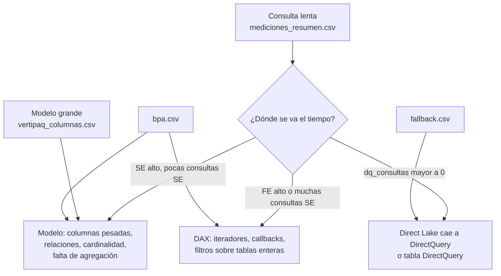

# Catálogo de optimizaciones para modelos semánticos

Qué mirar, con qué evidencia y cómo se ve el cambio en TMDL. Es la referencia de la skill `optimizar-modelo-semantico`: cada propuesta de `propuestas.csv` debería caer en una de estas filas o explicar por qué no.

Los nombres de propiedades TMDL son los que escribe Power BI Desktop con PBIP. Si una propiedad no aparece en tus archivos, abrí el modelo en Desktop, hacé el cambio a mano una vez y mirá el diff: es la forma más segura de confirmar la sintaxis.

## Cómo leer el diagnóstico



| Señal | Umbral orientativo | Dónde mirar |
|---|---|---|
| `fe_ms` > 50 % de `total_ms` | Consulta de más de 1 s | Medidas de la consulta (`dependencias.csv`, `diagnostico.json > medidas`) |
| `se_consultas` alto | Decenas o cientos para un visual | Iteradores con transición de contexto, `IF` y `SWITCH` que fragmentan |
| Una columna > 10 % del modelo | Sobre todo si `cardinalidad` ≈ filas de la tabla | IDs de transacción, GUIDs, fecha y hora juntas, texto libre |
| `filas_sin_match` > 0 en una relación | Cualquiera | Integridad referencial: filas en blanco y planes más caros |
| `dq_consultas` > 0 en un modelo Direct Lake | Cualquiera | `fallback.csv` |

Los umbrales son puntos de partida, no reglas: ajustalos a tu modelo y anotá el criterio en la propuesta.

## 1. Memoria y columnas

| Optimización | Evidencia | Cambio en TMDL | Cambia resultado | Refresh |
|---|---|---|---|---|
| Quitar columnas que nadie usa | Columna pesada sin referencias en medidas, relaciones, RLS, jerarquías, `sortByColumn` ni reportes | Borrar el bloque `column` de `tables/<Tabla>.tmdl`. En Import, también sacarla en la consulta M de la partición (`Table.SelectColumns` o `Table.RemoveColumns`) | No, si de verdad no se usa | Sí (Import) |
| Separar fecha y hora | `dateTime` con cardinalidad alta | Dos columnas (`fecha` y `hora`) desde el origen; relación con la tabla de fechas por la fecha | No, si las medidas usan la fecha | Sí |
| Bajar precisión | `double` con muchos decimales | `dataType: decimal` (decimal fijo, 4 decimales) o redondear en el origen | Puede cambiar en el 5.º decimal: marcar `cambia_resultado = si` | Sí |
| Claves enteras | Relaciones por columnas `string` de alta cardinalidad | Clave sustituta `int64` en el origen (gold) y relación por esa clave | No | Sí |
| Columnas calculadas al origen | Columnas `Calculated` pesadas en `vertipaq_columnas.csv` | Mover la lógica a Power Query o a la tabla gold; borrar `column ... = <DAX>` | No, si la lógica es la misma | Sí |
| `isAvailableInMdx: false` | Regla BPA de columnas ocultas que no son atributos | Agregar `isAvailableInMdx: false` en la columna | No (Excel/MDX ya no la ve como atributo) | Sí (Import) |
| Desactivar fecha/hora automática | Tablas `LocalDateTable_*` en `vertipaq_tablas.csv` | Hacerlo en Desktop (Opciones > Archivo actual > Carga de datos) y guardar: borra tablas, relaciones y `variation`. No editarlo a mano | Sí, si algún visual usa la jerarquía automática | Sí |

Ejemplo, columna sin uso en Import:

```tmdl
table Ventas
	...
	column IdTransaccion          // ← borrar todo el bloque
		dataType: string
		lineageTag: 6f1c...
		summarizeBy: none
		sourceColumn: IdTransaccion

	partition Ventas = m
		mode: import
		source =
				let
				    Origen = ...,
				    Columnas = Table.RemoveColumns(Origen, {"IdTransaccion"})   // ← agregar
				in
				    Columnas
```

## 2. Relaciones

| Optimización | Evidencia | Cambio en TMDL | Cambia resultado |
|---|---|---|---|
| Filtro en una dirección | `crossFilteringBehavior: bothDirections` sin una razón documentada | Borrar esa línea en `relationships.tmdl` (el default es una dirección). Si una medida necesita el filtro inverso, usar `CROSSFILTER` en esa medida | **Sí** en visuales que dependían del filtro bidireccional: listar las consultas afectadas |
| Integridad referencial | `filas_sin_match` > 0 | Corregir en el origen (fila "Desconocido" en la dimensión) | Sí: desaparece la fila en blanco |
| Evitar muchos a muchos | `multiplicidad` m:m | Tabla puente o dimensión al grano correcto | Puede: validar con huella |

## 3. DAX

Cada reescritura tiene que dar el mismo resultado: `NB_PERF_03` compara la huella. Si no da igual, no es una optimización, es otra medida.

| Patrón lento | Reescritura | Nota |
|---|---|---|
| `IFERROR(a / b, 0)` | `DIVIDE(a, b, 0)` | |
| La misma expresión repetida | `VAR` y referencia a la variable | Se evalúa una vez por contexto |
| `CALCULATE([m], FILTER('Tabla', 'Tabla'[Col] = "x"))` | `CALCULATE([m], KEEPFILTERS('Tabla'[Col] = "x"))` | `FILTER` sobre la tabla entera arrastra la tabla expandida. La reescritura no siempre es equivalente: dejá que la huella lo confirme |
| `SUMX('Hechos', [Medida])` sobre millones de filas | Iterar sobre `VALUES` de la columna del grano que hace falta | Menos transiciones de contexto |
| `COUNT('Tabla'[Clave])` para contar filas | `COUNTROWS('Tabla')` | |
| `IF` o `SWITCH` que evalúan ramas caras para cada celda | Calcular la condición en una `VAR` y devolver `BLANK()` temprano | Baja `se_consultas` |
| `DISTINCTCOUNT` sobre columna de cardinalidad muy alta | Contar sobre una columna de menor cardinalidad o preagregar | Validar que el negocio acepte la definición |

Ejemplo en TMDL:

```tmdl
	measure 'Margen %' =
			VAR _ventas = [Ventas]
			RETURN DIVIDE(_ventas - [Costo], _ventas)
		formatString: 0.0 %
		lineageTag: 9a2e...
```

## 4. Agregaciones y modo de almacenamiento

| Modo | Cuándo conviene | Riesgo |
|---|---|---|
| Import | Modelo que entra en la memoria de la capacidad y tolera la latencia del refresh | Ventana de refresh, tamaño |
| Direct Lake | Datos ya en un lakehouse o warehouse de Fabric, tablas grandes, refresh casi inmediato | Fallback a DirectQuery (Direct Lake sobre el SQL endpoint), límites por SKU (`directlake.get_direct_lake_guardrails()`), columnas calculadas con limitaciones [verificar en la doc vigente] |
| DirectQuery | Datos que no se pueden copiar o que cambian al segundo | Cada visual es una consulta al origen |

| Optimización | Cuándo | Cambio |
|---|---|---|
| Tabla gold preagregada | Consultas que siempre miran el mismo grano (mes, región) sobre hechos de millones de filas | Crear la tabla en el lakehouse (ver `Pipeline_Metadata_Medallion`, capa gold) y apuntar las medidas o los visuales a ella |
| Agregaciones definidas por el usuario | Modelo compuesto: hechos en DirectQuery y una tabla agregada en Import | Propiedad `alternateOf` en las columnas de la tabla agregada [verificar sintaxis TMDL en un diff de Desktop] |
| Pasar de Import a Direct Lake o al revés | El diagnóstico muestra que el modo actual es la causa (refresh imposible, fallback constante) | Es un cambio de arquitectura: propuesta con prioridad propia, no se mezcla con otras en el mismo PR |

## 5. Direct Lake

| Motivo en `fallback.csv` o síntoma | Qué hacer |
|---|---|
| La tabla es una vista del SQL endpoint | Materializarla como tabla Delta en el lakehouse |
| RLS u OLS definida en el SQL endpoint | Pasar la seguridad al modelo semántico, o usar Direct Lake sobre OneLake [verificar disponibilidad en tu tenant] |
| Se superan los límites del SKU (filas, archivos, row groups, tamaño) | `OPTIMIZE` y V-Order en las tablas Delta, menos archivos chicos, o subir de SKU. `sempy_labs.delta_analyzer` muestra archivos y row groups |
| Primera consulta lenta después de cada carga | Precalentar con `directlake.warm_direct_lake_cache_perspective` después del reframe |

## 6. Lo que no se toca desde TMDL

- `.pbi/cache.abf`, `.pbi/localSettings.json` y `diagramLayout.json`: no se editan a mano.
- `lineageTag` de objetos existentes: no se cambia. Un objeto nuevo puede llevar uno nuevo (un GUID) o quedarse sin él para que Desktop lo genere.
- Cambios en reportes (`.Report/`): fuera de esta skill, salvo para verificar que una columna no se usa.
