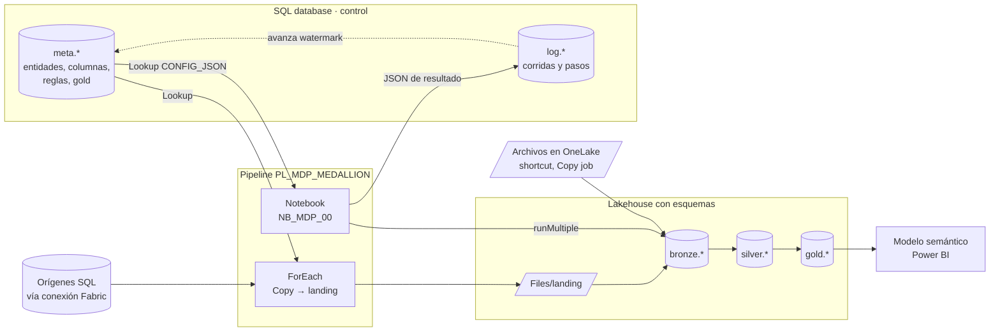
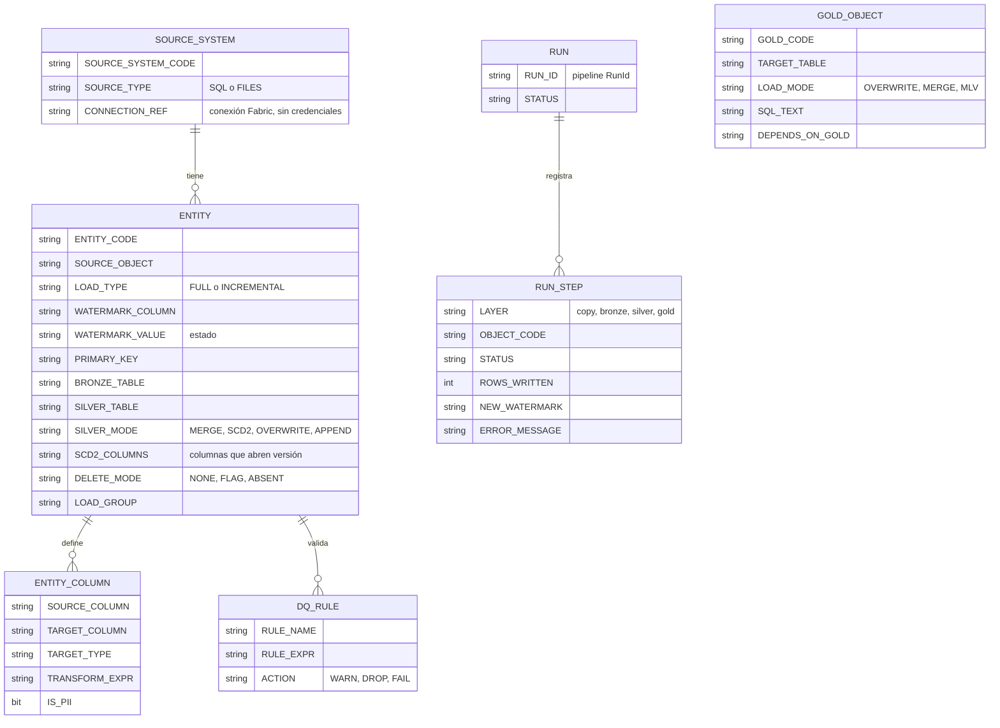
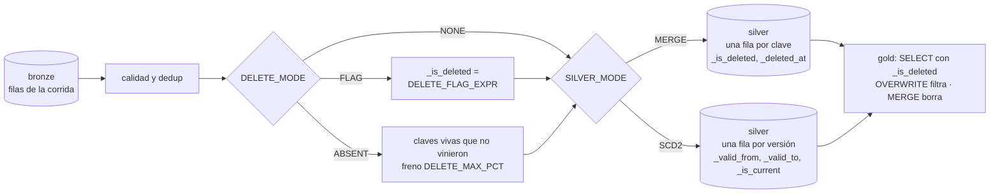

# Pipeline metadata-driven medallion en Fabric, con Claude

**En corto:** un solo pipeline de Fabric y cuatro notebooks cargan cualquier cantidad de tablas en una arquitectura **bronze → silver → gold**. Qué se carga, cómo y con qué reglas no está en el código sino en una **base de control** (SQL database de Fabric). Sumar una tabla es insertar filas, no armar otro pipeline. Claude entra en dos lugares: con la skill [`metadata-medallion`](skill/metadata-medallion/SKILL.md) genera esas filas a partir del DDL de un origen, y diagnostica las corridas leyendo el log.

| Archivo | Qué es | ¿Escribe datos? |
|---|---|---|
| [`sql/01_ddl_control.sql`](sql/01_ddl_control.sql) | Esquemas `meta` y `log`, tablas de configuración y de ejecución, y los stored procedures que usa el pipeline | Crea objetos; no borra nada |
| [`sql/02_ejemplo_metadata.sql`](sql/02_ejemplo_metadata.sql) | Metadata de ejemplo: un ERP en SQL Server y CSV en OneLake, con columnas, reglas y gold | Sí, en `meta.*` |
| [`sql/03_ejemplo_historia.sql`](sql/03_ejemplo_historia.sql) | Sobre el ejemplo: clientes con historia (SCD2), productos y ventas con bajas del origen, y gold con vigencia ([sección 10](#10-historia-scd-tipo-2-y-bajas-del-origen)) | Sí, en `meta.*` |
| [`notebooks/NB_MDP_00_orquestador.ipynb`](notebooks/NB_MDP_00_orquestador.ipynb) | Arma un DAG con la metadata y ejecuta los demás notebooks con `runMultiple` | No directamente |
| [`notebooks/NB_MDP_10_bronze.ipynb`](notebooks/NB_MDP_10_bronze.ipynb) | Una entidad: archivos → tabla bronze (append, con auditoría) | Sí, en bronze |
| [`notebooks/NB_MDP_20_silver.ipynb`](notebooks/NB_MDP_20_silver.ipynb) | Una entidad: columnas, tipos, calidad, deduplicación y `MERGE` o `SCD2` en silver, con bajas del origen | Sí, en silver |
| [`notebooks/NB_MDP_30_gold.ipynb`](notebooks/NB_MDP_30_gold.ipynb) | Un objeto gold: `SELECT` → tabla, `MERGE` o materialized lake view | Sí, en gold |
| [`skill/metadata-medallion/`](skill/metadata-medallion/SKILL.md) | Skill de Claude con plantillas: alta de entidades, objetos gold y diagnóstico | No: genera scripts para revisar |
| [`pruebas/prueba_local.py`](pruebas/prueba_local.py) | Prueba de los notebooks con Spark y Delta en tu PC, sin Fabric | Solo en una carpeta local |
| [`pruebas/prueba_scd2_bajas.py`](pruebas/prueba_scd2_bajas.py) | Prueba de SCD2 y bajas en silver y gold, con chequeos | Solo en una carpeta local |

---

## 1. Cómo funciona

Por cada corrida:

1. El pipeline abre la corrida en `log.RUN` y pide a `meta.usp_GET_COPY_TASKS` la lista de copias. Cada una trae la consulta de origen ya armada con el watermark.
2. Un **ForEach** copia cada tabla SQL a `Files/landing/<entidad>/<run_id>/` en Parquet y registra el resultado.
3. Un **Lookup** trae toda la configuración en un JSON (`meta.usp_GET_RUN_CONFIG`) y se lo pasa al notebook orquestador.
4. El orquestador corre, en la misma sesión de Spark, `bronze → silver` de todas las entidades en paralelo, y después los objetos gold en el orden de sus dependencias.
5. El pipeline le pasa el JSON de resultado a `log.usp_END_RUN`, que registra cada paso y **avanza el watermark solo de las entidades cuyo bronze terminó bien y cuyo silver no falló**. Si algo falló, el pipeline termina en error para que salte la alerta.

Las capas, como se usan acá:

| Capa | Qué guarda | Cómo se escribe | Quién la usa |
|---|---|---|---|
| Landing (`Files/landing`) | Lo que trajo la copia, tal cual, por corrida | Copy activity, Parquet | Solo bronze |
| Bronze | Historia de todo lo que llegó, con `_run_id`, `_ingested_at` y archivo de origen | Append | Reprocesos, auditoría |
| Silver | Una fila por clave (o una por versión, con `SCD2`), tipada, limpia y validada. Las bajas del origen quedan marcadas, no borradas | `MERGE`, `SCD2`, `OVERWRITE` o `APPEND` | Ingeniería, analistas |
| Gold | Modelo dimensional (hechos y dimensiones) para el negocio | `OVERWRITE`, `MERGE` o materialized lake view | Modelo semántico, reportes |

## 2. Qué usa de Fabric, y por qué

Lo verifiqué en la documentación oficial (octubre de 2026):

| Pieza | Para qué | Dato clave verificado |
|---|---|---|
| [SQL database en Fabric](https://learn.microsoft.com/en-us/fabric/data-factory/connector-sql-database-overview) | Base de control `meta` / `log` | Los pipelines la usan desde Copy, Lookup, Script y **Stored procedure**. Autenticación: cuenta organizacional |
| [Lookup](https://learn.microsoft.com/en-us/fabric/data-factory/lookup-activity) y [ForEach](https://learn.microsoft.com/en-us/fabric/data-factory/foreach-activity) | Leer la metadata e iterar las copias | [Límites](https://learn.microsoft.com/en-us/fabric/data-factory/data-factory-limitations): ForEach hasta **50** en paralelo (default 20), Lookup hasta **5000** filas, **120** actividades por pipeline contando las internas |
| [`notebookutils.notebook.runMultiple`](https://learn.microsoft.com/en-us/fabric/data-engineering/notebookutils/notebookutils-notebook-run) | Correr los notebooks hijos como DAG en una sola sesión | Claves `activities`, `dependencies`, `args`, `concurrency`, `retry`. **Timeout por celda de 90 s por defecto**: el orquestador lo sube a 3600. `exit()` no puede ir dentro de un `try` |
| Salida de un notebook en el pipeline | Pasar el resultado a `log.usp_END_RUN` | `@activity('NB_ORQUESTADOR').output.result.exitValue` ([ejemplo oficial](https://blog.fabric.microsoft.com/blog/use-fabric-data-factory-data-pipelines-to-orchestrate-notebook-based-workflows)) |
| [Lakehouse con esquemas](https://learn.microsoft.com/en-us/fabric/data-engineering/lakehouse-schemas) | `bronze.*`, `silver.*`, `gold.*` en un mismo lakehouse | Disponible en GA |
| [Materialized lake views](https://learn.microsoft.com/en-us/fabric/data-engineering/materialized-lake-views/overview-materialized-lake-view) | Opción para gold (`LOAD_MODE = 'MLV'`) | `CREATE MATERIALIZED LAKE VIEW [IF NOT EXISTS] ... AS SELECT`, con `CONSTRAINT ... CHECK ... ON MISMATCH DROP/FAIL`. Refresco incremental si las tablas de origen tienen *change data feed*. No admite UDF, time travel ni vistas temporales |
| [Copy job](https://learn.microsoft.com/en-us/fabric/data-factory/what-is-copy-job) | Alternativa para llevar orígenes a OneLake | Carga completa, incremental y CDC sin pipeline. Si lo usás, la entidad se configura como `FILES` o Delta |
| [Variable library](https://learn.microsoft.com/en-us/fabric/data-engineering/notebookutils/notebookutils-variable-library) | Opcional: nombres que cambian entre DES y PRD | Solo mismo workspace y **no soporta service principal** desde notebooks |
| [Fabric MCP](https://blog.fabric.microsoft.com/es/blog/introducing-fabric-mcp-public-preview) | Opcional: que Claude consulte esquemas de items de Fabric (pipelines, lakehouses) mientras genera definiciones | En preview, local y de solo lectura: no se conecta a tu tenant |

## 3. Decisiones de diseño y alternativas

### 3.1. Dónde guardar la metadata

| Opción | Costo | Complejidad | Robustez | Comentario |
|---|---|---|---|---|
| **A. SQL database de Fabric (recomendada)** | Consumo de capacidad bajo | Baja | Alta: transacciones, FK, `CHECK`, SP | Es lo que ya usás en `DB_TDM_Platform`. El pipeline la lee y escribe con Lookup y Stored procedure |
| B. Tablas Delta en un lakehouse de control | Mínimo | Baja | Media: sin FK ni transacciones entre tablas; actualizar el watermark en paralelo puede chocar | Sirve si no querés otra base |
| C. Archivos JSON/YAML en Git | Ninguno | Media | Media: el estado (watermark, log) igual necesita una base | Bueno para versionar la configuración; combinable con A |

**Recomiendo A.** La configuración y el estado viven en un solo lugar con integridad, y los notebooks nunca se conectan a la base: reciben la metadata por parámetro y devuelven el resultado por `exit`. Así no hace falta manejar credenciales ni drivers en Spark.

### 3.2. Cómo orquestar bronze y silver

| Opción | Arranque | Paralelismo | Complejidad | Cuándo |
|---|---|---|---|---|
| ForEach del pipeline con una actividad Notebook por entidad | Una sesión de Spark por entidad: minutos por cada una | Hasta 50 | Baja | Pocas entidades grandes |
| **Un notebook orquestador con `runMultiple` (recomendada)** | Una sola sesión para todo | `concurrencia` dentro de la sesión | Media | Muchas entidades chicas o medianas, que es lo habitual |
| Materialized lake views para silver y gold | Lo maneja Fabric | Lo maneja Fabric | Baja | Transformaciones que entran en un `SELECT`. No sirven para el `MERGE` con deduplicación de silver |

**Recomiendo el orquestador.** Con 30 tablas, arrancar 30 sesiones cuesta más que procesarlas. El pipeline queda solo para lo que hace bien: copiar desde orígenes con gateway, programar y alertar.

### 3.3. Otras decisiones

- **Un lakehouse con esquemas** (`bronze`, `silver`, `gold`) para empezar. Si después necesitás permisos distintos por capa, separalo en tres lakehouses y escribí los nombres completos en la metadata (`LH_SILVER.silver.clientes`); los notebooks los usan tal cual.
- **El watermark usa `>=`**, no `>`: puede volver a traer las filas del último instante, pero el `MERGE` de silver las deduplica. Con `>` se pierden las filas que llegan con el mismo valor.
- **El watermark avanza solo si bronze terminó bien y silver no falló.** Reintentar una corrida fallida nunca saltea datos: bronze vuelve a recibir esas filas (es historia, puede tenerlas dos veces) y el `MERGE` de silver no las duplica.
- **Si la copia de una entidad falla, bronze no lee su carpeta**, porque puede estar incompleta y adelantaría el watermark.
- **Gold no corre si bronze o silver tuvieron errores** (`gold_si_hay_errores = False`). Mejor un reporte con datos de ayer que uno con la mitad de los datos de hoy.
- **Las filas rechazadas por calidad** van a `silver.dq_rechazos` como JSON, **sin las columnas PII**.

## 4. Modelo de la base de control

`LOAD_GROUP` permite tener varias programaciones con el mismo pipeline (por ejemplo `diario` y `cada_hora`).

## 5. Requisitos y permisos

| Qué | Para qué | Dónde se configura |
|---|---|---|
| Workspace en capacidad Fabric (F o trial) | Todo | Workspace settings > License info |
| Rol **Contributor** o más en el workspace | Crear y correr items | Workspace > Manage access |
| SQL database de control de la plataforma (ej. `DB_TDM_Platform`): los esquemas `meta` y `log` conviven con `config` del [inventario](../Inventario_Workspace/README.md) | Base de control | New item > SQL database, o la que ya existe |
| Lakehouse con esquemas habilitados (ej. `LH_MEDALLION`) y esquemas `bronze`, `silver`, `gold` | Datos | New item > Lakehouse > *Lakehouse schemas* |
| Una **conexión de Fabric** por origen SQL (con gateway si es on-premises) | Copy activity | Settings > Manage connections and gateways |
| Zona horaria de la sesión de Spark en UTC (default) | Que el watermark de archivos sea coherente | Solo si alguien la cambió en el entorno |

## 6. Cómo armarlo

### Paso 1. Base de control

1. Abrí la SQL database y corré [`sql/01_ddl_control.sql`](sql/01_ddl_control.sql). Es idempotente.
2. Cargá tu metadata: adaptá [`sql/02_ejemplo_metadata.sql`](sql/02_ejemplo_metadata.sql) o generala con Claude (sección 7). Al final corre `meta.usp_VALIDATE_METADATA`, que tiene que devolver **cero filas**.
3. Si una base ya existía de una versión anterior, el mismo script le agrega las columnas de historia y bajas (`SCD2_COLUMNS`, `DELETE_MODE`, ...) con valores que no cambian nada. Para usarlas, ver la [sección 10](#10-historia-scd-tipo-2-y-bajas-del-origen).

### Paso 2. Lakehouse y notebooks

1. Creá el lakehouse con esquemas y los esquemas `bronze`, `silver` y `gold` (`CREATE SCHEMA IF NOT EXISTS bronze` desde un notebook).
2. Importá los cuatro notebooks (**Import > Notebook**) **sin cambiarles el nombre**: el orquestador llama a los otros por nombre.
3. A cada notebook adjuntale el lakehouse como **default**.
4. En cada notebook, revisá que la primera celda de código esté marcada como **parameters** (menú `...` de la celda > *Toggle parameter cell*). Al importar debería venir marcada, pero conviene confirmarlo.

### Paso 3. Pipeline `PL_MDP_MEDALLION`

Parámetros: `p_load_group` (String, `default`) y `p_layers` (String, `bronze,silver,gold`).

| # | Actividad | Tipo | Configuración | Depende de |
|---|---|---|---|---|
| 1 | `SP_START_RUN` | Stored procedure | `log.usp_START_RUN`: `RUN_ID = @pipeline().RunId`, `PIPELINE_NAME = @pipeline().PipelineName`, `LOAD_GROUP = @pipeline().parameters.p_load_group` | — |
| 2 | `LKP_COPY_TASKS` | Lookup | Stored procedure `meta.usp_GET_COPY_TASKS` (`LOAD_GROUP`, `RUN_ID`). **First row only: desmarcado** | 1 Succeeded |
| 3 | `FE_COPY` | ForEach | Items: `@activity('LKP_COPY_TASKS').output.value`. Sequential: no. Batch count: 10 | 2 Succeeded |
| 3.1 | `SW_CONEXION` | Switch (dentro del ForEach) | Expresión `@item().CONNECTION_REF`. Un *case* por conexión, con una Copy cada uno (ver abajo) | — |
| 3.2 | `SP_LOG_COPY_OK` | Stored procedure | `log.usp_LOG_STEP`: `RUN_ID`, `LAYER = copy`, `OBJECT_CODE = @item().ENTITY_CODE`, `STATUS = SUCCEEDED` | 3.1 Succeeded |
| 3.3 | `SP_LOG_COPY_ERR` | Stored procedure | Igual, con `STATUS = FAILED` y `ERROR_MESSAGE = @string(activity('SW_CONEXION').error)` | 3.1 Failed |
| 4 | `LKP_CONFIG` | Lookup | Stored procedure `meta.usp_GET_RUN_CONFIG` (`LOAD_GROUP`, `RUN_ID`). **First row only: marcado** | 3 **Completed** |
| 5 | `NB_ORQUESTADOR` | Notebook | `NB_MDP_00_orquestador`. Parámetros: `run_id = @pipeline().RunId`, `config_json = @activity('LKP_CONFIG').output.firstRow.CONFIG_JSON`, `layers = @pipeline().parameters.p_layers` | 4 Succeeded |
| 6 | `LKP_END_RUN` | Lookup | Stored procedure `log.usp_END_RUN`: `RUN_ID = @pipeline().RunId`, `RESULT_JSON = @coalesce(activity('NB_ORQUESTADOR').output?.result?.exitValue, '{"hay_errores": true, "pasos": []}')`. First row only: marcado | 5 **Completed** |
| 7 | `IF_FALLO` | If Condition | `@equals(activity('LKP_END_RUN').output.firstRow.STATUS, 'FAILED')`. En *True*: una actividad **Fail** con el mensaje `Corrida con errores: ver log.RUN_STEP` | 6 Succeeded |

En cada **Copy** (dentro de un case del Switch):

- **Source**: la conexión del case, *Use query* = **Query**, consulta `@item().SOURCE_QUERY`.
- **Destination**: el lakehouse, **Files**, carpeta `@item().LANDING_FOLDER`, formato **Parquet**.

Para controlar gold antes de refrescar el modelo (totales, hechos sin dimensión, frescura), sumá las actividades 8 a 11 de [Calidad_Reconciliacion](../Calidad_Reconciliacion/README.md#4-pasos).

`LKP_END_RUN` es un Lookup y no un Stored procedure porque necesitamos leer el estado que devuelve el SP. Las dependencias en **Completed** (4 y 6) hacen que el cierre se registre aunque algo haya fallado antes.

Por qué un Switch: en una Copy la conexión se elige al diseñar, así que hace falta un case por conexión de origen. Si tenés muchos orígenes, una alternativa es un pipeline hijo por tipo de origen. Otra es llevar los orígenes a OneLake con **Copy job** o **mirroring** y configurar esas entidades como `FILES`, sin Copy en este pipeline.

### Paso 4. Primera corrida

1. Corré el pipeline a mano con `p_load_group = default`.
2. Mirá `log.RUN` y `log.RUN_STEP` (consultas en [`consultas_operacion.sql`](skill/metadata-medallion/plantillas/consultas_operacion.sql)).
3. Programalo: **Schedule** en el pipeline, uno por `LOAD_GROUP`.

## 7. Dónde entra Claude

| Tarea | Cómo | Qué entrega |
|---|---|---|
| **Perfilar un origen nuevo antes de diseñar** | Con el caso [`Perfilado_Origen_Medallion`](../Perfilado_Origen_Medallion/README.md): copia exploratoria a bronze, perfil con datos y la skill `disenar-medallion-desde-perfil` | La misma metadata, con claves, tipos, PII y reglas decididas con evidencia del perfil y probadas contra bronze |
| **Sumar un origen o tablas** | Pegale a Claude el DDL (`INFORMATION_SCHEMA.COLUMNS`) o una muestra y pedile *"Usá la skill metadata-medallion para sumar estas tablas"* | Script SQL idempotente con entidad, columnas en snake_case, tipos, PII y reglas de calidad, más la lista de `[dato a confirmar]` |
| **Diseñar gold** | *"Armame la fact de ventas y sus dimensiones para el modelo semántico"* | Filas de `meta.GOLD_OBJECT` con el `SELECT`, modo de carga y dependencias, sin columnas PII |
| **Diagnosticar una corrida** | Corré `consultas_operacion.sql` y pegale el resultado | Causa probable, qué corregir y si se puede reintentar |
| **Documentar el resultado** | Con la skill [`documentar-modelo-semantico`](../Documentar_Modelo_Semantico/README.md) sobre el modelo que lee gold | Diccionario de datos |
| **Responder preguntas de negocio sobre gold** | Con el caso [`Agente_Datos_Fabric`](../Agente_Datos_Fabric/README.md): vistas `agente.*` sobre gold y un Fabric data agent que Claude consulta por MCP | Respuestas con los datos de gold, y un banco de preguntas validadas por cada área |

La skill se instala copiando la carpeta [`skill/metadata-medallion/`](skill/metadata-medallion/) a `.claude/skills/` del proyecto (Claude Code) o subiéndola como skill en claude.ai.

Claude **no escribe en la base de control ni en el lakehouse**: genera scripts que vos revisás y corrés, primero en desarrollo. Es la misma regla que en el resto del repo.

## 8. Cómo validar

| Prueba | Resultado esperado |
|---|---|
| `EXEC meta.usp_VALIDATE_METADATA` después de cargar metadata | Cero filas |
| `EXEC meta.usp_GET_RUN_CONFIG 'default', 'prueba'` | Una fila con un JSON válido (`ISJSON = 1`) con entidades y gold |
| Primera corrida | `log.RUN.STATUS = SUCCEEDED`, una fila `SUCCEEDED` por capa y entidad, y `WATERMARK_VALUE` cargado en las incrementales |
| Segunda corrida sin cambios en el origen | Bronze trae solo las filas del último instante (`>=`) y silver no duplica |
| Una fila con clave nula en una entidad con regla `FAIL` | Silver `FAILED`, gold `SKIPPED_UPSTREAM_FAILED`, el pipeline termina en error y el watermark de esa entidad no avanza |
| Cortar la conexión de un origen | Copy `FAILED`, bronze `SKIPPED`, el watermark no cambia, las demás entidades siguen |
| `layers = silver,gold` y `reprocesar_run_id` con una corrida vieja | Silver se recalcula desde bronze sin volver a copiar |
| [`pruebas/prueba_local.py`](pruebas/prueba_local.py) | Las cuatro corridas simuladas terminan como dice su encabezado |
| [`pruebas/prueba_scd2_bajas.py`](pruebas/prueba_scd2_bajas.py) | `Todo OK`: versiones, bajas `FLAG` y `ABSENT`, freno, reproceso fuera de orden, conversión desde `MERGE` y gold sin bajas |
| Entidad con `DELETE_MODE = 'ABSENT'` y una extracción cortada en DES (filtro que trae la mitad) | Silver `FAILED` con `DELETE_MAX_PCT` en el error y ninguna fila marcada |

**Qué está probado y qué no.** Los notebooks los corrí con [`pruebas/prueba_local.py`](pruebas/prueba_local.py) (Spark 3.5.3 y Delta 3.2.1, la misma línea de versiones que el runtime 1.3 de Fabric), con `notebookutils` simulado. Los casos fueron: carga inicial, incremental por fecha y por archivo, copia fallida, regla `FAIL`, nombres de columna con espacios y PII fuera de los rechazos. SCD2 y bajas, con [`pruebas/prueba_scd2_bajas.py`](pruebas/prueba_scd2_bajas.py) (31 chequeos). **No están probados** en Fabric real el pipeline, los stored procedures (T-SQL escrito para SQL database / Azure SQL, sin ejecutar), el comportamiento real de `runMultiple` cuando un hijo falla por infraestructura ni las materialized lake views. Probalo primero en un workspace de desarrollo.

## 9. Operación (mini runbook)

| Situación | Qué hacer |
|---|---|
| La corrida terminó en error | Corré la consulta 2 de `consultas_operacion.sql`. Arreglá el primer `FAILED` y volvé a correr el pipeline: el watermark no avanzó para las entidades que fallaron en copy, bronze o silver |
| Agregaron una columna en el origen | Bronze la agrega solo (`mergeSchema`). Para que llegue a silver, agregala en `meta.ENTITY_COLUMN`; si la entidad no tiene columnas definidas, llega sola |
| Cambió el tipo de una columna | Corregí `TARGET_TYPE`. Si silver ya tiene el tipo viejo, el `MERGE` puede fallar: pasá esa entidad una vez a `OVERWRITE` y recargá |
| Recargar una tabla desde cero | `UPDATE meta.ENTITY SET WATERMARK_VALUE = NULL WHERE ENTITY_CODE = '...'`. **Cambio con impacto**: la próxima corrida trae todo. Anotá el valor anterior para volver atrás |
| Dar de baja una tabla | `IS_ACTIVE = 0`. No borres la fila: perdés el historial y el watermark |
| Bronze crece mucho con cargas `FULL` | Cada corrida agrega una copia completa. Programá un borrado por `_ingested_at` (por ejemplo, conservar 30 días) y `VACUUM` |
| El pipeline tarda | Subí `concurrencia` del orquestador o el *Batch count* del ForEach. Mirá en el Monitoring hub qué entidad es la lenta |
| `runMultiple` corta por timeout | Subí `timeout_celda_seg` o separá las entidades grandes en otro `LOAD_GROUP` |
| Una regla `DROP` rechaza demasiado | Revisá `silver.dq_rechazos` antes de relajar la regla. Puede ser un problema real del origen |
| Silver falló con `DELETE_MAX_PCT` | La extracción completa trajo muchas menos claves que las vivas. Revisá la copia y el origen antes de tocar nada. Si las bajas son reales (depuración del maestro), subí `DELETE_MAX_PCT` para **una** corrida y volvelo a su valor. **Cambio con impacto**: marca esas bajas y gold las saca |
| Volver de `SCD2` a `MERGE` | No es automático. **Cambio con impacto**: perdés la historia. Exportá la tabla, poné `SILVER_MODE = 'OVERWRITE'` y `WATERMARK_VALUE = NULL`, corré una vez y volvé a `MERGE` |

**Datos a confirmar en la documentación vigente**, porque cambian seguido: el estado de GA o preview de las materialized lake views y de su refresco incremental, los límites de pipelines (ForEach, Lookup, actividades) y si la actividad Copy ya admite elegir la conexión con contenido dinámico (eso reemplazaría el Switch).

## 10. Historia (SCD tipo 2) y bajas del origen

**En corto:** con `MERGE`, silver guarda solo el último estado de cada fila. Si un cliente cambia de provincia, gold pierde en qué provincia estaba cuando compró. Y si el origen borra o anula una fila, silver la sigue mostrando viva. Dos columnas de `meta.ENTITY` lo resuelven sin tocar código: `SILVER_MODE = 'SCD2'` guarda versiones con vigencia, y `DELETE_MODE` marca las bajas del origen. Ninguna borra filas en silver. Gold saca las bajas solo con agregar `_is_deleted` al `SELECT`.

### Configuración

| Columna de `meta.ENTITY` | Valores | Qué hace |
|---|---|---|
| `SILVER_MODE` | `SCD2` | Una fila por versión de cada clave. Requiere `PRIMARY_KEY` |
| `SCD2_COLUMNS` | Columnas de silver separadas por coma | Las que abren versión nueva al cambiar. Vacío: todas menos la clave y `ORDER_COLUMN`. Las demás se actualizan en la versión vigente (tipo 1). **Nunca columnas PII**: `usp_VALIDATE_METADATA` lo marca |
| `DELETE_MODE` | `NONE` (default), `FLAG`, `ABSENT` | Cómo se detecta una baja en el origen. Solo con `MERGE` o `SCD2` |
| `DELETE_FLAG_EXPR` | Spark SQL sobre columnas de silver, ej. `anulada = true` | Con `FLAG`: la fila está dada de baja si da verdadero |
| `DELETE_MAX_PCT` | 0 a 100, default 10 | Con `ABSENT`: si falta más de este % de las claves vivas, silver **falla** y no marca nada |

| Cuándo | Bajas | Por qué |
|---|---|---|
| El origen tiene una columna de baja lógica (`Anulada`, `Activo`, `Borrado`); el perfil la marca como `candidata_baja_logica` | `FLAG` | Es lo más confiable. Reemplaza al `SOURCE_FILTER = 'Anulada = 0'`, que hace que una anulación posterior nunca llegue a silver |
| El origen borra filas físicamente y la carga es `FULL` | `ABSENT` | Lo que estaba vivo y no vino, se borró. `usp_VALIDATE_METADATA` lo rechaza en incrementales: ahí lo que no vino solo no cambió |
| El origen borra filas y la carga es incremental | Ninguna de las dos | Hace falta CDC o una tabla de borrados del origen [dato a confirmar] |

### Columnas que agrega silver

| Columna | Con | Qué es |
|---|---|---|
| `_is_deleted` | `SCD2`, o `DELETE_MODE` distinto de `NONE` | La fila (o la versión) quedó dada de baja en el origen |
| `_deleted_at` | `MERGE` con bajas | Cuándo lo detectó silver. Si la fila sigue de baja, conserva la primera fecha |
| `_valid_from`, `_valid_to` | `SCD2` | Vigencia: `[_valid_from, _valid_to)`. La primera versión de una clave vale desde `1900-01-01` y la vigente hasta `9999-12-31 23:59:59` |
| `_is_current` | `SCD2` | Versión vigente. Hay como mucho una por clave; ninguna si la clave está dada de baja |
| `_hash` | `SCD2` | SHA-256 de las columnas seguidas, para detectar cambios |

### Cómo decide SCD2

- **Cambia una columna seguida:** cierra la versión vigente y abre otra, las dos en el mismo instante. Ese instante es `ORDER_COLUMN` si es fecha u hora (la fecha de modificación del origen), si no `_ingested_at`. Nunca antes del inicio de la versión que cierra: los intervalos no se pisan.
- **Cambia otra columna:** se actualiza en la versión vigente, sin versión nueva.
- **Las versiones cerradas no guardan PII.** Las columnas PII que no se siguen quedan vacías al cerrar: solo la versión vigente tiene el email o el CUIT actual.
- **Baja:** cierra la versión vigente con `_is_deleted = true`. Si la clave vuelve, abre una versión nueva. Si llega ya dada de baja y nunca estuvo, queda una versión cerrada, para que los hechos viejos la encuentren.
- **Reproceso de una corrida vieja** (`reprocesar_run_id`): las claves que ya tienen una versión más nueva no se tocan y se cuentan como `fuera_de_orden`. Con `ABSENT`, un reproceso no evalúa bajas.
- **Granularidad:** la de las corridas. Si una clave cambió dos veces entre corridas, queda el último estado.
- **Una fila rechazada por una regla `DROP` no es una baja**: `ABSENT` compara las claves leídas antes de la calidad.
- **Pasar una entidad de `MERGE` a `SCD2`** no requiere recargar: la primera corrida convierte la tabla (cada fila queda como su primera versión, vigente desde 1900) y lo informa como `convertida_a_scd2`.

El resultado de silver trae un bloque `historia` (versiones nuevas y cerradas, bajas, fuera de orden) que queda en `log.RUN.RESULT_JSON`.

### Gold

Si el `SELECT` de un objeto gold devuelve una columna `_is_deleted`, `NB_MDP_30` saca esas claves: `OVERWRITE` las filtra y `MERGE` las borra. La columna no se guarda en gold. Si querés **conservar** las bajas en una dimensión (hay hechos viejos que las usan), renombrala: `_is_deleted AS discontinuado`.

| Objeto | Patrón |
|---|---|
| Dimensión actual (una fila por clave) | `row_number() OVER (PARTITION BY clave ORDER BY _valid_from DESC) = 1`, con `NOT _is_current AS dado_de_baja`. No filtres solo `_is_current`: perderías las claves dadas de baja que tienen hechos |
| Dimensión con historia | `xxhash64(clave, _valid_from) AS <x>_sk`, con `_valid_from AS vigente_desde`, `_valid_to AS vigente_hasta` |
| Hecho | `JOIN` a la dimensión con historia por clave y `fecha >= vigente_desde AND fecha < vigente_hasta`. Si la fecha del hecho es `date`, la compara a las 00:00: un cambio a media mañana vale desde el día siguiente |
| Hecho con bajas | `v._is_deleted` en el `SELECT` y `LOAD_MODE = 'MERGE'`: las ventas anuladas salen de gold |

El ejemplo completo está en [`sql/03_ejemplo_historia.sql`](sql/03_ejemplo_historia.sql). Si usás [Calidad_Reconciliacion](../Calidad_Reconciliacion/README.md), las reglas que cuentan silver tienen que filtrar `_is_deleted` y, en `SCD2`, contar solo `_is_current`.

**Qué está probado y qué no.** Silver y gold, con [`pruebas/prueba_scd2_bajas.py`](pruebas/prueba_scd2_bajas.py) en Spark 3.5.3 y Delta 3.2.1. El T-SQL de la ampliación (`ALTER TABLE` y `CHECK` en una base que ya existe) está escrito para SQL database de Fabric y Azure SQL, pero **no se ejecutó**: corré `01_ddl_control.sql` primero en DES. `whenNotMatchedBySource` no se usa a propósito, para que una fila rechazada por calidad no cuente como baja.

## Próximos pasos

1. Crear en desarrollo la SQL database y el lakehouse, y correr `01_ddl_control.sql`.
2. Elegir 2 o 3 tablas reales de un origen, perfilarlas con [`Perfilado_Origen_Medallion`](../Perfilado_Origen_Medallion/README.md) y generar su metadata con la skill.
3. Armar el pipeline (paso 3), hacer la primera corrida y revisar `log.RUN_STEP`.
4. Definir los objetos gold que necesita el modelo semántico y documentarlo con `documentar-modelo-semantico`.
5. Si el negocio mira el pasado de las dimensiones o el origen borra y anula filas: historia y bajas con [`03_ejemplo_historia.sql`](sql/03_ejemplo_historia.sql) (sección 10).
6. Despliegue a producción con [`Despliegue_Entre_Ambientes`](../Despliegue_Entre_Ambientes/README.md).
