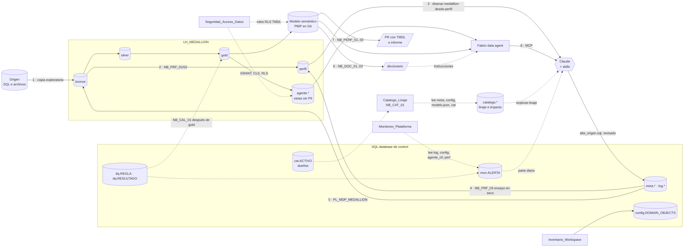

# BIA: Ingeniería y Arquitectura de Datos

Frameworks reutilizables para **Ingeniería** y **Arquitectura de Datos** sobre Microsoft Fabric, con Claude como asistente en cada paso. Cada caso tiene su carpeta con el contexto, las decisiones, los artefactos (SQL, notebooks, skills) y cómo validarlo y operarlo.

El patrón es el mismo en todos: **un notebook deja los datos listos, Claude trabaja con una skill, una persona revisa y un notebook carga solo lo aprobado.** Claude no escribe directo en la base de control, el lakehouse ni el modelo publicado.

## Índice

### Plataforma

| Caso | Para qué | Prefijo | Skill de Claude |
|---|---|---|---|
| [Inventario de un workspace](Inventario_Workspace/README.md) | Sincronizar los items de uno o más workspaces con la base de control (staging + `MERGE`, IDs estables y bajas lógicas) | `NB_INV_` | — |
| [Desplegar entre ambientes (CI/CD)](Despliegue_Entre_Ambientes/README.md) | Llevar lo que se arma en DES a TEST y PRD: repo por implementación, `parameter.yml`, migraciones de la base de control y GitHub Actions con fabric-cicd y aprobación para PRD | — | `revisar-despliegue-fabric` |
| [Monitorear la plataforma](Monitoreo_Plataforma/README.md) | Juntar el estado de todos los casos en el esquema `mon`, abrir y cerrar alertas con reglas fijas (fallas, SLA, calidad, volumen, agente, performance), avisar por un solo canal y armar el parte diario | `NB_MON_` | `diagnosticar-plataforma` |
| [Catálogo y linaje](Catalogo_Linaje/README.md) | Unir inventario, metadata, perfil y modelos en un grafo origen → bronze → silver → gold → modelo → reporte: impacto de un cambio, procedencia de un número, dueños, y hallazgos como dependencias faltantes o PII que llega a gold | `NB_CAT_` | `explorar-linaje` |
| [Seguridad y acceso a los datos](Seguridad_Acceso_Datos/README.md) | Decidir quién ve qué con una matriz aprobada por el dueño de los datos y generar los permisos: `GRANT` por objeto o sin columnas PII (CLS), RLS en el SQL endpoint y roles RLS en TMDL. Relevar PII y roles reales contra la matriz | `NB_SEG_` | `proponer-accesos-datos` |

### Datos: del origen a gold

| Caso | Para qué | Prefijo | Skill de Claude |
|---|---|---|---|
| [Perfilar un origen](Perfilado_Origen_Medallion/README.md) | Conocer el origen con datos (claves, tipos reales, nulos, relaciones, PII) y convertir ese perfil en el diseño de silver y gold y en la metadata del pipeline | `NB_PRF_` | `disenar-medallion-desde-perfil` |
| [Pipeline metadata-driven medallion](Pipeline_Metadata_Medallion/README.md) | Cargar bronze, silver y gold con un solo pipeline y cuatro notebooks, según una base de control en SQL. Incluye historia (SCD tipo 2) y bajas del origen | `NB_MDP_` | `metadata-medallion` |
| [Calidad y reconciliación](Calidad_Reconciliacion/README.md) | Controlar gold después de cada carga: cuadre entre capas por período, hechos sin dimensión, frescura y reglas de negocio. Si una regla grave falla, el pipeline frena antes de refrescar el modelo | `NB_CAL_` | `proponer-reglas-calidad` |

### Consumo: modelo semántico y agente

| Caso | Para qué | Prefijo | Skill de Claude |
|---|---|---|---|
| [Documentar un modelo semántico](Documentar_Modelo_Semantico/README.md) | Extraer la estructura y una muestra del modelo, redactar el diccionario con Claude y cargar las descripciones revisadas | `NB_DOC_` | `documentar-modelo-semantico` |
| [Performance de un modelo semántico PBIP](Performance_Modelo_Semantico/README.md) | Medir, proponer y aplicar optimizaciones en TMDL por PR, y comparar antes y después | `NB_PERF_` | `optimizar-modelo-semantico` |
| [Agente de datos en Fabric](Agente_Datos_Fabric/README.md) | Un Fabric data agent sobre gold que Claude usa por MCP, con mejora continua a partir de preguntas validadas por cada área | `NB_AGT_` | `agente-datos-fabric` |

### Transversal

| Documento | Qué tiene |
|---|---|
| [Catálogo de skills](docs/catalogo_skills.md) | Las diez skills de datos: qué hace cada una, en qué situación usarla, cuáles se confunden y cómo se encadenan. Suma las de BIA Time Agent |
| [Skills de BIA Time Agent (copia)](BIA_Time_Agent/README.md) | Las 14 skills del agente de carga de horas en Redmine, copiadas de `bia-da-agentic` v0.20.0, con los ejemplos de clientes anonimizados |
| [Convenciones](docs/convenciones.md) | Estructura de carpetas, nombres, rutas del lakehouse, una sola base de control, dónde van los artefactos de cada implementación y los desvíos corregidos |
| [Frameworks propuestos](docs/frameworks_propuestos.md) | Lo que falta para llevar esto a producción (costos y capacidad), priorizado. CI/CD, monitoreo, seguridad, calidad, historia con bajas y catálogo ya están construidos |
| [Wiki de Copilot (copia)](docs/copilot-javier-ramos/README.md) | Copia de la wiki de Javier Ramos sobre MCP, Copilot y agentes de Data Analytics (BIA Time Agent, Ayudin) |
| [Guía de lectura de la wiki de Copilot](docs/guia_wiki_copilot.md) | Resumen, conceptos clave con diagramas, análisis de Ayudin YPFL y orden de lectura |
| [Repo bia-da-agentic](docs/bia_da_agentic.md) | Cómo clonar en Windows el repo de los agentes de Data Analytics y qué hay en cada carpeta |

## Cómo se conectan los casos



### Secuencia recomendada para un origen nuevo

| Paso | Caso | Qué sale | Lo usa |
|---|---|---|---|
| 0 | Pipeline medallion: base de control, lakehouse y pipeline armados en desarrollo | Base de control (`DB_TDM_Platform`), `LH_MEDALLION`, `PL_MDP_MEDALLION` | Todos los pasos siguientes |
| 1 | Perfilado: carga exploratoria (`LOAD_GROUP = exploracion`, `p_layers = bronze`) | Bronze con una copia completa | Paso 2 |
| 2 | Perfilado: `NB_PRF_01` y `NB_PRF_02` | `perfil.*`, `perfil.json`, `resumen_perfil.md` | Paso 3 |
| 3 | Perfilado: skill `disenar-medallion-desde-perfil` | `diseno_<origen>.md`, `alta_<origen>.sql` | Pasos 4 y 5 |
| 4 | Perfilado: `NB_PRF_03` con el `CONFIG_JSON` real | `perfil.validacion` sin bloqueantes | Paso 5 |
| 5 | Pipeline medallion: corrida completa, con las reglas de [calidad](Calidad_Reconciliacion/README.md) al final | Silver y gold que cuadran | Pasos 6 a 8 |
| 6 | Documentar el modelo que lee gold | `modelo.json`, diccionario, descripciones en el modelo | Pasos 7 y 8 |
| 7 | Performance del modelo (reusa `modelo.json`) | PR con cambios TMDL e `informe_perf.md` | El modelo en producción |
| 8 | Agente de datos sobre `agente.*` y el modelo | Agente publicado y evaluado | Negocio, Claude vía MCP |

El inventario es independiente: se puede correr en cualquier momento para tener la lista de items de la plataforma. El [catálogo](Catalogo_Linaje/README.md) se arma una vez por día, cuando hay metadata y modelos documentados (después del paso 6), y se consulta antes de cada cambio. El [monitoreo](Monitoreo_Plataforma/README.md) se prende después del paso 5, cuando hay corridas reales, y suma reglas a medida que se agregan el agente y las mediciones de performance. La [seguridad](Seguridad_Acceso_Datos/README.md) se define antes de abrir gold, las vistas `agente.*` y el modelo a usuarios de negocio (pasos 6 a 8), y se revisa después de cada despliegue. El [despliegue entre ambientes](Despliegue_Entre_Ambientes/README.md) acompaña todos los pasos: lo que se arma en DES llega a TEST y PRD por PR, y los artefactos de cada paso (`alta_<origen>.sql`, diccionarios, instrucciones de agentes) viven en el repo de la implementación.

### Qué se comparte entre casos

| Pieza | Quién la escribe | Quién la lee |
|---|---|---|
| `meta.ENTITY`, `ENTITY_COLUMN`, `DQ_RULE`, `GOLD_OBJECT` | Perfilado (vía Claude), Pipeline medallion | Pipeline medallion, `NB_PRF_03` |
| `CONFIG_JSON` de `meta.usp_GET_RUN_CONFIG` | Base de control | `NB_MDP_00`, `NB_PRF_03` |
| `bronze.*` | Pipeline medallion | Perfilado, silver |
| `gold.*` | Pipeline medallion | Modelo semántico, vistas `agente.*` |
| `Files/doc_modelos/<modelo>/modelo.json` | `NB_DOC_01` | Skill de documentación, Performance, Catálogo (de qué tabla lee cada tabla del modelo) |
| [`Comun/patrones_sensibles.json`](Comun/README.md) (nombres de columna PII) | Una persona, por PR | `NB_DOC_01`, `NB_PRF_01`, `NB_SEG_01..02` |
| Base de control: `config.*`, `meta.*`, `log.*` | Inventario, Pipeline medallion, Perfilado | Pipeline medallion, `NB_PRF_03`, Monitoreo |
| `mon.*` (SLA y alertas) | Monitoreo (`NB_MON_01`) | Reporte operativo, skill `diagnosticar-plataforma` |
| `agente_ctl.eval_historial`, `perf.comparacion` | Agente, Performance | Monitoreo |
| `dq.REGLA`, `dq.RESULTADO` | Calidad (reglas vía Claude, revisadas) | `PL_MDP_MEDALLION` (frena si falla), Monitoreo |
| `meta.ENTITY_COLUMN.IS_PII` y `Comun/patrones_sensibles.json` | Perfilado (vía Claude), una persona | Seguridad (qué columnas no ve cada grupo), Catálogo (PII que llega a gold) |
| `cat.ACTIVO`, `catalogo.*` | Catálogo (dueños vía Claude, revisados; linaje con `NB_CAT_01`) | Skill `explorar-linaje`, análisis de impacto antes de un cambio |

## Estado de prueba

| Caso | Probado localmente | Probado en Fabric real |
|---|---|---|
| Inventario_Workspace | — | No: la versión v2 y el stored procedure sin ejecutar [dato a confirmar] |
| Perfilado_Origen_Medallion | Sí, `pruebas/prueba_local.py` (Spark 3.5.3 + Delta 3.2.1) | No |
| Pipeline_Metadata_Medallion | Sí, notebooks con `pruebas/prueba_local.py`; SCD2 y bajas con `pruebas/prueba_scd2_bajas.py` | No: pipeline y stored procedures sin ejecutar |
| Calidad_Reconciliacion | Sí, lógica del notebook y reglas de ejemplo en Spark 3.5.3 | No: T-SQL y actividades del pipeline sin ejecutar |
| Documentar_Modelo_Semantico | — | No |
| Performance_Modelo_Semantico | Sí, lógica de los notebooks | No |
| Agente_Datos_Fabric | Sí, reglas del banco y MCP contra un agente simulado | No: SDK y vistas sin ejecutar |
| Despliegue_Entre_Ambientes | Sí, scripts y workflows con el validador real de fabric-cicd 1.4.0 | No: sin despliegue real, login OIDC ni conexión a la base |
| Monitoreo_Plataforma | Sí, las reglas del notebook con situaciones armadas | No: script SQL, JDBC y avisos sin ejecutar |
| Seguridad_Acceso_Datos | Sí, PII, matrices, scripts generados y revisión con datos armados | No: consultas al endpoint y scripts de permisos sin ejecutar |
| Catalogo_Linaje | Sí, funciones sin Spark y notebook completo con Spark 3.5.3 + Delta | No: T-SQL, lectura de reportes con sempy y origen de las tablas en TOM sin ejecutar |

Las pruebas locales corren en cada PR con [`.github/workflows/pruebas.yml`](.github/workflows/pruebas.yml). Probá siempre primero en un workspace de desarrollo.

## Instalar las skills

Qué hace cada skill y cuándo conviene usarla está en el [catálogo de skills](docs/catalogo_skills.md). Cada skill está en `<Caso>/skill/<nombre>/`. Para Claude Code, copiá la carpeta a `.claude/skills/` del proyecto donde trabajás; en claude.ai, subila como skill. Las diez skills de BIA se pueden instalar juntas: cada una dice en su `description` cuándo usarla.

## Estructura

```text
BIA/
├── README.md
├── .github/workflows/pruebas.yml
├── docs/
│   ├── catalogo_skills.md
│   ├── convenciones.md
│   └── frameworks_propuestos.md
├── Comun/                         patrones_sensibles.json
├── Inventario_Workspace/          sql/ · notebooks/NB_INV_01
├── Perfilado_Origen_Medallion/    sql/ · notebooks/NB_PRF_01..03 · skill/disenar-medallion-desde-perfil/ · pruebas/
├── Pipeline_Metadata_Medallion/   sql/ · notebooks/NB_MDP_00..30 · skill/metadata-medallion/ · pruebas/
├── Calidad_Reconciliacion/        sql/ · notebooks/NB_CAL_01 · skill/proponer-reglas-calidad/ · pruebas/
├── Documentar_Modelo_Semantico/   notebooks/NB_DOC_01..03 · skill/documentar-modelo-semantico/
├── Performance_Modelo_Semantico/  notebooks/NB_PERF_01..03 · skill/optimizar-modelo-semantico/ · ci/ · pruebas/
├── Agente_Datos_Fabric/           sql/ · notebooks/NB_AGT_01..03 · mcp/ · skill/agente-datos-fabric/ · pruebas/
├── Despliegue_Entre_Ambientes/    plantilla_repo/ (workflows, deploy/, parameter.yml) · skill/revisar-despliegue-fabric/ · pruebas/
├── Monitoreo_Plataforma/          sql/ · notebooks/NB_MON_01 · skill/diagnosticar-plataforma/ · pruebas/
├── Catalogo_Linaje/               sql/ · notebooks/NB_CAT_01 · skill/explorar-linaje/ · pruebas/
└── Seguridad_Acceso_Datos/        notebooks/NB_SEG_01..02 · skill/proponer-accesos-datos/ · pruebas/
```

La estructura de cada carpeta y las convenciones de nombres están en [docs/convenciones.md](docs/convenciones.md).

## Cómo usar este repositorio

1. Empezá por el README del caso: objetivo, requisitos y flujo.
2. Revisá scripts y notebooks antes de correrlos y completá los valores de tu entorno (están marcados como `<...>`).
3. Probá en desarrollo y validá con la sección *Cómo validar* de cada caso antes de pasar a producción.
4. Leé las advertencias de seguridad y de cambios con impacto antes de tocar credenciales o datos reales.

## Convenciones de documentación

- Primero el problema y el resultado esperado, después los pasos técnicos.
- Servicios, permisos, dependencias y configuración necesarios, explícitos.
- Marcadores descriptivos para los valores del entorno; nunca secretos, tokens ni datos sensibles.
- Separar los pasos de lectura, los de escritura y los que modifican o borran datos.
- Validaciones, limitaciones y cómo volver atrás.
- Lo que cambia con el tiempo (precios, límites, previews) marcado como `[verificar]` o `[dato a confirmar]`.

## Alcance y responsabilidad

La documentación es una base de trabajo que debe revisarse frente al entorno, las políticas y las versiones de las herramientas utilizadas. Los ejemplos no reemplazan la revisión técnica ni la aprobación necesaria para ejecutar cambios en ambientes compartidos o productivos.
