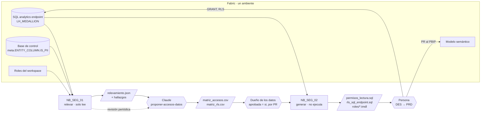

# Seguridad y acceso a los datos

**En corto:** `NB_PRF_01` y `NB_DOC_01` detectan PII, y el pipeline medallion la deja fuera de los rechazos y de gold. Lo que faltaba es decidir **quién ve qué** y aplicarlo. Este framework lo resuelve con una **matriz de accesos** en CSV, versionada en el repo de la implementación y aprobada por el dueño de los datos. La matriz define los roles de workspace por grupo de Entra ID, la lectura por capa o por objeto, qué grupos ven PII y los filtros por fila. Hay dos notebooks y una skill:

- **`NB_SEG_01`** releva el estado real (objetos, columnas PII, roles y permisos vigentes) y lo compara con la matriz.
- **La skill [`proponer-accesos-datos`](skill/proponer-accesos-datos/SKILL.md)** le sirve a Claude para proponer la matriz y revisar los scripts.
- **`NB_SEG_02`** genera los scripts: `GRANT` por objeto o por columnas sin PII (CLS), RLS en el SQL analytics endpoint y roles RLS en TMDL para el modelo semántico.

Nadie ejecuta permisos de forma automática: los scripts los corre una persona, primero en DES.

| Archivo | Qué es | ¿Escribe? |
|---|---|---|
| [`notebooks/NB_SEG_01_relevar_accesos.ipynb`](notebooks/NB_SEG_01_relevar_accesos.ipynb) | Catálogo y PII del SQL analytics endpoint, roles del workspace, permisos SQL vigentes, hallazgos y `relevamiento.json` | Solo `Files/seguridad/relevamiento.json` |
| [`notebooks/NB_SEG_02_generar_scripts.ipynb`](notebooks/NB_SEG_02_generar_scripts.ipynb) | Valida las matrices aprobadas y genera `permisos_lectura.sql`, `vuelta_atras_grants.sql`, `rls_sql_endpoint.sql`, `roles/<grupo>.tmdl` y `resumen.md` | Solo `Files/seguridad/scripts/` |
| [`skill/proponer-accesos-datos/`](skill/proponer-accesos-datos/SKILL.md) | Skill de Claude: proponer la matriz, revisar los scripts y la revisión periódica de accesos | No: genera CSV e informe |
| [`plantillas/matriz_accesos.csv`](skill/proponer-accesos-datos/plantillas/matriz_accesos.csv) · [`matriz_rls.csv`](skill/proponer-accesos-datos/plantillas/matriz_rls.csv) | Las dos matrices, con un ejemplo y nada aprobado | — |
| [`pruebas/prueba_local.py`](pruebas/prueba_local.py) | Detección de PII, validación de matrices, scripts generados y revisión, con datos armados | No |

---

## 1. Cómo funciona

- **PII, una sola definición.** Una columna es PII si está marcada con `IS_PII` en `meta.ENTITY_COLUMN`, si tiene el mismo nombre que una columna marcada, o si su nombre coincide con [`Comun/patrones_sensibles.json`](../Comun/README.md). Las coincidencias por nombre que no son PII (`nombre_producto`) se declaran en `EXCEPCIONES_PII` después de revisarlas.
- **Permisos por objeto, no por esquema.** Un `GRANT` sobre un esquema cubre también las tablas que se agreguen, incluidas las que tengan PII. Por eso el script da permisos por objeto, y por columnas cuando el grupo no ve PII. La contra es que una tabla nueva necesita regenerar y correr el script: `NB_SEG_01` la marca como `SEG_SQL_PERMISO_FALTANTE`.
- **La matriz vive en el repo de la implementación** (`seguridad/` en `TDM_Platform`), no en BIA ni en la base: cada cambio de acceso queda con su PR, su aprobación y su historia.

## 2. Dónde se aplica cada permiso

| Capa | Mecanismo | Lo genera | Comentario |
|---|---|---|---|
| Workspace | Roles Admin, Member, Contributor, Viewer | — (se asigna en el portal) | `NB_SEG_01` compara contra las filas `WORKSPACE` de la matriz. Negocio y analistas no necesitan rol de workspace |
| SQL analytics endpoint | `GRANT SELECT` por objeto y por columnas (CLS) | `NB_SEG_02` | Lo usan analistas, el data agent y cualquier herramienta SQL |
| SQL analytics endpoint | RLS con `CREATE SECURITY POLICY` | `NB_SEG_02` | Filtros fijos por grupo. [verificar] soporte en el SQL analytics endpoint del lakehouse |
| Modelo semántico | Roles RLS en TMDL (`definition/roles/`) | `NB_SEG_02` | Se suben por PR al PBIP, igual que los cambios de [Performance](../Performance_Modelo_Semantico/README.md). Los miembros se asignan en el servicio |
| Items (reportes, modelo, agente) | Compartir el item con el grupo | — | Fuera del alcance de los notebooks: anotalo en el informe |
| OneLake (Spark, accesos directos a archivos) | OneLake security, roles de acceso a datos | — | Opción para cuando otros motores lean el lakehouse. [verificar estado de GA y cómo convive con los permisos del endpoint] |

**Recomendación:** permisos del endpoint para todo lo que se lee por SQL (incluido el agente) y roles RLS en el modelo semántico para los reportes. Un modelo Direct Lake puede no respetar la RLS del endpoint, según cómo se conecte y con qué identidad [verificar el comportamiento vigente de Direct Lake con RLS en el endpoint]. Por eso la RLS del modelo se define aparte y con los mismos valores.

## 3. Requisitos

| Qué | Para qué |
|---|---|
| Grupos de Entra ID creados por un administrador del tenant | Destinatarios de todos los permisos. Ninguna persona con permiso directo |
| Identidad que corre los notebooks: rol en el workspace para leer roles, `VIEW DEFINITION` o similar en el endpoint para leer `sys.database_permissions` [verificar el permiso mínimo], `SELECT` en `meta` de la base de control | `NB_SEG_01` |
| Persona que aplica los scripts: Admin del workspace o permiso para dar `GRANT` en el endpoint | Correr los scripts generados |
| `semantic-link-labs==0.17.1` | `list_workspace_role_assignments` |
| Dueño de los datos por área | Aprueba la matriz (`aprobada = si`) |

## 4. Pasos

1. **Relevar (solo lectura).** Corré `NB_SEG_01` en DES con `SQL_SERVER`, `SQL_DATABASE`, `ENDPOINT_SERVIDOR` y `WORKSPACE`. Revisá los hallazgos `SEG_PII_EN_*`: la PII en gold o en `agente` se corrige sacándola del objeto (en `meta.GOLD_OBJECT` o en la vista), no con permisos.
2. **Proponer.** Pasale a Claude `Files/seguridad/relevamiento.json` con la skill `proponer-accesos-datos`. Devuelve las dos matrices con `aprobada = no` y el informe.
3. **Aprobar.** Guardá las matrices en `seguridad/` del repo de la implementación y abrí un PR. El dueño de los datos marca `aprobada = si`. Las filas con `[dato a confirmar]` no se pueden aprobar.
4. **Generar.** Subí las matrices aprobadas a `Files/seguridad/` y corré `NB_SEG_02`. Si una matriz tiene problemas, el notebook corta y los lista.
5. **Aplicar en DES (cambio con impacto).** Corré `permisos_lectura.sql` y, si hay, `rls_sql_endpoint.sql` en el SQL analytics endpoint. Agregá los `roles/*.tmdl` al PBIP por PR y asigná los grupos a cada rol en el servicio. Avisá antes a los grupos afectados.
6. **Validar.** Probá con un usuario de cada grupo: lo que ve y lo que no (ver la sección 5). Volvé a correr `NB_SEG_01`: no tienen que quedar hallazgos `SEG_SQL_*` de severidad ALTA.
7. **PRD.** Regenerá con `AMBIENTE = "PRD"` (los objetos pueden diferir) y repetí los pasos 5 y 6. Guardá los scripts aplicados en el repo de la implementación.
8. **Revisión periódica.** `NB_SEG_01` una vez por mes o después de cada despliegue, y la tarea C de la skill. Si querés que llegue como alerta, sumá sus hallazgos ALTA a [Monitoreo_Plataforma](../Monitoreo_Plataforma/README.md) (próximo paso).

## 5. Cómo validar

| Prueba | Resultado esperado |
|---|---|
| [`pruebas/prueba_local.py`](pruebas/prueba_local.py) | `Todo OK` |
| Usuario de analistas: `SELECT TOP 10 * FROM silver.clientes` | Error de permisos (no tiene las columnas PII); `SELECT cliente_id, zona FROM silver.clientes` funciona |
| Usuario de negocio Norte: `SELECT DISTINCT zona FROM gold.fact_ventas` o la vista del agente | Solo `Norte` |
| Usuario de negocio: `SELECT * FROM bronze.erp_clientes` | Error de permisos |
| Reporte con un usuario de cada rol (o *Ver como* rol en el servicio) | Solo sus filas |
| `NB_SEG_01` después de aplicar | Sin `SEG_SQL_PII_EXPUESTA` ni `SEG_SQL_PERMISO_DE_MAS` |

**Qué está probado y qué no.** La lógica de los dos notebooks se probó localmente con pandas (`prueba_local.py`, en el CI de BIA). **No está probado** en Fabric real: las consultas a `INFORMATION_SCHEMA` y `sys.database_permissions` del endpoint, `list_workspace_role_assignments`, ni que los scripts generados corran (sobre todo `CREATE SECURITY POLICY` e `IS_MEMBER` con grupos de Entra ID, marcados [verificar]). Probalo primero en un workspace de desarrollo con un grupo de prueba.

## 6. Operación (mini runbook)

| Situación | Qué hacer |
|---|---|
| Piden acceso para una persona | Se agrega la persona al grupo de Entra ID que corresponde. La matriz no cambia |
| Piden acceso para un área nueva | Fila nueva en la matriz por PR, aprobación del dueño, `NB_SEG_02` y aplicar |
| Se agregó una tabla a gold | `NB_SEG_01` la muestra como `SEG_SQL_PERMISO_FALTANTE`. Regenerá y aplicá: los grupos no la ven hasta entonces |
| Un grupo dejó de ver datos después de aplicar RLS | Ese grupo no tiene fila para la tabla en `matriz_rls.csv`. Agregala, con `*` si ve todo. Para volver atrás rápido, `DROP SECURITY POLICY` (está al final del script) |
| Hallazgo `SEG_SQL_PERMISO_DE_MAS` | Alguien dio permisos a mano. Revocá con `REVOKE` o sumalo a la matriz si estaba justificado |
| Hay que quitar todos los permisos de lectura de un ambiente | `vuelta_atras_grants.sql`. **Cambio con impacto**: deja sin datos a todos los grupos |

## Próximos pasos

1. Crear los grupos de Entra ID reales [dato a confirmar: nombres y dueños de cada área].
2. Correr `NB_SEG_01` en DES y corregir la PII que aparezca en gold o en `agente`.
3. Proponer la primera matriz con Claude, aprobarla y aplicarla en DES.
4. Sumar los hallazgos ALTA de `NB_SEG_01` al monitoreo de la plataforma.
5. Más adelante: RLS dinámica con una tabla de asignación por usuario y etiquetas de sensibilidad aplicadas desde Purview.
