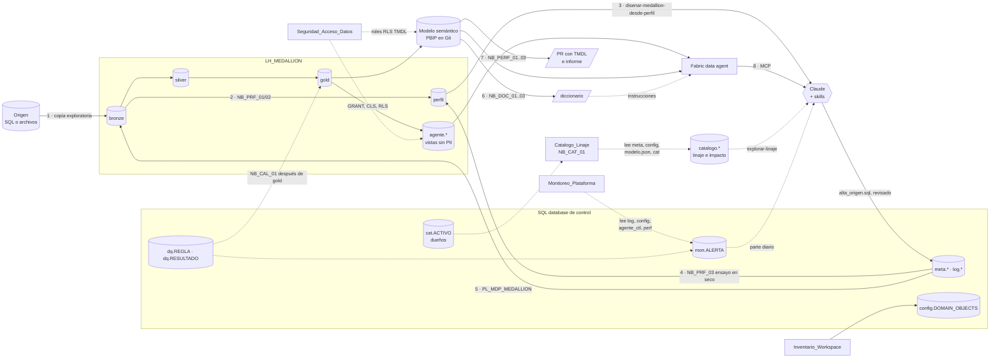

# Arquitectura: cómo encajan los casos

**En corto:** los casos de datos comparten una base de control en SQL y un lakehouse con capas bronze, silver y gold. Esta página muestra cómo se conectan, en qué orden se arma un origen nuevo y qué pieza escribe o lee cada caso. Los términos están en el [glosario](glosario.md).

## 1. Cómo se conectan los casos

## 2. Secuencia recomendada para un origen nuevo

| Paso | Caso | Qué sale | Lo usa |
|---|---|---|---|
| 0 | Pipeline medallion: base de control, lakehouse y pipeline armados en desarrollo | Base de control (`DB_TDM_Platform`), `LH_MEDALLION`, `PL_MDP_MEDALLION` | Todos los pasos siguientes |
| 1 | Perfilado: carga exploratoria (`LOAD_GROUP = exploracion`, `p_layers = bronze`) | Bronze con una copia completa | Paso 2 |
| 2 | Perfilado: `NB_PRF_01` y `NB_PRF_02` | `perfil.*`, `perfil.json`, `resumen_perfil.md` | Paso 3 |
| 3 | Perfilado: skill `disenar-medallion-desde-perfil` | `diseno_<origen>.md`, `alta_<origen>.sql` | Pasos 4 y 5 |
| 4 | Perfilado: `NB_PRF_03` con el `CONFIG_JSON` real | `perfil.validacion` sin bloqueantes | Paso 5 |
| 5 | Pipeline medallion: corrida completa, con las reglas de [calidad](../Calidad_Reconciliacion/README.md) al final | Silver y gold que cuadran | Pasos 6 a 8 |
| 6 | Documentar el modelo que lee gold | `modelo.json`, diccionario, descripciones en el modelo | Pasos 7 y 8 |
| 7 | Performance del modelo (reusa `modelo.json`) | PR con cambios TMDL e `informe_perf.md` | El modelo en producción |
| 8 | Agente de datos sobre `agente.*` y el modelo | Agente publicado y evaluado | Negocio, Claude vía MCP |

El inventario es independiente: se puede correr en cualquier momento para tener la lista de items de la plataforma. El [catálogo](../Catalogo_Linaje/README.md) se arma una vez por día, cuando hay metadata y modelos documentados (después del paso 6), y se consulta antes de cada cambio. El [monitoreo](../Monitoreo_Plataforma/README.md) se prende después del paso 5, cuando hay corridas reales, y suma reglas a medida que se agregan el agente y las mediciones de performance. La [seguridad](../Seguridad_Acceso_Datos/README.md) se define antes de abrir gold, las vistas `agente.*` y el modelo a usuarios de negocio (pasos 6 a 8), y se revisa después de cada despliegue. El [despliegue entre ambientes](../Despliegue_Entre_Ambientes/README.md) acompaña todos los pasos: lo que se arma en DES llega a TEST y PRD por PR, y los artefactos de cada paso (`alta_<origen>.sql`, diccionarios, instrucciones de agentes) viven en el repo de la implementación.

## 3. Qué se comparte entre casos

| Pieza | Quién la escribe | Quién la lee |
|---|---|---|
| `meta.ENTITY`, `ENTITY_COLUMN`, `DQ_RULE`, `GOLD_OBJECT` | Perfilado (vía Claude), Pipeline medallion | Pipeline medallion, `NB_PRF_03` |
| `CONFIG_JSON` de `meta.usp_GET_RUN_CONFIG` | Base de control | `NB_MDP_00`, `NB_PRF_03` |
| `bronze.*` | Pipeline medallion | Perfilado, silver |
| `gold.*` | Pipeline medallion | Modelo semántico, vistas `agente.*` |
| `Files/doc_modelos/<modelo>/modelo.json` | `NB_DOC_01` | Skill de documentación, Performance, Catálogo (de qué tabla lee cada tabla del modelo) |
| [`Comun/patrones_sensibles.json`](../Comun/README.md) (nombres de columna PII) | Una persona, por PR | `NB_DOC_01`, `NB_PRF_01`, `NB_SEG_01..02` |
| Base de control: `config.*`, `meta.*`, `log.*` | Inventario, Pipeline medallion, Perfilado | Pipeline medallion, `NB_PRF_03`, Monitoreo |
| `mon.*` (SLA y alertas) | Monitoreo (`NB_MON_01`) | Reporte operativo, skill `diagnosticar-plataforma` |
| `agente_ctl.eval_historial`, `perf.comparacion` | Agente, Performance | Monitoreo |
| `dq.REGLA`, `dq.RESULTADO` | Calidad (reglas vía Claude, revisadas) | `PL_MDP_MEDALLION` (frena si falla), Monitoreo |
| `meta.ENTITY_COLUMN.IS_PII` y `Comun/patrones_sensibles.json` | Perfilado (vía Claude), una persona | Seguridad (qué columnas no ve cada grupo), Catálogo (PII que llega a gold) |
| `cat.ACTIVO`, `catalogo.*` | Catálogo (dueños vía Claude, revisados; linaje con `NB_CAT_01`) | Skill `explorar-linaje`, análisis de impacto antes de un cambio |
