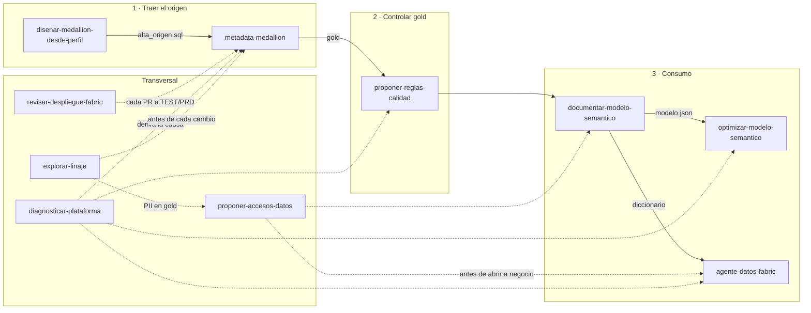

# Catálogo de skills de BIA

**En corto:** BIA tiene **diez skills de Claude** para los casos de datos, una por caso (el inventario no tiene), y una **copia de las 14 skills de BIA Time Agent** (carga de horas en Redmine, sección 8). Todas siguen la misma regla: Claude lee lo que dejó un notebook, propone archivos (CSV, SQL, Markdown o un PR) y **una persona revisa y aplica**. Ninguna escribe en Fabric. Esta página dice qué hace cada una y en qué situación conviene usarla.

Relevamiento del 2026-10-26 sobre `main` (después del merge del PR #12). Sección 8 agregada el mismo día desde `bia-da-agentic` v0.20.0.

---

## 1. Las diez skills de datos de un vistazo

| Skill | Caso | Para qué sirve | Usala cuando… | Necesita antes |
|---|---|---|---|---|
| [`disenar-medallion-desde-perfil`](../Perfilado_Origen_Medallion/skill/disenar-medallion-desde-perfil/SKILL.md) | Perfilar un origen | Convierte el perfil de un origen en el diseño de silver y gold y en la metadata del pipeline | Llega un origen nuevo y querés decidir claves, tipos, PII y reglas **con datos** | `NB_PRF_01/02` (`perfil.json`) |
| [`metadata-medallion`](../Pipeline_Metadata_Medallion/skill/metadata-medallion/SKILL.md) | Pipeline medallion | Escribe las filas de `meta.*` (entidades, columnas, reglas, gold) y diagnostica corridas | Sumás una tabla, armás un objeto gold, guardás historia (SCD2) o bajas, o falló una carga | DDL o muestra del origen; `log.RUN_STEP` para diagnosticar |
| [`proponer-reglas-calidad`](../Calidad_Reconciliacion/skill/proponer-reglas-calidad/SKILL.md) | Calidad y reconciliación | Propone reglas de `dq.REGLA` (cuadre, integridad, frescura, volumen, negocio) y explica las que fallan | Querés que gold cuadre con silver antes de refrescar el modelo, o una regla dio rojo | `meta.GOLD_OBJECT`; `dq.RESULTADO` para diagnosticar |
| [`documentar-modelo-semantico`](../Documentar_Modelo_Semantico/skill/documentar-modelo-semantico/SKILL.md) | Documentar un modelo | Redacta descripciones de tablas, columnas y medidas y arma el diccionario con diagrama ER | Un modelo semántico no tiene descripciones o hace falta el diccionario de datos | `NB_DOC_01` (`modelo.json`, `descripciones.csv`) |
| [`optimizar-modelo-semantico`](../Performance_Modelo_Semantico/skill/optimizar-modelo-semantico/SKILL.md) | Performance del modelo | Diagnostica, propone optimizaciones con evidencia y las aplica en TMDL por PR | El modelo es lento, pesa mucho o el BPA marca problemas | `NB_PERF_01/02`, repo PBIP |
| [`agente-datos-fabric`](../Agente_Datos_Fabric/skill/agente-datos-fabric/SKILL.md) | Agente de datos | Redacta instrucciones del Fabric data agent, propone preguntas para el banco, analiza evaluaciones y consulta datos por MCP | Creás o mejorás el agente, o querés preguntarle datos de gold desde Claude | Diccionario, vistas `agente.*`; `NB_AGT_03` para evaluar |
| [`proponer-accesos-datos`](../Seguridad_Acceso_Datos/skill/proponer-accesos-datos/SKILL.md) | Seguridad y acceso | Propone la matriz de quién ve qué (roles, lectura por capa, CLS, RLS) y revisa los scripts generados | Vas a abrir gold, el agente o el modelo a negocio, o toca la auditoría de accesos | `NB_SEG_01` (`relevamiento.json`) |
| [`revisar-despliegue-fabric`](../Despliegue_Entre_Ambientes/skill/revisar-despliegue-fabric/SKILL.md) | Desplegar entre ambientes | Revisa un PR del repo de la implementación antes de TEST/PRD y diagnostica despliegues fallidos | Hay un PR para pasar a producción, falta completar `parameter.yml` o falló el workflow *Desplegar* | Diff del PR, `validar.py`, log de GitHub Actions |
| [`diagnosticar-plataforma`](../Monitoreo_Plataforma/skill/diagnosticar-plataforma/SKILL.md) | Monitorear la plataforma | Arma el parte diario: agrupa alertas por causa raíz, dice si se puede reintentar y a quién avisar | Arranca el día, hay alertas abiertas o gold no llegó | `NB_MON_01` (parte JSON) o `mon.v_alertas_abiertas` |
| [`explorar-linaje`](../Catalogo_Linaje/skill/explorar-linaje/SKILL.md) | Catálogo y linaje | Responde impacto ("qué se rompe si…") y procedencia ("de dónde sale este número"), propone dueños y prioriza hallazgos | Antes de cambiar una tabla o columna, cuando alguien duda de un número o hay que asignar dueños | `NB_CAT_01` (`linaje.json` o `catalogo.*`) |

---

## 2. ¿Qué skill uso? Guía por situación

| Situación | Skill | Tarea dentro de la skill |
|---|---|---|
| "Nos pasaron acceso a una base nueva, ¿qué traemos?" | `disenar-medallion-desde-perfil` | A. Preparar la carga exploratoria |
| "Ya perfilamos, armá silver y gold" | `disenar-medallion-desde-perfil` | B. Diseñar desde `perfil.json` |
| "`NB_PRF_03` dio bloqueantes" | `disenar-medallion-desde-perfil` | C. Revisar la validación |
| "El origen cambió de columnas" | `disenar-medallion-desde-perfil` | D. Comparar corridas de perfil |
| "Sumá esta tabla al lakehouse" (tengo el DDL, sin perfil) | `metadata-medallion` | A. Sumar un origen o una tabla |
| "Necesito ventas por cliente y mes en gold" | `metadata-medallion` | B. Armar un objeto gold |
| "Quiero ver en qué zona estaba el cliente el año pasado" / "Reflejá las anulaciones" | `metadata-medallion` | A (`SILVER_MODE = SCD2`, `DELETE_MODE`) y B |
| "Falló la carga de anoche" (una corrida puntual) | `metadata-medallion` | C. Diagnosticar una corrida |
| "¿Cómo estuvo todo hoy?" / varias alertas a la vez | `diagnosticar-plataforma` | Parte diario |
| "Quiero estar seguro de que gold cuadra" | `proponer-reglas-calidad` | A. Proponer reglas |
| "Falló la regla de cuadre de ventas" | `proponer-reglas-calidad` | B. Diagnosticar una regla |
| "Documentá el modelo de Ventas" | `documentar-modelo-semantico` | Descripciones y diccionario |
| "El tablero tarda mucho" / "El modelo pesa demasiado" | `optimizar-modelo-semantico` | A. Diagnosticar y proponer |
| "Aplicá las propuestas aprobadas" | `optimizar-modelo-semantico` | B. Aplicar (rama y PR) |
| "Llegó el informe de `NB_PERF_03`" | `optimizar-modelo-semantico` | C. Cerrar con la medición |
| "Armá el agente para Comercial" | `agente-datos-fabric` | A. Instrucciones y B. Banco de preguntas |
| "El agente empeoró en la evaluación" | `agente-datos-fabric` | C. Analizar una evaluación |
| "¿Cuánto vendimos en marzo de 2026?" (desde Claude) | `agente-datos-fabric` | D. Responder con el agente (MCP) |
| "¿Quién tiene que ver qué?" / "Armá RLS por región" | `proponer-accesos-datos` | A. Proponer la matriz |
| "Revisá los scripts de permisos antes de correrlos" | `proponer-accesos-datos` | B. Revisar los scripts |
| "Toca la auditoría trimestral de accesos" | `proponer-accesos-datos` | C. Revisión periódica |
| "Revisá este PR antes de pasarlo a PRD" | `revisar-despliegue-fabric` | A. Revisar un PR |
| "Falló el workflow Desplegar" | `revisar-despliegue-fabric` | B. Diagnosticar un despliegue |
| "Si renombran `Provincia` en Clientes, ¿qué se rompe?" | `explorar-linaje` | A. Impacto de un cambio |
| "¿De dónde sale este total del reporte?" | `explorar-linaje` | B. Procedencia de un número |
| "¿Quién es dueño de cada tabla?" | `explorar-linaje` | C. Dueños para `cat.ACTIVO` |

### Casos que se confunden

| Duda | Diferencia | Cuál usar |
|---|---|---|
| `disenar-medallion-desde-perfil` o `metadata-medallion` | Las dos escriben la misma metadata. La de perfil **decide con evidencia** (nulos, unicidad, relaciones reales); la de metadata decide con el DDL y supuestos | Con `perfil.json`, la de perfil (que se apoya en la otra). Con solo el DDL o una tabla chica, `metadata-medallion` |
| `metadata-medallion` (tarea C) o `diagnosticar-plataforma` | La primera explica **una corrida** del pipeline. La segunda mira **toda la plataforma** (pipeline, calidad, agente, performance, inventario) y agrupa alertas | Una falla puntual: `metadata-medallion`. El estado del día o varias alertas: `diagnosticar-plataforma` |
| `meta.DQ_RULE` (en `metadata-medallion`) o `proponer-reglas-calidad` | `DQ_RULE` valida **fila por fila** en silver. `dq.REGLA` controla lo que una fila sola no muestra: totales entre capas, hechos sin dimensión, frescura | Formato y valores imposibles: `metadata-medallion`. Cuadre y consistencia de gold: `proponer-reglas-calidad` |
| `documentar-modelo-semantico` u `optimizar-modelo-semantico` | Comparten `modelo.json`. Una escribe **descripciones**; la otra cambia **TMDL** para que sea más rápido | Entender el modelo: documentar. Que ande más rápido: optimizar |
| `proponer-accesos-datos` o `explorar-linaje` para PII | El linaje **detecta** PII que llega a gold o al modelo. Accesos **decide** quién la ve y genera los permisos | Encontrarla: linaje. Protegerla: accesos (y sacarla del `SELECT` con `metadata-medallion`) |

---

## 3. Dónde entra cada skill en el ciclo

Las flechas punteadas son derivaciones: por ejemplo, `diagnosticar-plataforma` encuentra una alerta `CAL_REGLA_FALLA` y manda a `proponer-reglas-calidad` (tarea B); `explorar-linaje` encuentra `FALTA_DEPENDS_ON_GOLD` y manda a `metadata-medallion`.

---

## 4. Ficha de cada skill

### 4.1. `disenar-medallion-desde-perfil`

- **Qué hace:** traduce la evidencia del perfil de un origen (claves candidatas, tipos reales, nulos, relaciones, PII) en un diseño de silver y gold en estrella y en el script de metadata del pipeline. Cada decisión lleva su evidencia en una línea.
- **Tareas:** A. Carga exploratoria · B. Diseño desde `perfil.json` · C. Revisar `NB_PRF_03` · D. Comparar corridas de perfil.
- **Conviene cuando:** el origen es nuevo o poco conocido, tiene muchas tablas, o no hay documentación confiable de claves y relaciones.
- **No conviene cuando:** es una tabla suelta y bien conocida; ahí alcanza con `metadata-medallion`.
- **Entrega:** `alta_exploracion.sql`, `diseno_<origen>.md` (con diagrama) y `alta_<origen>.sql`.
- **Se combina con:** `metadata-medallion` (reglas de nombres y tipos), `proponer-reglas-calidad` (reglas de gold con el mismo perfil).

### 4.2. `metadata-medallion`

- **Qué hace:** escribe las filas de `meta.ENTITY`, `ENTITY_COLUMN`, `DQ_RULE` y `GOLD_OBJECT` que el pipeline ejecuta, incluida historia SCD2 y bajas del origen, y lee `log.RUN` / `log.RUN_STEP` para explicar una falla.
- **Tareas:** A. Sumar un origen o tabla · B. Armar un objeto gold · C. Diagnosticar una corrida.
- **Conviene cuando:** cambia lo que carga el pipeline (tabla nueva, columna nueva, objeto gold, historia, anulaciones) o hay que saber por qué falló una corrida y si se puede reintentar.
- **No conviene cuando:** querés el estado general de la plataforma (`diagnosticar-plataforma`) o el cuadre entre capas (`proponer-reglas-calidad`).
- **Entrega:** `alta_entidad.sql` idempotente (nunca toca `WATERMARK_VALUE`) o un diagnóstico con la acción.
- **Se combina con:** `disenar-medallion-desde-perfil`, `explorar-linaje` (impacto antes de cambiar).

### 4.3. `proponer-reglas-calidad`

- **Qué hace:** propone reglas `COMPARA` y `CONDICION` para `dq.REGLA` (cuadre silver → gold, integridad hecho → dimensión, frescura, volumen y reglas de negocio) y diagnostica las que fallan con `dq.RESULTADO`.
- **Tareas:** A. Proponer reglas para un modelo · B. Diagnosticar una regla que falla.
- **Conviene cuando:** gold alimenta un modelo usado por negocio y preferís "datos de ayer" antes que "datos mal" (una regla `ERROR` frena el pipeline antes de refrescar).
- **No conviene cuando:** el problema es de una fila (formato, valor imposible): eso es `meta.DQ_RULE` con `metadata-medallion`.
- **Entrega:** `alta_reglas_calidad.sql` e `informe_calidad.md`. Umbrales de negocio como `[dato a confirmar]`.
- **Se combina con:** `diagnosticar-plataforma` (las fallas llegan como alertas `CAL_*`).

### 4.4. `documentar-modelo-semantico`

- **Qué hace:** completa `descripciones.csv` (descripción y sensibilidad por tabla, columna y medida) y arma el diccionario con diagrama ER en Mermaid. También funciona con el Power BI Modeling MCP en solo lectura.
- **Conviene cuando:** el modelo no tiene descripciones, se suma gente nueva, se va a publicar a negocio o se va a armar un agente de datos (el diccionario alimenta sus instrucciones).
- **No conviene cuando:** el pedido es de performance (`optimizar-modelo-semantico`).
- **Entrega:** `descripciones.csv` para revisar (una persona pone `revisado = si`) y `diccionario.md`.
- **Se combina con:** `agente-datos-fabric`, `optimizar-modelo-semantico`, `explorar-linaje` (el `modelo.json` da el origen de cada tabla).

### 4.5. `optimizar-modelo-semantico`

- **Qué hace:** lee el diagnóstico (Vertipaq, BPA, Direct Lake fallback) y las mediciones de consultas, propone cambios atómicos con evidencia numérica, aplica los aprobados en archivos `.tmdl` (un commit por propuesta) y cierra con la medición antes/después.
- **Tareas:** A. Diagnosticar y proponer · B. Aplicar aprobadas por PR · C. Cerrar con la medición.
- **Conviene cuando:** el modelo está en PBIP con Git y hay quejas de velocidad, tamaño o refresh.
- **No conviene cuando:** el modelo no está en PBIP: la skill nunca escribe en el modelo publicado (XMLA o TOM), porque la próxima publicación lo pisaría.
- **Entrega:** `propuestas.csv`, rama `perf/<modelo>-<fecha>` con PR y el informe en el PR.
- **Se combina con:** `diagnosticar-plataforma` (alerta `PERF_REGRESION`).

### 4.6. `agente-datos-fabric`

- **Qué hace:** mejora un Fabric data agent con tres palancas que valida el área: instrucciones, ejemplos (pregunta + consulta) y evaluaciones (pregunta + respuesta esperada). Con la herramienta MCP `preguntar_agente_fabric`, responde preguntas citando que el dato viene del agente.
- **Tareas:** A. Redactar instrucciones · B. Proponer preguntas para el banco · C. Analizar una evaluación · D. Responder con el agente.
- **Conviene cuando:** querés que negocio (o Claude) pregunte datos de gold en lenguaje natural con respuestas medibles. "Entrenar" acá es curar ejemplos e instrucciones, no fine-tuning.
- **No conviene cuando:** gold no tiene vistas `agente.*` sin PII ni accesos definidos; primero `proponer-accesos-datos`.
- **Entrega:** `instrucciones_agente.md`, filas de `banco_preguntas.csv` con `estado = PROPUESTA` y la tabla de fallas con causa y cambio.
- **Se combina con:** `documentar-modelo-semantico`, `proponer-accesos-datos`, `diagnosticar-plataforma` (alerta `AGT_NO_APRUEBA`).

### 4.7. `proponer-accesos-datos`

- **Qué hace:** propone la matriz de accesos (grupos de Entra ID, roles de workspace, lectura por capa u objeto, PII con CLS, RLS fijo en el endpoint y en TMDL), revisa los scripts que genera `NB_SEG_02` y clasifica los hallazgos de la revisión periódica.
- **Tareas:** A. Proponer la matriz · B. Revisar los scripts generados · C. Revisión periódica de accesos.
- **Conviene cuando:** se abre gold, el agente o el modelo a usuarios de negocio, después de cada despliegue, o para una auditoría.
- **No conviene cuando:** querés dar o quitar un permiso ya: la skill no ejecuta, propone filas con `aprobada = no` que aprueba el dueño de los datos.
- **Entrega:** `matriz_accesos.csv`, `matriz_rls.csv` e `informe_seguridad.md`.
- **Se combina con:** `explorar-linaje` (PII en gold o en el modelo).

### 4.8. `revisar-despliegue-fabric`

- **Qué hace:** revisa el diff de un PR del repo de una implementación: inventario de items y migraciones, GUID de DES sin parametrizar (propone la entrada de `parameter.yml`), migraciones con impacto, riesgos de datos y orden. Diagnostica fallas del workflow desde el log de GitHub Actions.
- **Tareas:** A. Revisar un PR · B. Diagnosticar un despliegue fallido.
- **Conviene cuando:** algo armado en DES va a TEST o PRD con fabric-cicd.
- **No conviene cuando:** el repo no sigue la plantilla de `Despliegue_Entre_Ambientes/plantilla_repo`.
- **Entrega:** `checklist_despliegue.md` con veredicto (`LISTO`, `LISTO CON CONDICIONES`, `BLOQUEADO`) y vuelta atrás.
- **Se combina con:** todas: cada artefacto de las otras skills llega a PRD por este camino.

### 4.9. `diagnosticar-plataforma`

- **Qué hace:** a partir del parte de `NB_MON_01`, agrupa alertas por causa raíz (una falla en bronze explica las de silver, gold y el SLA), dice la causa probable, si se puede reintentar sin riesgo, a quién avisar, y propone ajustar umbrales que hacen ruido.
- **Conviene cuando:** todos los días, al revisar alertas abiertas, o cuando negocio pregunta por qué no está gold.
- **No conviene cuando:** no hay corridas reales todavía (el monitoreo se prende después del primer pipeline completo).
- **Entrega:** `parte_diario.md` con estado `OK`, `ATENCIÓN` o `CRÍTICO` y próximos pasos.
- **Se combina con:** deriva a `metadata-medallion`, `proponer-reglas-calidad`, `agente-datos-fabric` u `optimizar-modelo-semantico` según la alerta.

### 4.10. `explorar-linaje`

- **Qué hace:** lee el grafo origen → bronze → silver → gold → modelo → reporte que arma `NB_CAT_01` para responder impacto y procedencia, propone dueños y criticidad para `cat.ACTIVO`, y prioriza hallazgos (dependencias faltantes, PII en gold, ciclos, objetos sin uso).
- **Tareas:** A. Impacto de un cambio · B. Procedencia de un número · C. Dueños · D. Revisar hallazgos.
- **Conviene cuando:** antes de cambiar una tabla, columna o modelo; cuando alguien duda de un número; para ordenar responsables.
- **Ojo:** el linaje es por **tabla**, no por columna. Para una columna, la skill revisa el `SQL_TEXT` y el `modelo.json` y dice qué verificó y qué infirió. Lo que depende de una arista de confianza `baja` lleva `[verificar]`.
- **Entrega:** `informe_impacto.md` o `alta_activos.sql`.
- **Se combina con:** `metadata-medallion`, `proponer-accesos-datos`.

---

## 5. Lo que comparten todas

| Regla | Por qué |
|---|---|
| Claude no escribe en Fabric (base de control, lakehouse, modelo publicado ni permisos) | Todo cambio pasa por una persona y por DES primero |
| Lo que no se sabe va como `[dato a confirmar]` y no se carga | Nada de nombres, cifras ni reglas de negocio inventadas |
| Nada de PII en lo que generan, ni credenciales | Los archivos se versionan y se comparten |
| Lo aprobado se marca a mano (`revisado = si`, `aprobada = si`, `estado = VALIDADA`) | La validación es de una persona con nombre y fecha |
| Cierran con **Próximos pasos** | El entregable tiene que poder accionarse |

## 6. Huecos

- **Inventario_Workspace** no tiene skill: es un proceso mecánico (`NB_INV_01`) sin decisiones para Claude. Sus datos los usan `diagnosticar-plataforma` (`INV_ITEMS_BORRADOS`) y `explorar-linaje` (`ITEM_FUERA_DEL_LINAJE`).
- **Costos y capacidad** (framework 7 de [frameworks_propuestos.md](frameworks_propuestos.md)) todavía no existe; hoy `diagnosticar-plataforma` solo señala saturación (`429`, `throttl`) y sugiere mover el horario de carga.

## 7. Instalarlas

Cada skill está en `<Caso>/skill/<nombre>/` con su `SKILL.md` y sus plantillas. En Claude Code, copiá la carpeta a `.claude/skills/` del proyecto; en claude.ai, subila como skill. Se pueden instalar las diez juntas: cada una dice en su `description` cuándo usarla, y Claude elige sola.

## 8. Skills de BIA Time Agent (copia)

Vienen del repo [bia-da-agentic](../Agentes_Data_Analytics/bia_da_agentic.md) y están copiadas (con los ejemplos de clientes anonimizados) en [`Agentes_Data_Analytics/BIA_Time_Agent/skill/`](../Agentes_Data_Analytics/BIA_Time_Agent/README.md). No trabajan sobre Fabric: ayudan a cada colaborador a revisar y cargar sus horas en Redmine, con evidencias de Microsoft 365 (solo metadatos). Las reglas de la sección 5 no aplican; las suyas están en `bia-time-agent`. Se editan en el repo de origen, nunca acá.

| Skill | Usala cuando… | Escribe en Redmine |
|---|---|---|
| `bia-time-agent` | Es el punto de entrada: el agente completo, que carga las demás | Solo lo confirmado |
| `review-time-period` | "¿Qué días me faltan cargar?", "mostrame mis horas" | No |
| `recover-missing-time-period` | "Recuperá desde mi última carga", "completá la semana pasada" | Sí, tras confirmar |
| `propose-time-entry` | "Cargame 2 h de ayer en la reunión con el cliente" | No |
| `prepare-multi-day-entries` | Varios días, una actividad recurrente o el lote de una recuperación | No |
| `create-time-entry` | Después de una propuesta aprobada | Sí |
| `resolve-time-range`, `identify-working-days`, `resolve-time-context` | Las usan las anteriores para fechas, jornada, feriados, licencias y destino | No |
| `collect-work-evidence`, `normalize-work-evidence`, `classify-work-context`, `estimate-work-duration`, `reconcile-evidence-with-time-entries` | Pasos internos de una recuperación | No |

| Duda | Cuál usar |
|---|---|
| Revisar o recuperar | Revisar (`review-time-period`) muestra huecos y no lee el calendario. Recuperar (`recover-missing-time-period`) lee evidencias y propone cargas |
| Una carga o varias | Una: `propose-time-entry`. Varias o un período: `prepare-multi-day-entries` |

Requieren los MCP `redmine`, `vacation-tracker`, `bia-workdays` y `bia-m365` y la configuración personal; se instalan con `npm run install-user` desde `bia-da-agentic`. Detalle y flujo en el [README de la copia](../Agentes_Data_Analytics/BIA_Time_Agent/README.md).
