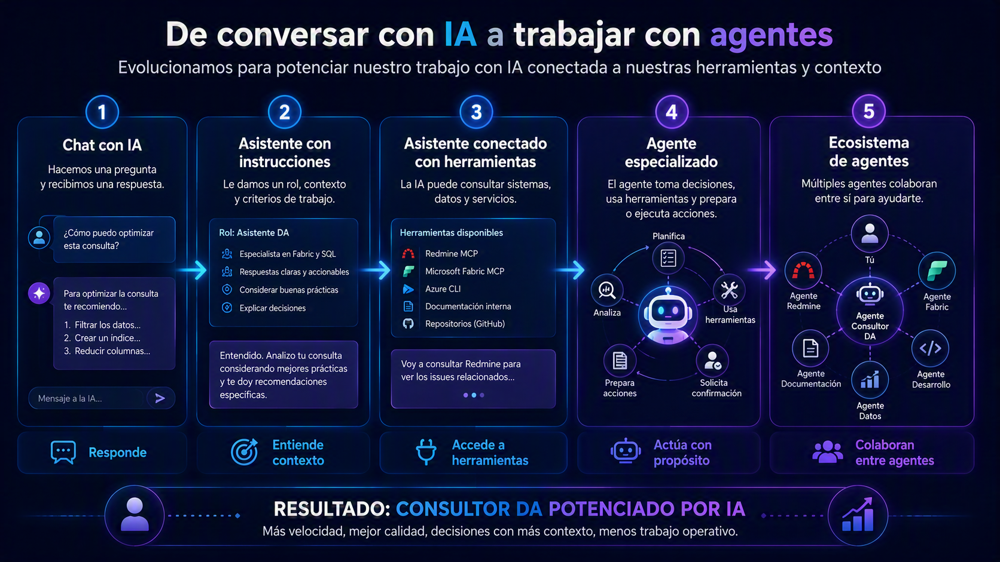

[[_TOC_]]

[[_TOSP_]]

# Overview

En Data Analytics estamos comenzando un recorrido que busca llevar la Inteligencia Artificial desde la curiosidad y la experimentación hacia situaciones concretas de nuestro trabajo diario.

El objetivo no es solamente aprender qué es un MCP, instalar GitHub Copilot, ejecutar comandos desde una terminal o conectarnos con una herramienta.

Todo eso es necesario, pero es solamente el comienzo. La visión que propongo para Data Analytics es más amplia:

> **Potenciar a cada integrante de Data Analytics con agentes que lo ayuden a trabajar mejor, resolver problemas con mayor velocidad y reducir el esfuerzo operativo de todos los días.**

No se trata de reemplazar lo que hacemos. Se trata de ampliar nuestras capacidades.

Queremos que cada persona del equipo pueda contar con asistentes especializados que conozcan sus herramientas, comprendan el contexto de su trabajo, respeten reglas claras y colaboren en actividades reales.

Nuestro objetivo no es tener IA para decir que tenemos IA.

> **Nuestro objetivo es construir agentes que nos ayuden a generar más valor.**

# Por qué estamos hablando de agentes?

Hoy contamos con distintas herramientas de Inteligencia Artificial.

Podemos conversar con un modelo, hacer preguntas, generar código, analizar documentos, redactar contenido o solicitar explicaciones. Todo eso tiene valor.

Pero la mayor oportunidad aparece cuando la IA deja de limitarse a responder preguntas y comienza a colaborar con nosotros utilizando las herramientas que forman parte de nuestro trabajo.

Por ejemplo, un agente podría:
- Consultar los issues asignados en Redmine.
- Preparar una carga de horas.
- Buscar información en la documentación de un proyecto.
- Analizar un requerimiento.
- Revisar código o notebooks.
- Ayudar a investigar un error.
- Consultar información de Microsoft Fabric.
- Asistir en la generación de documentación.
- Proponer pasos para resolver un incidente.
- Preparar una consulta o un script.
- Relacionar información distribuida entre distintas fuentes.

La diferencia no está solamente en la calidad de la respuesta.

La diferencia está en que el agente puede tener:
- Un propósito definido.
- Instrucciones específicas.
- Conocimiento del contexto.
- Acceso controlado a herramientas.
- Reglas que debe respetar.
- Capacidad para preparar o ejecutar acciones.
- Límites claros de autonomía.
- Validación humana en las decisiones importantes.

# De conversar con IA a trabajar con agentes

Podemos pensar la evolución de esta manera:

