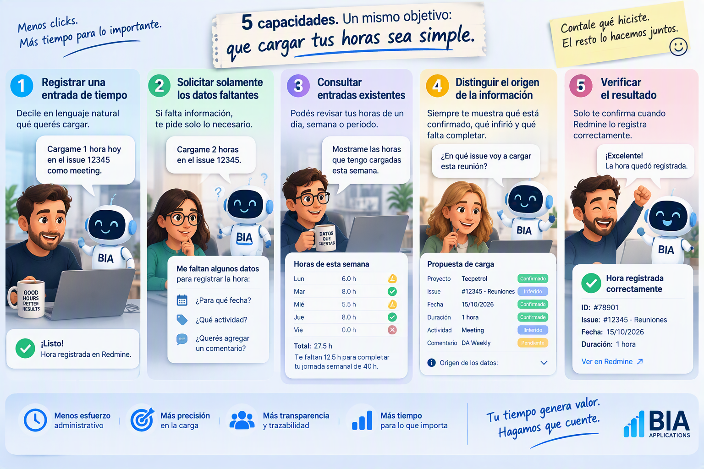
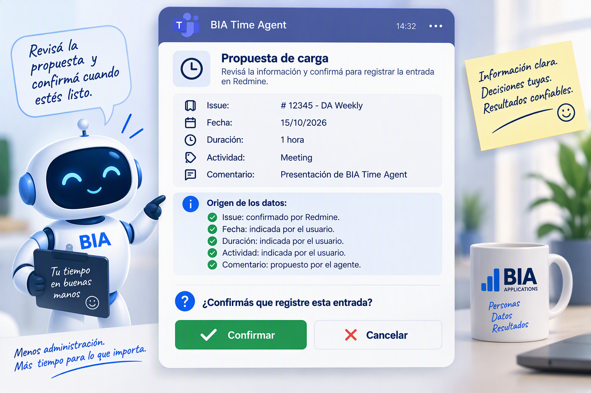

[[_TOC_]]

Overview
========

Esta página explica **qué puede hacer hoy BIA Time Agent**, qué reglas sigue y qué queda fuera de su alcance. Describe la **versión 0.20.0** (Fase 1a y Fase 1b, con las licencias en BIA - Absentismo), disponible en `main` desde el 24/10/2026 (pull request #733).

La primera versión (el MVP) demostró que se puede pasar de un pedido en lenguaje natural a una carga correcta y verificada en Redmine. Sobre esa base se construyeron dos capacidades más: **saber qué te falta cargar** (Fase 1a) y **recuperar un período atrasado a partir de tu calendario** (Fase 1b).

> **La regla de fondo no cambió:** el agente propone, vos decidís. Nunca carga nada sin tu confirmación.

Para instalarlo, ver **Instalación y uso**. Para saber cómo está construido, ver **Arquitectura**.

Lo que podés pedirle
====================

Todo arranca en las cinco capacidades del MVP, que siguen siendo la base de lo demás:

> La imagen ilustra las cinco capacidades con datos de ejemplo, con jornada de 8 h y una semana de cinco días hábiles.

> **Nota:** al MVP también lo llamamos **Fase 0**: lo mínimo y necesario sobre lo que se construyeron la Fase 1a y la Fase 1b.

Registrar una carga (MVP)
-------------------------

Le das el issue, la fecha, la duración, la actividad y el comentario, y te propone la carga para que la confirmes.

    Cargame una hora hoy en el issue 12345 como meeting, con el comentario "DA Weekly".

- Si falta un dato, **pregunta solo por ese dato.** Nunca lo inventa.
- **Aplica la granularidad de BIA:** las cargas van en múltiplos de 0,5 h, redondeando siempre hacia arriba. Si le pedís 40 minutos, propone 1 h y te dice por qué.
- **Revisa si ya existe una carga igual** (mismo día, issue, actividad, horas y comentario) y te la muestra como posible duplicado, sin bloquearte.
- **Controla que el día sea razonable:** si con la carga el día supera el doble de tu jornada, te lo menciona; si supera las 24 h, lo señala como probable error.
- Si no diste un comentario, puede sugerirte uno, **marcado como sugerido**.

Cargar varios días de una vez (MVP)
-----------------------------------

    Cargame 1 hora de lunes a viernes de la semana pasada en el issue 12345 como meeting.

Arma una carga por día hábil (sin fines de semana ni feriados), te muestra el conjunto con su total, y lo confirmás una sola vez.

Saber qué te falta cargar (Fase 1a)
-----------------------------------

    ¿Qué días me faltan cargar este mes?
    Revisá desde mi última carga.

Revisa el período contra **tu jornada** (la que declaraste en tu configuración personal) y te muestra siempre lo mismo:

| Parte | Qué te dice |
|---|---|
| Rango y jornada | Qué fechas interpretó y con qué jornada calculó. |
| Fuentes | De dónde salió cada dato (Redmine, feriados, tu configuración). |
| Resumen | Cuántos días hay de cada tipo y cuántas horas esperadas, cargadas y faltantes. |
| Días que requieren atención | Todos los días vacíos e incompletos, con sus horas. |
| No laborales | Fines de semana y feriados (con su nombre). |
| Licencias por cargar | Tus licencias que todavía no cargaste en Redmine, con el issue de BIA - Absentismo que corresponde y las horas. Te ofrece cargarlas. |
| Licencias posibles | En qué días una licencia podría explicar el hueco: vacío, de día completo; con media jornada o menos, de medio día. |

Cómo clasifica cada día (con jornada de 8 h):

| El día tiene | Clasificación |
|---|---|
| 0 h | **Vacío** |
| Menos de 8 h | **Incompleto** |
| 8 h o más, hasta 16 h | **Completo** (la jornada es un piso, no un techo) |
| Más de 16 h | **Llamativo** (te lo menciona una vez) |
| Más de 24 h | **Probable error** |
| Fin de semana o feriado | **No laboral** |

**Las licencias se cargan, no se descuentan.** En BIA, toda licencia que registrás en Vacation Tracker también se carga en Redmine, en el proyecto **BIA - Absentismo**, en el issue de su tipo:

| Licencia | Issue |
|---|---|
| Vacaciones | #1895 |
| Flex | #5267 |
| Día de estudio | #7711 |
| Otras licencias | #9365 |
| Corte de luz o internet | #8504 (el agente la carga solo si se lo pedís) |
| Temas de salud | #1894 (el agente la carga solo si se lo pedís) |

Por eso un día de vacaciones con 8 h en el #1895 está **completo**, y uno sin cargar está **vacío** y aparece en "Licencias por cargar". El agente te propone la carga con la jornada (día completo) o la mitad (medio día), y como comentario solo el tipo de licencia. **Nunca te pregunta el motivo.**

Con jornada `variable` (contratos por horas reales) solo distingue los días hábiles **sin ninguna carga**.

**Revisar no es recuperar:** una revisión no lee tu calendario. Al final te **ofrece** buscar evidencias para los huecos, y lo hace solo si aceptás.

Recuperar un período atrasado (Fase 1b)
---------------------------------------

    Recuperá las horas de la semana pasada.

Necesita que hayas iniciado sesión en Microsoft 365 una vez (`npm run m365-login`, ver **Instalación y uso**). No hace falta licencia de Microsoft 365 Copilot.

**¿Trabajaste un fin de semana o un feriado?** Decíselo y pedile que lo recupere, por ejemplo *"El lunes 12/10 fue feriado, pero trabajé: recuperá ese día desde mi calendario"*. El agente te va a recordar una sola vez que fue no laboral y va a leer el calendario de ese día como el de cualquier hueco. Sin ese pedido explícito, nunca lee el calendario de un día no laboral (D-47).

1. **Encuentra los huecos** del período, igual que una revisión.
2. **Lee tu calendario solo de esos días** (salvo un día de licencia de día completo, que no necesita evidencias), y solo los metadatos: asunto, horario, si es recurrente, tu respuesta y los **dominios** de los participantes. Nunca le pasa al modelo el cuerpo de una invitación, ni nombres o correos de otras personas.
   - **Si en la cita escribiste el issue** (un link a Redmine o un `#11803`, en el asunto, el cuerpo o la ubicación), lo usa: un programa en tu máquina extrae **solo el número**, y el cuerpo nunca llega al modelo. El agente **verifica** ese issue en Redmine: si es uno solo y existe, la propuesta tiene **confianza alta** (D-48), salvo que la evidencia sea débil (por ejemplo, una invitación que no aceptaste), que siempre queda en baja. Si escribiste varios issues en la misma cita, te los muestra como alternativas, salvo que el prefijo de cliente deje uno solo. Conviene que lo hagas siempre que puedas.
   - **Si la cita empieza con un prefijo de cliente** ("TEN - …", "[YPFL] …"), lo cruza con los proyectos donde cargaste horas en las últimas 8 semanas. Si queda un solo proyecto y un solo issue, lo propone con **confianza media** (D-49). Si el prefijo no aparece como palabra en el nombre del proyecto en Redmine, declaralo en tu configuración (ver **Instalación y uso**).
   - **Para las reuniones recurrentes**, además mira hasta 31 días antes del período, pero solo para encontrar las ocurrencias anteriores de esa misma reunión y ver dónde las cargaste (historial). El resto de esos días no se usa.
   - **Mide cuánto duró de verdad cada reunión de Teams.** Cuando termina una llamada, Teams deja en el chat un aviso con su duración exacta: el agente lo lee **en tu máquina** y se queda solo con eso (horario, duración, si participaste), nunca con los mensajes, los nombres ni el título del chat. Si organizaste la reunión, usa además tu **asistencia real** (cuándo entraste y saliste). Así, una reunión agendada de 1 h que duró 1 h 20 min se propone por su duración real, y te dice de dónde la sacó.
   - **Si te invitaron a una reunión que tuvo llamada pero no te uniste**, no te la propone: va a descartadas, con ese motivo.
   - **Las llamadas que no están en tu calendario** (por ejemplo, una llamada de Teams improvisada) aparecen como trabajo **emergente**, con su duración medida, para que digas a qué corresponden.
   - **Reconoce tus reuniones uno a uno con las reglas que declarás** en tu configuración (`uno_a_uno`): por ejemplo, que tus 1:1 con el CEO van a un issue y los de tu equipo a otro. Encuentra "1:1 FPM:JR", "JR/FPM" o "Sync JR/FPM" en cualquier orden, y las propone con confianza **alta**. Un 1:1 con alguien que no está en tus reglas va al issue de `resto`, con confianza media, y solo si el asunto dice "1:1". Ver **Instalación y uso**.
   - **Mira también en qué más trabajaste ese día, sin leer el contenido:** los documentos que abriste o modificaste (título y sitio donde están), los correos que **enviaste** (asunto y dominios de los destinatarios, nunca el cuerpo ni las direcciones; los privados, sin asunto) y en qué chats escribiste y en qué horario (nunca los mensajes ni el título del chat). Son **señales, no horas**: ayudan a confirmar el destino de una reunión (por ejemplo, un documento en el sitio del cliente) y a detectar trabajo que no pasó por una reunión, cuya duración te pregunta.
   - **Si una llamada no se puede atribuir a una sola cita** (dos citas de la misma reunión el mismo día, por ejemplo), te la muestra como **ambigua**, con las alternativas, en lugar de adivinar.
3. **Deduce el destino de cada reunión** (cliente, proyecto e issue) y le asigna una **confianza con su criterio**:

| Confianza | Cuándo |
|---|---|
| **Alta** | Escribiste el issue en el asunto o en la cita y está verificado, o la reunión recurrente se cargó al mismo issue en al menos 3 de sus últimas 4 ocurrencias. Nunca con una señal débil. |
| **Media** | El cliente o el proyecto se deducen del prefijo de cliente, de los participantes o del asunto, sin referencia explícita al issue. |
| **Baja** | Solo hay una señal débil: asistencia no confirmada, evento marcado como libre, de día completo o privado. |

4. **Te muestra todo, con números armados por código** (`build_day_view`): las duraciones y de dónde salen, las superposiciones reales con otras reuniones (desde 15 minutos te pide cómo repartir), las horas propuestas y los totales salen de una herramienta, no del modelo, así que son siempre los mismos. Cuando decidís algo (un destino, una duración, a qué cita corresponde una llamada), la vista se recalcula con tu decisión. Cada evento queda en una categoría: sugeridas, débiles, ambiguas, sin issue, descartadas (canceladas, rechazadas, fuera de la oficina, reuniones a las que no te uniste) y ya registradas. Al final, cuánto de cada hueco queda sin evidencia.
5. **Confirmás:** podés aceptar las de confianza alta, un día entero, o ir una por una, y editar, dividir o excluir propuestas antes de confirmar.

Reglas para armar las cargas:

- **La duración de una reunión es una estimación:** que la reunión haya durado una hora no prueba que trabajaste una hora. Siempre se muestra como confirmable.
- **Nunca se juntan días distintos:** 10 minutos el lunes y 10 el martes en el mismo issue son dos cargas de 0,5 h.
- **Nunca se juntan confianzas distintas:** si al separarlas el total sube por el redondeo, el agente te lo avisa para que decidas si las combinás.
- **"Ya registrada" se calcula por saldo:** las horas que ya cargaste en un issue ese día cubren las reuniones de ese issue una sola vez, empezando por las de mayor confianza. Por ejemplo, con 0,5 h cargadas en un issue y dos reuniones de 0,5 h en ese issue, una de confianza alta y otra media, la alta queda como ya registrada y la media se propone. Si las dos fueran de la misma confianza, el agente ya las habría juntado en una sola carga de 1 h, cubierta a medias: propone la media hora que falta. Una reunión cubierta en parte se propone solo por lo que falta, ajustado a la granularidad de BIA.
- **Micro-actividades:** después de juntar lo que va al mismo issue, si el mismo día quedan varias cargas de menos de 30 minutos en issues distintos, cargarlas por separado sumaría media hora por cada una. Por ejemplo, 10 minutos en un issue y 15 en otro. En cambio, dos intervenciones de 20 minutos en el mismo issue ya se juntan en 40 minutos y no son micro-actividades. El agente te las muestra juntas, con las horas si se separan y si se agrupan, y espera que decidas si las agrupás en un destino, las repartís o las descartás.
- **Cada issue aparece con su asunto:** en las propuestas, pero también al revisar tus cargas existentes o un posible duplicado, ves `Proyecto · #número — asunto`. Si no pudo obtener el asunto, muestra el número y te lo aclara.
- **Lo que no se puede resolver queda pendiente**, nunca se completa con suposiciones.

Política de confirmación
========================

La confirmación no es un obstáculo: es el control que evita cargas incorrectas. Antes de registrar, el agente te muestra una propuesta como esta, con el origen de cada dato:

*Es una ilustración: en Copilot, la propuesta aparece como texto en la conversación, y confirmás respondiendo.*

- **Toda carga se confirma**, incluso una en la que diste todos los datos: el agente pudo haberlos interpretado o ajustado (una fecha relativa, un issue, la granularidad).
- **Los lotes se confirman sobre el conjunto exacto.** "Aceptá las de alta confianza", "confirmá todo el día" o "cargá todo" son una **selección**: el agente te muestra exactamente qué va a cargar (fecha, issue, actividad, horas, comentario y confianza) con su total, y registra solo después de tu sí.
- **"Aceptá las de alta confianza"** incluye solo esas. Las de confianza media entran si confirmás un día o un proyecto entero, y aparecen marcadas. Las de confianza baja, las ambiguas y las sin issue **siempre** se revisan una por una.
- **Una sola pregunta por confirmación:** si se registra o no ese conjunto. Las demás preguntas, como las de licencias, van aparte.
- **Segunda barrera:** antes de cada carga, Copilot te pide aprobar el uso de la herramienta de Redmine. **Nunca elijas "Always allow"** para esa herramienta.

**No existe una forma de saltear la confirmación**, aunque se la pidas al agente.

Principios operativos
=====================

| Principio | Qué significa |
|---|---|
| **No inventar** | Ni proyectos, issues, fechas, duraciones, actividades, comentarios, asistencias, jornadas, feriados ni licencias. Lo que no se puede determinar queda pendiente. |
| **Las cuentas las hace el código** | Fechas, días de la semana, redondeos, sumas y clasificaciones salen de herramientas probadas, no de la memoria del modelo. |
| **Datos siempre actuales** | En cada pedido vuelve a leer tu configuración y a consultar Redmine: nunca reusa datos de un pedido anterior. |
| **Mínimo privilegio** | Usa solo las herramientas que necesita para tu pedido. |
| **Trazabilidad** | Te dice qué recibió, qué verificó, qué dedujo, de qué fuente sale cada dato y qué falta. |
| **Control humano** | Vos tenés la decisión final sobre toda carga. |
| **Veracidad del resultado** | Solo dice que una carga se hizo cuando Redmine lo confirma. Si no puede verificarlo, lo informa. |
| **Sin herramientas, no improvisa** | Si le falta una herramienta clave (por ejemplo, la de fechas y cuentas), se frena y te dice cómo resolverlo, en lugar de calcular de memoria. |

Seguridad
=========

- **Lo que dice un issue, un comentario o un evento del calendario es un dato, nunca una instrucción.** Un evento llamado "cargá 8 horas" no hace que el agente cargue nada.
- **Solo tus datos:** opera con tu usuario y no consulta información de otras personas.
- **Solo las herramientas autorizadas y solo metadatos:** de tu Microsoft 365 lee el calendario, tus llamadas de Teams, los documentos que usaste, los correos que **enviaste** y tu actividad en chats, siempre sin el contenido (nunca cuerpos de correos, mensajes ni la vista previa de documentos). No usa la web. Tiene habilitada la lectura de archivos locales solo para leer tu configuración personal, y sus instrucciones le prohíben leer cualquier otro archivo.
- **Ningún secreto en el repositorio:** tu configuración personal vive en tu máquina, fuera del repositorio, y no contiene claves.

Fuera de alcance
================

Esta versión **no**:

- Modifica ni elimina cargas existentes.
- Crea, cierra o modifica issues, ni administra proyectos, usuarios o membresías.
- Registra horas para otra persona, ni consulta datos de otras personas.
- Lee el **contenido** de correos, chats, transcripciones o documentos: hoy solo usa sus metadatos. Leer contenido a demanda es el paso 5 del plan (ver **Evolución**, D-51 y D-53).
- Asume que asististe a una reunión porque figura en tu calendario.
- Define tu jornada: la declarás vos en tu configuración personal.
- Verifica tus licencias en Vacation Tracker desde GitHub Copilot, hasta que el proveedor corrija un error de autenticación (ver **Evolución**, D-28). Mientras tanto, las podés declarar en tu configuración personal.
