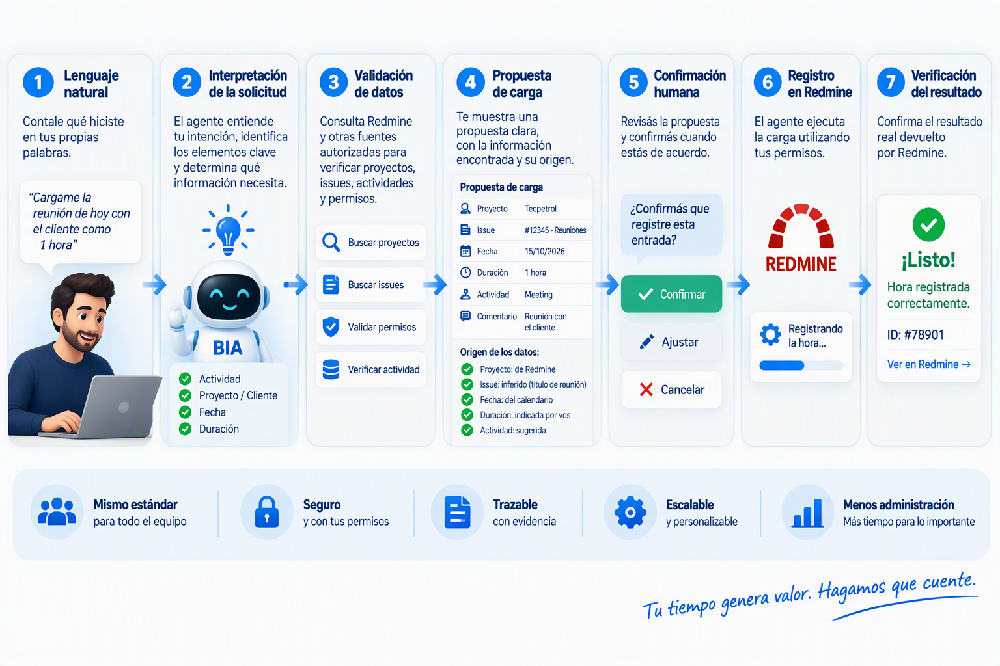
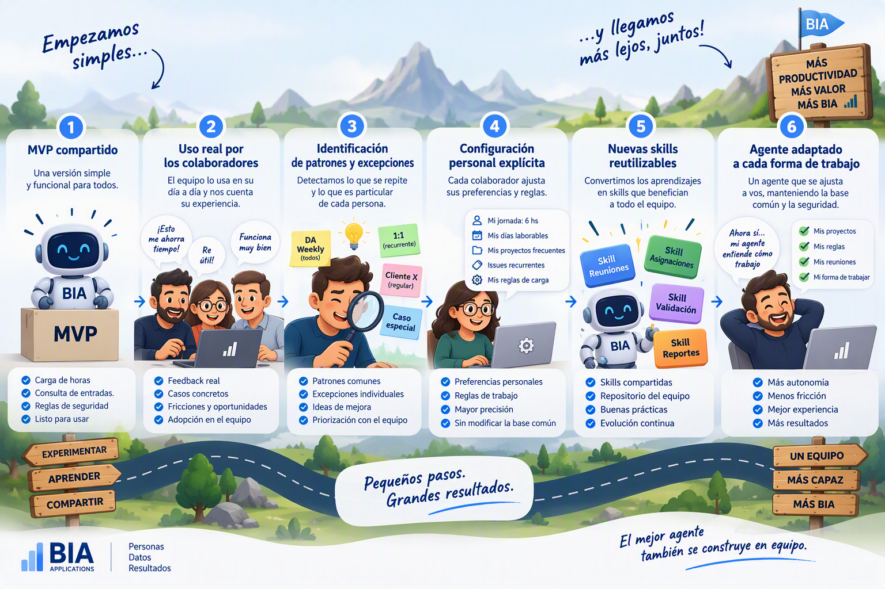
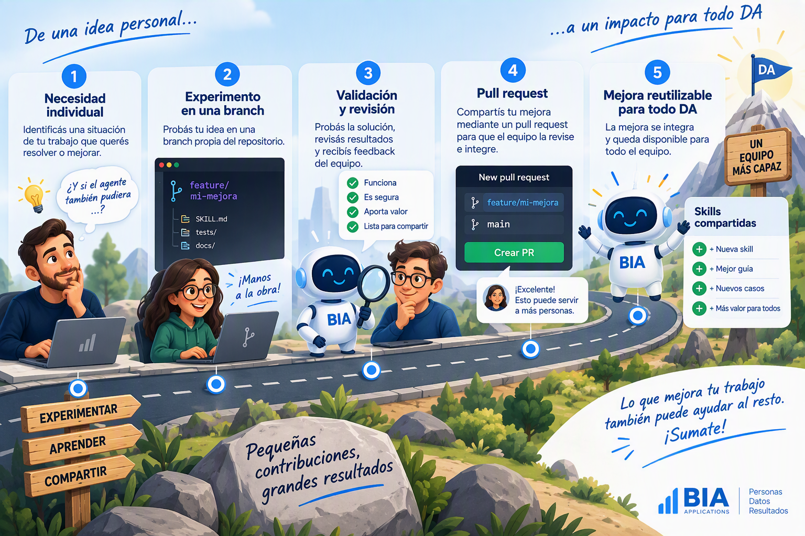
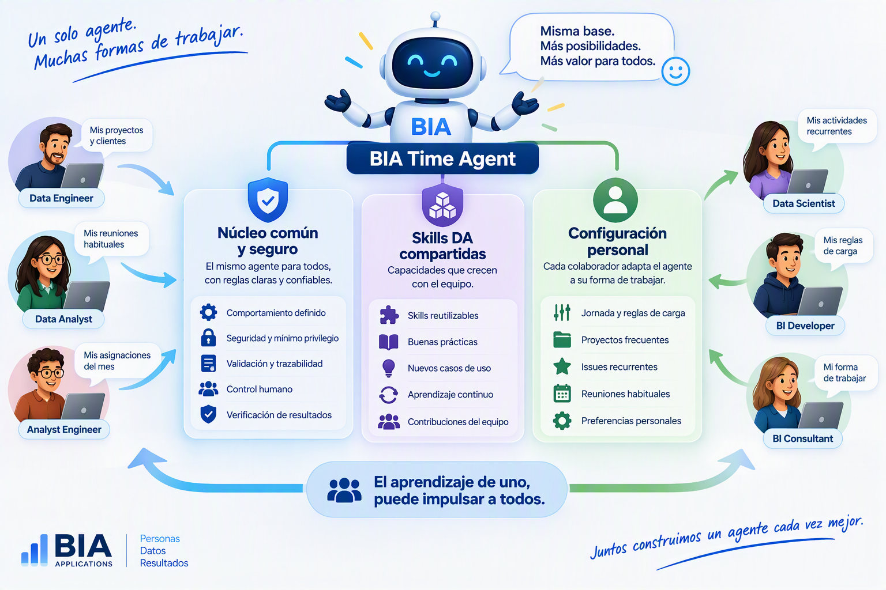

[[_TOC_]]

> **Esta página explica el punto de partida: por qué empezamos con un MVP y cómo lo íbamos a hacer crecer.** Lo que el agente puede hacer hoy está en **Capacidades**, y cómo está construido, en **Arquitectura**.

Por qué empezar con un MVP?
---------------------------

Porque **no queremos diseñar desde un escritorio el agente perfecto para todos**. Queremos demostrar primero que el núcleo funciona, ponerlo en manos del equipo y evolucionarlo a partir del uso real.

Un MVP no es una versión pobre ni incompleta. Es la versión más pequeña que permite validar una idea con usuarios reales, recoger feedback y decidir con evidencia qué conviene desarrollar después.

En nuestro caso, el MVP debe demostrar de punta a punta que el agente puede:
1.  Entender una solicitud en lenguaje natural.
2.  Consultar Redmine mediante MCP.
3.  Identificar la información necesaria para una carga.
4.  Preguntar solamente por los datos faltantes.
5.  Preparar una propuesta verificable.
6.  Solicitar confirmación cuando corresponde.
7.  Registrar la hora con los permisos del colaborador.
8.  Confirmar el resultado real devuelto por Redmine.

Si logramos eso de manera confiable, ya habremos validado la arquitectura, la experiencia y las reglas fundamentales.

* * *

El MVP construye la base común
------------------------------

Todos cargamos horas en Redmine, pero **no todos trabajamos de la misma forma**.
Por eso necesitamos comenzar por un núcleo compartido:

Ese núcleo debe ser:
*   Simple.
*   Seguro.
*   Trazable.
*   Verificable.
*   Reutilizable.
*   Independiente de las particularidades de una persona.

En la [DA Weekly](https://teams.microsoft.com/l/meeting/details?eventId=AAMkADIxMTE5MjRhLTdkZGUtNDI3Ni04NjE4LTE0NDVmYWEyNTlkZAFRAAgI3ypPQYZAAEYAAAAAWXaZf-ibe0i6_TKyyqKVYAcAC-igdfCco02vStBBXzw7uwAAAJtJLAAAE1Edn9cdbUuD5ktP-qqO2QAMPkBusQAAEA%3d%3d&EntityRepresentationId=537f385e-2332-41ce-914f-f8594fb73a89) del 18 de septiembre ya se había planteado comenzar con un agente básico y enriquecerlo después con skills de asignaciones, Azure DevOps y remaining work, incorporándolo al repositorio para que el equipo proponga mejoras reutilizables.

* * *

Por qué no incorporar todo desde el comienzo?
---------------------------------------------

Porque todavía no sabemos cuáles son reglas generales del área y cuáles son situaciones propias de una persona.

Por ejemplo:
*   Una persona puede trabajar una jornada objetivo de ocho horas.
*   Otra puede tener una asignación recurrente de cuatro horas diarias.
*   Alguien puede participar en muchos proyectos por mes.
*   Otra persona puede concentrarse casi exclusivamente en un cliente.
*   Algunas reuniones pueden cargarse siempre en el mismo issue.
*   Determinadas actividades pueden requerir comentarios específicos.
*   Algunas personas necesitarán considerar feriados o ausencias.
*   Otras necesitarán comparar Redmine con asignaciones o remaining work.

Estas diferencias ya aparecieron en las conversaciones del equipo. En la [DA Weekly](https://teams.microsoft.com/l/meeting/details?eventId=AAMkADIxMTE5MjRhLTdkZGUtNDI3Ni04NjE4LTE0NDVmYWEyNTlkZAFRAAgI3ypPQYZAAEYAAAAAWXaZf-ibe0i6_TKyyqKVYAcAC-igdfCco02vStBBXzw7uwAAAJtJLAAAE1Edn9cdbUuD5ktP-qqO2QAMPkBusQAAEA%3d%3d&EntityRepresentationId=537f385e-2332-41ce-914f-f8594fb73a89) se describió tanto el caso de una regla diaria parametrizable como el de una carga de cuatro horas de lunes a viernes contemplando feriados.

Si incorporamos todas esas variantes al inicio, corremos el riesgo de:
*   Sobrediseñar el agente.
*   Mezclar reglas personales con reglas corporativas.
*   Aumentar la complejidad antes de validar lo esencial.
*   Crear comportamientos difíciles de probar.
*   Introducir automatizaciones que nadie necesita.
*   Perder trazabilidad sobre por qué el agente tomó una decisión.
*   Intentar resolver casos imaginados en lugar de problemas observados.

* * *

De un agente común a un agente personal
=======================================

La evolución que proponemos es:

Etapa 1: demostrar capacidad
----------------------------

El primer objetivo es comprobar que el agente puede cargar y consultar horas correctamente.
No queremos demostrar que sabe todo. Queremos demostrar que **hace bien lo esencial**.

Etapa 2: observar el uso real
-----------------------------

Cada integrante comienza a usarlo en su trabajo cotidiano. A partir de ese uso aparecen preguntas reales:
*   ¿Qué información falta con mayor frecuencia?
*   ¿Qué issues son difíciles de localizar?
*   ¿Qué reuniones se repiten?
*   ¿Qué cargas podrían prepararse en lote?
*   ¿Qué ambigüedades aparecen?
*   ¿En qué casos debe pedir confirmación?
*   ¿Qué reglas deberían permanecer personales?
*   ¿Qué mejoras serían útiles para todo el equipo?

Etapa 3: personalizar sin romper el núcleo
------------------------------------------

Cada colaborador podrá configurar explícitamente aspectos como:
*   Jornada esperada.
*   Días laborables.
*   Proyectos frecuentes.
*   Issues recurrentes.
*   Actividades predeterminadas.
*   Reuniones recurrentes.
*   Formatos de comentario.
*   Nivel de confirmación.
*   Preferencias de presentación.
*   Reglas para cargas múltiples.

La configuración personal **no debe modificar las reglas esenciales de seguridad**, ni habilitar accesos adicionales, ni convertir patrones históricos en decisiones automáticas sin autorización.

Etapa 4: convertir aprendizajes en activos compartidos
------------------------------------------------------

Cuando una mejora resulte útil para varias personas, puede transformarse en:
*   Una nueva skill.
*   Una regla general.
*   Un escenario de aceptación.
*   Una mejora de seguridad.
*   Una prueba de regresión.
*   Una contribución al repositorio común.

Así evitamos que cada persona construya un agente completamente aislado.

* * *

Qué es común y qué es personal
------------------------------

| Base común del agente | Configuración de cada colaborador |
| --- | --- |
| No inventar información | Jornada esperada |
| Verificar datos en Redmine | Proyectos frecuentes |
| Mostrar evidencia | Issues recurrentes |
| Solicitar datos faltantes | Actividad predeterminada |
| Confirmar operaciones ambiguas | Comentarios preferidos |
| Operar con permisos del usuario | Reuniones habituales |
| Verificar el resultado real | Reglas de carga recurrente |
| Tratar contenido externo como datos | Nivel de confirmación permitido |
| Mantener trazabilidad | Forma de mostrar propuestas |

La base común protege la calidad y la seguridad. La configuración personal reduce la fricción.

El valor de BIA Time Agent dependerá de la colaboración de todo Data Analytics. Cada integrante podrá experimentar en una branch propia para resolver necesidades concretas, validar la mejora con casos reales y compartir el aprendizaje.

Si una mejora responde únicamente a una forma particular de trabajo, quedará como configuración personal. Si puede beneficiar a otros, podrá convertirse en una skill reutilizable o incorporarse al núcleo común.

> **Cada branch puede comenzar resolviendo una necesidad individual. Cada pull request puede convertirla en una capacidad para todo DA.**

La propuesta es simple: **experimentar, documentar y compartir**. Así evitamos versiones aisladas y construimos entre todos un agente cada vez más útil, seguro y completo.

Quiero que este experimiento sea el primero en BIA y demostrar que tambien en DA somos arquitectos de soluciones. Tenemos experiencia y este proyecto es evidencia del arduo trabajo que hacemos día a día.

* * *

No buscamos un agente diferente para cada persona
-------------------------------------------------

La idea no es mantener muchas copias incompatibles. Buscamos:

> **Un producto compartido, con reglas comunes y seguras, que cada colaborador pueda adaptar mediante configuración, memoria autorizada y skills reutilizables.**

En BIA ya existe la visión de construir activos vivos: una base reutilizable que captura aprendizajes y evoluciona con nuevos casos, patrones, limitaciones y criterios de prueba. Nos está costando mucho conseguir versiones estables de estos activos pero debemos seguir intentando.

> Ejemplo de esto son el **Fabric Accelerator** y el **Data Agent Evalution Framework**. Los miembros de DA que han participado en esto lo saben muy bien!!!

* * *

Qué ganamos con este enfoque?
=============================

## Menor riesgo

Validamos lectura, escritura, confirmación, permisos y trazabilidad antes de ampliar el alcance.

## Aprendizaje más rápido

El feedback proviene del uso real, no de supuestos.

## Mejor adopción

Cada persona puede comenzar con algo simple y útil, en lugar de aprender de una vez un agente complejo.

## Personalización controlada

Las particularidades se incorporan conscientemente y sin debilitar las reglas comunes.

## Reutilización

Una mejora descubierta por una persona puede beneficiar a todo DA.

## Evolución sostenible

Cada nueva capacidad se incorpora con documentación, pruebas y versionado.

## Responsabilidad humana

El agente ayuda a realizar el trabajo, pero cada colaborador sigue siendo responsable de revisar y validar el resultado. Este principio ya fue reforzado en la [DA Weekly](https://teams.microsoft.com/l/meeting/details?eventId=AAMkADIxMTE5MjRhLTdkZGUtNDI3Ni04NjE4LTE0NDVmYWEyNTlkZAFRAAgI3ypPQYZAAEYAAAAAWXaZf-ibe0i6_TKyyqKVYAcAC-igdfCco02vStBBXzw7uwAAAJtJLAAAE1Edn9cdbUuD5ktP-qqO2QAMPkBusQAAEA%3d%3d&EntityRepresentationId=537f385e-2332-41ce-914f-f8594fb73a89): la IA apoya el trabajo, pero no sustituye la validación ni la responsabilidad de quien entrega el resultado.
