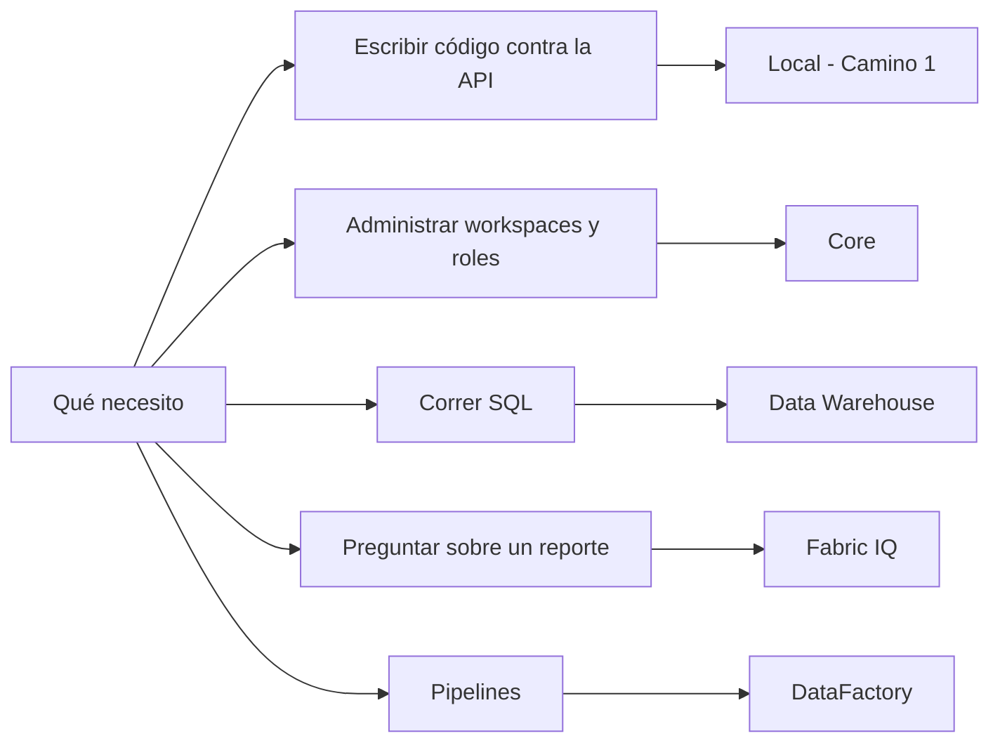
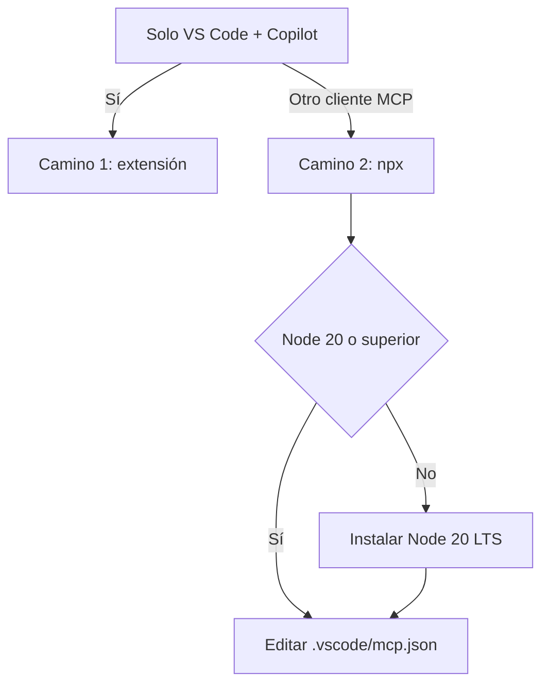

[[_TOC_]]


# Guía: MCP de Fabric en local con VS Code (Windows)
> 2026-09-17 · Javier Ramos


## Qué es y cuál levantamos

El **Fabric MCP Server (local)** es un server open source de Microsoft que corre en tu propia máquina por stdio y le da a Copilot en modo Agent herramientas para las APIs de Fabric, OneLake y las definiciones de items. No es lo mismo que los MCP remotos de Fabric, que son endpoints HTTP en la nube.

| Server | Cómo corre | Para qué sirve | Doc |
| --- | --- | --- | --- |
| Fabric MCP Server (local) | stdio, en tu laptop | Specs OpenAPI, schemas de items, best practices, operaciones sobre OneLake y creación de items | [get-started-local](https://learn.microsoft.com/rest/api/fabric/articles/mcp-servers/pro-dev-local/get-started-local) |
| Fabric Core MCP | HTTP remoto (`api.fabric.microsoft.com/v1/mcp/core`) | Operaciones de plataforma contra el tenant, con OAuth de Entra | [get-started-core](https://learn.microsoft.com/rest/api/fabric/articles/mcp-servers/core-remote/get-started-core) |
| Fabric Data Warehouse MCP | HTTP remoto (endpoint global o por item) | Consultar el SQL endpoint de un warehouse desde el agente | [data-warehouse-mcp-server](https://learn.microsoft.com/fabric/data-warehouse/data-warehouse-mcp-server) |
| DataFactory MCP | stdio, tool global de .NET | Crear, correr y monitorear pipelines desde VS Code | [pipelines-manage-vs-code](https://learn.microsoft.com/fabric/data-factory/pipelines-manage-vs-code) |

Esta guía cubre el primero. Las herramientas de documentación y best practices funcionan offline; las de OneLake pegan contra el entorno real y piden autenticación.


## Comparativo: qué hace cada MCP de Fabric

No hay un MCP de Fabric, hay una familia, y cada uno resuelve una cosa distinta. La confusión más cara es pedirle a uno lo que hace otro.

| Server | Cómo corre | Qué te habilita | Qué no hace |
| --- | --- | --- | --- |
| **Fabric MCP Server (local)** — nuestro Camino 1 | stdio en tu laptop | Specs OpenAPI, schemas de items y best practices sin tocar el tenant; archivos y tablas de OneLake; crear items | No consulta datos, no corre DAX ni SQL, no administra permisos |
| **Fabric Core MCP** | HTTP remoto, OAuth de Entra | Crear y administrar workspaces, items, carpetas y roles; listar capacidades; buscar en el catálogo de OneLake | No lee datos: ninguna tool ejecuta consultas |
| **Fabric Data Warehouse MCP** | HTTP remoto | Generar T-SQL, ejecutarlo contra el SQL endpoint del warehouse y explicar el resultado | No trae tools propias de descubrimiento: todo sale por `executeSQL`, incluso listar tablas |
| **Fabric IQ MCP** | HTTP remoto | Pregunta de negocio en lenguaje natural sobre un reporte o semantic model: descubre el artefacto, lee el esquema, arma el DAX y lo corre | No crea ni modifica items |
| **Power BI Consumption MCP** | HTTP remoto | Correr DAX contra un semantic model y traer su esquema completo, respetando RLS del usuario | No hace autoría del modelo |
| **Power BI Modeling MCP** | stdio local por `npx`, o variante hosted | Autoría de semantic models | La variante local necesita Power BI Desktop abierto en vivo |
| **DataFactory MCP** | stdio, instalado como tool global de .NET | Crear, configurar, correr, monitorear y agendar pipelines; conexiones y dataflows | Las tools de pipeline no aparecen si falta el flag `--pipeline` |

Cómo elegir, en una línea:



Una diferencia transversal que conviene remarcar: **sólo el local tiene una parte que funciona sin tenant**. Todos los demás piden autenticación contra Entra y permisos reales sobre el workspace desde la primera llamada, y ninguno te da más de lo que ya podés hacer vos — respetan tu rol en Fabric.


## Qué podés hacer con el local (Camino 1)

El que vamos a instalar expone tres familias de tools. La primera es la que más valor tiene para nosotros y la que menos se espera: **le da al agente la documentación completa de la API de Fabric, offline**, para que escriba código contra ella sin inventar nombres de campos.

| Familia | Tools | ¿Tenant? | Para qué la usás |
| --- | --- | --- | --- |
| Docs y best practices | `docs_workloads`, `docs_workload-api-spec`, `docs_platform-api-spec`, `docs_item-definitions`, `docs_best-practices`, `docs_api-examples` | No | Generar código contra la API de Fabric con la spec real delante, entender la forma de un item, seguir los patrones recomendados |
| OneLake | 14 tools `onelake_*` | Sí | Listar workspaces e items, navegar archivos, subir y bajar archivos, crear y borrar directorios, leer metadata de tablas y schemas |
| Core | `core_create-item` | Sí | Crear lakehouses, notebooks, pipelines y demás items |

Pedidos que resuelve bien, tal como se los podés escribir al agente:

- Mostrame las operaciones de la OpenAPI de `notebook` y dame un body de ejemplo para crear uno.
- Armame la definición de un Lakehouse con un schema que fuerce una columna string y una datetime.
- Mostrame el JSON schema de la definición de un Data Pipeline.
- ¿Cuáles son los patrones de paginación de las REST APIs de Fabric?
- Best practices para manejar throttling de la API.
- Bajame el `config.json` del lakehouse de Ventas, y después subí la versión actualizada.
- Creá un Lakehouse llamado `CustomerData` en mi workspace de dev.

### Dónde termina

Esto es lo que conviene dejar clarísimo, porque es exactamente donde el equipo se va a frustrar si nadie lo dice:

- **No consulta datos.** No hay `ExecuteQuery`, no hay `DiscoverArtifacts`, no hay nada de DAX ni de T-SQL. El nombre sugiere otra cosa y ya nos costó tiempo una vez.
- **No administra permisos ni roles** de workspace. Eso es Core.
- **No edita items existentes**: crea, pero la edición de definiciones vive en Core.
- **No orquesta pipelines.** Eso es DataFactory MCP.

Leído al derecho: el local es la herramienta del que **escribe código o automatiza contra Fabric**, no la del que quiere preguntarle cosas a un reporte. Para el equipo de DA eso significa que su lugar natural es el trabajo de ingeniería sobre la API y el manejo de archivos en OneLake, y que para todo lo demás hay que sumar otro server de la tabla de arriba.


## Requisitos previos (laptop Windows)

Lo único obligatorio es VS Code con Copilot Chat. El resto depende del camino de instalación que elijan y de si van a pegarle a un tenant real o solo usar las tools de documentación.

| Requisito | Cómo verificar | Cuándo hace falta |
| --- | --- | --- |
| VS Code (Stable o Insiders) + extensión GitHub Copilot Chat | Copilot Chat abre con `Ctrl+Shift+I` | Siempre |
| Extensión Fabric MCP Server del marketplace | Aparece en Extensions | Camino 1 |
| Node.js 20 LTS o superior | `node --version` | Camino 2 (npx) |
| .NET 9 SDK o superior | `dotnet --version` | Camino 3 (build desde fuente) |
| Azure CLI logueado | `az account show`; si falla, `az login` | Tools de OneLake y core |
| Workspace de Fabric con capacidad asignada | Portal de Fabric | Tools de OneLake y core |

Las tools de specs, schemas y best practices corren sin tenant y sin capacidad: sirven para probar el setup aunque todavía no tengan permisos sobre un workspace. Las de OneLake sí pegan contra el entorno real y piden autenticación.

Un detalle propio de Windows en un ambiente corporativo: si no tienen permisos de administrador en su laptop, Node se instala igual desde el instalador MSI en modo usuario, y `npx` queda bajo `%APPDATA%\npm`. Verifiquen que esa ruta esté en el `PATH` antes de seguir.


## Instalación paso a paso

Para nuestros primeros pasos, vamos por la vía corta, es decir, vamos por la extensión: dos clicks y no hay JSON que tocar. El camino por `npx` conviene cuando quieren la config versionada en el repo del proyecto o van a usar otro cliente MCP.



### Camino 1 — extensión de VS Code

1. Instalar la extensión **GitHub Copilot Chat** desde el marketplace.
2. Instalar la extensión **Fabric MCP Server** (publisher `fabric`).
3. Recargar la ventana: `Ctrl+Shift+P` → **Developer: Reload Window**.

No hay paso 4: la extensión registra el server sola, sin configuración adicional.


### Camino 2 — npx

1. Verificar Node: `node --version` (20 LTS o superior).
2. Precalentar la caché de npx una vez desde la terminal, para que el primer arranque no se pase del timeout del handshake:


```powershell
npx -y @microsoft/fabric-mcp@latest server start --mode all
```

Cuando el proceso quede corriendo, cortarlo con `Ctrl+C`. Ya quedó descargado.

3. Crear `.vscode\mcp.json` en la raíz del workspace:


```json
{
"servers": {
"fabric-mcp-server": {
"type": "stdio",
"command": "npx",
"args": ["-y", "@microsoft/fabric-mcp@latest", "server", "start", "--mode", "all"]
}
}
}
```

4. Recargar la ventana.

Ojo con la clave raíz: configurando VS Code a mano va `servers`, no `mcpServers` como muestra el ejemplo genérico de la doc. Y si al recargar el server queda en *Failed* con `spawn npx ENOENT`, es el gotcha clásico de Windows — está resuelto en Problemas comunes, más abajo.

Hay un tercer camino, compilar desde fuente con .NET 9 y apuntar al `fabmcp.exe`, pero para la Weekly no lo recomiendo: suma un SDK y no aporta nada sobre los otros dos.


## Modo Agent y autenticación

El server puede estar levantado y las tools igual no aparecer: falta pasar Copilot a modo Agent. Es el paso que más se saltea.

1. Abrir el chat de Copilot con `Ctrl+Shift+I`.
2. En el desplegable de modo, elegir **Agent**.
3. Tocar **refresh** en la lista de tools. Ahí tienen que aparecer las del Fabric MCP Server.

Sobre autenticación, hay dos mundos dentro del mismo server:

- Las tools de specs, schemas y best practices (`docs_*`) corren locales, sin tenant y sin login. Sirven para la demo de mañana aunque nadie tenga permisos todavía.

- Las de OneLake (`onelake_*`) y `core_create-item` pegan contra el entorno real y piden autenticación contra Entra ID.

Para el segundo grupo, hagan `az login` en la terminal **antes** de abrir VS Code. Es lo que nos viene funcionando con los otros MCP internos: cuando la sesión de Azure CLI está vencida, la primera llamada a una tool se queda colgada varios minutos en vez de devolver un error claro. El diagnóstico rápido, si algo queda colgado:

```powershell
az account show
```

La doc oficial del server local no detalla la cadena de credenciales que usa, así que esto lo damos como recomendación práctica, no como requisito documentado.

Si lo que quieren es la experiencia de OAuth por browser contra el tenant, eso es el server remoto, no este: `Ctrl+Shift+P` → **MCP: Add Server** → **HTTP** → `https://api.fabric.microsoft.com/v1/mcp/core`.


## Verificación — smoke test

El chequeo oficial es uno solo: si el agente devuelve la lista de workload types de Fabric, el server anda. Los primeros cuatro prompts corren sin tenant; el quinto es el único que prueba de verdad la autenticación.

| Prompt | Tool que debería llamar | Qué valida |
| --- | --- | --- |
| ¿Qué tipos de workload de Fabric hay disponibles? | `docs_workloads` | El server levantó |
| Mostrame las operaciones de la OpenAPI de notebook y un body de ejemplo | `docs_workload-api-spec` | Las specs se cargaron |
| Mostrame el JSON schema de la definición de un Data Pipeline | `docs_item-definitions` | Los schemas de items |
| Best practices para manejar throttling de la API de Fabric | `docs_best-practices` | La guía embebida |
| Listá mis workspaces de Fabric | `onelake_list_workspaces` | Autenticación y acceso al tenant |

Una advertencia que vale para todo el equipo: miren que VS Code muestre la invocación de la tool, no solo la respuesta. El modelo sabe bastante de Fabric de memoria y puede contestar los primeros cuatro prompts convincentemente **sin haber llamado a ninguna tool** — y ahí lo que probaron es nada. Si no ven la tool ejecutándose, el server no está enganchado.


## Problemas comunes en Windows

Casi todo lo que falla en Windows es el mismo puñado de cosas. Vale la pena leerlo antes de instalar, no después.

| Síntoma | Causa | Qué hacer |
| --- | --- | --- |
| `spawn npx ENOENT`, el server queda en *Failed* | En Windows `npx` es un `.cmd` en `%APPDATA%\npm`, y el spawn no pasa por shell | Envolver con `cmd /c` (abajo) |
| El server arranca pero el agente dice que no hay tools | `@latest` resuelve contra el registry en cada arranque; con caché fría se pasa del presupuesto del handshake | Precalentar la caché, o pinear la versión en lugar de `@latest` |
| Registré el MCP con la sesión ya abierta y el agente no lo ve | Las tools no quedan indexadas en esa sesión | Reiniciar la ventana y recién ahí pedirle que las use |
| La primera llamada contra el tenant cuelga varios minutos | Sesión de Azure CLI vencida | `az login`; verificar con `az account show` |
| `npx` no descarga nada | La laptop sale por proxy corporativo y npm no lo tiene configurado | Configurar el proxy en npm, o usar el camino de la extensión |
| Le pido DAX o consultar un semantic model y no hay tools para eso | Server equivocado — este no consulta modelos | Ver la sección de contexto BIA, abajo |

El wrapper de `cmd /c` para el primer caso:

```json
{
"servers": {
"fabric-mcp-server": {
"type": "stdio",
"command": "cmd",
"args": ["/c", "npx", "-y", "@microsoft/fabric-mcp@latest", "server", "start", "--mode", "all"]
}
}
}
```

Esto no está en la doc de Microsoft: es el workaround más citado de la comunidad para servers MCP por stdio en Windows, y aplica a cualquiera que arranque con `npx`, no solo a este.


## Lo que ya sabemos adentro de BIA

No arrancamos de cero: esto ya está probado y documentado internamente, y hay un hallazgo que nos ahorra la equivocación más común.

**El nombre engaña.** `@microsoft/fabric-mcp` no sirve para consultar semantic models. Es un server local de scaffolding: OneLake, Data Factory y documentación. No tiene `ExecuteQuery`, `DiscoverArtifacts` ni nada de consumo. El equipo lo registró en su momento creyendo que servía para eso y confirmó que no. Si lo que quieren es una pregunta de negocio en lenguaje natural sobre datos ya desplegados, va `FabricIQ`; si quieren DAX o esquema ad-hoc por el SQL endpoint, va `fabric-sqlendpoint`. Los dos son HTTP remotos contra `api.fabric.microsoft.com`, no este.

Dos gotchas más, ya confirmados en casa y que coinciden con lo que se ve en la comunidad: un MCP registrado a mitad de sesión no queda indexado hasta reiniciar, y desde una interfaz de chat no hay salida de red hacia Fabric ni Azure — la ejecución real siempre es VS Code o un CLI corriendo local.

## Fuentes

| Fuente | Qué aporta |
| --- | --- |
| [Get started with Fabric MCP Server (local)](https://learn.microsoft.com/rest/api/fabric/articles/mcp-servers/pro-dev-local/get-started-local) | Prerequisitos, los tres caminos de instalación, la verificación oficial |
| [Fabric MCP Server (local) tools reference](https://learn.microsoft.com/rest/api/fabric/articles/mcp-servers/pro-dev-local/tools-local-mcp-server) | Catálogo de tools y cuáles piden autenticación |
| [Get started with Fabric Core MCP Server](https://learn.microsoft.com/rest/api/fabric/articles/mcp-servers/core-remote/get-started-core) | El endpoint remoto y su flujo de OAuth |
| [Fabric Core MCP Server tools reference](https://learn.microsoft.com/rest/api/fabric/articles/mcp-servers/core-remote/tools-core-mcp-server) | Las 29 tools de Core: workspaces, items, carpetas, roles y capacidades |
| [Fabric Data Warehouse MCP server](https://learn.microsoft.com/fabric/data-warehouse/data-warehouse-mcp-server) | Que expone una sola tool, `executeSQL`, y cómo se suple el descubrimiento |
| [Get started with the Fabric IQ MCP server](https://learn.microsoft.com/fabric/iq/connectors/fabric-iq-mcp) | Las seis tools de Fabric IQ y cómo se encadenan para responder una pregunta |
| [Power BI Consumption MCP server](https://learn.microsoft.com/power-bi/developer/mcp/remote-mcp-server-get-started) | `ExecuteQuery` y el esquema del semantic model, con RLS |
| [Manage pipelines in Fabric from VS Code](https://learn.microsoft.com/fabric/data-factory/pipelines-manage-vs-code) | El DataFactory MCP y el flag `--pipeline` |
| [Microsoft Fabric MCP Server en el registry de MCP](https://github.com/mcp/com.microsoft/microsoft-fabric) | Botones de instalación en VS Code y el detalle de que es local-first |
| [Claude Code MCP on Windows](https://mcp.directory/blog/claude-code-mcp-on-windows-native-wsl-2026-complete-fix-guide) | Comunidad — por qué `npx` falla en Windows y el wrapper `cmd /c` |
| [Why your MCP server randomly shows no tools](https://dev.to/milkyway008/why-your-mcp-server-randomly-shows-no-tools-the-npx-startup-tax-2l0e) | Comunidad — el costo de arranque de `npx` y el timeout del handshake |

Las dos últimas son de comunidad, no de Microsoft: les pido que los tomemos como diagnóstico, no como configuración soportada.
