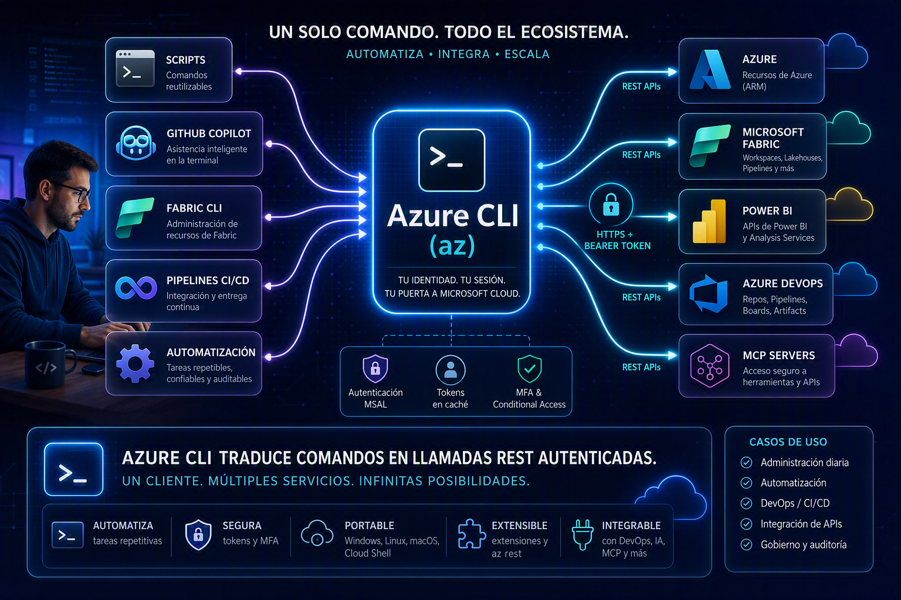
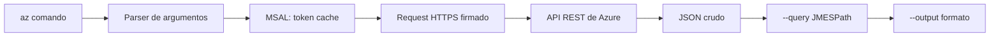
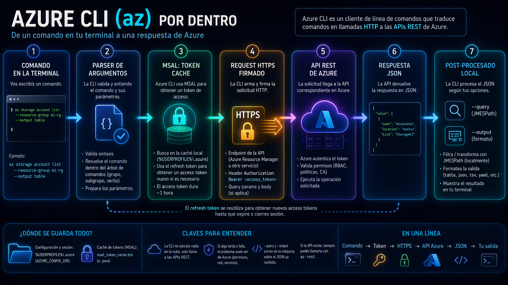
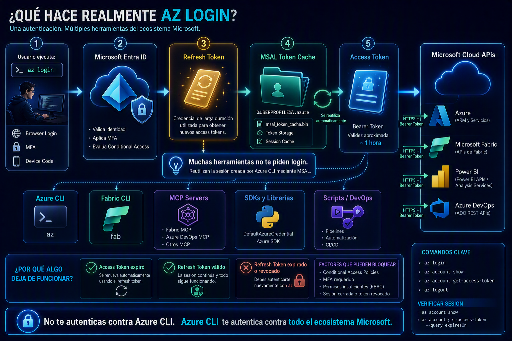

[[_TOC_]]

# Azure CLI, en detalle

Guía de referencia sobre qué es `az`, cómo funciona por dentro, cómo se instala y se usa en Windows, y dónde aparece en el día a día de un equipo de datos sobre el stack de Microsoft.

Versión vigente al momento de escribir esto: **2.90.0**. Para saber la tuya, `az version`.

---

## Qué es?

**Azure CLI es un cliente de línea de comandos multiplataforma que traduce comandos `az ...` en llamadas HTTP a las APIs REST de Azure.** Nada más y nada menos que eso. No es un runtime, no es un agente, no corre nada en la nube: es un programa local que arma un request, lo firma con tu token, lo manda y te devuelve la respuesta en JSON.

Esa definición aburrida es la que más sirve, porque explica casi todo el comportamiento raro que vas a encontrar:

- Si un comando devuelve JSON con campos que no entendés, es porque así los devuelve la API REST.
- Si un comando tarda, no es la CLI: es la operación en Azure.
- Si algo se puede hacer por API pero no hay comando `az` para eso, podés llamarlo igual con `az rest`.
- Si te da 403, el problema es de permisos en Azure, no de la herramienta.

Está escrita en Python. El instalador de Windows trae su propio intérprete embebido, así que no necesitás tener Python instalado ni te pisa el que tengas.



### Qué no es!

| No es | Por qué se confunde |
| --- | --- |
| Azure PowerShell (`Az` module) | Hace lo mismo pero es otro producto: cmdlets de PowerShell que devuelven objetos .NET, no JSON |
| Una consola remota | Todo corre local; lo remoto es la API a la que le pegás |
| Un reemplazo del portal | Es complementario: el portal explora, la CLI repite y automatiza |
| Un gestor de recursos de Fabric o Power BI | Cubre el plano de Azure. Fabric y Power BI tienen sus propias CLIs y APIs, aunque **la autenticación sí pasa muchas veces por `az`** |

---

## Cuándo usar qué

| Herramienta | Fuerte en | Flojo en |
| --- | --- | --- |
| Portal de Azure | Explorar, descubrir servicios nuevos, ver todo junto | Repetir, auditar qué hiciste, automatizar |
| Azure CLI (`az`) | Scripts, repetibilidad, pipelines, pegarle a la API | Descubrimiento visual |
| Azure PowerShell (`Az`) | Entornos 100% PowerShell, manipular objetos con pipeline | Portabilidad a Linux/macOS, ejemplos de doc (hay menos) |
| Cloud Shell | Máquina ajena, sin instalar nada, ya logueado | Trabajo con archivos locales |
| Bicep / Terraform | Infraestructura declarativa, estado deseado | Operaciones puntuales del día a día |

La regla práctica: **CLI para verbos, Bicep/Terraform para sustantivos.** Crear un recurso una vez, consultar algo, rotar una credencial, mover una suscripción → CLI. Definir cómo tiene que verse un entorno completo y mantenerlo así → IaC.

---

## Cómo funciona por dentro

Vale la pena tener el modelo mental porque hace que los errores se entiendan solos.





Las cuatro piezas:

1. **El parser.** Toma `az grupo subgrupo comando --parametro valor` y lo valida contra la definición del comando. Muchos errores de "unrecognized arguments" o "invalid jmespath_type" mueren acá, antes de tocar la red.

2. **MSAL y la caché de tokens.** Azure CLI usa la librería de autenticación de Microsoft (MSAL). Tu sesión vive en `%USERPROFILE%\.azure\msal_token_cache.bin` (o `.json`). Ahí está el refresh token con el que la CLI saca access tokens nuevos sin volver a pedirte credenciales.

3. **La llamada REST.** Arma el request contra el endpoint que corresponda (Azure Resource Manager, o el servicio de datos concreto) con el header `Authorization: Bearer ...`.

4. **El post-procesado local.** `--query` y `--output` corren **en tu máquina, sobre el JSON ya recibido**. No filtran del lado del servidor. Esto importa para performance: `az resource list --query "[?tags.env=='prod']"` se baja todo y después filtra.


### Dónde queda instalado

| Qué | Dónde (Windows) |
| --- | --- |
| Binarios 64-bit | `C:\Program Files\Microsoft SDKs\Azure\CLI2` |
| Binarios 32-bit | `C:\Program Files (x86)\Microsoft SDKs\Azure\CLI2` |
| Configuración y sesión | `%USERPROFILE%\.azure` (variable `AZURE_CONFIG_DIR`) |
| Caché de tokens | `%USERPROFILE%\.azure\msal_token_cache.bin` o `.json` |

No podés elegir la ruta de instalación. Sí podés mover la configuración cambiando `AZURE_CONFIG_DIR` — útil si necesitás dos sesiones aisladas en la misma máquina, por ejemplo un tenant de cliente y el propio.

---

## Instalación en Windows

Tres caminos. Los tres terminan en lo mismo.

### winget (el más limpio)

```powershell
winget install --exact --id Microsoft.AzureCLI
```

`--exact` evita que winget agarre otro paquete de nombre parecido. Para clavar una versión:

```powershell
winget install --exact --id Microsoft.AzureCLI --version 2.67.0
```

### MSI

Descargás el instalador y lo corrés. No hace falta desinstalar la versión anterior: el MSI actualiza lo que haya.

### ZIP (sin permisos de administrador)

Sigue siendo preview, pero resuelve el caso de la laptop corporativa bloqueada. Descomprimís el paquete y llamás a `<carpeta>\bin\az.cmd`. Si querés escribir `az` pelado, agregás `<carpeta>\bin` al `PATH` del usuario y reiniciás la terminal.

### Después de instalar, siempre

**Cerrá y volvé a abrir la terminal.** El 90% de los "az no se reconoce como comando" es no haber hecho esto: la ventana abierta tiene el `PATH` viejo.

```powershell
az version
az login
az account show
```

### Actualizar

```powershell
az upgrade
```

Te pregunta también si querés actualizar las extensiones instaladas. En equipos con winget, `winget upgrade --id Microsoft.AzureCLI` es equivalente.

### Si hay proxy corporativo

Para bajar el instalador, el proxy tiene que permitir `https://aka.ms/` y `https://azcliprod.blob.core.windows.net/`. Y ojo: esa misma configuración de proxy hace falta después **para usar la CLI**, no solo para instalarla. En Windows 11 se maneja en `Settings > Network & Internet > Proxy`.

---

## Anatomía de un comando

La sintaxis es siempre la misma: **grupo → subgrupo → comando → parámetros**.

```
az   storage   account     list   --resource-group mi-rg   --output table
     └─grupo   └─subgrupo  └─cmd    └─parámetro y valor      └─parámetro global
```

Los verbos se repiten en todos los grupos y son bastante predecibles:

| Verbo | Qué hace |
| --- | --- |
| `list` | Devuelve un array de objetos |
| `show` | Devuelve un solo objeto (diccionario) |
| `create` | Crea. Suele ser idempotente-ish: volver a correrlo actualiza |
| `update` | Modifica. Soporta `--set`, `--add`, `--remove` con rutas tipo `tags.env=prod` |
| `delete` | Borra. Casi siempre acepta `--yes` para saltear la confirmación |
| `wait` | Bloquea hasta que una condición se cumpla |

### Parámetros globales

Estos existen en **todos** los comandos:

| Parámetro | Para qué |
| --- | --- |
| `--output` / `-o` | Formato de salida: `json`, `jsonc`, `table`, `tsv`, `yaml`, `yamlc`, `none` |
| `--query` | Filtrar/transformar la salida con JMESPath |
| `--subscription` | Correr ese comando contra otra suscripción sin cambiar la default |
| `--verbose` | Un poco más de detalle |
| `--debug` | Todo: el request HTTP, los headers, los argumentos que recibió el parser |
| `--only-show-errors` | Silencia warnings — clave en scripts y pipelines |
| `--no-wait` | No esperar a que termine una operación larga |
| `--help` / `-h` | Ayuda de ese nivel del árbol |

### Descubrir comandos

```powershell
az storage --help
az storage account --help
az storage account create --help
az find "storage account"
```

`--help` en cualquier nivel te muestra qué cuelga de ahí. Es la forma más rápida de navegar la herramienta sin abrir la doc.

---

## Autenticación en profundidad

Es la parte que más problemas da, así que va larga.



### Los cuatro métodos

| Método | Cuándo |
| --- | --- |
| **Cloud Shell** | Ya venís logueado, no hacés nada |
| **Interactivo** (`az login`) | Tu máquina, tu usuario. Abre el browser y te deja elegir suscripción |
| **Managed identity** | Código corriendo dentro de Azure. No hay secreto que administrar |
| **Service principal** | Scripts y automatización. Es el recomendado para todo lo desatendido |

### Interactivo

```powershell
az login
```

Abre el browser. Si estás en una sesión sin browser (SSH, contenedor, terminal remota):

```powershell
az login --use-device-code
```

Te da un código que pegás en `microsoft.com/devicelogin` desde otro dispositivo.

Si tenés acceso a varios tenants:

```powershell
az login --tenant <tenant-id-o-dominio>
az account list --output table
az account set --subscription "<id o nombre>"
```

### MFA obligatorio

Desde **septiembre de 2025** Microsoft exige MFA para Azure CLI y demás herramientas de línea de comandos. Aplica a **identidades de usuario**, no a service principals ni managed identities.

La consecuencia práctica: si tenías scripts logueándose con usuario y contraseña (`az login -u ... -p ...`), eso se terminó. Hay que migrar a una workload identity.

### Service principal

```powershell
az login --service-principal `
--username <appId> `
--password <secret-o-ruta-al-certificado> `
--tenant <tenantId>
```

Y para crear uno con permisos acotados:

```powershell
az ad sp create-for-rbac `
--name "sp-mi-pipeline" `
--role Reader `
--scopes /subscriptions/<subId>/resourceGroups/<rg>
```

Lo que devuelve incluye el secreto **una sola vez**. Si lo perdés, se rota, no se recupera.

### Tokens: lo que realmente pasa

Cuando te logueás con usuario, la CLI guarda un **refresh token**. Los access tokens duran poco (típicamente una hora); el refresh token se canjea por uno nuevo cuando hace falta, sin molestarte.

Podés pedir un access token a mano:

```powershell
az account get-access-token
az account get-access-token --resource https://api.fabric.microsoft.com
az account get-access-token --resource https://analysis.windows.net/powerbi/api
```

La salida:

```json
{
"accessToken": "...",
"expiresOn": "2026-09-17 21:59:10.000000",
"expires_on": 1789765750,
"subscription": "...",
"tenant": "...",
"tokenType": "Bearer"
}
```

Dos detalles que muerden:

- `expiresOn` es hora local y **no maneja bien el cambio de horario**; `expires_on` es un timestamp POSIX en UTC. Si una aplicación tuya consume esto, usá `expires_on`. Está disponible desde la versión 2.54.0.

- Hay Conditional Access policies que pueden bloquearte un recurso específico aunque el login haya funcionado. El síntoma es un login exitoso y un 403 después.

### El modo de fallar más molesto

Cuando el refresh token venció, la primera llamada que necesita autenticación **no falla rápido**: se queda colgada intentando renovar de forma interactiva contra una terminal que quizás ni tiene browser. Herramientas que usan la sesión de `az` por debajo (MCP servers, SDKs con `DefaultAzureCredential`, `fab`) heredan ese cuelgue y no te dicen por qué.

El diagnóstico de dos segundos, antes de culpar a la herramienta:

```powershell
az account show
az account get-access-token --query expiresOn -o tsv
```

Si cualquiera de los dos falla o tarda, el problema es la sesión. `az login` y listo.

---

## Salida y consultas

### Formatos

| Formato | Para qué |
| --- | --- |
| `json` | Default. Lo que devuelve la API, completo |
| `jsonc` | Igual pero coloreado |
| `table` | Legible para humanos. Sólo muestra algunas columnas |
| `tsv` | Sin comillas, sin claves, separado por tabs. **El que usás para meter valores en variables** |
| `yaml` / `yamlc` | Cuando vas a pegar el resultado en un manifiesto |
| `none` | No mostrar nada, sólo el exit code |

Un detalle importante de `table`: no es un subconjunto arbitrario, es una vista definida por comando. Si un campo que necesitás no aparece en la tabla, existe igual en el JSON — pedilo con `--query`.

### JMESPath

`--query` acepta [JMESPath](https://jmespath.org), un lenguaje de consulta para JSON. Corre local, sobre el JSON, **antes** de aplicar el formato.

```powershell
# un campo
az storage account show -g mi-rg -n micuenta --query primaryEndpoints.blob

# varios campos como array
az storage account show -g mi-rg -n micuenta --query "[id, primaryLocation]"

# renombrar campos (multiselect hash) y formatear como tabla
az storage account list --query "{Nombre:name, Tipo:kind}" --output table

# filtrar un array
az vm list -g mi-rg --query "[?storageProfile.osDisk.diskSizeGb >=\`50\`].{Name:name, Disk:storageProfile.osDisk.diskSizeGb}" -o table

# contar
az group list --query "length(@)"
```

Dos reglas que ahorran una hora de frustración:

1. **Es case-sensitive.** Si te devuelve vacío y estabas seguro, revisá mayúsculas antes que nada.
2. **En JMESPath, los strings van entre comillas simples o backticks, nunca dobles.** Usar dobles dentro de un filtro devuelve output vacío, sin error.

### tsv para variables

```powershell
$subId = az account show --query id --output tsv
```

Sin `--output tsv`, el valor te llega con comillas dobles incluidas y después rompe en el comando siguiente.

---

## Quoting en Windows: el dolor real

Los ejemplos de la documentación están escritos casi siempre para Bash. Copiarlos tal cual a PowerShell falla, y el error no te dice por qué.

La causa de fondo: **los comandos de Azure CLI se tratan como scripts de Command Prompt**, así que en PowerShell tu string pasa por *dos* rondas de parseo antes de llegar a la CLI. Un símbolo sobrevive sólo si aguanta las dos.

Las mismas tres formas de escribir la misma consulta:

```powershell
# Bash
az version --query '"azure-cli"'

# PowerShell
az version --query '\"azure-cli\"'

# Cmd
az version --query "\"azure-cli\""
```

Números dentro de un filtro, en PowerShell, necesitan backtick de escape:

```powershell
az vm list --query "[?diskSizeGb >=``50``]"
```

Nombres de columna con espacios, en PowerShell 5.1 o 7 sobre Windows — comilla simple afuera, dobles duplicadas adentro:

```powershell
az storage account list --query '[].{""SA Name"":name, ""Endpoint"":primaryEndpoints.blob}' --output table
```

### Los dos salvavidas

**El token `--%`** le dice a PowerShell que deje de parsear y mande el resto crudo:

```powershell
az --% version --query "\"azure-cli\""
```

**`--debug`** te muestra exactamente qué argumentos recibió la CLI, en sintaxis de Python. Si lo que ves ahí no es lo que escribiste, el problema es el shell, no el comando.

---

## Configuración

```powershell
az config set core.output=table
az config set defaults.group=mi-rg
az config set defaults.location=eastus
az config get
```

Los defaults hacen que puedas omitir `--resource-group` en cada comando. Muy cómodo en el día a día, y una fuente de sorpresas desagradables en scripts: **en automatización, pasá siempre todo explícito**, porque el script no sabe con qué defaults corre la máquina destino.

También hay variables de entorno equivalentes (`AZURE_DEFAULTS_GROUP`, `AZURE_CORE_OUTPUT`, etc.), que es la forma de configurarlo en un pipeline sin tocar archivos.

---

## Extensiones

El core trae los servicios más usados. El resto vive en extensiones, que se bajan e instalan aparte.

```powershell
az extension list --output table
az extension list-available --output table
az extension add --name <nombre>
az extension update --name <nombre>
az extension remove --name <nombre>
```

Algunas están en preview y cambian entre versiones. En un pipeline, instalá la extensión de forma explícita como paso — no asumas que el agente la tiene.

---

## `az rest`, el comodín

Cuando la API existe pero el comando no, `az rest` te deja pegarle directo **reusando tu sesión y tu token**, sin que tengas que armar el header de autorización a mano:

```powershell
az rest --method get `
--url "https://management.azure.com/subscriptions/<subId>/resourceGroups?api-version=2021-04-01"
```

Y contra otros recursos que no son ARM, indicando explícitamente para qué audiencia querés el token:

```powershell
az rest --method get `
--url "https://api.fabric.microsoft.com/v1/workspaces" `
--resource "https://api.fabric.microsoft.com"
```

Esto es lo que convierte a `az` en algo más que un administrador de recursos de Azure: es un cliente HTTP autenticado contra cualquier cosa del ecosistema Microsoft donde tu identidad tenga permisos.

---

## Scripting y automatización

Lo que separa un comando suelto de algo que podés poner en un pipeline:

- **`--only-show-errors`** en todos los comandos, para que un warning nuevo de una versión futura no ensucie los logs.

- **Exit codes**: `0` es éxito, distinto de cero es error. En PowerShell, `$LASTEXITCODE`.

- **Idempotencia**: la mayoría de los `create` aceptan volver a correrse. Los que no, se resuelven con un `show` previo y un condicional.

- **Nada de secretos en la línea de comandos**: quedan en el historial del shell y en los logs del pipeline. Key Vault, variables protegidas o federación de identidad.

- **Clavar la versión** de la CLI en el pipeline. `az` se actualiza seguido y un cambio de formato de salida te rompe un `--query` en producción sin aviso.

- **`--no-wait` + `az ... wait`** para operaciones largas, en vez de bloquear el agente.

---

## Dónde aparece en nuestro mundo

Aunque el foco de `az` sea Azure, en un stack de datos de Microsoft termina siendo la puerta de entrada a casi todo:

| Escenario | Qué hace `az` |
| --- | --- |
| Fabric CLI (`fab`) | Tiene su propio login, pero conviven; el token de `az` sirve para pegarle a la API de Fabric con `az rest` |
| Skills y agentes de Fabric | Varios usan `az rest` para las operaciones que no cubre `fab` |
| MCP servers contra Fabric o Azure DevOps | Reusan la sesión de Azure CLI para autenticar, en vez de registrar otra app OAuth |
| SDKs con `DefaultAzureCredential` | En tu máquina, la cadena de credenciales cae en la sesión de `az` |
| Azure DevOps | El token del recurso de ADO se saca con `az account get-access-token --resource 499b84ac-1321-427f-aa17-267ca6975798` |
| Power BI / AAS | Token contra `https://analysis.windows.net/powerbi/api` |

La moraleja operativa: **`az login` vencido rompe cosas que aparentemente no tienen nada que ver con Azure.** Vale la pena que sea el primer chequeo del checklist cuando algo del stack falla raro.

---

## Errores comunes y qué significan

| Mensaje | Traducción | Qué hacer |
| --- | --- | --- |
| `'az' no se reconoce como un comando` | El `PATH` de esa ventana es el de antes de instalar | Cerrar y reabrir la terminal |
| `Please run 'az login' to setup account` | No hay sesión, o venció | `az login` |
| `argument --query: invalid jmespath_type value` | Quoting mal para tu shell | Revisar la sección 8; probar con `--debug` |
| Consulta que devuelve vacío sin error | Mayúsculas mal, o comillas dobles dentro de un filtro JMESPath | Corregir capitalización; usar comillas simples |
| `unrecognized arguments` | Carácter de continuación de línea equivocado | En PowerShell es backtick, en Bash es `\` |
| `AuthorizationFailed` / 403 | Tu identidad no tiene el rol necesario en ese scope | `az role assignment list --assignee <vos>` |
| `SubscriptionNotFound` | Estás parado en otra suscripción | `az account show`, `az account set` |
| La primera llamada cuelga varios minutos | Refresh token vencido, intento de login interactivo sin terminal | `az login` |

---

## Cheat sheet

```powershell
# Estado
az version
az upgrade
az account show
az account list --output table
az account set --subscription "<id o nombre>"

# Sesión
az login
az login --use-device-code
az login --tenant <tenant>
az logout

# Explorar
az find "key vault"
az group list --output table
az resource list --resource-group <rg> --output table

# Tokens
az account get-access-token --query expiresOn -o tsv
az account get-access-token --resource <resource-uri-o-guid>

# Consultar
az <comando> --query "<jmespath>" --output table
az <comando> --query "<campo>" --output tsv

# Diagnosticar
az <comando> --debug
az <comando> --only-show-errors

# Configurar
az config set core.output=table
az config set defaults.group=<rg>
```

---

## Fuentes

| Fuente | Qué aporta |
| --- | --- |
| [What is the Azure CLI?](https://learn.microsoft.com/cli/azure/what-is-azure-cli) | Definición, versión vigente, diseño de la sintaxis |
| [Authenticate to Azure using Azure CLI](https://learn.microsoft.com/cli/azure/authenticate-azure-cli) | Los cuatro métodos, MFA desde septiembre 2025, refresh tokens y `expires_on` |
| [Install the Azure CLI on Windows](https://learn.microsoft.com/cli/azure/install-azure-cli-windows) | winget, MSI, ZIP sin admin, proxy, troubleshooting de instalación |
| [How to install the Azure CLI (FAQ)](https://learn.microsoft.com/cli/azure/install-azure-cli) | Rutas de instalación y `AZURE_CONFIG_DIR` |
| [Query command output using JMESPath](https://learn.microsoft.com/cli/azure/use-azure-cli-successfully-query) | `--query`, formatos, `tsv` para variables |
| [Quoting differences between scripting languages](https://learn.microsoft.com/cli/azure/use-azure-cli-successfully-quoting) | Las diferencias entre Bash, PowerShell y Cmd |
| [Considerations for running the Azure CLI in PowerShell](https://learn.microsoft.com/cli/azure/use-azure-cli-successfully-powershell) | Espacios, escapes y el doble parseo en Windows |
