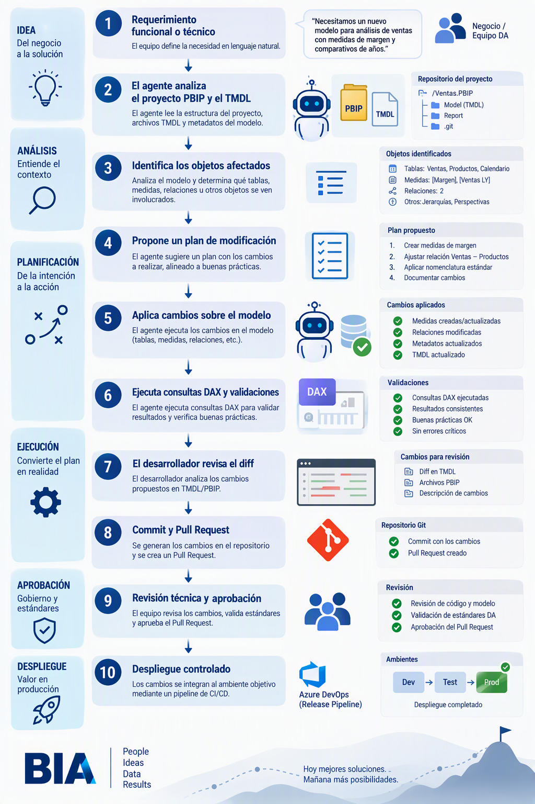
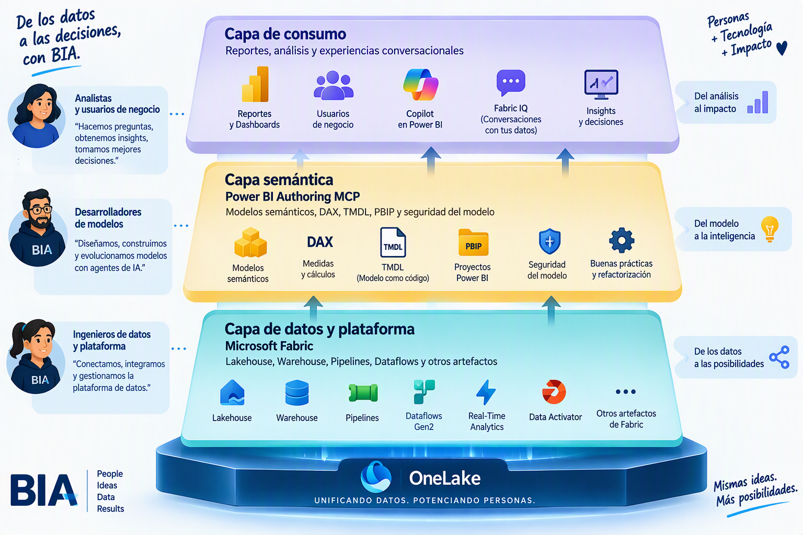
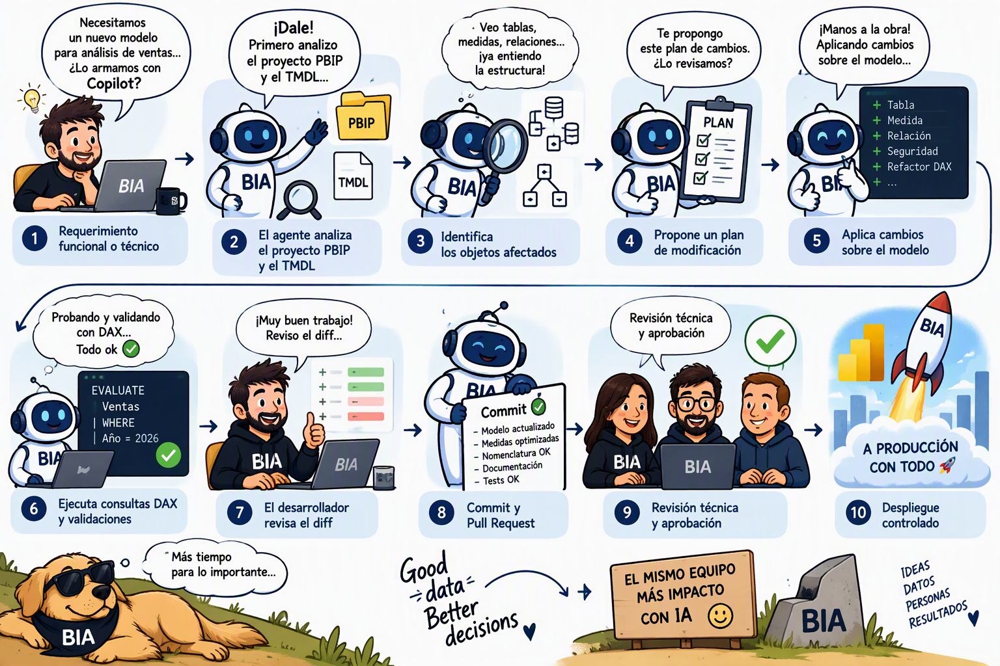

[[_TOC_]]

Power BI Authoring MCP
======================
> Agentes de IA aplicados al desarrollo de modelos semánticos

- [Post | LinkedIn | Power BI Authoring MCP server is now GA!](https://www.linkedin.com/posts/ruiromano_fabconbarcelona-mcp-powerbi-share-7511043860761030656-6HV4/?utm_source=share&utm_medium=member_desktop&rcm=ACoAAADsaZMB2D6ZGh8t7eafxijMTCBjcboEeo0)
- [Power BI Authoring MCP server - Power BI | Microsoft Learn](https://learn.microsoft.com/en-us/power-bi/developer/mcp/power-bi-authoring-mcp)

Introducción
------------

Microsoft presentó el **Power BI Authoring MCP Server**, una capacidad que permite que agentes de inteligencia artificial interactúen directamente con modelos semánticos de Power BI. El anuncio es relevante porque no se limita a incorporar una nueva experiencia de Copilot dentro de Power BI. Plantea una forma diferente de construir, mantener, validar y evolucionar soluciones analíticas mediante agentes capaces de operar sobre los artefactos técnicos del modelo.

A través de este MCP, un usuario puede describir en lenguaje natural el cambio que necesita y dejar que el agente utilice herramientas especializadas para implementarlo. Entre los ejemplos que Microsoft menciona están la creación de medidas, el cambio de nombres en distintos objetos del modelo, la generación de traducciones y la refactorización de expresiones DAX.

La documentación oficial puede consultarse en [Power BI Authoring MCP Server](https://learn.microsoft.com/en-us/power-bi/developer/mcp/power-bi-authoring-mcp).

¿Qué es un MCP y qué aporta en este escenario?
----------------------------------------------

MCP, o Model Context Protocol, es un estándar que permite que un agente de IA descubra y utilice herramientas externas de manera estructurada. En este caso, el agente no se limita a explicar cómo crear una medida o a generar un fragmento de DAX para que después lo copiemos manualmente. Puede recibir herramientas concretas para conectarse con un modelo semántico, inspeccionar sus objetos y aplicar cambios sobre ellos.

Esto introduce una diferencia importante respecto de la asistencia conversacional tradicional. Un asistente puede responder una consulta y generar una recomendación. Un agente conectado mediante MCP puede, dentro de los permisos y controles definidos, avanzar desde la recomendación hacia la ejecución.

La responsabilidad no desaparece. El desarrollador sigue teniendo que definir el objetivo, proporcionar el contexto correcto, revisar los cambios y determinar cuándo corresponde promoverlos a un ambiente superior. Lo que cambia es el nivel de automatización posible y la velocidad con la que pueden realizarse tareas técnicas complejas o repetitivas.

¿Por qué se llama “Authoring” y no simplemente “Power BI MCP”?
--------------------------------------------------------------

El nombre ayuda a delimitar el alcance. Si se llamara simplemente “Power BI MCP”, podría interpretarse que cubre toda la plataforma: administración de capacidades, actualización de datos, distribución de contenido, consumo de reportes, gobierno, seguridad, monitoreo y análisis de información.

En cambio, **Authoring** indica que el foco está puesto en la construcción y evolución de los artefactos de Power BI. Microsoft define específicamente este servidor como una herramienta para que los agentes creen y modifiquen modelos semánticos.

El término tampoco se limita al modelado conceptual tradicional. No se trata únicamente de crear tablas y relaciones. El alcance documentado incluye la creación, actualización y eliminación de tablas, columnas, medidas, relaciones, jerarquías, grupos de cálculo, perspectivas, particiones y roles de seguridad. También contempla operaciones masivas, traducciones, refactorizaciones y aplicación de buenas prácticas.

Por eso, el concepto de **Authoring** resulta más amplio que el de **Modeling**. Modelar es una parte del proceso. Authoring comprende desarrollar, modificar, validar, refactorizar y mantener el modelo como un activo técnico que evoluciona en el tiempo.

Capacidades principales
-----------------------

### Desarrollo de modelos mediante lenguaje natural

Una de las principales capacidades es la posibilidad de expresar una necesidad en lenguaje natural y permitir que el agente la traduzca en operaciones sobre el modelo.

Esto podría utilizarse, por ejemplo, para solicitar la creación de determinadas medidas, reorganizar objetos, incorporar relaciones o aplicar una regla de nomenclatura. El agente interpreta la intención y utiliza las herramientas expuestas por el MCP para operar sobre el tipo de objeto correspondiente.

El valor no está solamente en evitar algunos pasos manuales. También permite que el desarrollador trabaje en un nivel de abstracción más alto. En lugar de concentrarse inicialmente en cada operación técnica, puede describir el resultado esperado y después revisar cómo fue implementado.

### Operaciones masivas y refactorización

Microsoft destaca la posibilidad de modificar cientos de objetos en una misma intervención. Esto incluye cambios masivos de nombres, refactorización, traducciones del modelo y reglas de seguridad.

Este tipo de capacidad puede ser especialmente valioso en modelos grandes o heredados. Cambiar una convención de nombres o revisar una cantidad importante de medidas suele requerir muchas horas de trabajo manual y presenta riesgos de inconsistencia. Un agente puede ayudar a identificar el alcance, planificar los cambios y aplicarlos de forma sistemática.

No obstante, la automatización no elimina la necesidad de revisión. Cuanto mayor sea el alcance de una modificación, más importante será contar con versionado, comparación de cambios, validaciones y un proceso de aprobación antes de promover el resultado.

### Escritura, ejecución y validación de DAX

El MCP permite escribir y ejecutar consultas DAX para probar medidas, investigar problemas de cálculo y explorar los datos mientras se construye el modelo.

Esto transforma al agente en algo más que un generador de fórmulas. El agente podría proponer una expresión, ejecutarla, analizar el resultado y utilizar esa evidencia para ajustar la implementación.

El punto es importante porque uno de los problemas habituales de los asistentes generativos es que pueden producir DAX sintácticamente plausible pero incorrecto desde el punto de vista funcional. La capacidad de ejecutar consultas y validar resultados no garantiza por sí misma la corrección de negocio, pero crea un circuito de trabajo mucho más sólido que la generación aislada de código.

### Aplicación de buenas prácticas

La documentación también indica que el servidor puede evaluar un modelo contra buenas prácticas y aplicar correcciones.

Esto abre un escenario especialmente interesante para DA: convertir nuestros estándares internos de arquitectura y modelado en instrucciones reutilizables para los agentes. El objetivo no debería ser que cada desarrollador obtenga una respuesta diferente según cómo formule su prompt, sino acompañar el MCP con criterios consistentes sobre nomenclatura, organización de medidas, relaciones, seguridad, documentación y validación.

MCP y Agent Skills: las herramientas y el conocimiento
------------------------------------------------------

Microsoft introduce una distinción muy importante entre el MCP y las llamadas **Agent Skills**.

El servidor MCP le entrega al agente las herramientas, es decir, define qué acciones puede ejecutar. Las skills le proporcionan orientación sobre cómo utilizar esas herramientas, cómo secuenciar un cambio y qué características debería tener un modelo o reporte bien construido. Microsoft resume esta diferencia como “las herramientas son el qué y las skills son el cómo”.

Esta separación es central para comprender la arquitectura. Tener una herramienta para crear una relación no significa que el agente sepa cuándo debe crearla, qué cardinalidad corresponde o si el diseño resultante respeta una arquitectura dimensional adecuada. Ese criterio debe surgir de instrucciones, skills, estándares y contexto.

Microsoft recomienda combinar el MCP con el plugin `powerbi-authoring`, que instala skills para modelado semántico y construcción de reportes, además de incluir el servidor MCP local.

Para BIA, esto sugiere una oportunidad adicional. El diferencial no estaría solamente en instalar el MCP, sino en desarrollar una capa de conocimiento propio reutilizable: estándares de DA, patrones de modelado, convenciones de nomenclatura, validaciones y procedimientos de revisión que orienten al agente.

TMDL y PBIP: el modelo semántico como código
--------------------------------------------

Uno de los aspectos más relevantes del anuncio es el soporte para **TMDL** y **Power BI Project files, PBIP**.

TMDL permite representar la definición del modelo semántico mediante archivos de texto. PBIP organiza los componentes de un proyecto de Power BI en una estructura compatible con herramientas de desarrollo y control de versiones. Esto hace posible almacenar los artefactos en un repositorio, comparar cambios y aplicar procesos de revisión.

Microsoft indica expresamente que el MCP puede trabajar con TMDL y archivos de proyecto Power BI para que un agente planifique y ejecute cambios sobre el código del modelo semántico. También señala que esos cambios pueden integrarse con los procesos habituales de control de código fuente y revisión.

Este punto acerca Power BI a prácticas habituales de ingeniería de software. El modelo deja de ser solamente un archivo que una persona modifica desde una interfaz visual y pasa a poder tratarse como una base de código versionable, revisable y automatizable.

En DA ya existen antecedentes internos relacionados con esta dirección. [01DAPowerBI.pptx](https://cloudbia-my.sharepoint.com/personal/atsalvia_biapplications_com_ar/_layouts/15/Doc.aspx?sourcedoc=%7BFA07BCE3-7797-49CF-9CD0-8458CDDF4432%7D&file=01.DA.Power.BI.pptx&action=edit&mobileredirect=true&DefaultItemOpen=1&EntityRepresentationId=c19727f8-0670-44e6-8dba-25da94b05226) reúne material sobre despliegue de Power BI con Azure DevOps, integración Git y proyectos de Power BI, mientras que [MicrosoftFabricBootcampDay3.pdf](https://cloudbia.sharepoint.com/sites/OPE/Shared%20Documents/Learning/microsoft%20fabric%20bootcamp%20day3.pdf?web=1&EntityRepresentationId=a92d2258-2ff5-4f7b-a80d-4b06add024f2) aborda PBIP, TMDL, integración Git, ramas, Pull Requests y alternativas de CI/CD para Fabric.

Por lo tanto, este MCP no introduce una preocupación completamente ajena al equipo. Se conecta con una línea que DA ya viene explorando: tratar el desarrollo analítico con prácticas de versionado, revisión y automatización comparables a las del desarrollo de software.

Modalidad hospedada y modalidad local
-------------------------------------

El servidor presenta dos alternativas de ejecución.

La modalidad **hosted**, actualmente identificada en la documentación como preview, es un endpoint administrado por Microsoft. No requiere instalación local y Microsoft se ocupa de las actualizaciones. Puede trabajar con modelos semánticos ubicados en workspaces de Fabric y actúa con los permisos del usuario autenticado.

La modalidad **local** está disponible de forma general. Se ejecuta en la máquina del usuario mediante `stdio` y puede instalarse como extensión de Visual Studio Code, paquete NPM o ejecutable independiente. Además de conectarse con modelos semánticos de Fabric, puede trabajar con modelos abiertos en Power BI Desktop y con archivos PBIP o TMDL disponibles localmente.

La modalidad local incorpora capacidades especialmente relevantes para procesos de ingeniería. La documentación menciona autenticación mediante service principal para escenarios de integración continua, soporte para transacciones y acceso a trazas de Analysis Services.

La elección no debería abordarse como una competencia entre ambas opciones. La alternativa hospedada resulta natural para trabajar directamente contra modelos publicados en Fabric. La alternativa local tiene mayor sentido cuando el proceso se apoya en Power BI Desktop, archivos PBIP, TMDL, repositorios locales o pipelines de CI.

Microsoft recomienda no registrar simultáneamente ambas modalidades porque el agente recibiría conjuntos de herramientas superpuestos. Esto volvería ambiguo el enrutamiento de acciones y aumentaría el consumo de tokens en cada solicitud.

Permisos, seguridad y controles
-------------------------------

El servidor requiere permisos explícitos sobre el modelo semántico. Con permiso de escritura, el agente puede crear o modificar objetos. Si el usuario dispone solamente de permiso Build, el servidor queda restringido a la ejecución de consultas DAX. Para modelos de Fabric utilizados desde la modalidad local, el endpoint XMLA de la capacidad debe estar configurado como Read Write. En la modalidad hospedada, el administrador de Fabric debe habilitar una configuración específica del tenant.

Esto confirma que el agente no obtiene permisos propios ni evita los controles de la plataforma. Opera utilizando la identidad y las autorizaciones disponibles en el contexto de ejecución.

Sin embargo, que una operación esté autorizada no significa necesariamente que sea conveniente aplicarla directamente sobre un ambiente productivo. Nuestra recomendación debería ser comenzar con modelos de laboratorio, proyectos PBIP versionados o workspaces de desarrollo. Los cambios deberían quedar sujetos a comparación, revisión y promoción controlada.

El enfoque más sólido sería utilizar el agente para acelerar el desarrollo, pero mantener controles humanos en las decisiones de arquitectura, seguridad y promoción entre ambientes.

Flujo de trabajo posible para DA
--------------------------------

La integración de PBIP, TMDL, MCP y agentes permite imaginar un circuito como el siguiente:

No todos estos pasos son presentados por Microsoft como un proceso automático completo. Esta es una propuesta de aplicación para DA basada en las capacidades documentadas de TMDL, PBIP, validación de DAX, control de código fuente y procesos de revisión.

El objetivo no sería eliminar al desarrollador, sino desplazar parte de su esfuerzo desde tareas repetitivas hacia actividades de mayor valor: comprensión del negocio, definición de arquitectura, validación funcional, gobierno y control de calidad.

Relación con Microsoft Fabric
-----------------------------

Es importante precisar el alcance. El Power BI Authoring MCP trabaja sobre **modelos semánticos de Power BI**, incluidos los modelos alojados en workspaces de Fabric. No es un MCP general para diseñar o administrar todos los componentes de Fabric.

La documentación analizada no indica que este servidor cree Lakehouses, Warehouses, Pipelines, Dataflows Gen2, Shortcuts o Eventhouses. Tampoco aparece allí un producto denominado “Fabric Modeling MCP”.

Esto explica por qué el nombre conserva Power BI. Dentro de Fabric, la capa de modelado semántico continúa perteneciendo a la experiencia de Power BI. El MCP puede operar sobre modelos alojados en Fabric, pero su objeto de trabajo sigue siendo el modelo semántico.

DA cuenta además con una página interna titulada MCP de Fabric, donde ya se documentan capacidades y consideraciones del servidor MCP de Fabric. Esto refuerza la conveniencia de pensar los MCP como herramientas especializadas y complementarias, en lugar de asumir que un único servidor cubre toda la plataforma.

Una forma simple de representarlo sería:

Oportunidad para el Fabric Accelerator de BIA
---------------------------------------------

Desde la perspectiva de BIA, el valor no debería quedar reducido a demostrar que un agente puede crear una medida DAX. Ese caso es útil para introducir la tecnología, pero no representa su potencial estratégico.

La oportunidad sería incorporar estas capacidades dentro de un conjunto de estándares y aceleradores reutilizables. Un Fabric Accelerator podría incluir plantillas PBIP, estructuras TMDL, reglas de nomenclatura, bibliotecas de medidas, validaciones automáticas, skills internas y pipelines de revisión.

De esa manera, el agente no trabajaría desde cero en cada proyecto. Operaría dentro de un marco definido por BIA, utilizando nuestros estándares de arquitectura y calidad.

El resultado podría ser una combinación de:
*   mayor velocidad para iniciar proyectos;
*   mayor consistencia entre equipos y clientes;
*   reducción de tareas manuales de refactorización;
*   revisión más sistemática de modelos;
*   incorporación progresiva de CI/CD y GitOps;
*   generación de propiedad intelectual reutilizable.

Estos beneficios representan una hipótesis de aplicación para BIA. Deberían validarse mediante pruebas controladas con modelos reales y escenarios representativos del trabajo de DA.

Conclusión
----------

El Power BI Authoring MCP representa un cambio relevante en la relación entre inteligencia artificial y desarrollo analítico.

Hasta ahora, muchas experiencias de IA en Power BI estuvieron orientadas a asistir al usuario: sugerir una medida, explicar una fórmula o ayudar a construir una visualización. El nuevo enfoque permite que un agente disponga de herramientas concretas para inspeccionar y modificar objetos del modelo.

La combinación con TMDL, PBIP, Agent Skills y control de versiones es la parte más significativa. Esto permite pensar en agentes integrados al ciclo de desarrollo, capaces de analizar una base de código semántico, planificar modificaciones, aplicar cambios y colaborar dentro de procesos de revisión.
Para DA, la oportunidad no consiste simplemente en sumar otra herramienta. Consiste en evaluar cómo incorporar agentes especializados a nuestra metodología, manteniendo estándares, trazabilidad y gobierno.

El escenario más interesante no es un agente que “hace Power BI por nosotros”. Es un agente que trabaja dentro de nuestras prácticas de ingeniería, acelera tareas repetitivas y ayuda a que los estándares de DA sean más fáciles de aplicar de manera consistente.

