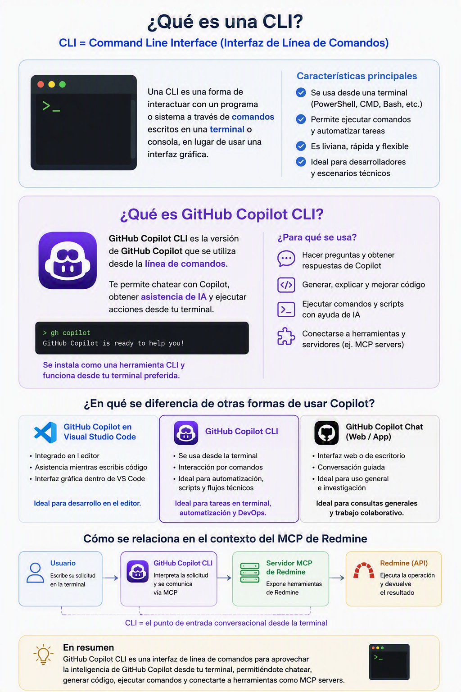
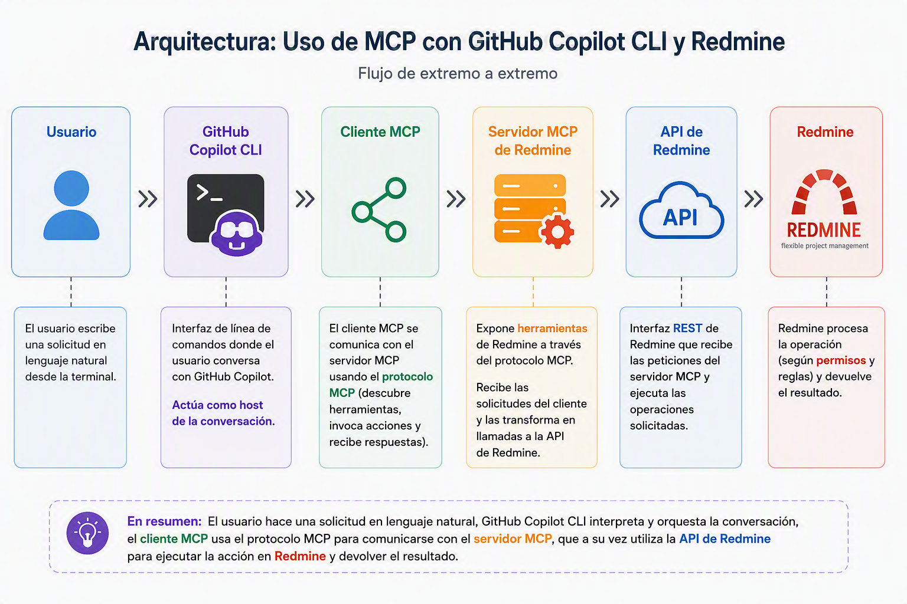
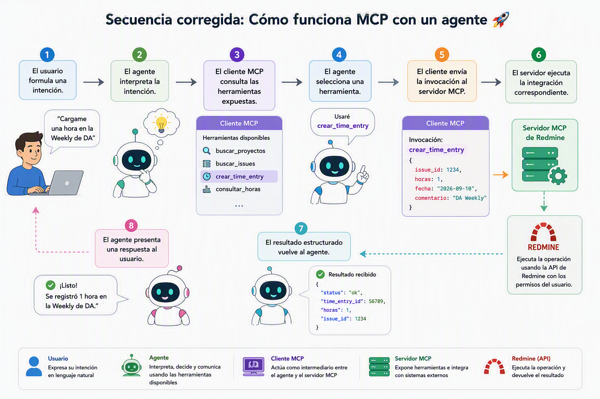

[[_TOC_]]

# Overview
> Dudas surgidas durante la configuración del MCP de Redmine y el rol de GitHub Copilot CLI

Durante la sesión donde configuramos el MCP de Redmine, realizada el **jueves 10 de septiembre de 2026, de 14:00 a 15:00**, surgieron algunas preguntas que pasamos por alta por cuestiones de tiempo y agenda, pero queremos recordarlas y darles respuesta.

El objetivo de este documento es recuperar con detalle las dudas que surgieron durante la sesión, especialmente aquellas relacionadas con **GitHub Copilot CLI**, y contrastar las explicaciones dadas por @<7D295BE8-C957-6DE4-B7AC-C3F9FBE66C1F> con documentación de Microsoft Learn.

La intención no es cuestionar el valor de la sesión, que terminó exitosamente con personas del equipo consultando proyectos y registrando horas en Redmine. La intención es separar con mayor precisión los componentes técnicos y corregir explícitamente aquellas explicaciones que fueron incompletas, excesivamente simplificadas o directamente incorrectas.

## Contexto

@<7D295BE8-C957-6DE4-B7AC-C3F9FBE66C1F> inició la reunión explicando que quería asegurarse de que el equipo comprendiera qué era MCP antes de avanzar con la instalación. En el chat previo también indicó que la semana anterior se había mostrado “la magia”, pero que faltaba afianzar el concepto. Posteriormente compartió dos páginas de la Wiki de DA:
*   “Qué es un MCP”.
*   “MCP de Redmine en Windows”.

La presentación comenzó con la definición conceptual de MCP y luego pasó a una demostración práctica desde Windows. El laboratorio requería:
1.  Verificar o instalar Node.js, npm y npx.
2.  Instalar GitHub Copilot CLI.
3.  Autenticarse en GitHub Copilot CLI.
4.  Configurar el servidor MCP de Redmine.
5.  Informar la URL y la API Access Key de Redmine.
6.  Probar inicialmente el servidor en modo de solo lectura.
7.  Habilitar escritura y registrar una hora en Redmine.

El recorrido práctico funcionó, pero al avanzar rápidamente con la instalación se mezclaron varios conceptos:
*   GitHub Copilot como producto.
*   La extensión de GitHub Copilot en Visual Studio Code.
*   GitHub Copilot CLI.
*   El cliente MCP.
*   El servidor MCP de Redmine.
*   La API de Redmine.
*   Node.js y npx como mecanismo para ejecutar el servidor.
*   Las credenciales de GitHub.
*   La API Access Key de Redmine.

# Dudas

## Qué es GitHub Copilot CLI?

Durante la instalación, @<EAEA2A54-2390-61F6-96AE-B5E3B28E18D5> preguntó si debía instalar nuevamente GitHub Copilot porque ya lo tenía disponible en Visual Studio Code. Más adelante, @<CCDC187A-6EA4-6827-A0F7-AD0BA15D8F37> consultó si se estaba instalando el mismo GitHub Copilot o una versión diferente. @<7D295BE8-C957-6DE4-B7AC-C3F9FBE66C1F> respondió que no se estaba reinstalando GitHub Copilot en Visual Studio Code, sino instalando “la CLI”, y decidió posponer la explicación de qué significaba CLI para evitar desviar el ejercicio.

_Esta duda quedó conceptualmente abierta._

### Explicación corregida

**CLI significa Command-Line Interface**, es decir, interfaz de línea de comandos.

**GitHub Copilot CLI** es una experiencia de GitHub Copilot que se utiliza directamente desde una terminal. Microsoft la describe como una forma de llevar asistencia basada en IA a la terminal y documenta que puede registrarse un servidor MCP para usar sus herramientas mediante instrucciones en lenguaje natural.

**Referencia:** [Set up WinGet MCP Server | Microsoft Learn](https://learn.microsoft.com/en-us/windows/package-manager/winget/mcp-server-setup#configure-the-mcp-server-in-github-copilot-cli)

La explicación más ordenada habría sido:

GitHub Copilot
├── Experiencia dentro de Visual Studio Code
├── Experiencia de escritorio
└── GitHub Copilot CLI en una terminal

**GitHub Copilot CLI**:
*   No es una segunda API.
*   No es el servidor MCP.
*   No es Redmine.
*   No sustituye a la extensión de GitHub Copilot en Visual Studio Code.
*   Es otro entorno desde el que una persona puede interactuar con GitHub Copilot.

## Por qué había que instalar Copilot CLI?

La pregunta apareció indirectamente en distintas intervenciones. El equipo ya utilizaba GitHub Copilot desde Visual Studio Code y no estaba claro por qué necesitaba otra interfaz.
@<7D295BE8-C957-6DE4-B7AC-C3F9FBE66C1F> explicó que utilizaba GitHub Copilot desde diferentes puntos de entrada y que, para el laboratorio, la CLI permitía conversar con el servidor MCP de Redmine desde PowerShell de manera muy ágil. @<EAEA2A54-2390-61F6-96AE-B5E3B28E18D5> terminó sintetizándolo correctamente como “otro punto de entrada”.

### Explicación corregida

Para este laboratorio, GitHub Copilot CLI fue el **host o cliente compatible con MCP elegido para realizar la prueba**.

La arquitectura correcta puede representarse así:

La documentación de Microsoft confirma que GitHub Copilot CLI puede registrar servidores MCP usando una configuración propia o mediante el comando interactivo `/mcp add`.

**Referencia:** [Use the MCP server - Dev Proxy | Microsoft Learn](https://learn.microsoft.com/en-us/microsoft-cloud/dev/dev-proxy/how-to/use-mcp-server#configure-the-mcp-server)

Durante la sesión pudo quedar instalada esta idea:

> “Para utilizar un MCP hace falta GitHub Copilot CLI”.

No es así, es incorrecto decirlo así. **GitHub Copilot CLI fue una elección para el laboratorio, no una condición universal de MCP.** Microsoft documenta distintos clientes compatibles, entre ellos Visual Studio Code con GitHub Copilot, GitHub Copilot CLI y otras aplicaciones compatibles con MCP.

La formulación correcta debería ser:

> Para esta prueba instalamos GitHub Copilot CLI porque era el cliente MCP desde el que @<7D295BE8-C957-6DE4-B7AC-C3F9FBE66C1F> había validado previamente el servidor de Redmine. También es posible configurar servidores MCP desde otros clientes compatibles, pero cada cliente puede requerir su propia configuración.

## Copilot CLI es lo mismo que una API?

La confusión entre MCP y API apareció desde el comienzo. @<CCDC187A-6EA4-6827-A0F7-AD0BA15D8F37> preguntó si MCP podía ser “tipo una API”. @<7D295BE8-C957-6DE4-B7AC-C3F9FBE66C1F> respondió inicialmente “vendría a ser tipo una API”, aunque inmediatamente aclaró que MCP no era una API y trató de diferenciarlos.

Más adelante, al incorporar GitHub Copilot CLI, los límites entre CLI, MCP y API volvieron a quedar poco claros.

### Separación correcta

#### GitHub Copilot CLI

Es la interfaz en la terminal desde la que el usuario conversa con GitHub Copilot.

#### MCP

Es el protocolo que permite que un cliente compatible descubra y utilice herramientas ofrecidas por un servidor MCP.

#### Servidor MCP de Redmine

Es el proceso que expone herramientas relacionadas con Redmine mediante MCP.

#### API de Redmine

Es la interfaz técnica propia de Redmine mediante la que se ejecutan consultas o modificaciones sobre el sistema.

#### Redmine

Es el sistema de destino que conserva proyectos, issues, usuarios y registros de horas.

### Lo correcto!

> MCP no es una API. La API expone operaciones propias de una aplicación. MCP estandariza cómo un agente o cliente de IA descubre y utiliza herramientas que un servidor pone a su disposición. El servidor MCP puede utilizar una API para ejecutar esas herramientas, pero MCP y API cumplen responsabilidades diferentes.

Microsoft define MCP como un estándar que permite a asistentes de IA conectarse con herramientas y fuentes de datos externas. También muestra servidores MCP que se ejecutan mediante `npx` y que se configuran tanto en Visual Studio Code como en GitHub Copilot CLI.

## MCP es un “traductor”?

Durante la explicación, @<CCDC187A-6EA4-6827-A0F7-AD0BA15D8F37> propuso la analogía de un traductor. @<7D295BE8-C957-6DE4-B7AC-C3F9FBE66C1F> aceptó parcialmente esa analogía y explicó que el agente interpretaba el pedido y que MCP determinaba la operación correspondiente, por ejemplo `createIssue` o `createTimeEntry`.

La analogía ayudó a transmitir el concepto, pero técnicamente resultó imprecisa porque se le  **atribuyó al MCP una capacidad de interpretación que corresponde principalmente al agente, al modelo y al host.**

MCP, como protocolo, no “comprende” por sí mismo que “cargame una hora” significa ejecutar `createTimeEntry`. El servidor MCP publica herramientas con nombres, descripciones, entradas y salidas. El agente utiliza esa información para seleccionar la herramienta que considera adecuada.

Por lo tanto, MCP puede describirse informalmente como un mecanismo que facilita la traducción entre intención y capacidades, pero **no corresponde decir que MCP es quien razona, interpreta o decide**.

## Qué estamos autenticando?

Durante el inicio de sesión de GitHub Copilot CLI, @<0B64ECD8-482A-6880-8F98-D53D414F6ADD> preguntó si ese procedimiento se hacía una sola vez y si era “para Redmine”. @<7D295BE8-C957-6DE4-B7AC-C3F9FBE66C1F> aclaró correctamente que el login era para GitHub Copilot CLI y no para Redmine.

Luego se utilizó por separado la API Access Key disponible en la cuenta de Redmine.

### Le ponemos orden!

Había dos autenticaciones distintas:

#### Autenticación en GitHub Copilot CLI

Respondía a la pregunta:

> ¿Qué cuenta está autorizada para utilizar GitHub Copilot desde esta terminal?

#### Autenticación del servidor MCP contra Redmine

Respondía a la pregunta:

> ¿Con qué usuario y permisos realizará el servidor MCP las operaciones en Redmine?

La autenticación de GitHub no concedía automáticamente acceso a Redmine. La API Access Key de Redmine era la credencial usada por el servidor para operar contra la aplicación.

Microsoft distingue autenticaciones del cliente y del servicio de destino. Por ejemplo, en Azure MCP Server se documenta que la autenticación contra Azure puede realizarse mediante identidades y credenciales de Azure disponibles en el entorno.

**Referencia:** [Quickstart: Integrate Azure MCP Server with GitHub Copilot CLI - Azure MCP Server | Microsoft Learn](https://learn.microsoft.com/en-us/azure/developer/azure-mcp-server/how-to/github-copilot-cli?tabs=visual-studio-code)

## La configuración hecha en Copilot CLI debería aparecer en VS Code?

Esta fue una de las dudas más importantes y quedó pendiente.

@<0B64ECD8-482A-6880-8F98-D53D414F6ADD> preguntó si debían trabajar siempre desde PowerShell. El equipo probó entonces la misma solicitud en Visual Studio Code, pero la sesión de VS Code informó que no había herramientas de Redmine conectadas o disponibles.

Durante la reunión se especuló que, al utilizar la misma cuenta, la configuración podía quedar disponible automáticamente en Visual Studio Code.

### Corrección explícita

**@<7D295BE8-C957-6DE4-B7AC-C3F9FBE66C1F> y parte del equipo asumieron que la configuración podía compartirse automáticamente entre GitHub Copilot CLI y Visual Studio Code por utilizar la misma cuenta. Esa suposición fue incorrecta o, como mínimo, no estaba fundamentada.**

Microsoft documenta ubicaciones diferentes:
*   GitHub Copilot CLI puede utilizar `~/.copilot/mcp-config.json`.
*   Visual Studio Code puede utilizar `.vscode/mcp.json` para el workspace o la configuración de usuario de VS Code.

Esto explica por qué el servidor configurado en Copilot CLI no apareció automáticamente en Visual Studio Code durante la prueba.

La formulación correcta debería ser:

> Utilizar la misma cuenta de GitHub Copilot no implica necesariamente compartir la configuración de servidores MCP entre aplicaciones. Copilot CLI y Visual Studio Code tienen mecanismos y archivos de configuración específicos.

Microsoft también documenta que, en Visual Studio Code, puede agregarse un servidor desde la paleta de comandos mediante **MCP: Add Server**, eligiendo el transporte correspondiente y definiendo si la configuración será global o del workspace.

**Referencia:** [Connect Dataverse MCP with GitHub Copilot in Visual Studio Code and Copilot CLI - Power Apps | Microsoft Learn](https://learn.microsoft.com/en-us/power-apps/maker/data-platform/data-platform-mcp-vscode)

## Para qué sirven Node.js, npm y npx?

Varias personas encontraron que `node`, `npm` y `npx` no estaban instalados o no eran reconocidos por PowerShell. El equipo avanzó con su instalación, pero no se explicó claramente por qué eran necesarios.

### Explicación corregida

En el laboratorio:
*   **Node.js** era el entorno de ejecución requerido por el paquete utilizado.
*   **npm** era el administrador de paquetes asociado a Node.js.
*   **npx** permitía ejecutar el paquete del servidor MCP sin tratarlo como una aplicación tradicional instalada manualmente.
*   **GitHub Copilot CLI** era el cliente o experiencia conversacional.
*   **El servidor MCP de Redmine** era el proceso ejecutado mediante `npx`.
*   **Redmine** era el sistema externo.

Microsoft utiliza el mismo patrón en ejemplos de servidores MCP publicados como paquetes npm: configuración de tipo `stdio`, comando `npx` y argumentos que identifican el paquete a ejecutar.

### Corrección conceptual

Durante algunos pasajes, @<7D295BE8-C957-6DE4-B7AC-C3F9FBE66C1F> habló del “MCP dentro del servidor” como si MCP fuera una pieza de software contenida físicamente dentro del proceso.

La expresión correcta sería:

> El servidor implementa el protocolo MCP y expone herramientas mediante ese protocolo.

MCP no es un módulo único que necesariamente “vive dentro” del servidor. Es el contrato de comunicación que el servidor implementa.

## Permisos, confirmaciones y modo de solo lectura

Durante la prueba aparecieron distintos tipos de confirmación:
*   Confianza en la carpeta.
*   Inicio de sesión en GitHub.
*   Autorización de GitHub Copilot CLI.
*   Confirmación para usar herramientas.
*   API Access Key de Redmine.
*   Configuración `read-only`.
*   Permisos propios del usuario dentro de Redmine.

@<EAEA2A54-2390-61F6-96AE-B5E3B28E18D5> preguntó qué cambiaba al pasar el valor de `true` a `false`. @<7D295BE8-C957-6DE4-B7AC-C3F9FBE66C1F> explicó que el modo inicial permitía realizar lecturas y que, al habilitar escritura, el servidor podía registrar horas.

La explicación fue válida para el servidor utilizado, pero faltó remarcar que seguían existiendo otras capas de autorización. Habilitar escritura en el servidor no garantizaba que Redmine aceptara cualquier operación. La API Access Key seguía estando limitada por los permisos del usuario.

## El error de PowerShell y `RemoteSigned`

@<0B64ECD8-482A-6880-8F98-D53D414F6ADD> y @<F3AD1471-98AE-667A-8352-97A859560FE9> recibieron errores de seguridad al ejecutar npm y npx. Posteriormente se utilizó `Set-ExecutionPolicy -ExecutionPolicy RemoteSigned -Scope CurrentUser`.

@<7D295BE8-C957-6DE4-B7AC-C3F9FBE66C1F> le explicó a @<0B64ECD8-482A-6880-8F98-D53D414F6ADD> muy vagamente lo que significa realmente, por lo cual vale hacer una corrección explícita. `RemoteSigned` no significa que el usuario pueda “ejecutar remotamente cualquier cosa” ni que se eliminen todos los pedidos de autorización.

Microsoft explica que la **Execution Policy** controla las condiciones bajo las cuales PowerShell carga archivos de configuración y ejecuta scripts. También aclara que no constituye una frontera de seguridad, sino una medida de defensa en profundidad. Con `RemoteSigned`, pueden ejecutarse scripts locales sin firma, mientras que los scripts descargados de Internet requieren firma o deben desbloquearse de manera consciente.

**Referencia:** [About_Execution_Policies - PowerShell | Microsoft Learn](https://learn.microsoft.com/en-us/powershell/module/microsoft.powershell.core/about/about_execution_policies?view=powershell-7.6) y [About_Signing - PowerShell | Microsoft Learn](https://learn.microsoft.com/en-us/powershell/module/microsoft.powershell.core/about/about_signing?view=powershell-7.6)

La explicación correcta debería haber sido:

> Estamos cambiando la política de ejecución de PowerShell para el usuario actual. Esto permite ejecutar determinados scripts locales que antes estaban bloqueados. No concede permisos remotos, no reemplaza los controles de seguridad y no autoriza por sí mismo a GitHub Copilot o al MCP a realizar cualquier acción.

Además, antes de cambiarla conviene revisar la política efectiva y las políticas aplicadas por la organización, porque una Group Policy puede prevalecer sobre la configuración local.

**Referencia:** [Get-ExecutionPolicy (Microsoft.PowerShell.Security) - PowerShell | Microsoft Learn](https://learn.microsoft.com/en-us/powershell/module/microsoft.powershell.security/get-executionpolicy?view=powershell-7.6) y [Set-ExecutionPolicy (Microsoft.PowerShell.Security) - PowerShell | Microsoft Learn](https://learn.microsoft.com/en-us/powershell/module/microsoft.powershell.security/set-executionpolicy?view=powershell-7.6)

## Copilot CLI puede utilizarse como motor de cualquier aplicación?

Cerca del final, Javier Ramos explicó que, al tener Copilot CLI instalado, el equipo podría crear una aplicación propia que utilizara Copilot CLI y aprovechar las mismas capacidades de GitHub Copilot. No está mal, pero **la afirmación fue demasiado amplia y no quedó respaldada por documentación.**

Microsoft documenta GitHub Copilot CLI como una experiencia de asistencia desde terminal y documenta por separado GitHub Copilot SDK para integrar capacidades en aplicaciones.

**Referencia:** [Quickstart: Integrate Azure MCP Server with GitHub Copilot SDK - Azure MCP Server | Microsoft Learn](https://learn.microsoft.com/en-us/azure/developer/azure-mcp-server/how-to/github-copilot-sdk?tabs=visual-studio-code%2Cpython)

Por lo tanto, no corresponde presentar Copilot CLI como un runtime de propósito general listo para incrustar dentro de cualquier aplicación. La formulación más precisa sería:

> Copilot CLI permite utilizar GitHub Copilot desde una terminal y conectarlo con servidores MCP. Para construir una aplicación propia con capacidades de agente, habría que evaluar un SDK o framework de agentes apropiado y no asumir que Copilot CLI es automáticamente el componente embebible de la solución.

# Conclusiones

La sesión cumplió su objetivo práctico: el equipo logró levantar el servidor MCP de Redmine, consultar proyectos y registrar una hora mediante lenguaje natural. Después de la reunión, @<0B64ECD8-482A-6880-8F98-D53D414F6ADD> confirmó en el chat que tenía el MCP funcionando, mientras que @<EAEA2A54-2390-61F6-96AE-B5E3B28E18D5> continuó probando la automatización de carga de horas.
