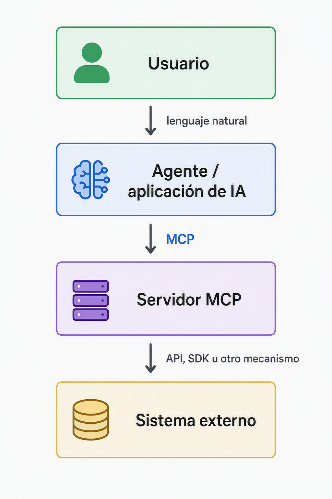
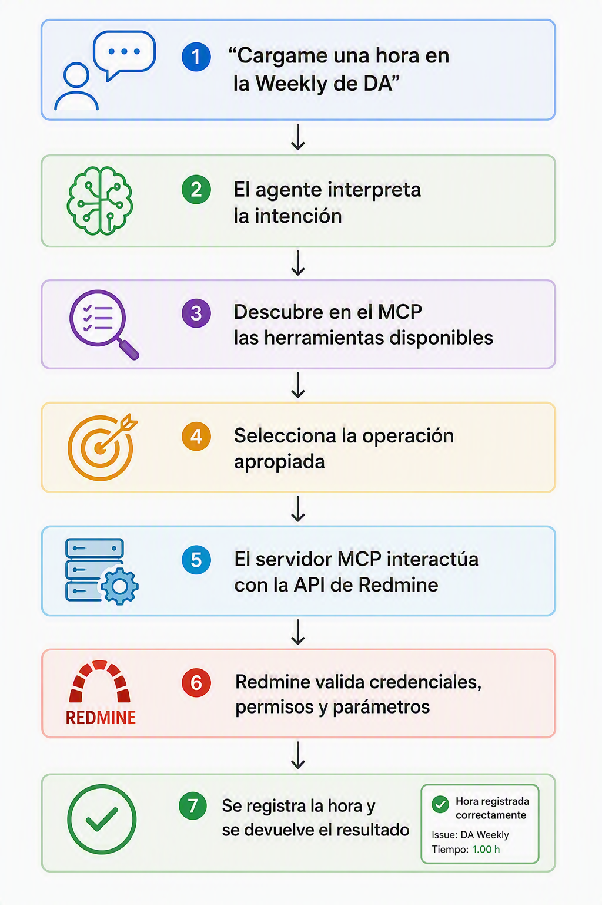

[[_TOC_]]

[[_TOSP_]]

MCP explicado simple
--------------------

**MCP significa Model Context Protocol.**

Es un protocolo abierto que estandariza cómo una aplicación de IA se conecta con sistemas externos para:
*   Consultar información.
*   Recibir contexto.
*   Descubrir herramientas disponibles.
*   Ejecutar acciones autorizadas.

Una analogía bastante clara es pensar en MCP como un **USB-C para agentes de IA**. El USB-C define una forma común de conectar dispositivos distintos. MCP define una forma común para que agentes y aplicaciones de IA se conecten con herramientas, datos y sistemas externos.

Por qué hace falta?
--------------------

Un modelo de lenguaje, por sí solo, puede comprender tu pedido y generar texto, pero no necesariamente sabe:
*   Qué proyectos existen en Redmine.
*   Cuál es el issue activo de la DA Weekly.
*   Qué recursos tenés en Azure.
*   Qué operación permite registrar una hora.
*   Con qué parámetros debe invocarse esa operación.
*   Qué permisos tiene el usuario.

MCP le ofrece al agente una interfaz estandarizada para descubrir esas capacidades y utilizarlas. Microsoft lo describe como un protocolo abierto para administrar cómo los modelos interactúan con herramientas, memoria y contexto externos de manera estructurada.

La arquitectura, sin complicarla
--------------------------------

Hay cuatro piezas que conviene diferenciar:

1.  **Usuario**
    Expresa una intención en lenguaje natural.

2.  **Host o aplicación de IA**
    Es el entorno donde vive la experiencia, por ejemplo Visual Studio Code o una aplicación con agente.

3.  **Cliente MCP**
    Mantiene la conexión con el servidor MCP y pone sus capacidades a disposición del agente.

4.  **Servidor MCP**
    Publica las herramientas, los recursos y los prompts que el agente puede utilizar.

Microsoft documenta precisamente esta arquitectura: el host contiene clientes MCP, y cada cliente se conecta con un servidor que expone recursos de datos, herramientas para ejecutar acciones y prompts para orientar la interacción.

Un esquema simple sería:

Aplicado a nuestro ejemplo de Redmine
--------------------------------

En la última [DA Weekly](https://teams.microsoft.com/l/meeting/details?eventId=AAMkADIxMTE5MjRhLTdkZGUtNDI3Ni04NjE4LTE0NDVmYWEyNTlkZAFRAAgI3w7OdREAAEYAAAAAWXaZf-ibe0i6_TKyyqKVYAcAC-igdfCco02vStBBXzw7uwAAAJtJLAAAE1Edn9cdbUuD5ktP-qqO2QAMPkBusQAAEA%3d%3d&EntityRepresentationId=85fd0288-68e7-45c9-9625-f22d1eb7cdd5) expliqué un prototipo local que combinaba GitHub Copilot, Copilot CLI, un servidor MCP y la API de Redmine. El agente interpretaba una instrucción como “cargame una hora”, localizaba el issue activo y registraba la entrada de tiempo utilizando las credenciales autorizadas.

El recorrido conceptual era:

Lo importante es que **el MCP no inventa una API que no existe**. En la explicación marqué que detrás había un servicio con una API y un contrato de requests y responses. El agente traducía el lenguaje natural a la operación necesaria y MCP funcionaba como la capa de interacción estructurada.

MCP versus API
--------------

Esta distinción seguramente va a aparecer en cualquier conversación donde se intente explicar que es un MCP:

### API

Una API expone operaciones concretas de un sistema:
*   Obtener un issue.
*   Buscar proyectos.
*   Registrar horas.
*   Crear un work item.
*   Consultar una capacidad.

Cada API tiene su propio contrato, autenticación, endpoints y formatos.

### MCP

MCP estandariza la forma en que una aplicación de IA:
*   Descubre qué capacidades están disponibles.
*   Comprende para qué sirve cada herramienta.
*   Conoce sus parámetros de entrada.
*   Invoca la herramienta.
*   Recibe una respuesta estructurada.

Por eso, una frase precisa para una buena explicación podría ser:

> **La API permite hablar con el sistema. MCP permite que un agente descubra y utilice esa capacidad siguiendo un protocolo común.**

¿Qué publica un servidor MCP?
-----------------------------

Principalmente puede exponer:
*   **Tools:** operaciones que el agente puede ejecutar.
*   **Resources:** datos o contenido que puede recuperar como contexto.
*   **Prompts:** instrucciones o plantillas especializadas para determinados escenarios.

Microsoft documenta que un servidor MCP puede proporcionar recursos, herramientas para realizar acciones y prompts que orienten las interacciones.

En un MCP para Redmine, por ejemplo, las tools podrían ser conceptualmente:
*   Buscar proyecto.
*   Buscar issue.
*   Consultar horas cargadas.
*   Registrar una entrada de tiempo.
*   Crear o actualizar un issue.

El servidor describe cada herramienta, sus entradas y sus salidas. Luego el agente elige cuál utilizar según la intención expresada por el usuario.

¿Qué ventaja ofrece frente a integrar todo directamente?
--------------------------------------------------------

La ventaja no es solamente “hablar en lenguaje natural”. El valor más importante es la **estandarización**.

Sin MCP, una aplicación de IA necesita integrar cada API con mecanismos particulares. Con MCP, distintos servidores exponen sus capacidades mediante una convención común, y un cliente compatible puede descubrirlas y utilizarlas.

Esto favorece:
*   **Reutilización:** un servidor puede ser utilizado por diferentes clientes compatibles.
*   **Descubrimiento:** el agente puede conocer las herramientas publicadas.
*   **Composición:** un agente puede trabajar con varios servidores.
*   **Desacoplamiento:** la experiencia conversacional no necesita conocer todos los detalles internos de cada backend.
*   **Gobierno:** cada conexión conserva autenticación y permisos del sistema involucrado.

Como ejemplo concreto, Azure MCP Server funciona con clientes como GitHub Copilot Agent Mode, OpenAI Agents SDK y Semantic Kernel, y expone herramientas para interactuar con recursos de Azure.

Seguridad: el punto que no conviene minimizar
---------------------------------------------

MCP **no elimina el modelo de seguridad del sistema conectado**.

Si una herramienta permite escritura, el agente puede intentar ejecutar acciones de escritura dentro del alcance de las credenciales configuradas. En Azure MCP Server, por ejemplo, Microsoft utiliza las credenciales del usuario o una identidad administrada y aplica Azure RBAC para determinar qué operaciones están autorizadas.

Para DA, yo enfatizo estos principios:
*   Mínimo privilegio.
*   Separar herramientas de lectura y escritura.
*   No incorporar tokens dentro del código.
*   Confirmación humana para acciones sensibles.
*   Registrar las operaciones ejecutadas.
*   Usar servidores provenientes de fuentes confiables.
*   Revisar siempre el resultado generado por el agente.

Microsoft recomienda revisar cuidadosamente los servidores MCP conectados y priorizar servidores alojados por proveedores confiables, especialmente cuando brindan acceso a herramientas y datos corporativos.

Lo que yo propongo hoy al equipo
----------------------------------

No planteo “hagamos un MCP para todo”. Lo bajo a un ejercicio concreto:

### Inventario de procesos candidatos

Preguntar al equipo:

> ¿Qué tareas repetitivas hacemos hoy que dependen de una API, una CLI o archivos estructurados y que podrían exponerse como tools para un agente?

Posibles frentes surgidos en la [DA Weekly](https://teams.microsoft.com/l/meeting/details?eventId=AAMkADIxMTE5MjRhLTdkZGUtNDI3Ni04NjE4LTE0NDVmYWEyNTlkZAFRAAgI3w7OdREAAEYAAAAAWXaZf-ibe0i6_TKyyqKVYAcAC-igdfCco02vStBBXzw7uwAAAJtJLAAAE1Edn9cdbUuD5ktP-qqO2QAMPkBusQAAEA%3d%3d&EntityRepresentationId=85fd0288-68e7-45c9-9625-f22d1eb7cdd5):

1.  **Redmine**
    Consultar issues, buscar asignaciones y registrar horas.

2.  **Azure DevOps**
    Consultar o gestionar work items y repositorios. Para una próxima demo queda pendiente revisar la conexión del MCP con Azure DevOps.

3.  **Power BI y modelos tabulares**
    Revisar definiciones, generar consultas y validar convenciones o estándares.

4.  **Azure**
    Consultar recursos, capacidades y configuraciones utilizando identidad y RBAC. Azure MCP Server ya ofrece herramientas para operar sobre recursos de Azure mediante lenguaje natural.

5.  **Microsoft Learn**
    Conectar al agente con documentación oficial actualizada. Microsoft Learn ofrece un servidor MCP remoto que permite buscar documentación, recuperar artículos completos y consultar ejemplos de código.

Las tres preguntas para cerrar el tema
--------------------------------------

1.  **¿Qué tareas repetitivas de DA justificarían un MCP?**
2.  **¿Cuáles deberían ser solo lectura y cuáles podrían ejecutar cambios?**
3.  **¿Conviene consumir servidores existentes o construir componentes propios como IP reutilizable de BIA?**

Mi recomendación es evitar que la conversación se convierta en una discusión sobre instalación, NPX o archivos de configuración. Para esta Weekly, el punto más valioso es que el equipo entienda que **MCP puede transformar conocimiento técnico y APIs dispersas en herramientas reutilizables para agentes**, pero siempre con permisos, trazabilidad y revisión humana.

------
by @<7D295BE8-C957-6DE4-B7AC-C3F9FBE66C1F> , 2026-09-10
