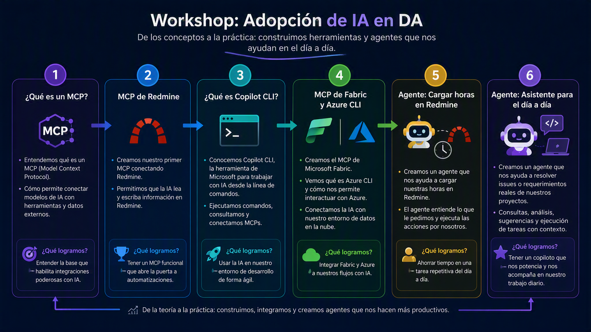
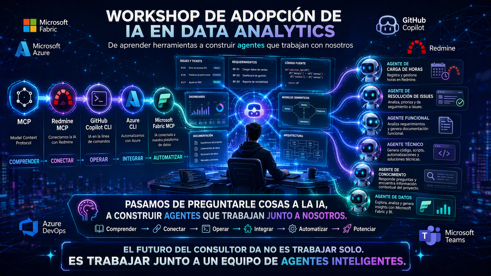

[[_TOC_]]

[[_TOSP_]]

# Overview

# Plan de Acción

## Nivel 1

### Comprender

#### ¿Qué es un MCP?

**Objetivo** Entender cómo la IA puede conectarse con herramientas, datos y sistemas reales.

**Aprendemos**
*   Qué es el Model Context Protocol (MCP).
*   Cómo los modelos consumen contexto externo.
*   Por qué los MCP amplían las capacidades de la IA.

**Resultado** ✅ Comprendemos la base que hace posible las integraciones inteligentes.

## Nivel 2

### Conectar

#### MCP de Redmine

**Objetivo** Construir nuestra primera integración con una herramienta de trabajo real.

**Aprendemos**
*   Conectar IA con Redmine.
*   Leer y actualizar información desde el modelo.
*   Utilizar lenguaje natural para interactuar con proyectos.

**Resultado** ✅ La IA deja de ser solo un chat y comienza a trabajar con nuestros sistemas.

## Nivel 3

### Operar

#### Copilot CLI y Azure CLI

**Objetivo** Aprender a trabajar con IA desde la consola y automatizar tareas.

**Aprendemos**
*   Qué es Copilot CLI.
*   Qué es Azure CLI.
*   Cómo ejecutar acciones mediante lenguaje natural.

**Resultado** ✅ Incorporamos IA a nuestro entorno de trabajo y desarrollo diario.

## Nivel 4

### Integrar

#### MCP de Microsoft Fabric

**Objetivo** Conectar la IA con nuestra plataforma de datos y analítica.

**Aprendemos**
*   Cómo funciona el MCP de Fabric.
*   Acceso a Workspaces, Lakehouses y modelos semánticos.
*   Uso de Azure CLI para autenticación y administración.

**Resultado** ✅ La IA obtiene contexto real sobre nuestros datos y soluciones analíticas.

## Nivel 5

### Automatizar

#### Agente de Carga de Horas

**Objetivo** Delegar tareas repetitivas en agentes especializados.

**Aprendemos**
*   Diseñar un agente orientado a un proceso.
*   Automatizar la carga de horas en Redmine.
*   Reducir esfuerzo administrativo.

**Resultado** ✅ Recuperamos tiempo para enfocarnos en actividades de mayor valor.

## Nivel 6

### Potenciar

#### Agente para Proyectos Reales

**Objetivo** Crear un asistente que acompañe nuestro trabajo diario.

**Aprendemos**
*   Resolver issues y requerimientos.
*   Analizar documentación funcional y técnica.
*   Consultar conocimiento del proyecto.
*   Generar entregables y acelerar tareas.

**Resultado** ✅ Trabajamos junto a un copiloto especializado que amplifica nuestra productividad.

# Mensaje Final

## De usuarios de IA a creadores de agentes

**Entendemos → Conectamos → Automatizamos → Escalamos**

_"El objetivo no es aprender herramientas. El objetivo es construir asistentes capaces de ayudarnos en el trabajo real de nuestros proyectos."_

O incluso una frase más potente para cerrar el workshop:

> **"Pasamos de preguntarle cosas a la IA, a construir agentes que trabajan con nosotros."** 🚀

