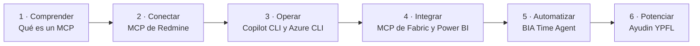
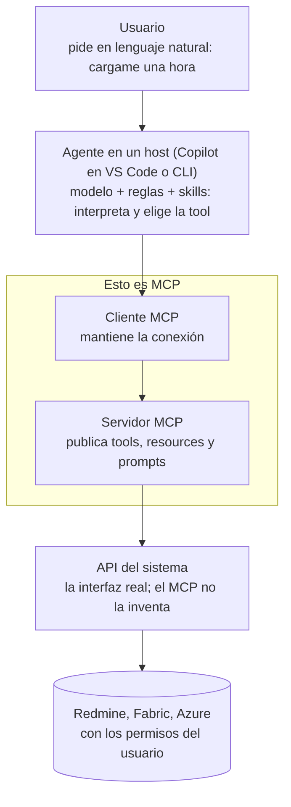
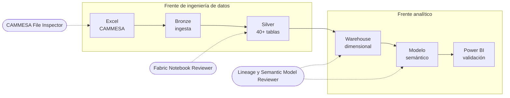

# Guía de lectura de la wiki de Copilot

**En corto:** la [wiki de Copilot](copilot-javier-ramos/README.md) es el plan de Javier Ramos para que Data Analytics pase de usar la IA como un chat a construir agentes que trabajan con sus herramientas reales (Redmine, Fabric, Power BI). Esta página la resume, explica los conceptos que más confunden, analiza Ayudin YPFL y dice cómo leerla. La copia de la wiki no se toca: esta guía es un documento aparte.

Revisión del 2026-10-26 sobre la copia de `docs/copilot-javier-ramos` (wiki original en Azure DevOps). El repo del código, `bia-da-agentic`, está descripto en [bia_da_agentic.md](bia_da_agentic.md).

---

## 1. El mapa: seis niveles

El [Overview](copilot-javier-ramos/overview.md) ordena la wiki como una escalera. Cada nivel tiene su página y se apoya en el anterior.

Los niveles 1 a 4 son aprendizaje: qué es cada pieza y cómo se conecta. Los niveles 5 y 6 son agentes sobre procesos reales del equipo. La frase de cierre lo resume: *"Pasamos de preguntarle cosas a la IA, a construir agentes que trabajan con nosotros."*

## 2. Los conceptos clave

**MCP (Model Context Protocol)** es un estándar abierto para que un agente descubra y use herramientas externas. Javier lo compara con un USB-C para agentes: una forma común de enchufarlo a Redmine, Fabric o Azure, en lugar de una integración distinta por sistema.

Las tres distinciones que la wiki repite:

| Confusión | Lo correcto |
|---|---|
| "MCP es una API" | La API es cómo se habla con el sistema. MCP es cómo un agente descubre esa capacidad y la usa con un protocolo común |
| "MCP traduce mi pedido" | MCP no razona. El agente entiende el pedido y elige la tool; el servidor solo publica qué tools hay y para qué sirven |
| "Con las tools ya tengo un agente" | Las tools dicen qué se puede hacer, las skills cómo hacerlo bien y la definición del agente fija propósito, reglas y límites |

**Seguridad:** MCP no saltea permisos. El agente opera con las credenciales del usuario: mínimo privilegio, lectura separada de escritura, confirmación humana para lo sensible y revisión del resultado.

## 3. Las herramientas

| Herramienta | Qué es | La trampa que aclara la wiki |
|---|---|---|
| GitHub Copilot CLI | Copilot en la terminal: el host elegido para el laboratorio | No es una API ni el servidor MCP. Lo que se configura en la CLI no aparece solo en VS Code |
| MCP de Redmine | Servidor con tools para buscar issues y cargar horas | Dos logins distintos: GitHub para Copilot y la API key para Redmine. Buscar por ID de issue, no por título |
| Azure CLI (`az`) | Programa local que convierte comandos en llamadas REST a Azure | Muchos MCP y SDK usan su sesión: un `az login` vencido rompe cosas que parecen no tener relación |
| MCP de Fabric | Una familia: local, Core, Data Warehouse, Fabric IQ, DataFactory y otros | El local (`@microsoft/fabric-mcp`) no consulta datos: sirve para escribir código contra la API y manejar OneLake |
| Power BI Authoring MCP | MCP para que el agente cree y modifique modelos semánticos | "Las tools son el qué, las skills el cómo": sin estándares propios, el agente sabe hacer pero no qué conviene |

## 4. BIA Time Agent

Primer agente real del equipo: revisa y carga horas en Redmine en lenguaje natural. Versión 0.20.0 en `main` de `bia-da-agentic`. Nunca carga nada sin confirmación.

| Fase | Pedido de ejemplo | Qué hace |
|---|---|---|
| MVP (Fase 0) | "Cargame una hora hoy en el issue 12345 como meeting" | Arma la carga, pregunta solo lo que falta, pide confirmación y verifica la respuesta de Redmine |
| Fase 1a | "¿Qué días me faltan cargar este mes?" | Compara contra la jornada, sin fines de semana ni feriados, y marca licencias sin cargar |
| Fase 1b | "Recuperá las horas de la semana pasada" | Lee el calendario (solo metadatos) y la duración real de las llamadas de Teams; propone cargas con confianza alta, media o baja |

Decisiones de diseño para recordar:

1. **MVP primero:** un núcleo común y seguro; cada persona lo adapta con su configuración.
2. **Las cuentas las hace el código:** fechas, feriados y sumas salen de un MCP propio (`bia-workdays`). Con eso alcanza un modelo unas 17 veces más barato.
3. **Dos barreras antes de escribir:** el agente muestra el conjunto exacto y espera el sí, y Copilot pide aprobar cada uso de la tool de carga. Nunca "Always allow".

Línea base (julio a septiembre de 2026): el 74 % de las cargas llega en término y el 15,3 % se corrige después. La Fase 2 va en seis entregas chicas, cada una medida contra esa línea base.

## 5. Ayudin YPFL

### 5.1. Qué es

Ayudin todavía no es un agente: es el relevamiento previo para construir uno. La [página](copilot-javier-ramos/Agentes-de-IA/Ayudin-Agent/Ayudin-YPFL.md) es un borrador de Javier sobre el trabajo de dos personas en el proyecto de YPF Luz, y les pide que lo corrijan antes de diseñar nada: *"la meta no es documentar el proyecto; la meta es entender el trabajo para poder amplificarlo mediante IA"*.

Contexto del proyecto, según la wiki:

- Se arranca por CAMMESA, el frente mejor definido. Los datos llegan en Excel (la API se descartó).
- SAP queda condicionado a que el cliente defina el mecanismo (Crestone, otro conector o archivos manuales).
- Se desarrolla en el tenant de BIA y después se replica en el de YPF Luz, cuando allí se habilite Fabric.
- Unos 80 indicadores priorizados, con dependencias muy distintas, y presión por llegar antes del cierre de año.

### 5.2. Dónde actúa cada skill

Segunda iteración, sobre todo el flujo: Backlog Builder y Documentation and UAT Generator.

### 5.3. Fricciones y skills

| Frente | Fricciones principales |
|---|---|
| Ingeniería de datos | Excel que cambian de estructura entre meses; adaptar notebooks una y otra vez; pasar y verificar más de 40 tablas entre Bronze y Silver; documentar después; replicar entre tenants |
| Analítico | Indicadores sin fuentes o definiciones completas; dependencias que aparecen al construir; medidas repetitivas; validar métricas una por una contra Excel |
| Compartidas | No siempre está claro qué está decidido; SAP incierto; Fabric todavía no disponible en YPF Luz |

| Skill | Qué haría | Cuándo |
|---|---|---|
| CAMMESA File Inspector | Compara los Excel de dos períodos y propone ajustes al notebook | Primera iteración |
| Fabric Notebook Reviewer | Revisa notebooks y pipelines: hardcodeo, duplicación, manejo de errores | Primera iteración |
| Indicator Lineage Assistant | Arma la ficha de un indicador: tablas, columnas, medidas auxiliares, validación | Primera iteración |
| Semantic Model Reviewer | Analiza PBIP/TMDL: relaciones, cardinalidad, estrella, nombres | Primera iteración |
| Backlog Builder | Sugiere tareas y estimaciones, sin tocar la estimación sin validación humana | Segunda iteración |
| Documentation and UAT Generator | Documentación y casos de UAT con lo confirmado, inferido y pendiente | Segunda iteración |

Javier le pide al equipo, para cada bloque: qué tarea hacen, cómo la hacen hoy, qué es lo más tedioso, qué información necesitan, qué entregan, qué validan, qué le confiarían a un agente y qué repositorios o archivos debería consultar.

### 5.4. Lectura de arquitectura

El enfoque es sólido: arranca por el trabajo y no por la herramienta, igual que Time Agent con su MVP. Comparado con ese caso, faltan cuatro definiciones antes de construir:

1. **Qué datos del cliente pueden llegar al modelo.** Time Agent tiene reglas explícitas (metadatos por defecto, contenido solo con autorización de IT). Ayudin va a leer Excel, notebooks y modelos de YPF Luz: hace falta la misma regla, validada contra el contrato. **Riesgo de exposición de datos del cliente.**
2. **Una línea base.** Por ejemplo: horas para adaptar un notebook a un Excel nuevo, medidas validadas por día, horas de documentación por entrega.
3. **Qué es código y qué es modelo.** Comparar la estructura de dos Excel es determinístico: que lo haga un script o un MCP propio, y que el agente explique el impacto y proponga el ajuste.
4. **Contra qué tenant opera.** Para no tocar el del cliente por error.

Superposición a resolver: el control de estructura que la wiki pone como tarea de ingeniería (frenar el pipeline y avisar por Teams) y el File Inspector atacan el mismo problema. El control va en el pipeline, porque corre siempre; el inspector entra cuando el pipeline frena, para explicar qué cambió.

## 6. Cómo leer la wiki

1. [Overview](copilot-javier-ramos/overview.md).
2. [Qué es un MCP](copilot-javier-ramos/Qué-es-un-MCP.md).
3. [MCP de Redmine](copilot-javier-ramos/MCP-de-Redmine.md) y [Qué es GitHub Copilot CLI](copilot-javier-ramos/MCP-de-Redmine/Que-es-GitHub-Copilot-CLI.md).
4. [Qué es Azure CLI](copilot-javier-ramos/MCP-de-Fabric/Que-es-Azure-CLI.md), [MCP de Fabric](copilot-javier-ramos/MCP-de-Fabric.md) y [MCP de Power BI](copilot-javier-ramos/MCP-de-Power-BI.md).
5. [BIA Time Agent](copilot-javier-ramos/Agentes-de-IA/BIA-Time-Agent.md): MVP, Capacidades y Arquitectura. Evolución es la más larga: el resumen y las métricas alcanzan salvo que vayas a contribuir.
6. [Ayudin YPFL](copilot-javier-ramos/Agentes-de-IA/Ayudin-Agent/Ayudin-YPFL.md).

Se pueden saltear los pasos de instalación (Redmine en Windows, Instalación y uso, comandos de Azure CLI) y la página de Azure DevOps, que está en construcción.

## Próximos pasos

1. Conseguir las respuestas del equipo de YPF Luz a las ocho preguntas de Ayudin.
2. Diseñar el CAMMESA File Inspector como MVP, reusando la estructura de `bia-da-agentic` (ver [bia_da_agentic.md](bia_da_agentic.md)).
3. Definir la línea base y la regla de datos del cliente antes de la primera prueba.
